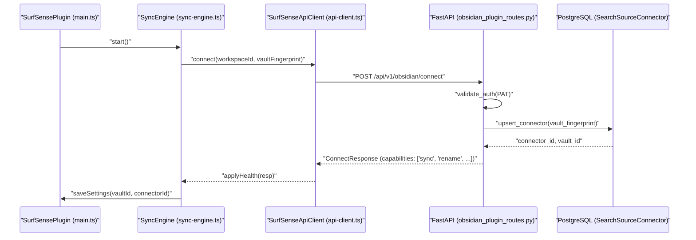
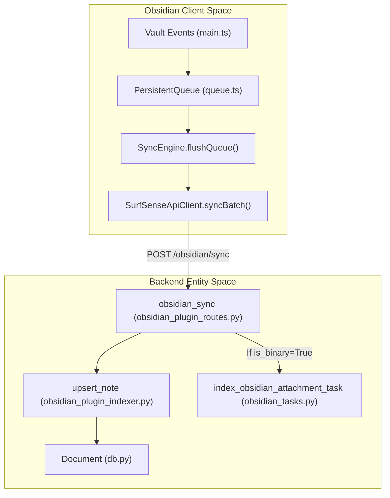

<!-- source: DeepWiki mcp.deepwiki.com · repo MODSetter/SurfSense · page 17.2 Plugin Configuration and Installation · fetched 2026-10-29 -->

# Plugin Configuration and Installation

Relevant source files

The following files were used as context for generating this wiki page:

- [.github/workflows/obsidian-plugin-lint.yml](.github/workflows/obsidian-plugin-lint.yml)
- [.github/workflows/release-obsidian-plugin.yml](.github/workflows/release-obsidian-plugin.yml)
- [manifest.json](manifest.json)
- [surfsense_backend/app/routes/obsidian_plugin_routes.py](surfsense_backend/app/routes/obsidian_plugin_routes.py)
- [surfsense_backend/app/schemas/obsidian_plugin.py](surfsense_backend/app/schemas/obsidian_plugin.py)
- [surfsense_backend/app/services/obsidian_plugin_indexer.py](surfsense_backend/app/services/obsidian_plugin_indexer.py)
- [surfsense_backend/tests/integration/test_obsidian_plugin_routes.py](surfsense_backend/tests/integration/test_obsidian_plugin_routes.py)
- [surfsense_backend/tests/unit/test_obsidian_plugin_indexer.py](surfsense_backend/tests/unit/test_obsidian_plugin_indexer.py)
- [surfsense_obsidian/LICENSE](surfsense_obsidian/LICENSE)
- [surfsense_obsidian/eslint.config.mts](surfsense_obsidian/eslint.config.mts)
- [surfsense_obsidian/manifest.json](surfsense_obsidian/manifest.json)
- [surfsense_obsidian/package-lock.json](surfsense_obsidian/package-lock.json)
- [surfsense_obsidian/package.json](surfsense_obsidian/package.json)
- [surfsense_obsidian/src/api-client.ts](surfsense_obsidian/src/api-client.ts)
- [surfsense_obsidian/src/attachments-confirm-modal.ts](surfsense_obsidian/src/attachments-confirm-modal.ts)
- [surfsense_obsidian/src/excludes.ts](surfsense_obsidian/src/excludes.ts)
- [surfsense_obsidian/src/folder-suggest-modal.ts](surfsense_obsidian/src/folder-suggest-modal.ts)
- [surfsense_obsidian/src/main.ts](surfsense_obsidian/src/main.ts)
- [surfsense_obsidian/src/queue.ts](surfsense_obsidian/src/queue.ts)
- [surfsense_obsidian/src/settings.ts](surfsense_obsidian/src/settings.ts)
- [surfsense_obsidian/src/status-bar.ts](surfsense_obsidian/src/status-bar.ts)
- [surfsense_obsidian/src/status-modal.ts](surfsense_obsidian/src/status-modal.ts)
- [surfsense_obsidian/src/status-visuals.ts](surfsense_obsidian/src/status-visuals.ts)
- [surfsense_obsidian/src/sync-engine.ts](surfsense_obsidian/src/sync-engine.ts)
- [surfsense_obsidian/src/types.ts](surfsense_obsidian/src/types.ts)
- [surfsense_obsidian/styles.css](surfsense_obsidian/styles.css)
- [surfsense_obsidian/versions.json](surfsense_obsidian/versions.json)
- [surfsense_web/components/assistant-ui/connector-popup/connect-forms/components/obsidian-connect-form.tsx](surfsense_web/components/assistant-ui/connector-popup/connect-forms/components/obsidian-connect-form.tsx)
- [surfsense_web/components/assistant-ui/connector-popup/connector-configs/components/obsidian-config.tsx](surfsense_web/components/assistant-ui/connector-popup/connector-configs/components/obsidian-config.tsx)
- [surfsense_web/public/connectors/obsidian.svg](surfsense_web/public/connectors/obsidian.svg)
- [versions.json](versions.json)

The SurfSense Obsidian plugin enables real-time synchronization between local Obsidian vaults and SurfSense SearchSpaces. Unlike legacy connectors that required server-side file access, this plugin pushes data over HTTPS, supporting both cloud and self-hosted deployments on desktop and mobile platforms [surfsense_web/components/assistant-ui/connector-popup/connect-forms/components/obsidian-connect-form.tsx:58-61]().

## Installation Process

The installation is a four-step process initiated from the SurfSense web interface and completed within the Obsidian application.

### 1. Plugin Acquisition
Users can download the latest release from the official GitHub repository [surfsense_web/components/assistant-ui/connector-popup/connect-forms/components/obsidian-connect-form.tsx:14-15](). Once installed, the plugin must be enabled in Obsidian's **Settings → Community plugins**.

### 2. API Token Generation
Authentication is handled via Personal Access Tokens (PATs).
- Navigate to the Obsidian connector setup in the SurfSense web app.
- Click **Create and copy token** to generate a new PAT [surfsense_web/components/assistant-ui/connector-popup/connect-forms/components/obsidian-connect-form.tsx:129-141]().
- This token is used by the `SurfSenseApiClient` to authorize all sync operations [surfsense_obsidian/src/api-client.ts:24-29]().

### 3. Server Configuration
In the Obsidian plugin settings:
- **Server URL**: Set to `https://surfsense.com` for Cloud or the custom domain for self-hosted instances [surfsense_obsidian/src/settings.ts:41-60]().
- **API Token**: Paste the PAT generated in step 2 [surfsense_obsidian/src/settings.ts:67-91]().
- Click **Verify** to validate the connection via the `/api/v1/obsidian/health` endpoint [surfsense_obsidian/src/settings.ts:95-112]().

### 4. SearchSpace Selection
The **Search space** dropdown populates with workspaces available to the authenticated user [surfsense_obsidian/src/settings.ts:115-143](). Selecting a workspace triggers the `ensureConnected()` flow, which registers the vault with the backend [surfsense_obsidian/src/sync-engine.ts:125-151]().

---

## Configuration Settings

The plugin provides granular control over what data is synchronized and how frequently updates occur.

| Setting | Description | Code Reference |
| :--- | :--- | :--- |
| **Sync Interval** | Frequency (5m to 24h) for checking external changes. | [surfsense_obsidian/src/settings.ts:156-183]() |
| **Include Folders** | Whitelist specific directories to sync. | [surfsense_obsidian/src/settings.ts:185-193]() |
| **Exclude Folders** | Blacklist specific directories from sync. | [surfsense_obsidian/src/settings.ts:195-203]() |
| **Exclude Patterns** | Glob patterns (e.g., `templates/**`) for advanced filtering. | [surfsense_obsidian/src/settings.ts:205-219]() |
| **Include Attachments** | Toggle sync for non-Markdown files (PDFs, images). | [surfsense_obsidian/src/settings.ts:221-240]() |

**Sources:** [surfsense_obsidian/src/settings.ts:154-240](), [surfsense_obsidian/src/types.ts:3-23]()

---

## Technical Implementation

### Data Flow and Registration
When a user selects a workspace, the plugin computes a `vaultFingerprint` (a deterministic SHA-256 hash of vault paths) to identify the vault across different devices [surfsense_obsidian/src/sync-engine.ts:133-139](). The backend uses this fingerprint to deduplicate connectors and prevent redundant data storage [surfsense_backend/app/routes/obsidian_plugin_routes.py:186-196]().

**Vault Registration Sequence**
The following diagram illustrates the handshake between the Obsidian `SyncEngine` and the FastAPI `obsidian_plugin_routes`.

Title: Obsidian Plugin Registration Flow

**Sources:** [surfsense_obsidian/src/sync-engine.ts:95-151](), [surfsense_backend/app/routes/obsidian_plugin_routes.py:328-360](), [surfsense_obsidian/src/api-client.ts:116-132]()

### Sync Engine and Adaptive Backoff
The `SyncEngine` manages the lifecycle of document ingestion. It employs an adaptive backoff strategy where the sync interval is multiplied (up to 8x) if consecutive reconciles find no changes [surfsense_obsidian/src/sync-engine.ts:70-84]().

**Document Lifecycle**
1. **Events**: The plugin registers listeners for `create`, `modify`, `delete`, and `rename` events via the Obsidian `App` [surfsense_obsidian/src/main.ts:84-102]().
2. **Queueing**: Changes are added to a `PersistentQueue` [surfsense_obsidian/src/queue.ts:19-24]().
3. **Batching**: The `flushQueue()` function sends batches of up to 100 notes to the `/api/v1/obsidian/sync` endpoint [surfsense_backend/app/schemas/obsidian_plugin.py:110-114]().
4. **ETL**: For binary attachments (PDF/Images), the backend enqueues a Celery task `index_obsidian_attachment_task` for background extraction [surfsense_backend/app/routes/obsidian_plugin_routes.py:214-220]().

Title: Obsidian Document Ingestion Pipeline

**Sources:** [surfsense_obsidian/src/sync-engine.ts:160-220](), [surfsense_backend/app/routes/obsidian_plugin_routes.py:388-410](), [surfsense_backend/app/services/obsidian_plugin_indexer.py:53-54]()

### Status Monitoring
The `StatusBar` and `StatusModal` provide real-time feedback on the sync state, displaying the number of files synced and any pending queue depth [surfsense_obsidian/src/status-bar.ts:1-20](), [surfsense_obsidian/src/status-modal.ts:1-30](). Users can also view connector-specific statistics (last sync time, total files) within the SurfSense web UI [surfsense_web/components/assistant-ui/connector-popup/connector-configs/components/obsidian-config.tsx:106-121]().

**Sources:** [surfsense_obsidian/src/status-bar.ts:1-20](), [surfsense_obsidian/src/status-modal.ts:1-30](), [surfsense_web/components/assistant-ui/connector-popup/connector-configs/components/obsidian-config.tsx:106-121]()

---

