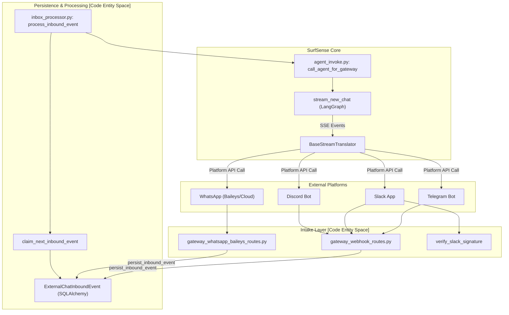
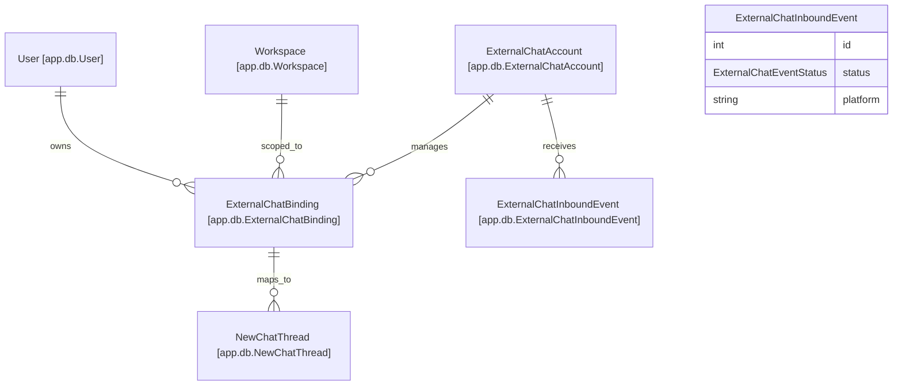

<!-- source: DeepWiki mcp.deepwiki.com · repo MODSetter/SurfSense · page 18 Messaging Gateway · fetched 2026-10-29 -->

# Messaging Gateway

Relevant source files

The following files were used as context for generating this wiki page:

- [surfsense_backend/alembic/versions/103_add_last_login_to_user.py](surfsense_backend/alembic/versions/103_add_last_login_to_user.py)
- [surfsense_backend/app/etl_pipeline/parsers/vision_llm.py](surfsense_backend/app/etl_pipeline/parsers/vision_llm.py)
- [surfsense_backend/app/gateway/accounts.py](surfsense_backend/app/gateway/accounts.py)
- [surfsense_backend/app/gateway/agent_invoke.py](surfsense_backend/app/gateway/agent_invoke.py)
- [surfsense_backend/app/gateway/auth_invariant.py](surfsense_backend/app/gateway/auth_invariant.py)
- [surfsense_backend/app/gateway/bindings.py](surfsense_backend/app/gateway/bindings.py)
- [surfsense_backend/app/gateway/inbox.py](surfsense_backend/app/gateway/inbox.py)
- [surfsense_backend/app/gateway/inbox_processor.py](surfsense_backend/app/gateway/inbox_processor.py)
- [surfsense_backend/app/gateway/pairing.py](surfsense_backend/app/gateway/pairing.py)
- [surfsense_backend/app/gateway/ratelimit.py](surfsense_backend/app/gateway/ratelimit.py)
- [surfsense_backend/app/gateway/registry.py](surfsense_backend/app/gateway/registry.py)
- [surfsense_backend/app/gateway/thread_lock.py](surfsense_backend/app/gateway/thread_lock.py)
- [surfsense_backend/app/routes/agent_action_log_route.py](surfsense_backend/app/routes/agent_action_log_route.py)
- [surfsense_backend/app/routes/agent_permissions_route.py](surfsense_backend/app/routes/agent_permissions_route.py)
- [surfsense_backend/app/routes/export_routes.py](surfsense_backend/app/routes/export_routes.py)
- [surfsense_backend/app/routes/gateway_webhook_routes.py](surfsense_backend/app/routes/gateway_webhook_routes.py)
- [surfsense_backend/app/routes/gateway_whatsapp_baileys_routes.py](surfsense_backend/app/routes/gateway_whatsapp_baileys_routes.py)
- [surfsense_backend/app/routes/logs_routes.py](surfsense_backend/app/routes/logs_routes.py)
- [surfsense_backend/app/routes/rbac_routes.py](surfsense_backend/app/routes/rbac_routes.py)
- [surfsense_backend/app/routes/sandbox_routes.py](surfsense_backend/app/routes/sandbox_routes.py)
- [surfsense_backend/app/routes/video_presentations_routes.py](surfsense_backend/app/routes/video_presentations_routes.py)
- [surfsense_backend/app/schemas/rbac_schemas.py](surfsense_backend/app/schemas/rbac_schemas.py)
- [surfsense_backend/app/services/export_service.py](surfsense_backend/app/services/export_service.py)
- [surfsense_backend/app/utils/rbac.py](surfsense_backend/app/utils/rbac.py)
- [surfsense_backend/scripts/register_webhook.py](surfsense_backend/scripts/register_webhook.py)
- [surfsense_backend/tests/unit/automations/actions/builtin/agent_task/test_dependencies.py](surfsense_backend/tests/unit/automations/actions/builtin/agent_task/test_dependencies.py)
- [surfsense_backend/tests/unit/gateway/test_pairing.py](surfsense_backend/tests/unit/gateway/test_pairing.py)
- [surfsense_backend/tests/unit/gateway/test_webhook_routes.py](surfsense_backend/tests/unit/gateway/test_webhook_routes.py)
- [surfsense_web/atoms/documents/document-mutation.atoms.ts](surfsense_web/atoms/documents/document-mutation.atoms.ts)
- [surfsense_web/contracts/types/log.types.ts](surfsense_web/contracts/types/log.types.ts)
- [surfsense_web/contracts/types/members.types.ts](surfsense_web/contracts/types/members.types.ts)
- [surfsense_web/contracts/types/permissions.types.ts](surfsense_web/contracts/types/permissions.types.ts)
- [surfsense_web/hooks/use-logs.ts](surfsense_web/hooks/use-logs.ts)
- [surfsense_web/lib/apis/invites-api.service.ts](surfsense_web/lib/apis/invites-api.service.ts)
- [surfsense_web/lib/apis/logs-api.service.ts](surfsense_web/lib/apis/logs-api.service.ts)
- [surfsense_web/lib/apis/members-api.service.ts](surfsense_web/lib/apis/members-api.service.ts)
- [surfsense_web/lib/apis/permissions-api.service.ts](surfsense_web/lib/apis/permissions-api.service.ts)
- [surfsense_web/lib/apis/roles-api.service.ts](surfsense_web/lib/apis/roles-api.service.ts)

The Messaging Gateway is a unified integration layer that connects SurfSense's AI agent capabilities to external chat platforms, including **Telegram**, **WhatsApp**, **Slack**, and **Discord**. It allows users to query their knowledge base, trigger automations, and interact with agents directly from their preferred messaging apps.

The system handles the complexities of platform-specific protocols, webhooks, and long-polling, presenting a normalized interface to the internal [AI Agent System](#6).

### System Overview

The gateway operates as an asynchronous pipeline. Inbound messages are captured via webhooks or platform adapters, persisted to an inbox, and then processed by a dedicated worker that invokes the SurfSense agent.

#### Messaging Flow Architecture

**Sources:**
- `surfsense_backend/app/routes/gateway_webhook_routes.py` [1-58]()
- `surfsense_backend/app/gateway/inbox_processor.py` [1-35]()
- `surfsense_backend/app/gateway/agent_invoke.py` [58-87]()
- `surfsense_backend/app/routes/gateway_webhook_routes.py` [149-163]()

---

### Core Components

#### 1. Inbox Processor
The `inbox_processor.py` manages the lifecycle of inbound messages. It uses a "claim" mechanism via `claim_next_inbound_event` [surfsense_backend/app/gateway/inbox_processor.py:59-79]() to ensure messages are processed exactly once, even in distributed environments, using `with_for_update(skip_locked=True)` [surfsense_backend/app/gateway/inbox_processor.py:69](). It handles event status transitions defined in `ExternalChatEventStatus` [surfsense_backend/app/db.py](), moving from `RECEIVED` to `PROCESSING`, and finally `PROCESSED` or `FAILED`.

For details on the worker implementation and error handling, see **[Gateway Architecture](#18.1)**.

**Sources:**
- `surfsense_backend/app/gateway/inbox_processor.py` [59-135]()

#### 2. Agent Invocation & Translation
The `agent_invoke.py` module bridges the gateway to the `stream_new_chat` flow [surfsense_backend/app/gateway/agent_invoke.py:76-87](). Because external platforms typically do not support Server-Sent Events (SSE) directly, the `_events_from_sse` function [surfsense_backend/app/gateway/agent_invoke.py:25-56]() normalizes the stream. The `BaseStreamTranslator` then converts internal agent stream events (text deltas, tool calls) into platform-specific API calls.

**Sources:**
- `surfsense_backend/app/gateway/agent_invoke.py` [25-56]()
- `surfsense_backend/app/gateway/agent_invoke.py` [58-106]()

#### 3. Account Pairing & Security
To maintain multi-tenancy and security, external chat accounts must be "paired" with a SurfSense user and workspace.
- **Pairing Codes:** Users generate a short-lived code via `generate_pairing_code` [surfsense_backend/app/gateway/pairing.py:48]() to link their account.
- **OAuth Flows:** Slack and Discord use standard OAuth2 flows. Slack scopes include `app_mentions:read` and `chat:write` [surfsense_backend/app/routes/gateway_webhook_routes.py:67-75]().
- **Thread Locking:** `acquire_thread_lock` [surfsense_backend/app/gateway/thread_lock.py:18]() ensures that a single external conversation thread does not trigger multiple concurrent agent runs.

**Sources:**
- `surfsense_backend/app/routes/gateway_webhook_routes.py` [62-86]()
- `surfsense_backend/app/gateway/pairing.py` [1-48]()
- `surfsense_backend/app/gateway/thread_lock.py` [1-20]()

---

### Supported Platforms

SurfSense supports different intake modes depending on the platform configuration:

| Platform | Intake Method | Implementation File | Key Config / Logic |
| :--- | :--- | :--- | :--- |
| **Telegram** | Webhook | `gateway_webhook_routes.py` | `_telegram_gateway_enabled` [206-216]() |
| **WhatsApp** | Baileys (Self-hosted) or Cloud API | `gateway_whatsapp_baileys_routes.py` | `_active_whatsapp_account_mode` [191-197]() |
| **Slack** | Webhook (Events API) | `gateway_webhook_routes.py` | `verify_slack_signature` [149-163]() |
| **Discord** | Webhook / Gateway | `gateway_webhook_routes.py` | `DISCORD_GATEWAY_PERMISSIONS` [81-86]() |

For configuration details and platform-specific setup, see **[Platform Integrations](#18.2)**.

**Sources:**
- `surfsense_backend/app/routes/gateway_webhook_routes.py` [76-86]()
- `surfsense_backend/app/routes/gateway_webhook_routes.py` [191-225]()

---

### Data Entities

The gateway relies on specific database entities to track state and identity:

| Entity Name | Code Identifier | Purpose |
| :--- | :--- | :--- |
| **External Account** | `ExternalChatAccount` | Represents the bot instance (e.g., a specific Telegram Bot Token). |
| **External Binding** | `ExternalChatBinding` | Maps a platform user (e.g., Telegram User ID) to a SurfSense `User` and `Workspace`. |
| **Inbound Event** | `ExternalChatInboundEvent` | The "Inbox" record for every incoming message. |

#### Entity Relationship Diagram

**Sources:**
- `surfsense_backend/app/routes/gateway_webhook_routes.py` [25-34]()
- `surfsense_backend/app/gateway/inbox_processor.py` [17-28]()
- `surfsense_backend/app/gateway/inbox_processor.py` [81-135]()

---

