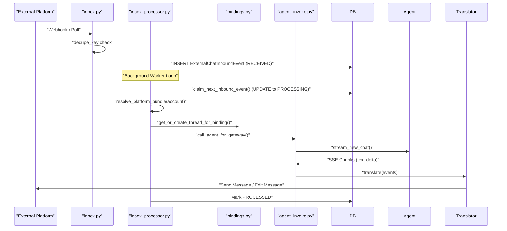
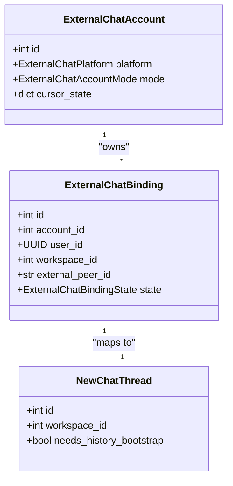

<!-- source: DeepWiki mcp.deepwiki.com · repo MODSetter/SurfSense · page 18.1 Gateway Architecture · fetched 2026-10-29 -->

# Gateway Architecture

Relevant source files

The following files were used as context for generating this wiki page:

- [surfsense_backend/alembic/versions/103_add_last_login_to_user.py](surfsense_backend/alembic/versions/103_add_last_login_to_user.py)
- [surfsense_backend/app/gateway/accounts.py](surfsense_backend/app/gateway/accounts.py)
- [surfsense_backend/app/gateway/agent_invoke.py](surfsense_backend/app/gateway/agent_invoke.py)
- [surfsense_backend/app/gateway/auth_invariant.py](surfsense_backend/app/gateway/auth_invariant.py)
- [surfsense_backend/app/gateway/bindings.py](surfsense_backend/app/gateway/bindings.py)
- [surfsense_backend/app/gateway/inbox.py](surfsense_backend/app/gateway/inbox.py)
- [surfsense_backend/app/gateway/inbox_processor.py](surfsense_backend/app/gateway/inbox_processor.py)
- [surfsense_backend/app/gateway/pairing.py](surfsense_backend/app/gateway/pairing.py)
- [surfsense_backend/app/gateway/ratelimit.py](surfsense_backend/app/gateway/ratelimit.py)
- [surfsense_backend/app/gateway/registry.py](surfsense_backend/app/gateway/registry.py)
- [surfsense_backend/app/gateway/thread_lock.py](surfsense_backend/app/gateway/thread_lock.py)
- [surfsense_backend/app/routes/agent_action_log_route.py](surfsense_backend/app/routes/agent_action_log_route.py)
- [surfsense_backend/app/routes/agent_permissions_route.py](surfsense_backend/app/routes/agent_permissions_route.py)
- [surfsense_backend/app/routes/rbac_routes.py](surfsense_backend/app/routes/rbac_routes.py)
- [surfsense_backend/app/schemas/rbac_schemas.py](surfsense_backend/app/schemas/rbac_schemas.py)
- [surfsense_backend/app/utils/rbac.py](surfsense_backend/app/utils/rbac.py)
- [surfsense_backend/tests/unit/gateway/test_pairing.py](surfsense_backend/tests/unit/gateway/test_pairing.py)
- [surfsense_web/contracts/types/members.types.ts](surfsense_web/contracts/types/members.types.ts)
- [surfsense_web/contracts/types/permissions.types.ts](surfsense_web/contracts/types/permissions.types.ts)
- [surfsense_web/lib/apis/invites-api.service.ts](surfsense_web/lib/apis/invites-api.service.ts)
- [surfsense_web/lib/apis/members-api.service.ts](surfsense_web/lib/apis/members-api.service.ts)
- [surfsense_web/lib/apis/permissions-api.service.ts](surfsense_web/lib/apis/permissions-api.service.ts)
- [surfsense_web/lib/apis/roles-api.service.ts](surfsense_web/lib/apis/roles-api.service.ts)

The Messaging Gateway in SurfSense provides a durable, asynchronous bridge between external chat platforms (Telegram, WhatsApp, Slack, Discord) and the internal LangGraph-based AI agent system. It handles message intake, identity mapping (Account Pairing), thread management, and real-time response streaming back to the external platform.

## 1. Overview and Data Flow

The gateway operates on an asynchronous "Inbound Event" model to ensure reliability. Unlike the direct WebSocket/SSE connection used by the web frontend, external messages are persisted before processing to handle platform-specific retries and long-running agent reasoning steps.

### High-Level Messaging Flow
1.  **Intake**: External webhooks (or polling services like Baileys for WhatsApp) receive messages and call `persist_inbound_event` [surfsense_backend/app/gateway/inbox.py:23-34]().
2.  **Deduplication**: Events are deduplicated using platform-specific keys (e.g., `update_id` for Telegram) [surfsense_backend/app/gateway/inbox.py:11-20]().
3.  **Inbox Processing**: A background worker claims the oldest `RECEIVED` event [surfsense_backend/app/gateway/inbox_processor.py:59-78]().
4.  **Binding & Threading**: The system resolves the `ExternalChatBinding` to map the platform user to a SurfSense `User` and `Workspace` [surfsense_backend/app/gateway/inbox_processor.py:150-169]().
5.  **Agent Invocation**: The agent is invoked via `call_agent_for_gateway`, which manages thread locking and response streaming [surfsense_backend/app/gateway/agent_invoke.py:58-66]().
6.  **Translation**: A platform-specific `BaseStreamTranslator` converts agent SSE events (text-deltas, tool calls) into platform-native API calls (e.g., Telegram `editMessageText`) [surfsense_backend/app/gateway/agent_invoke.py:88-90]().

### Gateway Architecture Component Map
| System Name | Code Entity | File Reference |
| :--- | :--- | :--- |
| **Inbox Storage** | `ExternalChatInboundEvent` | [surfsense_backend/app/db.py]() |
| **Intake Handler** | `persist_inbound_event` | [surfsense_backend/app/gateway/inbox.py:23]() |
| **Worker Loop** | `process_inbound_event` | [surfsense_backend/app/gateway/inbox_processor.py:81]() |
| **Identity Mapper** | `ExternalChatBinding` | [surfsense_backend/app/db.py]() |
| **Stream Adapter** | `BaseStreamTranslator` | [surfsense_backend/app/gateway/base/translator.py:15]() |

**Sources:** [surfsense_backend/app/gateway/inbox_processor.py:1-35](), [surfsense_backend/app/gateway/inbox.py:1-54](), [surfsense_backend/app/gateway/agent_invoke.py:1-22]()

---

## 2. Inbox Processor and Dispatch

The `inbox_processor` module is responsible for the lifecycle of an external message. It uses a state machine represented by `ExternalChatEventStatus` (`RECEIVED` -> `PROCESSING` -> `PROCESSED`/`FAILED`).

### Sequence: Inbound Event Processing
This diagram shows how a raw event is transformed into an agent turn.

**Sources:** [surfsense_backend/app/gateway/inbox_processor.py:59-135](), [surfsense_backend/app/gateway/agent_invoke.py:58-90](), [surfsense_backend/app/gateway/registry.py:111-191]()

---

## 3. Agent Invocation and Threading

External platforms require strict thread management. The `call_agent_for_gateway` function ensures that only one agent turn happens per thread at a time using an advisory lock.

### Key Functions
- `acquire_thread_lock(thread_id)`: Prevents race conditions where multiple messages from the same user trigger overlapping agent runs [surfsense_backend/app/gateway/agent_invoke.py:72-73]().
- `_events_from_sse(stream)`: A generator that normalizes internal SSE chunks into `GatewayStreamEvent` objects [surfsense_backend/app/gateway/agent_invoke.py:25-55]().
- `stream_new_chat`: The core agent entry point. In gateway mode, `disabled_tools` are populated with `DEFAULT_HITL_TOOL_NAMES` to enforce Human-in-the-Loop constraints on external surfaces [surfsense_backend/app/gateway/agent_invoke.py:76-87]().

### HITL Filter for Gateways
Because external messaging platforms lack the complex UI components of the web dashboard, certain high-risk tools (defined in `DEFAULT_HITL_TOOL_NAMES`) are disabled or redirected during gateway turns to prevent unauthorized actions without a proper HITL interface [surfsense_backend/app/gateway/agent_invoke.py:17](), [surfsense_backend/app/gateway/agent_invoke.py:84]().

**Sources:** [surfsense_backend/app/gateway/agent_invoke.py:58-106](), [surfsense_backend/app/gateway/thread_lock.py]()

---

## 4. Account Pairing and Authorization

Before a user can interact with the agent via Telegram or Slack, their external identity must be "paired" with a SurfSense account.

### Binding Resolution Logic
The system resolves identity through the `ExternalChatBinding` entity.
1.  **Slack/Discord**: Resolution uses metadata like `team_id` or `guild_id` to find the correct system account [surfsense_backend/app/gateway/inbox_processor.py:155-158]().
2.  **Binding State**: Only bindings in `BOUND` or `SUSPENDED` states are processed [surfsense_backend/app/gateway/inbox_processor.py:164-167]().
3.  **Authorization Invariant**: `assert_authorization_invariant` ensures that the user associated with the binding still has active membership in the target workspace [surfsense_backend/app/gateway/agent_invoke.py:67]().

### Code Mapping: Identity Entities

**Sources:** [surfsense_backend/app/gateway/inbox_processor.py:150-180](), [surfsense_backend/app/gateway/bindings.py](), [surfsense_backend/app/gateway/auth_invariant.py]()

---

## 5. Platform Registry and Translators

The `PlatformBundle` is the central configuration object that links an account to its specific implementation [surfsense_backend/app/gateway/registry.py:27-33]().

### Supported Platforms
| Platform | Adapter | Translator |
| :--- | :--- | :--- |
| **Telegram** | `TelegramAdapter` | `TelegramStreamTranslator` |
| **WhatsApp (Cloud)** | `WhatsAppCloudAdapter` | `WhatsAppCloudStreamTranslator` |
| **WhatsApp (BYO)** | `WhatsAppBaileysAdapter` | `WhatsAppBaileysStreamTranslator` |
| **Slack** | `SlackAdapter` | `SlackStreamTranslator` |
| **Discord** | `DiscordAdapter` | `DiscordStreamTranslator` |

### Translator Factory
Each platform provides a factory to instantiate its translator with the correct context (e.g., `channel_id` for Slack or `external_peer_id` for Telegram) [surfsense_backend/app/gateway/registry.py:36-109](). This allows the agent's incremental output to be mapped to platform-specific actions like "replying to a specific message ID" or "updating a message with a typing indicator."

**Sources:** [surfsense_backend/app/gateway/registry.py:111-191](), [surfsense_backend/app/gateway/accounts.py:20-57]()

---

