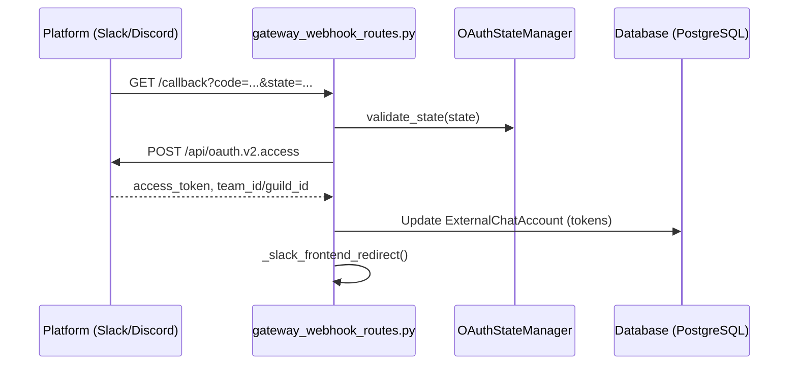
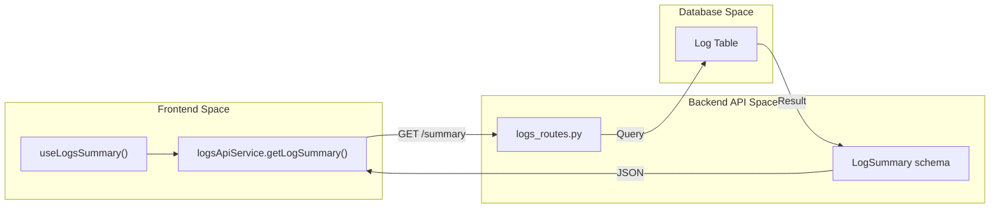

<!-- source: DeepWiki mcp.deepwiki.com · repo MODSetter/SurfSense · page 18.2 Platform Integrations · fetched 2026-10-29 -->

# Platform Integrations

<details>
<summary>Relevant source files</summary>

The following files were used as context for generating this wiki page:

- [surfsense_backend/app/etl_pipeline/parsers/vision_llm.py](surfsense_backend/app/etl_pipeline/parsers/vision_llm.py)
- [surfsense_backend/app/routes/export_routes.py](surfsense_backend/app/routes/export_routes.py)
- [surfsense_backend/app/routes/gateway_webhook_routes.py](surfsense_backend/app/routes/gateway_webhook_routes.py)
- [surfsense_backend/app/routes/gateway_whatsapp_baileys_routes.py](surfsense_backend/app/routes/gateway_whatsapp_baileys_routes.py)
- [surfsense_backend/app/routes/logs_routes.py](surfsense_backend/app/routes/logs_routes.py)
- [surfsense_backend/app/routes/sandbox_routes.py](surfsense_backend/app/routes/sandbox_routes.py)
- [surfsense_backend/app/routes/video_presentations_routes.py](surfsense_backend/app/routes/video_presentations_routes.py)
- [surfsense_backend/app/services/export_service.py](surfsense_backend/app/services/export_service.py)
- [surfsense_backend/scripts/register_webhook.py](surfsense_backend/scripts/register_webhook.py)
- [surfsense_backend/tests/unit/automations/actions/builtin/agent_task/test_dependencies.py](surfsense_backend/tests/unit/automations/actions/builtin/agent_task/test_dependencies.py)
- [surfsense_backend/tests/unit/gateway/test_webhook_routes.py](surfsense_backend/tests/unit/gateway/test_webhook_routes.py)
- [surfsense_web/atoms/documents/document-mutation.atoms.ts](surfsense_web/atoms/documents/document-mutation.atoms.ts)
- [surfsense_web/contracts/types/log.types.ts](surfsense_web/contracts/types/log.types.ts)
- [surfsense_web/hooks/use-logs.ts](surfsense_web/hooks/use-logs.ts)
- [surfsense_web/lib/apis/logs-api.service.ts](surfsense_web/lib/apis/logs-api.service.ts)

</details>


SurfSense extends its AI knowledge management capabilities to external communication platforms via a **Messaging Gateway**. This system allows users to interact with their SearchSpaces, query documents, and receive AI-generated insights directly through Telegram, WhatsApp, Slack, and Discord.

## Gateway Architecture

The messaging gateway operates as a webhook-driven ingestion system that routes external events into a unified `inbox` for processing [surfsense_backend/app/routes/gateway_webhook_routes.py:43-47](). It supports two primary interaction modes:
1.  **System Accounts**: Shared bots managed by the SurfSense instance (e.g., a central Telegram bot) [surfsense_backend/app/routes/gateway_webhook_routes.py:37-38]().
2.  **BYO (Bring Your Own) Accounts**: User-provided bot tokens or sessions for private workspace integration [surfsense_backend/app/routes/gateway_webhook_routes.py:191-196]().

### Message Routing Flow

The following diagram illustrates how an external message is transformed from a platform-specific webhook into a SurfSense agent task.

**External Message to Code Entity Mapping**

```mermaid
graph TD
    subgraph "External Platform Space"
        TG["Telegram Webhook"]
        SL["Slack Event"]
        DC["Discord Gateway"]
    end

    subgraph "SurfSense API Gateway (Code Entity Space)"
        WH["gateway_webhook_routes.py"]
        IB["persist_inbound_event()"]
        AC["ExternalChatAccount"]
        BD["ExternalChatBinding"]
    end

    TG -->|POST /gateway/telegram/{id}| WH
    SL -->|POST /gateway/slack/events| WH
    DC -->|POST /gateway/discord/callback| WH

    WH -->|Verify Signature| IB
    IB -->|Lookup| AC
    AC -->|Link to Workspace| BD
    BD -->|Invoke| AG["Agent Ingestion"]
```
Sources: [surfsense_backend/app/routes/gateway_webhook_routes.py:58-86](), [surfsense_backend/app/routes/gateway_webhook_routes.py:43-47]()

---

## Telegram Integration

Telegram integration supports both a shared system bot and private bots. It uses a webhook mechanism where Telegram sends updates to a unique URL containing the `account_id`.

### Implementation Details
-   **Security**: Validates requests using the `X-Telegram-Bot-Api-Secret-Token` header [surfsense_backend/app/routes/gateway_webhook_routes.py:152-163]().
-   **Deduplication**: Uses `telegram_event_dedupe_key` to prevent processing the same `update_id` multiple times [surfsense_backend/app/routes/gateway_webhook_routes.py:43-47]().
-   **Pairing**: Users connect their Telegram account to a SurfSense SearchSpace using a unique pairing code generated via `generate_pairing_code` [surfsense_backend/app/routes/gateway_webhook_routes.py:48-48]().

Sources: [surfsense_backend/app/routes/gateway_webhook_routes.py:109-114](), [surfsense_backend/app/routes/gateway_webhook_routes.py:175-200]()

---

## WhatsApp Integration (Baileys)

SurfSense supports a self-hosted WhatsApp integration using the **Baileys** library. This allows the system to act as a WhatsApp Web client.

### Connection Lifecycle
1.  **Pairing Request**: The user provides a phone number via `BaileysPairRequest` [surfsense_backend/app/routes/gateway_whatsapp_baileys_routes.py:30-33]().
2.  **Code Generation**: The `WhatsAppBaileysAdapter` requests a pairing code from the Baileys bridge [surfsense_backend/app/routes/gateway_whatsapp_baileys_routes.py:70-74]().
3.  **Account Management**: An `ExternalChatAccount` is created or updated with the mode `SELF_HOST_BYO` [surfsense_backend/app/routes/gateway_whatsapp_baileys_routes.py:78-87]().

| Feature | Specification |
| :--- | :--- |
| **Adapter** | `WhatsAppBaileysAdapter` [surfsense_backend/app/routes/gateway_whatsapp_baileys_routes.py:23-23]() |
| **Account Mode** | `ExternalChatAccountMode.SELF_HOST_BYO` [surfsense_backend/app/routes/gateway_whatsapp_baileys_routes.py:80-80]() |
| **Constraint** | Only available for self-hosted installs [surfsense_backend/app/routes/gateway_whatsapp_baileys_routes.py:40-44]() |

Sources: [surfsense_backend/app/routes/gateway_whatsapp_baileys_routes.py:61-97]()

---

## Slack & Discord Integrations

Slack and Discord use OAuth2 flows to authorize SurfSense bots within specific teams (Slack) or guilds (Discord).

### Slack Setup
-   **OAuth Scopes**: Requires `app_mentions:read`, `chat:write`, `im:write`, and others [surfsense_backend/app/routes/gateway_webhook_routes.py:67-75]().
-   **Verification**: Implements `verify_slack_signature` using HMAC-SHA256 to validate the `X-Slack-Signature` header against the `GATEWAY_SLACK_SIGNING_SECRET` [surfsense_backend/app/routes/gateway_webhook_routes.py:149-163]().
-   **Event Handling**: Specifically filters for `app_mention` and `message` types [surfsense_backend/app/routes/gateway_webhook_routes.py:166-169]().

### Discord Setup
-   **Permissions**: Requests `VIEW_CHANNEL`, `SEND_MESSAGES`, and `READ_MESSAGE_HISTORY` [surfsense_backend/app/routes/gateway_webhook_routes.py:77-86]().
-   **Routing**: Messages are routed based on the `guild_id` to identify the associated `ExternalChatAccount` via `get_discord_account_by_guild` [surfsense_backend/app/routes/gateway_webhook_routes.py:35-40]().

**Platform Integration Logic**


Sources: [surfsense_backend/app/routes/gateway_webhook_routes.py:62-86](), [surfsense_backend/app/routes/gateway_webhook_routes.py:123-146]()

---

## Observability and Health

Integrations are monitored through a centralized logging and metrics system.
-   **Metrics**: The gateway records inbox writes and parse errors via `record_gateway_inbox_write` and `record_gateway_webhook_parse_error` [surfsense_backend/app/routes/gateway_webhook_routes.py:50-53]().
-   **Health Checks**: The WhatsApp Baileys adapter provides a `/health` endpoint to validate bridge connectivity [surfsense_backend/app/routes/gateway_whatsapp_baileys_routes.py:100-110]().
-   **Log Management**: Backend log entries are managed via `logs_routes.py` supporting filtering by level, status, and workspace [surfsense_backend/app/routes/logs_routes.py:59-71]().
-   **Frontend Monitoring**: The `useLogsSummary` hook in the web application polls the `/api/v1/logs/workspaces/{id}/summary` endpoint to display active processing tasks [surfsense_web/hooks/use-logs.ts:82-119]().

**Logging and Monitoring Entity Mapping**


Sources: [surfsense_web/hooks/use-logs.ts:82-119](), [surfsense_backend/app/routes/logs_routes.py:59-71](), [surfsense_web/lib/apis/logs-api.service.ts:116-126]()

---

