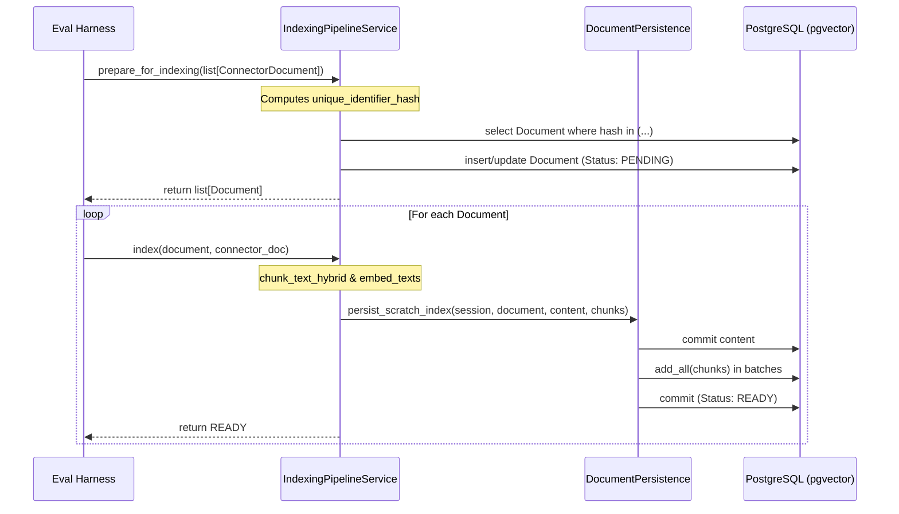

<!-- source: DeepWiki mcp.deepwiki.com · repo MODSetter/SurfSense · page 19.1 Eval Harness Architecture · fetched 2026-10-29 -->

# Eval Harness Architecture

<details>
<summary>Relevant source files</summary>

The following files were used as context for generating this wiki page:

- [surfsense_backend/app/indexing_pipeline/__init__.py](surfsense_backend/app/indexing_pipeline/__init__.py)
- [surfsense_backend/app/indexing_pipeline/adapters/__init__.py](surfsense_backend/app/indexing_pipeline/adapters/__init__.py)
- [surfsense_backend/app/indexing_pipeline/adapters/file_upload_adapter.py](surfsense_backend/app/indexing_pipeline/adapters/file_upload_adapter.py)
- [surfsense_backend/app/indexing_pipeline/connector_document.py](surfsense_backend/app/indexing_pipeline/connector_document.py)
- [surfsense_backend/app/indexing_pipeline/document_persistence.py](surfsense_backend/app/indexing_pipeline/document_persistence.py)
- [surfsense_backend/app/indexing_pipeline/indexing_pipeline_service.py](surfsense_backend/app/indexing_pipeline/indexing_pipeline_service.py)
- [surfsense_backend/app/indexing_pipeline/pipeline_logger.py](surfsense_backend/app/indexing_pipeline/pipeline_logger.py)
- [surfsense_backend/app/services/task_dispatcher.py](surfsense_backend/app/services/task_dispatcher.py)
- [surfsense_backend/tests/conftest.py](surfsense_backend/tests/conftest.py)
- [surfsense_backend/tests/integration/conftest.py](surfsense_backend/tests/integration/conftest.py)
- [surfsense_backend/tests/integration/document_upload/conftest.py](surfsense_backend/tests/integration/document_upload/conftest.py)
- [surfsense_backend/tests/integration/indexing_pipeline/adapters/__init__.py](surfsense_backend/tests/integration/indexing_pipeline/adapters/__init__.py)
- [surfsense_backend/tests/integration/indexing_pipeline/adapters/test_file_upload_adapter.py](surfsense_backend/tests/integration/indexing_pipeline/adapters/test_file_upload_adapter.py)
- [surfsense_backend/tests/integration/indexing_pipeline/test_index_document.py](surfsense_backend/tests/integration/indexing_pipeline/test_index_document.py)
- [surfsense_backend/tests/integration/indexing_pipeline/test_prepare_for_indexing.py](surfsense_backend/tests/integration/indexing_pipeline/test_prepare_for_indexing.py)
- [surfsense_backend/tests/unit/connector_indexers/test_confluence_parallel.py](surfsense_backend/tests/unit/connector_indexers/test_confluence_parallel.py)
- [surfsense_backend/tests/unit/connector_indexers/test_linear_parallel.py](surfsense_backend/tests/unit/connector_indexers/test_linear_parallel.py)
- [surfsense_backend/tests/unit/connector_indexers/test_notion_parallel.py](surfsense_backend/tests/unit/connector_indexers/test_notion_parallel.py)
- [surfsense_backend/tests/unit/indexing_pipeline/conftest.py](surfsense_backend/tests/unit/indexing_pipeline/conftest.py)
- [surfsense_backend/tests/unit/indexing_pipeline/test_connector_document.py](surfsense_backend/tests/unit/indexing_pipeline/test_connector_document.py)
- [surfsense_backend/tests/unit/indexing_pipeline/test_document_chunker.py](surfsense_backend/tests/unit/indexing_pipeline/test_document_chunker.py)
- [surfsense_backend/tests/unit/indexing_pipeline/test_index_batch_parallel.py](surfsense_backend/tests/unit/indexing_pipeline/test_index_batch_parallel.py)

</details>


The evaluation framework in SurfSense, primarily encapsulated within the `surfsense_evals` harness, is designed to benchmark RAG (Retrieval-Augmented Generation) quality. This infrastructure allows for systematic testing of the system against specialized datasets, such as medical and multimodal document benchmarks, to measure retrieval accuracy and response fidelity.

## Core Infrastructure

The harness is built around a suite of components that coordinate to execute benchmarks, collect metrics, and generate comparative reports. It abstracts the complexities of interacting with the SurfSense backend and various LLM providers.

### System Components and Code Entities

The following diagram bridges the conceptual evaluation components to their specific implementations within the codebase, focusing on the indexing and data persistence layers that underpin the benchmarks.

**Eval Harness Component Mapping**

```mermaid
graph TD
    subgraph "Execution & Logic"
        [SuiteRegistry] --> |"registers"| [BenchmarkSuites]
        [BenchmarkArms] --> |"defines variants"| [LLM_Scenarios]
        [EvalRunner] --> |"invokes"| [IndexingPipelineService]
    end

    subgraph "Indexing Infrastructure"
        [IndexingPipelineService] --> [surfsense_backend/app/indexing_pipeline/indexing_pipeline_service.py:82-83]()
        [UploadDocumentAdapter] --> [surfsense_backend/app/indexing_pipeline/adapters/file_upload_adapter.py:9-12]()
        [ConnectorDocument] --> [surfsense_backend/app/indexing_pipeline/connector_document.py:6-7]()
    end

    subgraph "Persistence Layer"
        [DocumentPersistence] --> [surfsense_backend/app/indexing_pipeline/document_persistence.py:46-54]()
        [Database_Session] --> [surfsense_backend/tests/integration/conftest.py:63-78]()
    end

    [EvalRunner] -.-> [ConnectorDocument]
    [IndexingPipelineService] -.-> [DocumentPersistence]
```
Sources: [surfsense_backend/app/indexing_pipeline/indexing_pipeline_service.py:82-83](), [surfsense_backend/app/indexing_pipeline/adapters/file_upload_adapter.py:9-12](), [surfsense_backend/app/indexing_pipeline/connector_document.py:6-7](), [surfsense_backend/app/indexing_pipeline/document_persistence.py:46-54](), [surfsense_backend/tests/integration/conftest.py:63-78]()

## Data Flow and Implementation

The evaluation process follows a structured pipeline from document ingestion to metric calculation.

### 1. HTTP Clients and Backend Interaction
The harness uses specialized HTTP clients to simulate user actions like uploading documents and querying the agent. It interacts directly with the `IndexingPipelineService` to ensure documents are correctly processed through the standard pipeline.
*   **Placeholder Creation**: Before full ingestion, `create_placeholder_documents` is called to provide instant UI feedback [surfsense_backend/app/indexing_pipeline/indexing_pipeline_service.py:88-90]().
*   **Document Preparation**: The `prepare_for_indexing` method handles content hashing and determines if a document needs a full re-index or just a metadata update [surfsense_backend/app/indexing_pipeline/indexing_pipeline_service.py:37-42]().
*   **Parallel Processing**: For large-scale benchmarks, `index_batch_parallel` manages concurrency using `asyncio.to_thread` to prevent blocking the event loop during heavy embedding or chunking tasks [surfsense_backend/tests/unit/indexing_pipeline/test_index_batch_parallel.py:37-53](), [surfsense_backend/tests/unit/indexing_pipeline/test_index_batch_parallel.py:210-214]().

### 2. Benchmark Arms and Scenarios
Benchmarks are run across different "Arms" (configurations). This allows for head-to-head comparisons between different models or retrieval strategies.
*   **Head-to-Head**: Comparing two distinct LLM configurations.
*   **Cost-Arbitrage**: Testing if cheaper models can achieve similar performance to expensive ones using specific RAG optimizations.

### 3. Metrics and Report Writer
The harness collects several key metrics:
*   **Retrieval Precision/Recall**: Measured by verifying if the `Chunk` entities associated with a `Document` are correctly retrieved [surfsense_backend/tests/integration/indexing_pipeline/adapters/test_file_upload_adapter.py:51-74]().
*   **Faithfulness**: Whether the LLM response is supported by the retrieved context.
*   **Latency**: Tracked via `perf` loggers during the indexing and retrieval phases [surfsense_backend/app/indexing_pipeline/document_persistence.py:83-90]().

## Indexing Pipeline Integration

The evaluation harness relies heavily on the `IndexingPipelineService` to prepare the knowledge base for testing.

**Indexing Pipeline Flow for Evals**


Sources: [surfsense_backend/app/indexing_pipeline/indexing_pipeline_service.py:82-171](), [surfsense_backend/app/indexing_pipeline/document_persistence.py:46-70](), [surfsense_backend/app/indexing_pipeline/document_persistence.py:76-82](), [surfsense_backend/tests/unit/indexing_pipeline/test_index_batch_parallel.py:101-109]()

### Key Functions and Classes

| Entity | Role | Location |
| :--- | :--- | :--- |
| `IndexingPipelineService` | Main entry point for processing benchmark documents. | [surfsense_backend/app/indexing_pipeline/indexing_pipeline_service.py:82]() |
| `ConnectorDocument` | DTO used to pass evaluation data into the pipeline. | [surfsense_backend/app/indexing_pipeline/connector_document.py:6]() |
| `UploadDocumentAdapter` | Orchestrates reindexing for edited or updated eval documents. | [surfsense_backend/app/indexing_pipeline/adapters/file_upload_adapter.py:9]() |
| `persist_scratch_index` | Commits embeddings and chunks to the database in batches. | [surfsense_backend/app/indexing_pipeline/document_persistence.py:46]() |
| `rollback_and_persist_failure` | Ensures failed eval documents are marked correctly in the DB without crashing the harness. | [surfsense_backend/app/indexing_pipeline/document_persistence.py:14]() |

## Suite Registry and Benchmarks

The `SuiteRegistry` maintains a list of available benchmark suites. Currently, the system supports:
*   **Medical Benchmarks**: `medxpertqa`, `mirage`, and `cure` for testing domain-specific knowledge retrieval.
*   **Multimodal Benchmarks**: `mmlongbench` for testing long-context document understanding and image-based retrieval.

The infrastructure utilizes `pytest` fixtures for integration testing of these suites, ensuring that the `db_session` and `db_workspace` are correctly isolated during benchmark runs using savepoints [surfsense_backend/tests/integration/conftest.py:63-78]().

Sources: [surfsense_backend/app/indexing_pipeline/indexing_pipeline_service.py:82-171](), [surfsense_backend/app/indexing_pipeline/document_persistence.py:46-102](), [surfsense_backend/tests/integration/conftest.py:63-78](), [surfsense_backend/app/indexing_pipeline/connector_document.py:6-26]()

---

