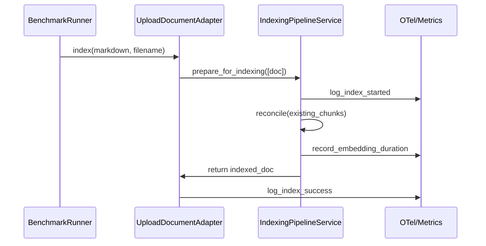

<!-- source: DeepWiki mcp.deepwiki.com · repo MODSetter/SurfSense · page 19.2 Benchmark Suites · fetched 2026-10-29 -->

# Benchmark Suites

<details>
<summary>Relevant source files</summary>

The following files were used as context for generating this wiki page:

- [surfsense_backend/app/connectors/dropbox/client.py](surfsense_backend/app/connectors/dropbox/client.py)
- [surfsense_backend/app/connectors/dropbox/file_types.py](surfsense_backend/app/connectors/dropbox/file_types.py)
- [surfsense_backend/app/connectors/google_drive/file_types.py](surfsense_backend/app/connectors/google_drive/file_types.py)
- [surfsense_backend/app/connectors/onedrive/file_types.py](surfsense_backend/app/connectors/onedrive/file_types.py)
- [surfsense_backend/app/etl_pipeline/etl_pipeline_service.py](surfsense_backend/app/etl_pipeline/etl_pipeline_service.py)
- [surfsense_backend/app/etl_pipeline/file_classifier.py](surfsense_backend/app/etl_pipeline/file_classifier.py)
- [surfsense_backend/app/indexing_pipeline/__init__.py](surfsense_backend/app/indexing_pipeline/__init__.py)
- [surfsense_backend/app/indexing_pipeline/adapters/__init__.py](surfsense_backend/app/indexing_pipeline/adapters/__init__.py)
- [surfsense_backend/app/indexing_pipeline/adapters/file_upload_adapter.py](surfsense_backend/app/indexing_pipeline/adapters/file_upload_adapter.py)
- [surfsense_backend/app/indexing_pipeline/connector_document.py](surfsense_backend/app/indexing_pipeline/connector_document.py)
- [surfsense_backend/app/indexing_pipeline/document_persistence.py](surfsense_backend/app/indexing_pipeline/document_persistence.py)
- [surfsense_backend/app/indexing_pipeline/indexing_pipeline_service.py](surfsense_backend/app/indexing_pipeline/indexing_pipeline_service.py)
- [surfsense_backend/app/indexing_pipeline/pipeline_logger.py](surfsense_backend/app/indexing_pipeline/pipeline_logger.py)
- [surfsense_backend/app/services/task_dispatcher.py](surfsense_backend/app/services/task_dispatcher.py)
- [surfsense_backend/app/tasks/connector_indexers/dropbox_indexer.py](surfsense_backend/app/tasks/connector_indexers/dropbox_indexer.py)
- [surfsense_backend/app/tasks/connector_indexers/onedrive_indexer.py](surfsense_backend/app/tasks/connector_indexers/onedrive_indexer.py)
- [surfsense_backend/app/utils/file_extensions.py](surfsense_backend/app/utils/file_extensions.py)
- [surfsense_backend/tests/conftest.py](surfsense_backend/tests/conftest.py)
- [surfsense_backend/tests/integration/conftest.py](surfsense_backend/tests/integration/conftest.py)
- [surfsense_backend/tests/integration/document_upload/conftest.py](surfsense_backend/tests/integration/document_upload/conftest.py)
- [surfsense_backend/tests/integration/indexing_pipeline/adapters/__init__.py](surfsense_backend/tests/integration/indexing_pipeline/adapters/__init__.py)
- [surfsense_backend/tests/integration/indexing_pipeline/adapters/test_file_upload_adapter.py](surfsense_backend/tests/integration/indexing_pipeline/adapters/test_file_upload_adapter.py)
- [surfsense_backend/tests/integration/indexing_pipeline/test_dropbox_pipeline.py](surfsense_backend/tests/integration/indexing_pipeline/test_dropbox_pipeline.py)
- [surfsense_backend/tests/integration/indexing_pipeline/test_index_document.py](surfsense_backend/tests/integration/indexing_pipeline/test_index_document.py)
- [surfsense_backend/tests/integration/indexing_pipeline/test_prepare_for_indexing.py](surfsense_backend/tests/integration/indexing_pipeline/test_prepare_for_indexing.py)
- [surfsense_backend/tests/unit/connector_indexers/test_confluence_parallel.py](surfsense_backend/tests/unit/connector_indexers/test_confluence_parallel.py)
- [surfsense_backend/tests/unit/connector_indexers/test_dropbox_parallel.py](surfsense_backend/tests/unit/connector_indexers/test_dropbox_parallel.py)
- [surfsense_backend/tests/unit/connector_indexers/test_linear_parallel.py](surfsense_backend/tests/unit/connector_indexers/test_linear_parallel.py)
- [surfsense_backend/tests/unit/connector_indexers/test_notion_parallel.py](surfsense_backend/tests/unit/connector_indexers/test_notion_parallel.py)
- [surfsense_backend/tests/unit/connectors/test_dropbox_file_types.py](surfsense_backend/tests/unit/connectors/test_dropbox_file_types.py)
- [surfsense_backend/tests/unit/connectors/test_google_drive_file_types.py](surfsense_backend/tests/unit/connectors/test_google_drive_file_types.py)
- [surfsense_backend/tests/unit/connectors/test_onedrive_file_types.py](surfsense_backend/tests/unit/connectors/test_onedrive_file_types.py)
- [surfsense_backend/tests/unit/etl_pipeline/test_etl_pipeline_service.py](surfsense_backend/tests/unit/etl_pipeline/test_etl_pipeline_service.py)
- [surfsense_backend/tests/unit/indexing_pipeline/conftest.py](surfsense_backend/tests/unit/indexing_pipeline/conftest.py)
- [surfsense_backend/tests/unit/indexing_pipeline/test_connector_document.py](surfsense_backend/tests/unit/indexing_pipeline/test_connector_document.py)
- [surfsense_backend/tests/unit/indexing_pipeline/test_document_chunker.py](surfsense_backend/tests/unit/indexing_pipeline/test_document_chunker.py)
- [surfsense_backend/tests/unit/indexing_pipeline/test_index_batch_parallel.py](surfsense_backend/tests/unit/indexing_pipeline/test_index_batch_parallel.py)
- [surfsense_backend/tests/unit/utils/test_file_extensions.py](surfsense_backend/tests/unit/utils/test_file_extensions.py)
- [surfsense_web/components/assistant-ui/connector-popup/connector-configs/components/dropbox-config.tsx](surfsense_web/components/assistant-ui/connector-popup/connector-configs/components/dropbox-config.tsx)

</details>


SurfSense includes a dedicated evaluation framework, `surfsense_evals`, designed to measure RAG (Retrieval-Augmented Generation) quality, retrieval accuracy, and cost-efficiency across specialized domains. The framework supports several industry-standard benchmark suites, particularly focusing on medical knowledge and long-context multimodal document understanding.

## Overview of Benchmark Suites

The system categorizes benchmarks into two primary domains: Medical QA and Multimodal Document Analysis. These suites validate the performance of the indexing and retrieval pipelines, ensuring that documents processed via the `IndexingPipelineService` [surfsense_backend/app/indexing_pipeline/indexing_pipeline_service.py:82-83]() are correctly retrieved.

### 1. Medical Benchmarks
These suites evaluate the agent's ability to retrieve precise medical facts and reason over clinical data.
*   **MedXpertQA**: Focused on high-level medical board examination questions.
*   **Mirage**: Benchmarks medical information retrieval and generation.
*   **CURE**: Evaluates clinical understanding and reasoning capabilities.

### 2. Multimodal & Long-Context Benchmarks
*   **MMLongBench (Multimodal)**: Tests the system's ability to handle documents containing mixed media (text and images). This suite heavily exercises the `EtlPipelineService` [surfsense_backend/app/etl_pipeline/etl_pipeline_service.py:23-24](), specifically the `_extract_image` logic which uses vision LLMs [surfsense_backend/app/etl_pipeline/etl_pipeline_service.py:104-122]().

## Evaluation Harness Architecture

The evaluation harness operates as a standalone infrastructure that interacts with the SurfSense backend. It utilizes a "Benchmark Arm" strategy to compare different system configurations.

### Code Entity Map: Evaluation Data Flow

The following diagram illustrates how the evaluation harness triggers search and retrieval through the core system entities, linking the evaluation logic to the indexing and retrieval components.

**Diagram: Eval Harness to System Entity Mapping**
```mermaid
graph TD
    subgraph "Eval Harness (surfsense_evals)"
        [Registry] --> [SuiteRunner]
        [SuiteRunner] --> [BenchmarkArm]
    end

    subgraph "SurfSense Backend (surfsense_backend)"
        [BenchmarkArm] -- "Process Request" --> [IndexingPipelineService:index]
        [IndexingPipelineService:index] --> [UploadDocumentAdapter]
        [UploadDocumentAdapter] --> [EtlPipelineService:extract]
        [EtlPipelineService:extract] --> [Chunker:chunk_text_hybrid]
        [Chunker:chunk_text_hybrid] --> [PostgreSQL:ChunkTable]
    end

    subgraph "Storage Entities"
        [PostgreSQL:ChunkTable] -- "Foreign Key" --> [Document:SQLAlchemyModel]
    end
```
Sources: [surfsense_backend/app/indexing_pipeline/indexing_pipeline_service.py:210-220](), [surfsense_backend/app/indexing_pipeline/adapters/file_upload_adapter.py:14-21](), [surfsense_backend/app/etl_pipeline/etl_pipeline_service.py:29-40](), [surfsense_backend/app/db.py:17-18]()

## Execution Scenarios

Benchmarks can be executed under different economic and performance scenarios to optimize for specific deployment needs.

### 1. Head-to-Head
Compares two different LLM configurations or retrieval strategies (e.g., Docling vs. Unstructured ETL) using identical datasets. The `UploadDocumentAdapter` [surfsense_backend/app/indexing_pipeline/adapters/file_upload_adapter.py:9-12]() is often used here to ingest benchmark files with specific `etl_service` flags [surfsense_backend/app/indexing_pipeline/adapters/file_upload_adapter.py:18-18]().

### 2. Symmetric-Cheap
Utilizes lower-cost models for both retrieval reasoning and generation. This scenario tests the robustness of the `chunk_text_hybrid` strategy [surfsense_backend/app/indexing_pipeline/cache/cached_indexing.py:23-23]() when paired with smaller embedding models.

### 3. Cost-Arbitrage
A scenario where the system uses an expensive "Teacher" model to generate gold-standard embeddings or summaries, but uses a "Student" model for real-time inference. The framework measures if the higher quality indexing from `IndexingPipelineService` justifies the cost during retrieval.

## Implementation Details

### Data Ingestion Pipeline
The benchmarks exercise the full document lifecycle. Documents are first processed into `ConnectorDocument` objects [surfsense_backend/app/indexing_pipeline/connector_document.py:10-15](), which are then passed to `prepare_for_indexing` [surfsense_backend/app/indexing_pipeline/indexing_pipeline_service.py:183-185]().

### Hybrid Chunking
A key component being benchmarked is the hybrid chunker. Non-code documents route through `chunk_text_hybrid` to preserve Markdown table integrity [surfsense_backend/tests/unit/indexing_pipeline/test_index_batch_parallel.py:101-109](), while code-heavy documents use the standard `chunk_text` [surfsense_backend/tests/unit/indexing_pipeline/test_index_batch_parallel.py:116-121]().

**Table: Benchmarking Observation Points**

| Phase | Code Entity | Metric Tracked |
| :--- | :--- | :--- |
| **ETL Extraction** | `EtlPipelineService.extract` | Extraction duration and success rate [surfsense_backend/app/etl_pipeline/etl_pipeline_service.py:91-96]() |
| **Indexing** | `IndexingPipelineService.index` | Chunking efficiency and embedding latency [surfsense_backend/app/indexing_pipeline/indexing_pipeline_service.py:210-215]() |
| **Persistence** | `persist_scratch_index` | DB write performance for chunks [surfsense_backend/app/indexing_pipeline/document_persistence.py:31-32]() |
| **Re-indexing** | `UploadDocumentAdapter.reindex` | Content hash consistency [surfsense_backend/app/indexing_pipeline/adapters/file_upload_adapter.py:50-55]() |

### Observability and Instrumentation
The benchmark suites are integrated with OpenTelemetry. When a suite runs, it generates spans for ETL extraction [surfsense_backend/app/etl_pipeline/etl_pipeline_service.py:35-39]() and indexing operations, allowing for detailed bottleneck analysis.

**Diagram: Indexing Pipeline Instrumentation**

Sources: [surfsense_backend/app/indexing_pipeline/indexing_pipeline_service.py:54-55](), [surfsense_backend/app/indexing_pipeline/pipeline_logger.py:45-55](), [surfsense_backend/app/indexing_pipeline/adapters/file_upload_adapter.py:37-42](), [surfsense_backend/app/indexing_pipeline/chunk_reconciler.py:24-25]()

---

