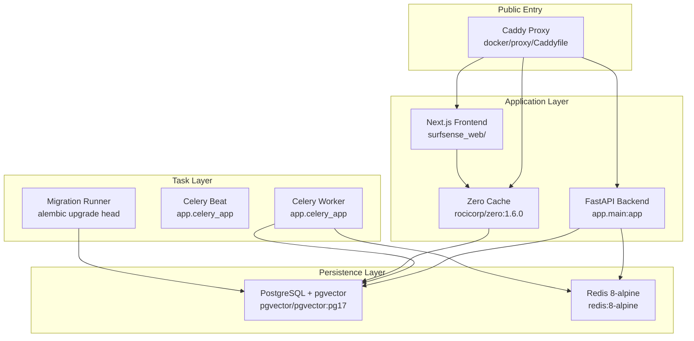
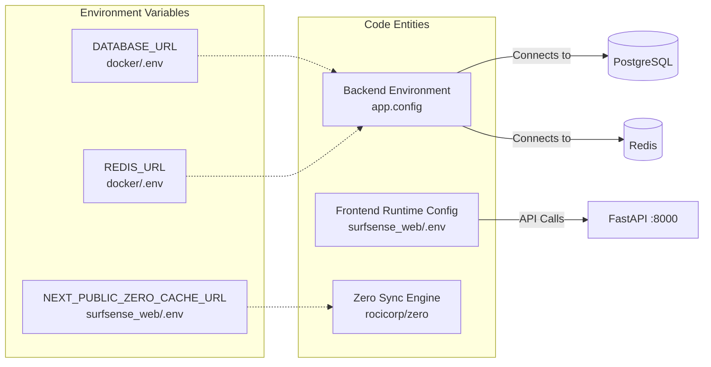

<!-- source: DeepWiki mcp.deepwiki.com · repo MODSetter/SurfSense · page 2 Installation and Deployment · fetched 2026-10-29 -->

# Installation and Deployment

Relevant source files

The following files were used as context for generating this wiki page:

- [.gitignore](.gitignore)
- [CONTRIBUTING.md](CONTRIBUTING.md)
- [docker/.env.example](docker/.env.example)
- [docker/docker-compose.deps-only.yml](docker/docker-compose.deps-only.yml)
- [docker/docker-compose.dev.yml](docker/docker-compose.dev.yml)
- [docker/docker-compose.gpu.yml](docker/docker-compose.gpu.yml)
- [docker/docker-compose.yml](docker/docker-compose.yml)
- [docker/scripts/install.ps1](docker/scripts/install.ps1)
- [docker/scripts/install.sh](docker/scripts/install.sh)
- [docker/scripts/migrate-database.ps1](docker/scripts/migrate-database.ps1)
- [docker/scripts/migrate-database.sh](docker/scripts/migrate-database.sh)
- [surfsense_backend/Dockerfile](surfsense_backend/Dockerfile)
- [surfsense_backend/scripts/docker/entrypoint.sh](surfsense_backend/scripts/docker/entrypoint.sh)
- [surfsense_web/.env.example](surfsense_web/.env.example)
- [surfsense_web/Dockerfile](surfsense_web/Dockerfile)
- [surfsense_web/content/docs/connectors/meta.json](surfsense_web/content/docs/connectors/meta.json)
- [surfsense_web/content/docs/docker-installation/index.mdx](surfsense_web/content/docs/docker-installation/index.mdx)
- [surfsense_web/content/docs/how-to/index.mdx](surfsense_web/content/docs/how-to/index.mdx)
- [surfsense_web/content/docs/how-to/meta.json](surfsense_web/content/docs/how-to/meta.json)
- [surfsense_web/content/docs/how-to/web-search.mdx](surfsense_web/content/docs/how-to/web-search.mdx)
- [surfsense_web/content/docs/index.mdx](surfsense_web/content/docs/index.mdx)
- [surfsense_web/content/docs/installation.mdx](surfsense_web/content/docs/installation.mdx)
- [surfsense_web/content/docs/meta.json](surfsense_web/content/docs/meta.json)
- [surfsense_web/content/docs/observability.mdx](surfsense_web/content/docs/observability.mdx)
- [surfsense_web/lib/source.ts](surfsense_web/lib/source.ts)
- [surfsense_web/next.config.ts](surfsense_web/next.config.ts)
- [surfsense_web/public/docs/unstructured.png](surfsense_web/public/docs/unstructured.png)
- [surfsense_web/source.config.ts](surfsense_web/source.config.ts)
- [surfsense_web/tsconfig.json](surfsense_web/tsconfig.json)

This document provides an overview of SurfSense installation and deployment options, including prerequisites, deployment architecture, and the setup workflow. SurfSense offers three primary deployment approaches:

1.  **Quick Start Docker** — Single-command deployment using an all-in-one script (see [Installation Options](#2.1)).
2.  **Docker Compose** — Full production setup with separate services (see [Docker Deployment](#2.2)).
3.  **Manual Installation** — Component-by-component setup for development or custom infrastructure (see [Manual Installation](#2.3)).

For detailed step-by-step instructions, see the child pages. For comprehensive environment variable configuration, see [Environment Configuration](#2.4).

## Prerequisites

Before installing SurfSense, ensure the following components are available:

### Required Infrastructure
| Component | Purpose | Source Requirement |
| :--- | :--- | :--- |
| **PostgreSQL 17** | Core database | Must include `pgvector` extension [docker/docker-compose.yml:14]() and `wal_level = logical` for real-time sync. |
| **Redis 8** | Task broker | Used for Celery queues and real-time state caching [docker/docker-compose.yml:50-59](). |
| **Zero-Cache** | Real-time Sync | A `rocicorp/zero` instance to stream database changes to the UI [docker/docker-compose.yml:213-217](). |
| **Python 3.12** | Backend Runtime | Required for backend services and migrations [surfsense_backend/Dockerfile:11](). |
| **Node.js 20+** | Frontend Runtime | Required for the Next.js standalone web application [surfsense_web/next.config.ts:13](). |

### ETL Service Options
SurfSense converts uploaded files using one of three services, configured via `ETL_SERVICE` [docker/.env.example:45]():
*   **Docling** (Default): Local processing, privacy-friendly, no API key required.
*   **Unstructured**: Cloud-based or self-hosted parsing.
*   **LlamaCloud**: Cloud-based high-fidelity parsing.

Sources: [docker/docker-compose.yml:13-59](), [docker/.env.example:1-45](), [surfsense_backend/Dockerfile:11-13]()

## Deployment Architecture

The following diagram illustrates the relationship between the deployment infrastructure and core code entities:

### Logical Deployment Model

**Architecture Overview**
*   **Entry Point**: Caddy acts as the single public entry point, routing traffic to the frontend, backend, and Zero-cache [docker/docker-compose.yml:86-111]().
*   **Real-time Sync**: `zero-cache` connects to PostgreSQL via logical replication to stream updates to the `surfsense_web` frontend [docker/docker-compose.yml:213-233]().
*   **Background Processing**: `celery_worker` handles long-running tasks like document chunking and indexing [surfsense_backend/scripts/docker/entrypoint.sh:93-115]().
*   **Migration Safety**: The `migrations` service ensures the database schema and `zero_publication` are up-to-date before any application services start [surfsense_backend/scripts/docker/entrypoint.sh:56-83]().

Sources: [docker/docker-compose.yml:12-233](), [surfsense_backend/scripts/docker/entrypoint.sh:1-173](), [docker/.env.example:61-100]()

## Installation Options

SurfSense provides different paths depending on your technical requirements and environment.

### 1. Quick Start (Scripted)
The easiest way to deploy is using the one-line install script for Linux/macOS or Windows. This script automates Docker Compose setup, generates a `SECRET_KEY`, and handles migrations.
*   **Linux/macOS**: `curl -fsSL .../install.sh | bash` [docker/scripts/install.sh:6-6]()
*   **Windows**: `irm .../install.ps1 | iex` [docker/scripts/install.ps1:5-5]()

### 2. Docker Compose (Production)
For production, use the standard `docker-compose.yml`. It separates the stack into distinct services for the database, redis, backend, frontend, and celery workers. It includes specialized `SERVICE_ROLE` assignments for `api`, `worker`, and `beat` [surfsense_backend/scripts/docker/entrypoint.sh:4-20]().

### 3. Manual Installation
Manual installation is recommended for developers. It involves:
1.  Configuring PostgreSQL 17 with `pgvector` [docker/docker-compose.dev.yml:19-35]().
2.  Running the backend via `python main.py` with `SERVICE_ROLE=api` [surfsense_backend/scripts/docker/entrypoint.sh:86-91]().
3.  Starting the frontend dev server via `pnpm dev`.
4.  Running a standalone `zero-cache` container [docker/docker-compose.dev.yml:204-225]().

For details, see [Installation Options](#2.1) and [Manual Installation](#2.3).

Sources: [docker/scripts/install.sh:31-185](), [docker/docker-compose.yml:1-112](), [surfsense_backend/scripts/docker/entrypoint.sh:140-173]()

## Configuration and Networking

### Component Connectivity Map
This diagram maps how internal services communicate using environment variables.

**Networking Details**:
*   **Backend**: Loads configuration from the environment, including `DATABASE_URL` and `CELERY_BROKER_URL` [docker/docker-compose.yml:125-127]().
*   **Frontend**: Communicates with the backend using `NEXT_PUBLIC_FASTAPI_BACKEND_URL` and internal server-side calls via `SURFSENSE_BACKEND_INTERNAL_URL` [surfsense_web/.env.example:8-12]().
*   **Zero Sync**: Requires `NEXT_PUBLIC_ZERO_CACHE_URL` to establish WebSocket connections for real-time updates [surfsense_web/.env.example:43-43]().

For details, see [Environment Configuration](#2.4).

Sources: [docker/docker-compose.yml:125-142](), [surfsense_web/.env.example:1-47](), [docker/.env.example:1-72]()

---

