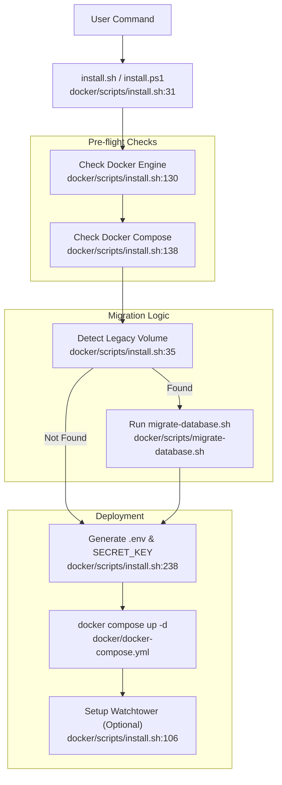
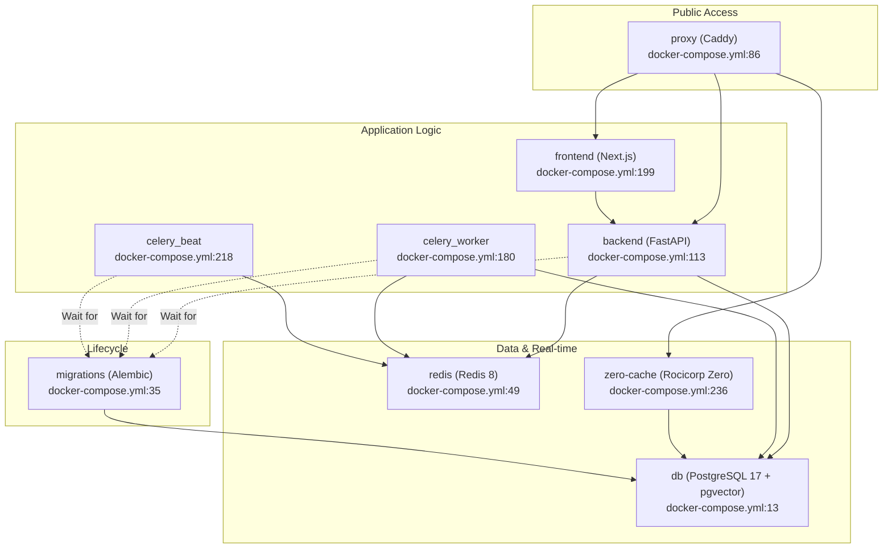
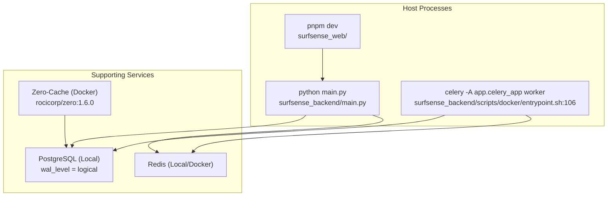

<!-- source: DeepWiki mcp.deepwiki.com · repo MODSetter/SurfSense · page 2.1 Installation Options · fetched 2026-10-29 -->

# Installation Options

Relevant source files

The following files were used as context for generating this wiki page:

- [.gitignore](.gitignore)
- [CONTRIBUTING.md](CONTRIBUTING.md)
- [docker/.env.example](docker/.env.example)
- [docker/docker-compose.deps-only.yml](docker/docker-compose.deps-only.yml)
- [docker/docker-compose.dev.yml](docker/docker-compose.dev.yml)
- [docker/docker-compose.gpu.yml](docker/docker-compose.gpu.yml)
- [docker/docker-compose.yml](docker/docker-compose.yml)
- [docker/scripts/install.ps1](docker/scripts/install.ps1)
- [docker/scripts/install.sh](docker/scripts/install.sh)
- [docker/scripts/migrate-database.ps1](docker/scripts/migrate-database.ps1)
- [docker/scripts/migrate-database.sh](docker/scripts/migrate-database.sh)
- [surfsense_backend/Dockerfile](surfsense_backend/Dockerfile)
- [surfsense_backend/scripts/docker/entrypoint.sh](surfsense_backend/scripts/docker/entrypoint.sh)
- [surfsense_web/.env.example](surfsense_web/.env.example)
- [surfsense_web/Dockerfile](surfsense_web/Dockerfile)
- [surfsense_web/content/docs/connectors/meta.json](surfsense_web/content/docs/connectors/meta.json)
- [surfsense_web/content/docs/docker-installation/index.mdx](surfsense_web/content/docs/docker-installation/index.mdx)
- [surfsense_web/content/docs/how-to/index.mdx](surfsense_web/content/docs/how-to/index.mdx)
- [surfsense_web/content/docs/how-to/meta.json](surfsense_web/content/docs/how-to/meta.json)
- [surfsense_web/content/docs/how-to/web-search.mdx](surfsense_web/content/docs/how-to/web-search.mdx)
- [surfsense_web/content/docs/index.mdx](surfsense_web/content/docs/index.mdx)
- [surfsense_web/content/docs/installation.mdx](surfsense_web/content/docs/installation.mdx)
- [surfsense_web/content/docs/meta.json](surfsense_web/content/docs/meta.json)
- [surfsense_web/content/docs/observability.mdx](surfsense_web/content/docs/observability.mdx)
- [surfsense_web/lib/source.ts](surfsense_web/lib/source.ts)
- [surfsense_web/next.config.ts](surfsense_web/next.config.ts)
- [surfsense_web/public/docs/unstructured.png](surfsense_web/public/docs/unstructured.png)
- [surfsense_web/source.config.ts](surfsense_web/source.config.ts)
- [surfsense_web/tsconfig.json](surfsense_web/tsconfig.json)

This document describes the available deployment methods for SurfSense, including cloud-hosted and self-hosted options. For detailed setup instructions, see **2.2 Docker Deployment** or **2.3 Manual Installation**. For environment variable configuration, see **2.4 Environment Configuration**.

## Deployment Methods Overview

SurfSense offers four deployment options ranging from zero-setup cloud hosting to fully customizable self-hosted installations.

### SurfSense Cloud (Managed Service)

Fully managed SurfSense deployment hosted at [surfsense.com](https://www.surfsense.com).

| **Aspect** | **Details** |
|------------|-------------|
| Setup Time | Immediate (no installation) |
| Infrastructure | Managed by SurfSense team |
| Maintenance | Automatic updates, backups, monitoring |
| Scaling | Automatic |
| Best For | Teams wanting immediate access without infrastructure management |

**Sources:** [surfsense_web/.env.example:26](), [docker/.env.example:39]()

### Quick Start (One-Line Script)

The fastest way to self-host SurfSense on Linux, macOS, or Windows using a single command that orchestrates the Docker stack.

| **Aspect** | **Details** |
|------------|-------------|
| Setup Time | Under 5 minutes |
| Linux/macOS Command | `curl -fsSL https://raw.githubusercontent.com/MODSetter/SurfSense/main/docker/scripts/install.sh | bash` |
| Windows Command | `irm https://raw.githubusercontent.com/MODSetter/SurfSense/main/docker/scripts/install.ps1 | iex` |
| Features | Automatic Docker/Compose checks, DB migration from legacy volumes, optional Watchtower for auto-updates |
| Best For | Quick evaluation, personal use, and users who want a "managed-like" experience on their own hardware |

**One-Line Installation Flow:**

**Sources:** [docker/scripts/install.sh:6-15](), [docker/scripts/install.ps1:5-18]()

### Docker Compose (Production-Ready)

Multi-container deployment defined in `docker-compose.yml` with separate services for database, cache, workers, and frontend.

| **Aspect** | **Details** |
|------------|-------------|
| Setup Complexity | Moderate (configure `.env`, run `docker compose up`) |
| Service Isolation | Dedicated containers for DB, Redis, Backend, Frontend, and Zero-cache |
| Persistence | Managed via named Docker volumes (`postgres_data`, `redis_data`, `object_store`) |
| GPU Support | Supported via `docker-compose.gpu.yml` and `SURFSENSE_VARIANT=cuda` |
| Best For | Production deployments, team environments, and deployments requiring GPU acceleration |

**Multi-Container Architecture:**

**Sources:** [docker/docker-compose.yml:10-250](), [docker/.env.example:1-16]()

### Manual Installation (Development)

Native installation where each service runs as a host process. This is the preferred method for contributors.

| **Aspect** | **Details** |
|------------|-------------|
| Setup Complexity | High (requires Python 3.12, Node.js 20, Postgres, Redis) |
| Tooling | `uv` for Python, `pnpm` for Node.js, `docker` for Zero-cache |
| Configuration | Direct `.env` management in `surfsense_backend/` and `surfsense_web/` |
| Best For | Active development, debugging, and contributing to the codebase |

**Manual Development Workflow:**

**Sources:** [surfsense_backend/Dockerfile:86-96](), [surfsense_web/next.config.ts:13](), [surfsense_backend/scripts/docker/entrypoint.sh:106-115]()

## Deployment Method Selection

| **Scenario** | **Recommended Method** | **Rationale** |
|--------------|------------------------|---------------|
| No infrastructure team | SurfSense Cloud | Zero maintenance, managed updates. |
| Personal / Home Lab | Quick Start Script | Easiest setup, includes automatic migration logic. |
| Production Team | Docker Compose | Service isolation, scalability, and easy monitoring. |
| GPU-Heavy RAG | Docker Compose (GPU) | Native support for NVIDIA Container Toolkit via `docker-compose.gpu.yml`. |
| Code Contribution | Manual Installation | Required for hot-reloading and direct debugging. |

**Sources:** [docker/scripts/install.sh:17-27](), [docker/docker-compose.yml:1-10]()

## System Requirements

### Hardware Requirements
- **CPU:** 2+ Cores (4+ recommended for local embedding/parsing).
- **RAM:** 4GB Minimum (8GB+ recommended for `DOCLING` ETL service).
- **GPU (Optional):** NVIDIA GPU with 8GB+ VRAM for local LLM/embedding acceleration.

### Software Requirements
- **Docker Engine:** 20.10+ (Required for all Docker-based options).
- **PostgreSQL:** Version 17 with `pgvector` (Bundled in Docker as `pgvector/pgvector:pg17`).
- **Python:** 3.12+ (Manual only).
- **Node.js:** 20+ (Manual only).

**Sources:** [docker/docker-compose.yml:14](), [surfsense_backend/Dockerfile:11](), [surfsense_backend/Dockerfile:135]()

## Critical Configuration Decisions

Before installing, you must decide on three core components that affect your environment variables:

1.  **Authentication (`AUTH_TYPE`):**
    - `LOCAL`: Standard email/password.
    - `GOOGLE`: OAuth 2.0 (requires `GOOGLE_CLIENT_ID`).
2.  **Document Parsing (`ETL_SERVICE`):**
    - `DOCLING`: Local, privacy-friendly (Default).
    - `UNSTRUCTURED`: Cloud-based (requires API key).
    - `LLAMACLOUD`: Cloud-based (requires API key).
3.  **Embeddings (`EMBEDDING_MODEL`):**
    - Local: `sentence-transformers/all-MiniLM-L6-v2`.
    - Cloud: `litellm://...` or OpenAI compatible endpoints.

**Sources:** [docker/.env.example:31-54](), [surfsense_web/.env.example:22-26]()

## Next Steps
- **Docker Users:** Follow the [Docker Deployment](./2.2) guide.
- **Developers:** Follow the [Manual Installation](./2.3) guide.
- **Configurators:** Reference the [Environment Configuration](./2.4) for all `.env` options.

**Sources:** [surfsense_web/content/docs/index.mdx:12-28]()

---

