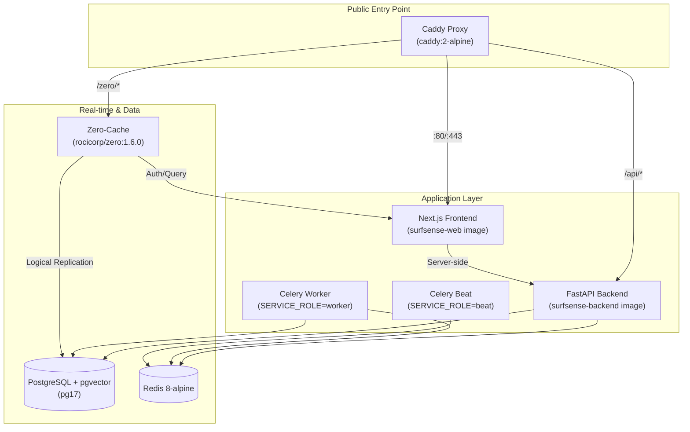
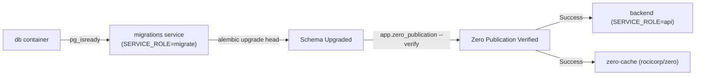

<!-- source: DeepWiki mcp.deepwiki.com · repo MODSetter/SurfSense · page 2.2 Docker Deployment · fetched 2026-10-29 -->

# Docker Deployment

<details>
<summary>Relevant source files</summary>

The following files were used as context for generating this wiki page:

- [.gitignore](.gitignore)
- [docker/.env.example](docker/.env.example)
- [docker/docker-compose.deps-only.yml](docker/docker-compose.deps-only.yml)
- [docker/docker-compose.dev.yml](docker/docker-compose.dev.yml)
- [docker/docker-compose.gpu.yml](docker/docker-compose.gpu.yml)
- [docker/docker-compose.yml](docker/docker-compose.yml)
- [docker/scripts/install.ps1](docker/scripts/install.ps1)
- [docker/scripts/install.sh](docker/scripts/install.sh)
- [docker/scripts/migrate-database.ps1](docker/scripts/migrate-database.ps1)
- [docker/scripts/migrate-database.sh](docker/scripts/migrate-database.sh)
- [surfsense_backend/Dockerfile](surfsense_backend/Dockerfile)
- [surfsense_backend/scripts/docker/entrypoint.sh](surfsense_backend/scripts/docker/entrypoint.sh)
- [surfsense_web/.env.example](surfsense_web/.env.example)
- [surfsense_web/Dockerfile](surfsense_web/Dockerfile)
- [surfsense_web/next.config.ts](surfsense_web/next.config.ts)

</details>


This page provides detailed instructions for deploying SurfSense using Docker. It covers the primary deployment methods: the production-ready Docker Compose stack (including GPU acceleration) and the automated one-line install script.

## Deployment Architecture

SurfSense utilizes a multi-container architecture orchestrated by Docker Compose. The stack includes a reverse proxy (Caddy), the Next.js frontend, a FastAPI backend, background workers (Celery), and supporting data services (PostgreSQL with pgvector, Redis, and Rocicorp Zero).

### System Component Map
This diagram bridges the conceptual deployment services to the specific code entities and images used in the stack.


**Sources:** [docker/docker-compose.yml:12-230](), [docker/docker-compose.dev.yml:18-210](), [surfsense_backend/scripts/docker/entrypoint.sh:20-173]()

## Quick Start (One-Line Install)

For most users, the recommended way to deploy SurfSense is via the automated install script. This script handles prerequisite checks, directory setup, environment configuration, and container startup.

### Installation Command

**Linux / macOS:**
```bash
curl -fsSL https://raw.githubusercontent.com/MODSetter/SurfSense/main/docker/scripts/install.sh | bash
```

**Windows (PowerShell):**
```powershell
irm https://raw.githubusercontent.com/MODSetter/SurfSense/main/docker/scripts/install.ps1 | iex
```

### Script Flags
The installer supports several flags to customize the deployment:
- `--variant=cpu|cuda|cuda126`: Selects the backend image variant. Use `cuda` for NVIDIA GPU acceleration [docker/scripts/install.sh:11-13]().
- `--gpu-count=N|all`: Number of GPUs to reserve [docker/scripts/install.sh:14]().
- `--no-watchtower`: Skips automatic setup of Watchtower for auto-updates [docker/scripts/install.sh:9]().
- `--quiet`: Skips interactive prompts and uses defaults [docker/scripts/install.sh:15]().

**Sources:** [docker/scripts/install.sh:1-60](), [docker/scripts/install.ps1:25-31]()

## Production Docker Compose Setup

For manual control over the production stack, use the provided `docker-compose.yml`.

### 1. Prerequisite Configuration
SurfSense requires a `.env` file in the `docker/` directory. Use the provided example as a template:

```bash
cd docker
cp .env.example .env
```

Key required settings in `docker/.env`:
- `SECRET_KEY`: Generate a secure string using `openssl rand -base64 32` [docker/.env.example:28]().
- `SURFSENSE_PUBLIC_URL`: The full URL where your instance will be accessible (e.g., `http://localhost:3929`) [docker/.env.example:62]().
- `ETL_SERVICE`: Choice of `DOCLING`, `UNSTRUCTURED`, or `LLAMACLOUD` [docker/.env.example:45]().
- `EMBEDDING_MODEL`: Local model (e.g., `sentence-transformers/all-MiniLM-L6-v2`) or provider-based [docker/.env.example:54]().

### 2. Startup Lifecycle and Migrations
SurfSense uses a dedicated `migrations` service to ensure the database schema and logical replication publications are ready before other services start.



The `migrations` service runs `alembic upgrade head` and verifies the `zero_publication` shape to prevent `zero-cache` from booting against a drifted publication [docker/docker-compose.yml:35-47](), [surfsense_backend/scripts/docker/entrypoint.sh:56-83]().

### 3. Service Definitions
| Service | Image | Role |
| :--- | :--- | :--- |
| `proxy` | `caddy:2-alpine` | Terminates SSL and routes traffic to FE/BE/Zero [docker/docker-compose.yml:86-104](). |
| `backend` | `surfsense-backend` | FastAPI application (`main.py`) handling logic and tool execution [docker/docker-compose.yml:113-142](). |
| `celery_worker`| `surfsense-backend` | Processes background tasks like indexing and podcast generation [docker/docker-compose.yml:180-195](). |
| `zero-cache` | `rocicorp/zero` | Syncs PostgreSQL data to the frontend in real-time [docker/docker-compose.yml:210-230](). |

**Sources:** [docker/docker-compose.yml:12-230](), [surfsense_backend/Dockerfile:1-146](), [surfsense_backend/scripts/docker/entrypoint.sh:86-122]()

## GPU Acceleration

SurfSense supports NVIDIA GPU acceleration for local embedding and document processing. This requires the `nvidia-container-toolkit` on the host.

### Enabling CUDA
1. Set `SURFSENSE_VARIANT=cuda` or `cuda126` in your `.env` [docker/.env.example:16]().
2. Use the GPU overlay file during startup:

```bash
docker compose -f docker-compose.yml -f docker-compose.gpu.yml up -d
```

The `docker-compose.gpu.yml` file adds the `nvidia` reservation to the `backend` and `celery_worker` services, enabling access to GPU resources [docker/docker-compose.gpu.yml:1-30]().

**Sources:** [docker/.env.example:10-18](), [docker/docker-compose.gpu.yml:1-30]()

## Data Flow and Persistence

SurfSense persists data using named Docker volumes to ensure stability across updates.

| Volume Name | Target Path | Content |
| :--- | :--- | :--- |
| `postgres_data` | `/var/lib/postgresql/data` | Relational data and vector embeddings [docker/docker-compose.yml:16](). |
| `redis_data` | `/data` | Celery task states and application cache [docker/docker-compose.yml:52](). |
| `object_store` | `/app/.local_object_store` | Uploaded files and generated artifacts [docker/docker-compose.yml:119](). |
| `shared_temp` | `/shared_tmp` | Temporary files shared between API and Workers [docker/docker-compose.yml:118](). |

### Logical Replication for Zero
Zero-cache requires `wal_level = logical`. The Docker stack applies this via a custom `postgresql.conf` mounted into the `db` container [docker/docker-compose.yml:17](), [docker/docker-compose.yml:22]().

**Sources:** [docker/docker-compose.yml:13-235]()

## Development Deployment

For developers, a separate `docker-compose.dev.yml` is provided. This setup builds images from local source code and includes additional tools:

- **pgAdmin**: Web-based PostgreSQL management at port `5050` [docker/docker-compose.dev.yml:54-64]().
- **Hot Reloading**: Backend code is mounted as a volume (`../surfsense_backend/app:/app/app`) allowing real-time updates without rebuilding [docker/docker-compose.dev.yml:93]().
- **Observability**: Includes the `otel-lgtm` stack for tracing and metrics [docker/docker-compose.dev.yml:79-86]().

### Running Dev Stack
```bash
docker compose -f docker/docker-compose.dev.yml up --build
```

**Sources:** [docker/docker-compose.dev.yml:1-210]()

## Implementation Details: Backend Dockerfile

The backend image is a multi-stage build optimized for size and caching:
1. **Base**: Installs system dependencies like `ffmpeg`, `pandoc 3.9`, and `xvfb` for web scraping [surfsense_backend/Dockerfile:10-54]().
2. **Deps**: Uses `uv` to install Python dependencies from `uv.lock` deterministically [surfsense_backend/Dockerfile:65-96]().
3. **Models**: Pre-downloads `EasyOCR` models, `Docling` models, and the specified `EMBEDDING_MODEL` [surfsense_backend/Dockerfile:100-123]().
4. **Stealth Hardening**: Installs `patchright` Chromium engines via `scrapling install` [surfsense_backend/Dockerfile:127]().

**Sources:** [surfsense_backend/Dockerfile:1-200]()

---

