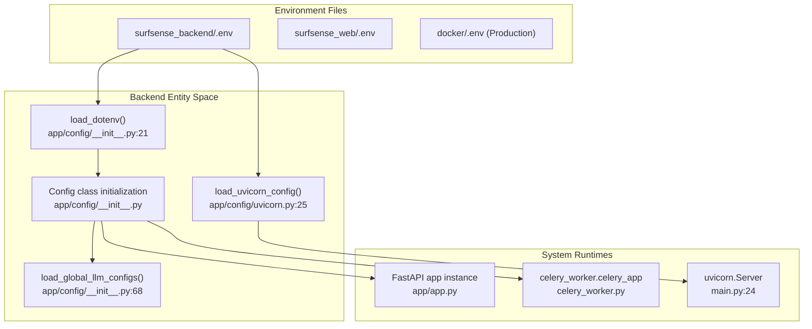
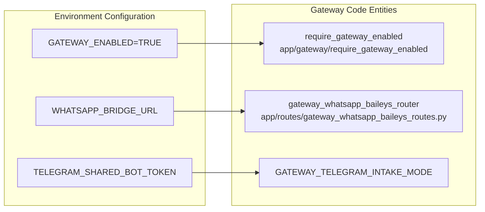

<!-- source: DeepWiki mcp.deepwiki.com · repo MODSetter/SurfSense · page 2.4 Environment Configuration · fetched 2026-10-29 -->

# Environment Configuration

Relevant source files

The following files were used as context for generating this wiki page:

- [.gitignore](.gitignore)
- [docker/.env.example](docker/.env.example)
- [docker/docker-compose.deps-only.yml](docker/docker-compose.deps-only.yml)
- [docker/docker-compose.dev.yml](docker/docker-compose.dev.yml)
- [docker/docker-compose.gpu.yml](docker/docker-compose.gpu.yml)
- [docker/docker-compose.yml](docker/docker-compose.yml)
- [docker/scripts/install.ps1](docker/scripts/install.ps1)
- [docker/scripts/install.sh](docker/scripts/install.sh)
- [docker/scripts/migrate-database.ps1](docker/scripts/migrate-database.ps1)
- [docker/scripts/migrate-database.sh](docker/scripts/migrate-database.sh)
- [surfsense_backend/.env.example](surfsense_backend/.env.example)
- [surfsense_backend/Dockerfile](surfsense_backend/Dockerfile)
- [surfsense_backend/app/config/__init__.py](surfsense_backend/app/config/__init__.py)
- [surfsense_backend/app/connectors/composio_connector.py](surfsense_backend/app/connectors/composio_connector.py)
- [surfsense_backend/app/db.py](surfsense_backend/app/db.py)
- [surfsense_backend/app/routes/__init__.py](surfsense_backend/app/routes/__init__.py)
- [surfsense_backend/app/routes/composio_routes.py](surfsense_backend/app/routes/composio_routes.py)
- [surfsense_backend/app/routes/documents_routes.py](surfsense_backend/app/routes/documents_routes.py)
- [surfsense_backend/app/routes/search_source_connectors_routes.py](surfsense_backend/app/routes/search_source_connectors_routes.py)
- [surfsense_backend/app/schemas/documents.py](surfsense_backend/app/schemas/documents.py)
- [surfsense_backend/app/schemas/search_source_connector.py](surfsense_backend/app/schemas/search_source_connector.py)
- [surfsense_backend/app/services/composio_service.py](surfsense_backend/app/services/composio_service.py)
- [surfsense_backend/app/tasks/celery_tasks/connector_tasks.py](surfsense_backend/app/tasks/celery_tasks/connector_tasks.py)
- [surfsense_backend/app/tasks/celery_tasks/document_tasks.py](surfsense_backend/app/tasks/celery_tasks/document_tasks.py)
- [surfsense_backend/app/tasks/celery_tasks/schedule_checker_task.py](surfsense_backend/app/tasks/celery_tasks/schedule_checker_task.py)
- [surfsense_backend/app/tasks/celery_tasks/stale_notification_cleanup_task.py](surfsense_backend/app/tasks/celery_tasks/stale_notification_cleanup_task.py)
- [surfsense_backend/app/tasks/composio_indexer.py](surfsense_backend/app/tasks/composio_indexer.py)
- [surfsense_backend/app/tasks/connector_indexers/__init__.py](surfsense_backend/app/tasks/connector_indexers/__init__.py)
- [surfsense_backend/app/utils/periodic_scheduler.py](surfsense_backend/app/utils/periodic_scheduler.py)
- [surfsense_backend/scripts/docker/entrypoint.sh](surfsense_backend/scripts/docker/entrypoint.sh)
- [surfsense_web/.env.example](surfsense_web/.env.example)
- [surfsense_web/Dockerfile](surfsense_web/Dockerfile)
- [surfsense_web/components/auth/sign-in-button.tsx](surfsense_web/components/auth/sign-in-button.tsx)
- [surfsense_web/content/docs/manual-installation.mdx](surfsense_web/content/docs/manual-installation.mdx)
- [surfsense_web/i18n/request.ts](surfsense_web/i18n/request.ts)
- [surfsense_web/lib/env-config.ts](surfsense_web/lib/env-config.ts)
- [surfsense_web/lib/runtime-auth-config.ts](surfsense_web/lib/runtime-auth-config.ts)
- [surfsense_web/lib/supported-extensions.ts](surfsense_web/lib/supported-extensions.ts)
- [surfsense_web/next.config.ts](surfsense_web/next.config.ts)
- [surfsense_web/proxy.ts](surfsense_web/proxy.ts)

This page provides a complete technical reference for configuring SurfSense through environment variables. Environment variables control authentication methods (OAuth/Local), AI model selection (LiteLLM), database connections, task queue settings, and service-specific configurations across the backend, frontend, and browser extension.

---

## Configuration Architecture

SurfSense employs a centralized configuration management system. In the backend, settings are managed by a `Config` class that initializes models and validates constraints at startup. The frontend uses a mix of build-time and runtime environment variables.

### Configuration Loading Flow

The following diagram illustrates how environment variables propagate from `.env` files to code entities like the `Config` class and the `uvicorn` server.

**Sources**: [surfsense_backend/app/config/__init__.py:18-73](), [surfsense_backend/main.py:17-26]()

---

## Backend Environment Reference

The backend loads configuration from `surfsense_backend/.env`. The primary entry point for these settings is the `Config` class.

### Database & Persistence
| Variable | Description | Implementation Detail |
|:---|:---|:---|
| `DATABASE_URL` | PostgreSQL connection string. | Used in `app.db.DATABASE_URL` [surfsense_backend/app/db.py:40](). |
| `REDIS_URL` | Single endpoint for Celery and app features. | Defaults to `redis://localhost:6379/0`. |
| `DB_BOOTSTRAP_ON_STARTUP` | Run DDL on app startup. | Controlled in `.env.example:6`. |
| `FILE_STORAGE_LOCAL_PATH` | Path for local object storage. | Default: `/app/.local_object_store`. |

**Sources**: [surfsense_backend/.env.example:1-27](), [surfsense_backend/app/db.py:40](), [docker/docker-compose.yml:125-133]()

### Authentication (Local & OAuth)
SurfSense supports `LOCAL` (Email/Password) and `GOOGLE` authentication modes via the `AUTH_TYPE` variable.

| Variable | Description | Source |
|:---|:---|:---|
| `AUTH_TYPE` | `LOCAL` or `GOOGLE`. | [surfsense_backend/.env.example:124]() |
| `SECRET_KEY` | JWT signing secret. | [surfsense_backend/.env.example:77]() |
| `GOOGLE_OAUTH_CLIENT_ID` | Client ID for Google Auth. | [surfsense_backend/.env.example:128]() |
| `GOOGLE_OAUTH_CLIENT_SECRET` | Client Secret for Google Auth. | [surfsense_backend/.env.example:129]() |
| `REGISTRATION_ENABLED` | Enable new user signup. | [surfsense_backend/.env.example:126]() |

**Sources**: [surfsense_backend/.env.example:77-132](), [surfsense_backend/app/db.py:35-36]()

### AI & LLM Provider Configuration
LLM configurations are managed through a combination of environment variables and a YAML file for global model definitions.

| Variable | Description | Source |
|:---|:---|:---|
| `EMBEDDING_MODEL` | Model for vector search. | [docker/.env.example:54]() |
| `EMBEDDING_BASE_URL` | Endpoint for OpenAI-compatible embeddings. | [docker/.env.example:55]() |
| `ETL_SERVICE` | `DOCLING`, `UNSTRUCTURED`, or `LLAMACLOUD`. | [docker/.env.example:45]() |

**Global LLM Config**: The file `surfsense_backend/app/config/global_llm_config.yaml` provides pre-defined model configurations. The function `load_global_llm_configs()` in [surfsense_backend/app/config/__init__.py:68]() parses this file and stamps metadata like `auto_pin_tier` and `quality_score`.

**Sources**: [surfsense_backend/app/config/__init__.py:68-164](), [docker/.env.example:45-57]()

---

## Connector & Gateway Configuration

SurfSense integrates with external platforms via OAuth and messaging gateways. These require specific redirect URIs and API keys.

### OAuth Connector Settings
These variables must match the callback URLs registered in the respective developer portals.

| Connector | Variable | Default Callback Path |
|:---|:---|:---|
| **Google Drive** | `GOOGLE_DRIVE_REDIRECT_URI` | `/api/v1/auth/google/drive/connector/callback` |
| **Notion** | `NOTION_REDIRECT_URI` | `/api/v1/auth/notion/connector/callback` |
| **Slack** | `SLACK_REDIRECT_URI` | `/api/v1/auth/slack/connector/callback` |
| **Airtable** | `AIRTABLE_REDIRECT_URI` | `/api/v1/auth/airtable/connector/callback` |

**Sources**: [surfsense_backend/.env.example:135-171](), [surfsense_backend/app/routes/search_source_connectors_routes.py:118-132]()

### Messaging Gateway
The gateway enables chat via Telegram, WhatsApp, Discord, and Slack. It is disabled by default.

**Sources**: [surfsense_backend/.env.example:33-56](), [surfsense_backend/app/routes/__init__.py:92-100]()

---

## Frontend Environment Reference

The Next.js frontend (`surfsense_web`) uses environment variables to communicate with the backend and Zero-cache.

| Variable | Scope | Description |
|:---|:---|:---|
| `NEXT_PUBLIC_FASTAPI_BACKEND_URL` | Client | Browser-side URL for API calls. |
| `SURFSENSE_BACKEND_INTERNAL_URL` | Server | Internal Docker URL for RSC/SSR calls. |
| `NEXT_PUBLIC_ZERO_CACHE_URL` | Client | WebSocket endpoint for real-time sync. |
| `AUTH_TYPE` | Server | Determines login UI (Local vs Google). |

**Sources**: [surfsense_web/.env.example:1-43](), [docker/docker-compose.yml:134-135]()

---

## Docker Deployment Knobs

When deploying via `docker-compose.yml`, the root `.env` file handles orchestration and port mapping.

### Container Orchestration
| Variable | Description | Default |
|:---|:---|:---|
| `SURFSENSE_VERSION` | Image tag (e.g., `latest`). | `latest` |
| `SURFSENSE_VARIANT` | Image type: `cpu`, `cuda`, or `cuda126`. | (empty for CPU) |
| `LISTEN_HTTP_PORT` | Public port for the Caddy proxy. | `3929` |
| `SURFSENSE_SITE_ADDRESS` | Domain name for automatic HTTPS. | `:80` |

### Zero-Cache Tuning
Zero-cache handles real-time data synchronization between Postgres and the browser.

| Variable | Description | Source |
|:---|:---|:---|
| `ZERO_UPSTREAM_DB` | Postgres URL for Zero replication. | [docker/.env.example:130]() |
| `ZERO_NUM_SYNC_WORKERS` | Parallel sync workers (default 4). | [docker/.env.example:124]() |
| `ZERO_AUTO_RESET` | Wipe SQLite replica if replication halts. | [docker/.env.example:116]() |

**Sources**: [docker/.env.example:7-147](), [docker/docker-compose.yml:86-112]()

---

## Setup & Validation

### Verification Scripts
The installation scripts validate the environment before starting services.
- **Linux/macOS**: `docker/scripts/install.sh` checks for `docker compose` and `pg_isready` [docker/scripts/install.sh:130-154]().
- **Windows**: `docker/scripts/install.ps1` performs similar checks via PowerShell.

### Common Validation Failures
1. **JWT Secret**: If `SECRET_KEY` is not set, the backend will fail to sign session tokens [surfsense_backend/.env.example:77]().
2. **Database Migrations**: The `migrations` service in Docker must complete successfully before `backend` or `zero-cache` can start [docker/docker-compose.yml:35-47]().
3. **Logical Replication**: Zero-cache requires `wal_level = logical` in Postgres. This is configured in `docker/postgresql.conf` [surfsense_web/content/docs/manual-installation.mdx:73-79]().

**Sources**: [docker/scripts/install.sh:130-185](), [docker/docker-compose.yml:35-47](), [surfsense_web/content/docs/manual-installation.mdx:71-106]()

---

