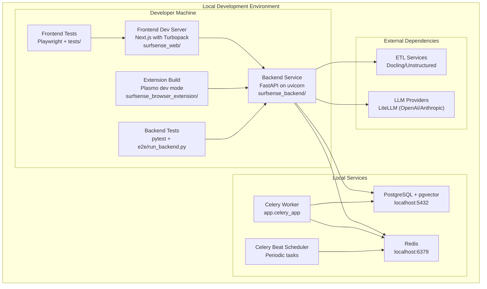
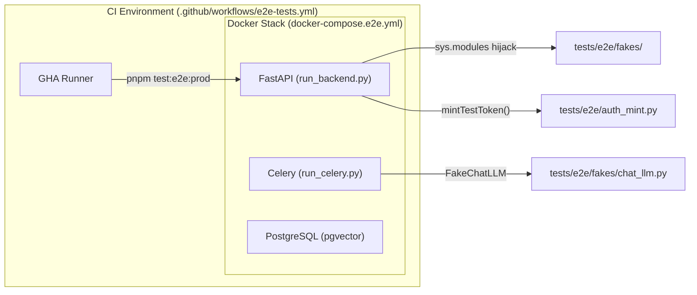

<!-- source: DeepWiki mcp.deepwiki.com · repo MODSetter/SurfSense · page 20 Development and Operations · fetched 2026-10-29 -->

# Development and Operations

Relevant source files

The following files were used as context for generating this wiki page:

- [.github/workflows/code-quality.yml](.github/workflows/code-quality.yml)
- [.github/workflows/e2e-tests.yml](.github/workflows/e2e-tests.yml)
- [.pre-commit-config.yaml](.pre-commit-config.yaml)
- [.secrets.baseline](.secrets.baseline)
- [biome.json](biome.json)
- [docker/docker-compose.e2e.yml](docker/docker-compose.e2e.yml)
- [surfsense_backend/app/connectors/bookstack_connector.py](surfsense_backend/app/connectors/bookstack_connector.py)
- [surfsense_backend/scripts/docker/entrypoint.e2e.sh](surfsense_backend/scripts/docker/entrypoint.e2e.sh)
- [surfsense_backend/tests/e2e/auth_mint.py](surfsense_backend/tests/e2e/auth_mint.py)
- [surfsense_backend/tests/e2e/fakes/chat_llm.py](surfsense_backend/tests/e2e/fakes/chat_llm.py)
- [surfsense_backend/tests/e2e/fakes/clickup_module.py](surfsense_backend/tests/e2e/fakes/clickup_module.py)
- [surfsense_backend/tests/e2e/fakes/docling_service.py](surfsense_backend/tests/e2e/fakes/docling_service.py)
- [surfsense_backend/tests/e2e/fakes/fixtures/clickup_tasks.json](surfsense_backend/tests/e2e/fakes/fixtures/clickup_tasks.json)
- [surfsense_backend/tests/e2e/fakes/fixtures/gmail_messages.json](surfsense_backend/tests/e2e/fakes/fixtures/gmail_messages.json)
- [surfsense_backend/tests/e2e/fixtures/global_llm_config.yaml](surfsense_backend/tests/e2e/fixtures/global_llm_config.yaml)
- [surfsense_backend/tests/e2e/run_backend.py](surfsense_backend/tests/e2e/run_backend.py)
- [surfsense_backend/tests/e2e/run_celery.py](surfsense_backend/tests/e2e/run_celery.py)
- [surfsense_web/playwright.config.ts](surfsense_web/playwright.config.ts)
- [surfsense_web/tests/auth.setup.ts](surfsense_web/tests/auth.setup.ts)
- [surfsense_web/tests/documents/file-upload/journey.spec.ts](surfsense_web/tests/documents/file-upload/journey.spec.ts)
- [surfsense_web/tests/helpers/api/auth.ts](surfsense_web/tests/helpers/api/auth.ts)

This section provides guidance for developers working on SurfSense, covering local development environment setup, understanding core operational systems, and extending functionality. It focuses on the technical aspects of developing, maintaining, and deploying the SurfSense platform.

For installation instructions aimed at end users, see [Installation and Deployment](#2). For detailed component architecture, see [System Architecture](#3).

---

## Development Environment Overview

SurfSense consists of three main components that developers work with:

| Component | Technology | Package Manager | Primary Language |
|-----------|-----------|-----------------|------------------|
| **Backend** (`surfsense_backend/`) | FastAPI, Celery, Alembic | uv | Python 3.12+ |
| **Frontend** (`surfsense_web/`) | Next.js 15, React 19 | pnpm | TypeScript |
| **Extension** (`surfsense_browser_extension/`) | Plasmo (Manifest v3) | pnpm | TypeScript |

### Development Architecture

**Sources:** [surfsense_backend/tests/e2e/run_backend.py:1-40](), [surfsense_web/playwright.config.ts:1-81]()

---

## Database Migrations and Schema Management

SurfSense uses Alembic for database schema migrations. The system includes a fail-fast contract in its entrypoint to ensure migrations are successful before starting services.

### Migration Logic
The backend entrypoint manages the lifecycle of the database schema. It waits for the database to be ready and runs migrations before starting the application. A specialized verification step ensures the database matches the expected publication shape.

### Fresh DB Fast-Forward
To optimize setup, SurfSense detects a fresh database and builds the head-shape schema directly using `Base.metadata.create_all` and `_stamp_head` instead of replaying the entire migration history. This includes creating essential extensions like `vector` and `pg_trgm`.

**Sources:** [surfsense_backend/tests/e2e/run_backend.py:75-82]()

---

## Background Task Processing

The system relies on Celery for long-running tasks such as document processing, connector indexing, and podcast generation.

### Service Roles
The environment supports multiple `SERVICE_ROLE` configurations to separate concerns in production [docker/docker-compose.e2e.yml:111-151]():
- `api`: Starts the FastAPI application.
- `worker`: Starts the Celery worker.

### Task Monitoring
Tasks are routed to specific queues. In E2E environments, the `celery_worker` is health-checked using `celery -A app.celery_app inspect ping` [docker/docker-compose.e2e.yml:157-159]().

**Sources:** [surfsense_backend/tests/e2e/run_celery.py:1-176](), [docker/docker-compose.e2e.yml:143-164]()

---

## Testing and Quality Assurance

SurfSense employs a multi-layered testing strategy, including unit tests, E2E backend tests, and Playwright-based frontend journeys.

### E2E Backend Entrypoints
For testing, the backend can be started via `tests/e2e/run_backend.py`, which hijacks external SDKs (like `composio` and `notion_client`) and replaces them with strict fakes in `sys.modules` to prevent accidental outbound calls during CI [surfsense_backend/tests/e2e/run_backend.py:50-65]().

### Frontend Playwright Tests
The web application uses Playwright for end-to-end journey testing. The configuration manages a local `webServer` for Next.js and targets the FastAPI backend [surfsense_web/playwright.config.ts:30-81](). Authentication is handled via `auth.setup.ts` which acquires a token and persists it as a session cookie [surfsense_web/tests/auth.setup.ts:39-79]().

### CI/CD Integration
GitHub Actions automate the build and test process:
- **E2E Tests**: Spawns a full stack (DB, Redis, Backend, Celery) using `docker-compose.e2e.yml` and runs Playwright [.github/workflows/e2e-tests.yml:49-131]().
- **Code Quality**: Uses `pre-commit` hooks for `ruff`, `bandit`, and `biome` to ensure linting and security standards [.pre-commit-config.yaml:42-85]().

### E2E Test Stack to Code Mapping

**Sources:** [surfsense_backend/tests/e2e/run_backend.py:1-166](), [surfsense_web/playwright.config.ts:1-81](), [.github/workflows/e2e-tests.yml:1-176](), [.pre-commit-config.yaml:1-98]()

---

## Operational Environment

### Security and Hardening
The E2E environment uses `HTTPS_PROXY=http://127.0.0.1:1` and sentinel API keys (e.g., `local-deny-real-call-sentinel`) to ensure that any leaked outbound HTTP calls fail loudly [surfsense_backend/tests/e2e/run_backend.py:16-17]().

### Fake LLM Integration
To facilitate testing without real LLM costs or latency, the system uses `FakeChatLLM` which recognizes canary tokens (e.g., `DRIVE_CANARY_TOKEN`) to simulate tool outputs [surfsense_backend/tests/e2e/fakes/chat_llm.py:15-85]().

**Sources:** [surfsense_backend/tests/e2e/run_backend.py:90-95](), [surfsense_backend/tests/e2e/fakes/chat_llm.py:1-114]()

---

## Child Pages

For detailed guides on specific operational topics, refer to the following pages:

- [Development Setup](#20.1) — Instructions for setting up local development environment for backend, frontend, and extension
- [Database Schema and Migrations](#20.2) — Explain the Alembic migration system, schema versioning, and how to create new migrations
- [Background Task Processing](#20.3) — Document the Celery task system architecture, worker configuration, and how to add new background tasks
- [Adding New Connectors](#20.4) — Guide for implementing new connector types including API integration, OAuth flow, and UI configuration
- [Adding New Agent Tools](#20.5) — Guide for creating new tools in the agent's tool registry with proper dependency injection
- [Observability and Monitoring](#20.6) — Document the OpenTelemetry integration, metrics collection, task logging, and how to monitor SurfSense in production

---

