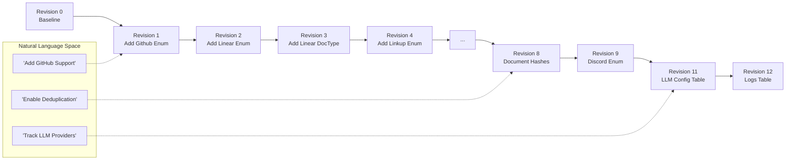
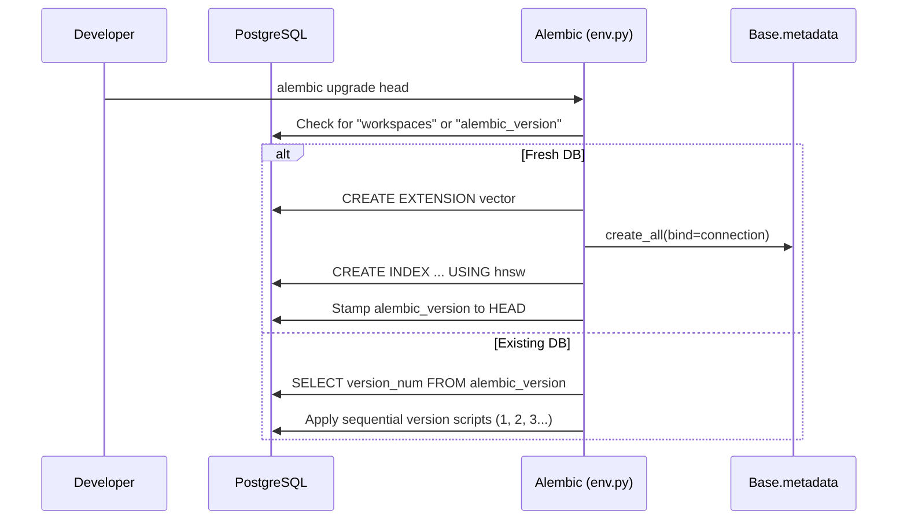

<!-- source: DeepWiki mcp.deepwiki.com · repo MODSetter/SurfSense · page 20.2 Database Schema and Migrations · fetched 2026-10-29 -->

# Database Schema and Migrations

<details>
<summary>Relevant source files</summary>

The following files were used as context for generating this wiki page:

- [surfsense_backend/alembic/env.py](surfsense_backend/alembic/env.py)
- [surfsense_backend/alembic/versions/11_add_llm_config_table_and_relationships.py](surfsense_backend/alembic/versions/11_add_llm_config_table_and_relationships.py)
- [surfsense_backend/alembic/versions/12_add_logs_table.py](surfsense_backend/alembic/versions/12_add_logs_table.py)
- [surfsense_backend/alembic/versions/1_add_github_connector_enum.py](surfsense_backend/alembic/versions/1_add_github_connector_enum.py)
- [surfsense_backend/alembic/versions/2_add_linear_connector_enum.py](surfsense_backend/alembic/versions/2_add_linear_connector_enum.py)
- [surfsense_backend/alembic/versions/3_add_linear_connector_to_documenttype_.py](surfsense_backend/alembic/versions/3_add_linear_connector_to_documenttype_.py)
- [surfsense_backend/alembic/versions/4_add_linkup_api_enum.py](surfsense_backend/alembic/versions/4_add_linkup_api_enum.py)
- [surfsense_backend/alembic/versions/6_change_podcast_content_to_transcript.py](surfsense_backend/alembic/versions/6_change_podcast_content_to_transcript.py)
- [surfsense_backend/alembic/versions/7_remove_is_generated_column.py](surfsense_backend/alembic/versions/7_remove_is_generated_column.py)
- [surfsense_backend/alembic/versions/8_add_content_hash_to_documents.py](surfsense_backend/alembic/versions/8_add_content_hash_to_documents.py)
- [surfsense_backend/alembic/versions/9_add_discord_connector_enum_and_documenttype.py](surfsense_backend/alembic/versions/9_add_discord_connector_enum_and_documenttype.py)
- [surfsense_backend/alembic/versions/e55302644c51_add_github_connector_to_documenttype_.py](surfsense_backend/alembic/versions/e55302644c51_add_github_connector_to_documenttype_.py)
- [surfsense_backend/app/agents/chat/multi_agent_chat/subagents/builtins/indeed/system_prompt.md](surfsense_backend/app/agents/chat/multi_agent_chat/subagents/builtins/indeed/system_prompt.md)
- [surfsense_backend/app/proprietary/platforms/google_search/fetch.py](surfsense_backend/app/proprietary/platforms/google_search/fetch.py)
- [surfsense_backend/app/proprietary/platforms/indeed_jobs/fetch.py](surfsense_backend/app/proprietary/platforms/indeed_jobs/fetch.py)
- [surfsense_backend/app/proprietary/platforms/indeed_jobs/scraper.py](surfsense_backend/app/proprietary/platforms/indeed_jobs/scraper.py)
- [surfsense_backend/app/schemas/logs.py](surfsense_backend/app/schemas/logs.py)
- [surfsense_backend/app/services/task_logging_service.py](surfsense_backend/app/services/task_logging_service.py)
- [surfsense_backend/app/utils/browser_loop.py](surfsense_backend/app/utils/browser_loop.py)
- [surfsense_backend/scripts/check_migration_flow.py](surfsense_backend/scripts/check_migration_flow.py)
- [surfsense_backend/tests/unit/platforms/google_search/test_fetch_concurrency.py](surfsense_backend/tests/unit/platforms/google_search/test_fetch_concurrency.py)
- [surfsense_backend/tests/unit/platforms/indeed_jobs/test_fetch_resilience.py](surfsense_backend/tests/unit/platforms/indeed_jobs/test_fetch_resilience.py)
- [surfsense_backend/tests/unit/platforms/indeed_jobs/test_scraper.py](surfsense_backend/tests/unit/platforms/indeed_jobs/test_scraper.py)

</details>


## Purpose and Scope

This document describes the database migration system in SurfSense, which uses **Alembic** to manage schema evolution and data transformations in PostgreSQL. Database migrations track changes to table structures, indexes, constraints, and data backfills, allowing the system to evolve safely across deployments.

SurfSense implements a hybrid initialization strategy: it uses `Base.metadata.create_all` for rapid bootstrapping of fresh databases while maintaining an Alembic revision history for legacy upgrades and complex schema transitions like workspace renames or enum additions.

---

## Migration System Architecture

SurfSense uses **Alembic**, the database migration tool for SQLAlchemy, to manage schema changes. Alembic creates a revision chain where each migration file depends on the previous one, forming a directed acyclic graph of database states.

### Directory Structure

```
surfsense_backend/
├── alembic/
│   ├── env.py             # Migration environment & bootstrap logic
│   ├── script.py.mako     # Template for new migrations
│   └── versions/          # Migration scripts
│       ├── 0_*.py         # Initial baseline
│       ├── 1_add_github_connector_enum.py
│       ├── 8_add_content_hash_to_documents.py
│       ├── 11_add_llm_config_table_and_relationships.py
│       └── ...
├── alembic.ini            # Alembic configuration file
└── app/
    └── db.py              # SQLAlchemy models (source of truth)
```

### Bootstrap vs. Replay Logic
The system handles two distinct scenarios in `surfsense_backend/alembic/env.py`:
1.  **Fresh DB Bootstrap**: If no `alembic_version` table is found, the system creates the current head-shape schema directly using `Base.metadata.create_all` and then stamps the head revision [surfsense_backend/alembic/env.py:66-132](). This skips historical migrations that might fail due to object renames (e.g., the `searchspaces` to `workspaces` rename) [surfsense_backend/alembic/env.py:45-53]().
2.  **Legacy Replay**: If an existing version is detected, Alembic replays the remaining migrations in the chain [surfsense_backend/alembic/env.py:135-180]().

**Sources:** [surfsense_backend/alembic/env.py:15-55](), [surfsense_backend/alembic/env.py:66-132]()

---

## Migration Revision Chain



Each migration file contains:
- **`revision`**: Unique identifier (e.g., `"8"`) [surfsense_backend/alembic/versions/8_add_content_hash_to_documents.py:15]().
- **`down_revision`**: Previous migration (e.g., `"7"`) [surfsense_backend/alembic/versions/8_add_content_hash_to_documents.py:16]().
- **`upgrade()`**: Function to apply changes.
- **`downgrade()`**: Function to reverse changes.

**Sources:** [surfsense_backend/alembic/versions/1_add_github_connector_enum.py:15-18](), [surfsense_backend/alembic/versions/8_add_content_hash_to_documents.py:15-18]()

---

## Database Schema Models

The source of truth for the database schema is defined in the SQLAlchemy models, typically integrated into Alembic via `target_metadata = Base.metadata` [surfsense_backend/alembic/env.py:40]().

### Core Tables and Migration Examples

| Table Name | Purpose | Migration Example |
|-------------|-----------|---------|
| `workspaces` | Workspace isolation (formerly `searchspaces`) | Renamed in Revision 170 [surfsense_backend/alembic/env.py:45-55]() |
| `documents` | Document metadata and content | Revision 8 added `content_hash` for deduplication [surfsense_backend/alembic/versions/8_add_content_hash_to_documents.py:28-30]() |
| `podcasts` | Generated audio content | Revision 6 changed `podcast_content` (Text) to `podcast_transcript` (JSON) [surfsense_backend/alembic/versions/6_change_podcast_content_to_transcript.py:28-32]() |
| `llm_configs` | LLM provider configurations | Added in Revision 11 [surfsense_backend/alembic/versions/11_add_llm_config_table_and_relationships.py]() |
| `logs` | System activity logs | Added in Revision 12 [surfsense_backend/alembic/versions/12_add_logs_table.py]() |
| `search_source_connectors` | External data source configs | Multiple migrations add Enum values (GitHub, Linear, Linkup, Discord) [surfsense_backend/alembic/versions/1_add_github_connector_enum.py:40-56]() |

**Sources:** [surfsense_backend/alembic/versions/6_change_podcast_content_to_transcript.py:1-46](), [surfsense_backend/alembic/versions/8_add_content_hash_to_documents.py:21-66](), [surfsense_backend/alembic/env.py:45-55]()

---

## Complex Migration Patterns

### 1. Enum Evolution (PostgreSQL)
PostgreSQL enums cannot be easily modified within transactions. SurfSense migrations use two strategies:
- **Safe Add**: Using `ALTER TYPE ... ADD VALUE IF NOT EXISTS` within a `DO $$` block to prevent errors if the value already exists [surfsense_backend/alembic/versions/1_add_github_connector_enum.py:42-54](), [surfsense_backend/alembic/versions/4_add_linkup_api_enum.py:22-24]().
- **Safe Remove (Downgrade)**: Recreating the type by renaming the old one, creating a new one with original values, updating columns, and dropping the old type [surfsense_backend/alembic/versions/1_add_github_connector_enum.py:75-85](), [surfsense_backend/alembic/versions/9_add_discord_connector_enum_and_documenttype.py:97-111]().

### 2. Data Deduplication and Backfill
Revision 8 demonstrates a complex data migration:
1.  **Add Column**: Adds `content_hash` as nullable [surfsense_backend/alembic/versions/8_add_content_hash_to_documents.py:28-30]().
2.  **Backfill**: Generates SHA256 hashes for all existing content using SQL `sha256` and `convert_to` [surfsense_backend/alembic/versions/8_add_content_hash_to_documents.py:33-39]().
3.  **Deduplicate**: Deletes documents where the hash is redundant, keeping the minimum ID [surfsense_backend/alembic/versions/8_add_content_hash_to_documents.py:41-50]().
4.  **Enforce**: Sets column to `NOT NULL` and adds unique constraints [surfsense_backend/alembic/versions/8_add_content_hash_to_documents.py:52-63]().

**Sources:** [surfsense_backend/alembic/versions/8_add_content_hash_to_documents.py:21-66](), [surfsense_backend/alembic/versions/9_add_discord_connector_enum_and_documenttype.py:59-134]()

---

## Vector and Search Index Management

SurfSense relies on `pgvector` and `pg_trgm` extensions for AI capabilities. These are initialized during the bootstrap phase in `env.py`.

### Automated Index Setup
When a fresh database is detected, the system executes:
- `CREATE EXTENSION IF NOT EXISTS vector` [surfsense_backend/alembic/env.py:97]()
- `CREATE EXTENSION IF NOT EXISTS pg_trgm` [surfsense_backend/alembic/env.py:98]()

### Core Indexes
The following indexes are established to support RAG (Retrieval-Augmented Generation):

| Index Name | Table | Type | Purpose |
|------------|-------|------|---------|
| `document_vector_index` | `documents` | `hnsw` | Vector cosine similarity search [surfsense_backend/alembic/env.py:102-107]() |
| `document_search_index` | `documents` | `gin` | English full-text search [surfsense_backend/alembic/env.py:108-113]() |
| `chucks_vector_index` | `chunks` | `hnsw` | Vector search on document fragments [surfsense_backend/alembic/env.py:114-119]() |
| `chucks_search_index` | `chunks` | `gin` | Full-text search on fragments [surfsense_backend/alembic/env.py:120-125]() |

**Sources:** [surfsense_backend/alembic/env.py:97-125]()

---

## Migration Workflow



### Creating a New Migration
1.  **Modify Models**: Update classes in `surfsense_backend/app/db.py`.
2.  **Generate**: Run `alembic revision --autogenerate -m "description"`.
3.  **Refine**: Manually edit the generated script in `alembic/versions/`, especially for Enums or data backfills. Revision 1 shows manual bypass of autogenerate for custom Enum logic [surfsense_backend/alembic/versions/1_add_github_connector_enum.py:39-40]().
4.  **Test**: Apply locally using `alembic upgrade head`.

### Running Migrations in Production
The backend environment automatically attempts to synchronize the database on startup. The `DATABASE_URL` environment variable is used to configure the connection [surfsense_backend/alembic/env.py:27-29]().

**Sources:** [surfsense_backend/alembic/env.py:27-29](), [surfsense_backend/alembic/env.py:83-132]()

---

