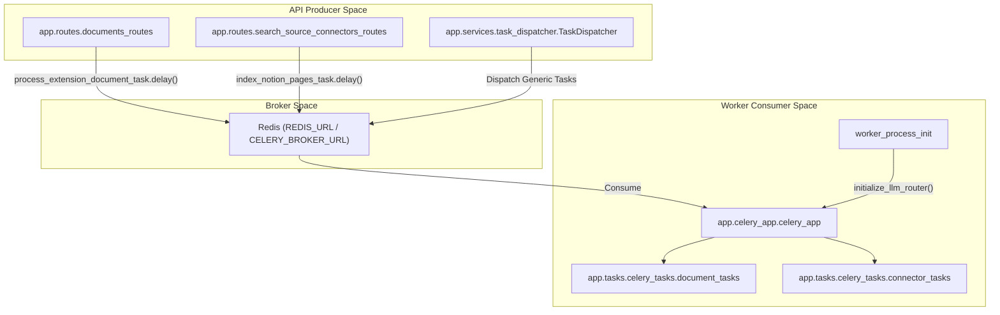
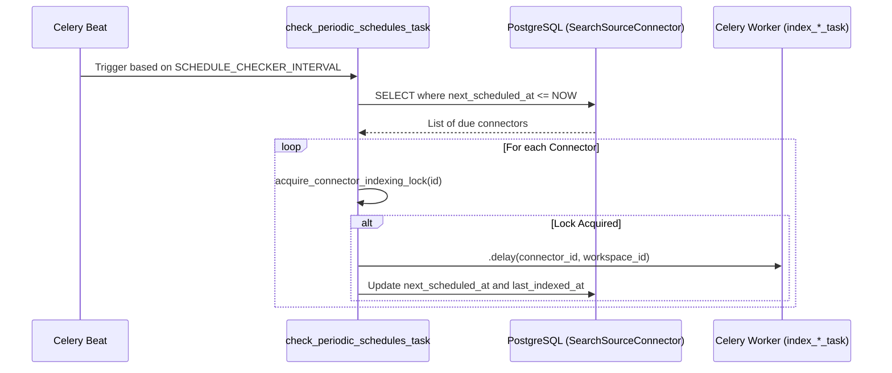

<!-- source: DeepWiki mcp.deepwiki.com · repo MODSetter/SurfSense · page 20.3 Background Task Processing · fetched 2026-10-29 -->

# Background Task Processing

<details>
<summary>Relevant source files</summary>

The following files were used as context for generating this wiki page:

- [surfsense_backend/.env.example](surfsense_backend/.env.example)
- [surfsense_backend/app/agents/chat/multi_agent_chat/main_agent/tools/automation/create.py](surfsense_backend/app/agents/chat/multi_agent_chat/main_agent/tools/automation/create.py)
- [surfsense_backend/app/agents/chat/multi_agent_chat/main_agent/tools/index.py](surfsense_backend/app/agents/chat/multi_agent_chat/main_agent/tools/index.py)
- [surfsense_backend/app/agents/chat/multi_agent_chat/main_agent/tools/registry.py](surfsense_backend/app/agents/chat/multi_agent_chat/main_agent/tools/registry.py)
- [surfsense_backend/app/agents/chat/multi_agent_chat/shared/tools/catalog.py](surfsense_backend/app/agents/chat/multi_agent_chat/shared/tools/catalog.py)
- [surfsense_backend/app/automations/actions/__init__.py](surfsense_backend/app/automations/actions/__init__.py)
- [surfsense_backend/app/automations/actions/builtin/__init__.py](surfsense_backend/app/automations/actions/builtin/__init__.py)
- [surfsense_backend/app/automations/actions/builtin/agent_task/dependencies.py](surfsense_backend/app/automations/actions/builtin/agent_task/dependencies.py)
- [surfsense_backend/app/automations/actions/builtin/agent_task/invoke.py](surfsense_backend/app/automations/actions/builtin/agent_task/invoke.py)
- [surfsense_backend/app/automations/actions/types.py](surfsense_backend/app/automations/actions/types.py)
- [surfsense_backend/app/automations/api/__init__.py](surfsense_backend/app/automations/api/__init__.py)
- [surfsense_backend/app/automations/api/automation.py](surfsense_backend/app/automations/api/automation.py)
- [surfsense_backend/app/automations/api/run.py](surfsense_backend/app/automations/api/run.py)
- [surfsense_backend/app/automations/runtime/executor.py](surfsense_backend/app/automations/runtime/executor.py)
- [surfsense_backend/app/automations/runtime/step.py](surfsense_backend/app/automations/runtime/step.py)
- [surfsense_backend/app/automations/schemas/api/__init__.py](surfsense_backend/app/automations/schemas/api/__init__.py)
- [surfsense_backend/app/automations/schemas/api/run.py](surfsense_backend/app/automations/schemas/api/run.py)
- [surfsense_backend/app/automations/services/__init__.py](surfsense_backend/app/automations/services/__init__.py)
- [surfsense_backend/app/automations/services/automation.py](surfsense_backend/app/automations/services/automation.py)
- [surfsense_backend/app/automations/services/model_policy.py](surfsense_backend/app/automations/services/model_policy.py)
- [surfsense_backend/app/automations/services/run.py](surfsense_backend/app/automations/services/run.py)
- [surfsense_backend/app/automations/services/trigger.py](surfsense_backend/app/automations/services/trigger.py)
- [surfsense_backend/app/automations/triggers/__init__.py](surfsense_backend/app/automations/triggers/__init__.py)
- [surfsense_backend/app/config/__init__.py](surfsense_backend/app/config/__init__.py)
- [surfsense_backend/app/connectors/composio_connector.py](surfsense_backend/app/connectors/composio_connector.py)
- [surfsense_backend/app/db.py](surfsense_backend/app/db.py)
- [surfsense_backend/app/routes/__init__.py](surfsense_backend/app/routes/__init__.py)
- [surfsense_backend/app/routes/composio_routes.py](surfsense_backend/app/routes/composio_routes.py)
- [surfsense_backend/app/routes/documents_routes.py](surfsense_backend/app/routes/documents_routes.py)
- [surfsense_backend/app/routes/search_source_connectors_routes.py](surfsense_backend/app/routes/search_source_connectors_routes.py)
- [surfsense_backend/app/schemas/documents.py](surfsense_backend/app/schemas/documents.py)
- [surfsense_backend/app/schemas/search_source_connector.py](surfsense_backend/app/schemas/search_source_connector.py)
- [surfsense_backend/app/services/composio_service.py](surfsense_backend/app/services/composio_service.py)
- [surfsense_backend/app/tasks/celery_tasks/__init__.py](surfsense_backend/app/tasks/celery_tasks/__init__.py)
- [surfsense_backend/app/tasks/celery_tasks/connector_tasks.py](surfsense_backend/app/tasks/celery_tasks/connector_tasks.py)
- [surfsense_backend/app/tasks/celery_tasks/document_tasks.py](surfsense_backend/app/tasks/celery_tasks/document_tasks.py)
- [surfsense_backend/app/tasks/celery_tasks/schedule_checker_task.py](surfsense_backend/app/tasks/celery_tasks/schedule_checker_task.py)
- [surfsense_backend/app/tasks/celery_tasks/stale_notification_cleanup_task.py](surfsense_backend/app/tasks/celery_tasks/stale_notification_cleanup_task.py)
- [surfsense_backend/app/tasks/chat/streaming/flows/shared/pre_stream_setup.py](surfsense_backend/app/tasks/chat/streaming/flows/shared/pre_stream_setup.py)
- [surfsense_backend/app/tasks/composio_indexer.py](surfsense_backend/app/tasks/composio_indexer.py)
- [surfsense_backend/app/tasks/connector_indexers/__init__.py](surfsense_backend/app/tasks/connector_indexers/__init__.py)
- [surfsense_backend/app/utils/periodic_scheduler.py](surfsense_backend/app/utils/periodic_scheduler.py)
- [surfsense_backend/tests/unit/automations/runtime/test_executor_action_ctx.py](surfsense_backend/tests/unit/automations/runtime/test_executor_action_ctx.py)
- [surfsense_backend/tests/unit/automations/services/test_model_policy.py](surfsense_backend/tests/unit/automations/services/test_model_policy.py)
- [surfsense_backend/tests/unit/tasks/test_celery_async_runner.py](surfsense_backend/tests/unit/tasks/test_celery_async_runner.py)
- [surfsense_web/content/docs/manual-installation.mdx](surfsense_web/content/docs/manual-installation.mdx)

</details>


This page documents the Celery-based background task processing system that handles asynchronous operations such as document processing, connector indexing, and automated workflows. The system uses Redis as a message broker and supports both immediate task execution and scheduled periodic tasks.

## System Architecture

SurfSense uses **Celery** as its distributed task queue system. The architecture consists of the FastAPI application acting as a producer, Redis as the transport broker, and dedicated worker processes as consumers.

### Task Flow and Infrastructure
The following diagram bridges the Natural Language concepts to the specific code entities involved in the task lifecycle.

Title: Task Lifecycle and Code Entities

**Sources:** [surfsense_backend/app/celery_app.py:176-200](), [surfsense_backend/app/routes/documents_routes.py:101-103](), [surfsense_backend/app/celery_app.py:102-124](), [surfsense_backend/.env.example:22-26]()

### Component Responsibilities

| Component | Purpose | Code Reference |
|-----------|---------|---------------|
| **Celery App** | Main application instance and configuration | [surfsense_backend/app/celery_app.py:176-200]() |
| **Worker Init** | Pre-warms LLM routers and OTel instrumentation in child processes | [surfsense_backend/app/celery_app.py:102-124]() |
| **Queue Latency** | Middleware to measure wait time in Redis | [surfsense_backend/app/celery_app.py:36-75]() |
| **Heartbeat** | Redis-based liveness tracking for long-running indexing | [surfsense_backend/app/tasks/celery_tasks/document_tasks.py:64-93]() |

**Sources:** [surfsense_backend/app/celery_app.py:1-200](), [surfsense_backend/app/tasks/celery_tasks/document_tasks.py:27-61]()

---

## Task Categories and Implementation

### Document Processing Tasks
These tasks handle the ingestion of content from the browser extension, file uploads, and deletions.

*   **`process_extension_document_task`**: Processes raw HTML and metadata captured by the browser extension. [surfsense_backend/app/routes/documents_routes.py:84-103]()
*   **`delete_document_task`**: Performs batched deletion of `Chunk` entities and purges physical blobs from storage. [surfsense_backend/app/tasks/celery_tasks/document_tasks.py:140-181]()
*   **`delete_folder_documents_task`**: Handles recursive deletion of documents within a folder structure. [surfsense_backend/app/tasks/celery_tasks/document_tasks.py:183-204]()

### Connector Indexing Tasks
Indexing tasks are often long-running and require specialized error handling for SQLAlchemy async contexts (Greenlets).

*   **greenlet_spawn protection**: The `_handle_greenlet_error` helper identifies issues where SQLAlchemy tries to lazy-load relationships outside of an active async session during background sync. [surfsense_backend/app/tasks/celery_tasks/connector_tasks.py:88-116]()
*   **Heartbeat Mechanism**: While a connector indexes, a background loop refreshes a Redis key (`indexing:heartbeat:{notification_id}`). If the worker crashes, the heartbeat expires, allowing the `stale_notification_cleanup_task` to mark the job as failed. [surfsense_backend/app/routes/search_source_connectors_routes.py:98-123]()
*   **Indexing Lock**: To prevent concurrent indexing of the same connector, tasks use a distributed lock in Redis. [surfsense_backend/app/routes/search_source_connectors_routes.py:71-74]()

**Sources:** [surfsense_backend/app/tasks/celery_tasks/connector_tasks.py:1-215](), [surfsense_backend/app/tasks/celery_tasks/document_tasks.py:64-93](), [surfsense_backend/app/db.py:127-148]()

---

## Scheduling and Periodic Tasks

SurfSense uses a "Meta-Scheduler" pattern via `schedule_checker_task`. Instead of hardcoding every connector into a static Celery Beat schedule, a single task checks the database for due jobs.

Title: Periodic Indexing Logic

**Sources:** [surfsense_backend/app/tasks/celery_tasks/schedule_checker_task.py:17-45](), [surfsense_backend/app/utils/periodic_scheduler.py:1-50](), [surfsense_backend/app/schemas/search_source_connector.py:35-56]()

### Configuration
*   **Intervals**: Configured via `SCHEDULE_CHECKER_INTERVAL` (default "5m") in `.env`. [surfsense_backend/.env.example:58-73]()
*   **Queue Routing**: Standard tasks go to the default queue (`surfsense`), while long-running connector tasks are routed to `surfsense.connectors`. [surfsense_backend/.env.example:29](), [surfsense_backend/app/celery_app.py:205-205]()
*   **Stale Cleanup**: `stale_notification_cleanup_task` runs periodically to recover tasks that lost their heartbeat. [surfsense_backend/app/tasks/celery_tasks/stale_notification_cleanup_task.py:10-30]()

---

## Adding New Background Tasks

To extend the system with new background processing:

1.  **Define the task** in a module listed in the `include` section of `celery_app.py`. [surfsense_backend/app/celery_app.py:180-200]()
2.  **Use the async wrapper**: Wrap the core logic in `run_async_celery_task` to handle event loop management and recording metrics. [surfsense_backend/app/tasks/celery_tasks/connector_tasks.py:25-51]()
3.  **Session Management**: Always use `get_celery_session_maker()()` to create a fresh database session inside the task. [surfsense_backend/app/tasks/celery_tasks/connector_tasks.py:153-157]()
4.  **Instrumentation**: Add OTel spans using `ot.connector_sync_span` and capture outcomes via PostHog analytics. [surfsense_backend/app/tasks/celery_tasks/connector_tasks.py:42-85]()

### Example Task Structure
```python
@celery_app.task(name="index_custom_source", bind=True)
def index_custom_source_task(self, connector_id: int, workspace_id: int, user_id: str):
    return run_async_celery_task(
        lambda: _index_custom_logic(connector_id, workspace_id, user_id),
        workspace_id=workspace_id,
        user_id=user_id,
    )

async def _index_custom_logic(connector_id: int, workspace_id: int, user_id: str):
    async with get_celery_session_maker()() as session:
        # DB and indexing logic here
        ...
```
**Sources:** [surfsense_backend/app/tasks/celery_tasks/connector_tasks.py:118-138](), [surfsense_backend/app/celery_app.py:102-111]()

---

