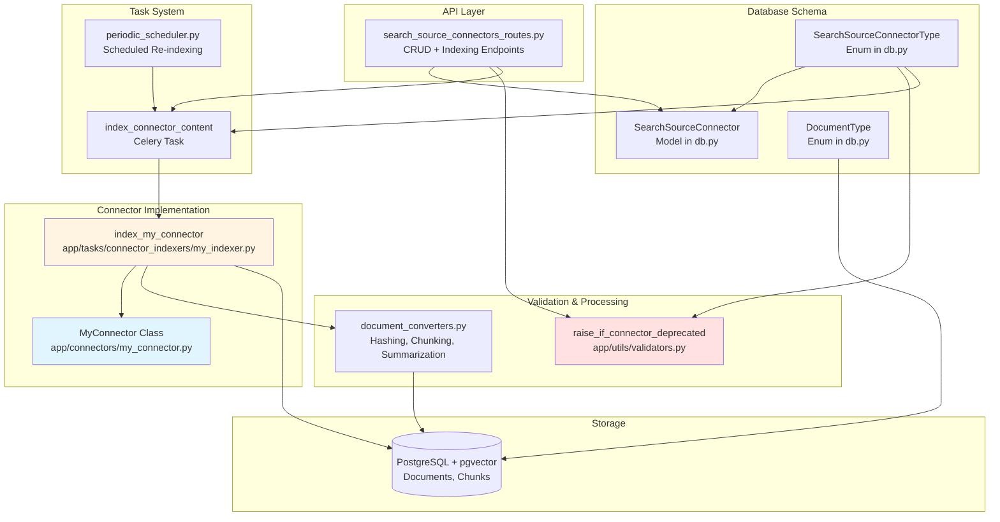
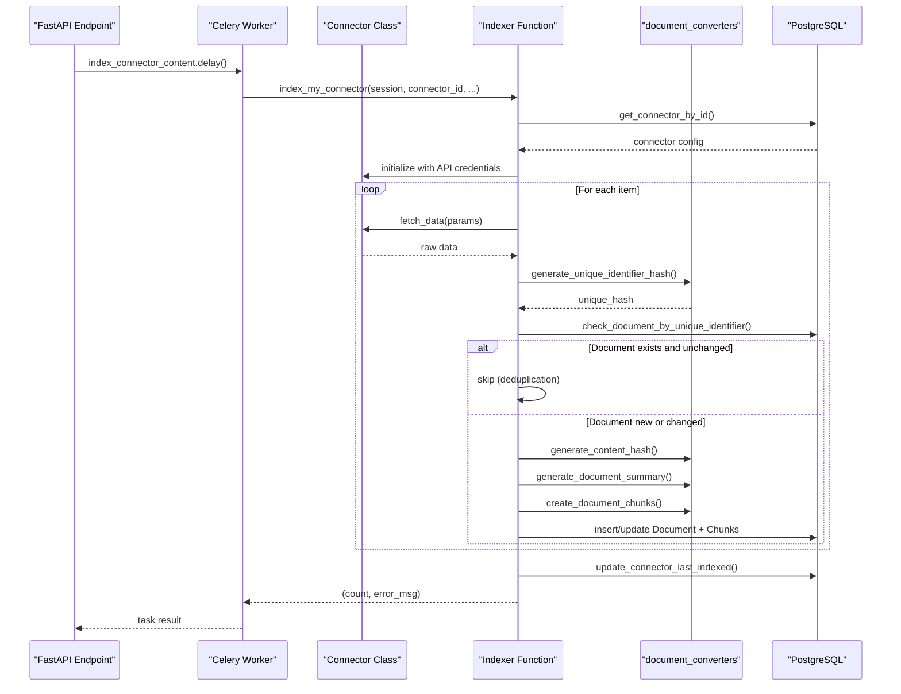
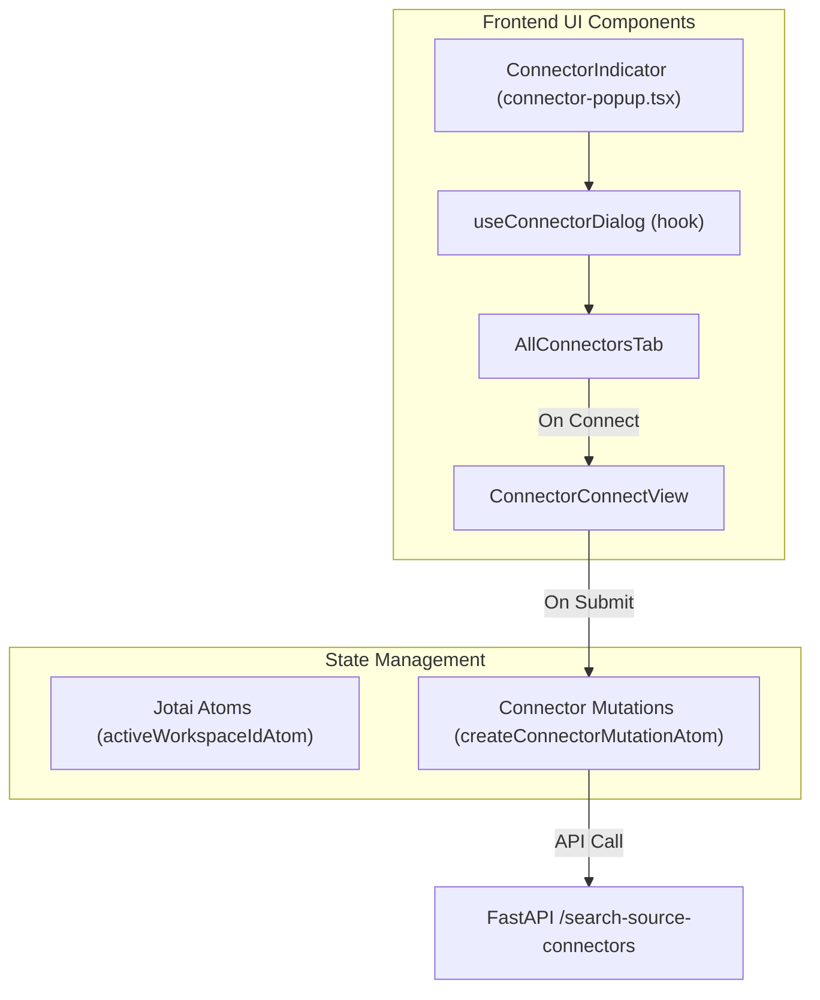
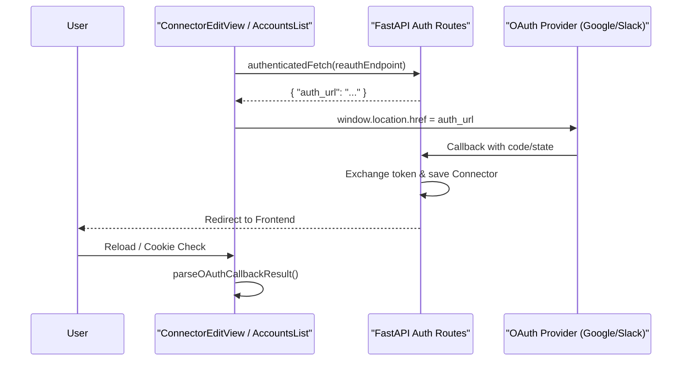

<!-- source: DeepWiki mcp.deepwiki.com · repo MODSetter/SurfSense · page 20.4 Adding New Connectors · fetched 2026-10-29 -->

# Adding New Connectors

<details>
<summary>Relevant source files</summary>

The following files were used as context for generating this wiki page:

- [surfsense_backend/app/routes/airtable_add_connector_route.py](surfsense_backend/app/routes/airtable_add_connector_route.py)
- [surfsense_backend/app/routes/confluence_add_connector_route.py](surfsense_backend/app/routes/confluence_add_connector_route.py)
- [surfsense_backend/app/routes/discord_add_connector_route.py](surfsense_backend/app/routes/discord_add_connector_route.py)
- [surfsense_backend/app/routes/google_calendar_add_connector_route.py](surfsense_backend/app/routes/google_calendar_add_connector_route.py)
- [surfsense_backend/app/routes/google_drive_add_connector_route.py](surfsense_backend/app/routes/google_drive_add_connector_route.py)
- [surfsense_backend/app/routes/google_gmail_add_connector_route.py](surfsense_backend/app/routes/google_gmail_add_connector_route.py)
- [surfsense_backend/app/routes/jira_add_connector_route.py](surfsense_backend/app/routes/jira_add_connector_route.py)
- [surfsense_backend/app/routes/linear_add_connector_route.py](surfsense_backend/app/routes/linear_add_connector_route.py)
- [surfsense_backend/app/routes/notion_add_connector_route.py](surfsense_backend/app/routes/notion_add_connector_route.py)
- [surfsense_backend/app/routes/slack_add_connector_route.py](surfsense_backend/app/routes/slack_add_connector_route.py)
- [surfsense_backend/app/utils/validators.py](surfsense_backend/app/utils/validators.py)
- [surfsense_web/components/assistant-ui/connector-popup/components/connector-card.tsx](surfsense_web/components/assistant-ui/connector-popup/components/connector-card.tsx)
- [surfsense_web/components/assistant-ui/connector-popup/components/connector-dialog-header.tsx](surfsense_web/components/assistant-ui/connector-popup/components/connector-dialog-header.tsx)
- [surfsense_web/components/assistant-ui/connector-popup/connect-forms/connector-benefits.ts](surfsense_web/components/assistant-ui/connector-popup/connect-forms/connector-benefits.ts)
- [surfsense_web/components/assistant-ui/connector-popup/connect-forms/index.tsx](surfsense_web/components/assistant-ui/connector-popup/connect-forms/index.tsx)
- [surfsense_web/components/assistant-ui/connector-popup/connector-configs/index.tsx](surfsense_web/components/assistant-ui/connector-popup/connector-configs/index.tsx)
- [surfsense_web/components/assistant-ui/connector-popup/connector-configs/views/connector-connect-view.tsx](surfsense_web/components/assistant-ui/connector-popup/connector-configs/views/connector-connect-view.tsx)
- [surfsense_web/components/assistant-ui/connector-popup/connector-configs/views/connector-edit-view.tsx](surfsense_web/components/assistant-ui/connector-popup/connector-configs/views/connector-edit-view.tsx)
- [surfsense_web/components/assistant-ui/connector-popup/connector-configs/views/indexing-configuration-view.tsx](surfsense_web/components/assistant-ui/connector-popup/connector-configs/views/indexing-configuration-view.tsx)
- [surfsense_web/components/assistant-ui/connector-popup/constants/connector-constants.ts](surfsense_web/components/assistant-ui/connector-popup/constants/connector-constants.ts)
- [surfsense_web/components/assistant-ui/connector-popup/hooks/use-connector-dialog.ts](surfsense_web/components/assistant-ui/connector-popup/hooks/use-connector-dialog.ts)
- [surfsense_web/components/assistant-ui/connector-popup/tabs/active-connectors-tab.tsx](surfsense_web/components/assistant-ui/connector-popup/tabs/active-connectors-tab.tsx)
- [surfsense_web/components/assistant-ui/connector-popup/tabs/all-connectors-tab.tsx](surfsense_web/components/assistant-ui/connector-popup/tabs/all-connectors-tab.tsx)
- [surfsense_web/components/assistant-ui/connector-popup/views/connector-accounts-list-view.tsx](surfsense_web/components/assistant-ui/connector-popup/views/connector-accounts-list-view.tsx)
- [surfsense_web/components/assistant-ui/connector-popup/views/youtube-crawler-view.tsx](surfsense_web/components/assistant-ui/connector-popup/views/youtube-crawler-view.tsx)

</details>


This document provides a comprehensive guide for developers implementing new connector types in SurfSense. It covers the complete workflow from defining a new connector type to implementing indexing logic, with emphasis on code structure, deduplication strategies, and integration patterns.

For information about managing existing connectors through the UI, see [Connector Management UI](#7.3). For details on periodic indexing and scheduling, see [Periodic Indexing](#7.5).

---

## Overview

Connectors in SurfSense enable integration with external data sources (Slack, Notion, GitHub, Discord, etc.) and services (web crawlers, search APIs). This system provides a unified interface for retrieving, indexing, and searching content from diverse platforms.

Adding a new connector involves:
1. Defining the connector type in the database schema
2. Creating a connector client class for API interactions
3. Implementing an indexer function for document processing
4. Adding configuration validation
5. Registering the indexer with the task system

---

## Connector Architecture

### System Components



**Sources:** [surfsense_backend/app/db.py:57-78](), [surfsense_backend/app/db.py:478-511](), [surfsense_backend/app/utils/validators.py:24-40]()

---

### Data Flow During Indexing



**Sources:** [surfsense_backend/app/routes/google_drive_add_connector_route.py:113-166](), [surfsense_web/components/assistant-ui/connector-popup/hooks/use-connector-dialog.ts:144-185]()

---

## Step-by-Step Implementation Guide

### Step 1: Define Connector Type in Database Schema

Add your connector type to both the `SearchSourceConnectorType` and `DocumentType` enums in `app/db.py`.

**Add to SearchSourceConnectorType enum** (for searchable connectors):

```python
class SearchSourceConnectorType(str, Enum):
    # ... existing types ...
    MY_CONNECTOR = "MY_CONNECTOR"  # Add this line
```

**Add to DocumentType enum** (for indexable connectors):

```python
class DocumentType(str, Enum):
    # ... existing types ...
    MY_CONNECTOR = "MY_CONNECTOR"  # Add this line
```

**Decision criteria:**
- **Indexable connectors** (e.g., Google Drive, OneDrive): Create documents stored in the database. Add to both enums.
- **Live/Real-time connectors** (e.g., Slack, Notion): Operate in real-time via agent tools or MCP. Add to `LIVE_CONNECTOR_TYPES` in frontend.

**Sources:** [surfsense_backend/app/db.py:57-78](), [surfsense_web/components/assistant-ui/connector-popup/constants/connector-constants.ts:40-56]()

---

### Step 2: Implement Configuration Validation

Add validation logic for your connector's configuration in `app/utils/validators.py`. Note that several connectors are now deprecated in favor of the Google-only web-search consolidation or MCP migration.

**Refuse deprecated connectors:**
If a connector is retired (e.g., `DISCORD_CONNECTOR`, `TEAMS_CONNECTOR`), add it to `DEPRECATED_CONNECTOR_TYPES` to return HTTP 410.

**Sources:** [surfsense_backend/app/utils/validators.py:24-40](), [surfsense_backend/app/utils/validators.py:43-65]()

---

## Frontend Integration Pattern

SurfSense uses a unified connector popup UI for managing all connectors.

### Step 3.1: Register Connector in Constants

Add your connector to the appropriate category in `connector-constants.ts`.

```typescript
// For OAuth connectors
export const OAUTH_CONNECTORS = [
  // ... existing connectors ...
  {
    id: "my-connector",
    title: "MyService",
    description: "Search MyService data",
    connectorType: EnumConnectorName.MY_CONNECTOR,
    authEndpoint: "/api/v1/auth/myservice/connector/add/",
  },
] as const;

// Mark as live if it doesn't use background indexing (e.g. Slack, Notion via MCP)
export const LIVE_CONNECTOR_TYPES = new Set<string>([
    EnumConnectorName.SLACK_CONNECTOR,
    EnumConnectorName.NOTION_CONNECTOR,
]);
```

**Sources:** [surfsense_web/components/assistant-ui/connector-popup/constants/connector-constants.ts:40-56](), [surfsense_web/components/assistant-ui/connector-popup/constants/connector-constants.ts:59-161]()

### Step 3.2: Create Connect Form and Config View

For connectors using direct configuration (API keys, URLs), register them in the form and config maps:
- **Connect Form**: Define how users enter initial credentials in `surfsense_web/components/assistant-ui/connector-popup/connect-forms/index.tsx`.
- **Edit View**: Define the post-connection management UI in `surfsense_web/components/assistant-ui/connector-popup/connector-configs/index.tsx`.

**Sources:** [surfsense_web/components/assistant-ui/connector-popup/connector-configs/index.tsx:16-60](), [surfsense_web/components/assistant-ui/connector-popup/connector-configs/views/connector-connect-view.tsx:12-23]()

### Step 3.3: UI Data Flow



**Sources:** [surfsense_web/components/assistant-ui/connector-popup/hooks/use-connector-dialog.ts:61-108](), [surfsense_web/components/assistant-ui/connector-popup/tabs/all-connectors-tab.tsx:153-195](), [surfsense_web/components/assistant-ui/connector-popup/connector-configs/views/connector-connect-view.tsx:45-50]()

---

## OAuth Integration Flow

For connectors requiring OAuth (Google, Slack, Notion, etc.), SurfSense uses a specialized flow:

1.  **Initiation**: Frontend calls the `authEndpoint` defined in `OAUTH_CONNECTORS`.
2.  **Redirect**: Backend returns an `auth_url`, and the user is redirected to the provider.
3.  **Callback**: After authorization, the provider redirects back to the backend.
4.  **Completion**: The backend sets an `OAUTH_RESULT_COOKIE` which the frontend reads to finalize the connection.



**Sources:** [surfsense_web/components/assistant-ui/connector-popup/connector-configs/views/connector-edit-view.tsx:94-123](), [surfsense_web/components/assistant-ui/connector-popup/hooks/use-connector-dialog.ts:49-59](), [surfsense_web/components/assistant-ui/connector-popup/views/connector-accounts-list-view.tsx:58-90](), [surfsense_backend/app/routes/google_drive_add_connector_route.py:113-166]()

---

## Implementation Checklist

- [ ] **Database**: Add enum to `SearchSourceConnectorType` in `app/db.py`. [surfsense_backend/app/db.py:57-78]()
- [ ] **Backend Auth**: Implement OAuth initiation and callback routes (e.g., following the pattern in `google_drive_add_connector_route.py`). [surfsense_backend/app/routes/google_drive_add_connector_route.py:113-166]()
- [ ] **Frontend Constants**: Add to `OAUTH_CONNECTORS` or `OTHER_CONNECTORS` in `connector-constants.ts`. [surfsense_web/components/assistant-ui/connector-popup/constants/connector-constants.ts:59-161]()
- [ ] **Frontend UI**:
    - Register icon in `getConnectorIcon`. [surfsense_web/components/assistant-ui/connector-popup/components/connector-card.tsx:96-103]()
    - Implement Connect Form and register in `FORM_ID_MAP`. [surfsense_web/components/assistant-ui/connector-popup/connector-configs/views/connector-connect-view.tsx:12-23]()
    - If it supports Vision LLM, add to `VISION_LLM_CONNECTOR_TYPES` in `connector-edit-view.tsx`. [surfsense_web/components/assistant-ui/connector-popup/connector-configs/views/connector-edit-view.tsx:27-33]()
- [ ] **Indexing**: If indexable, handle background indexing logic and trigger via `indexConnectorMutationAtom`. [surfsense_web/components/assistant-ui/connector-popup/hooks/use-connector-dialog.ts:144-185]()

---

