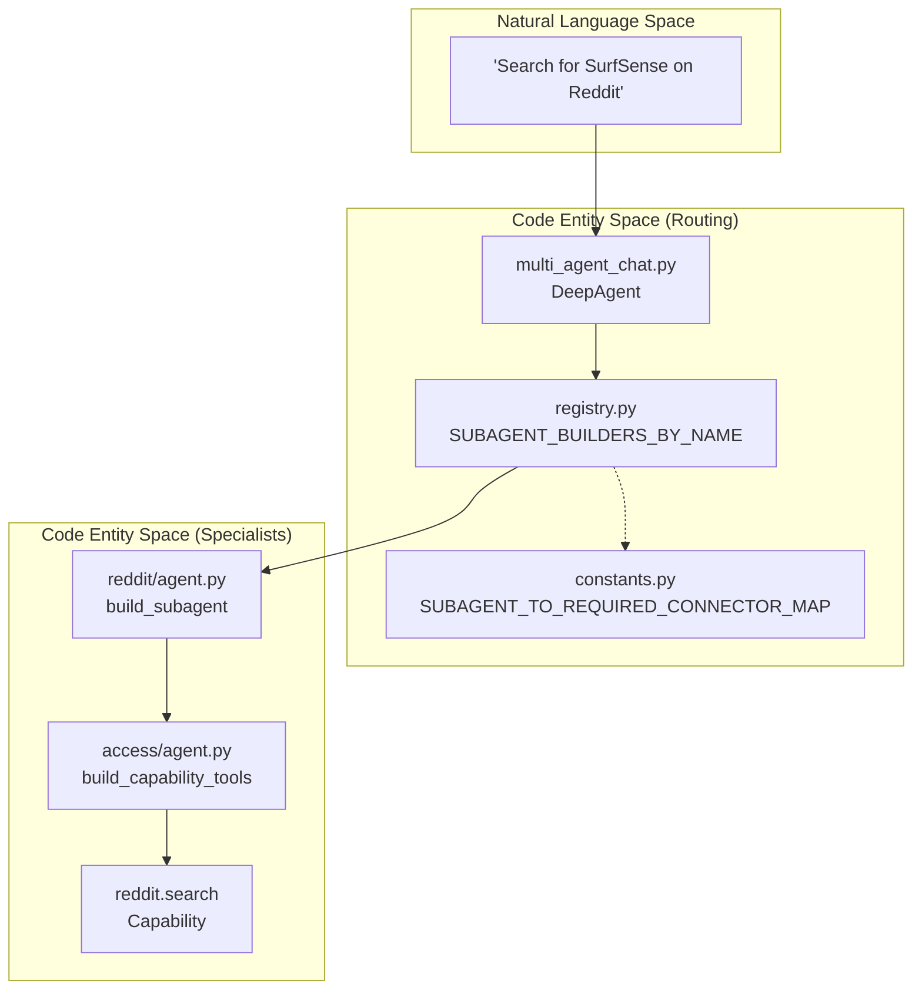
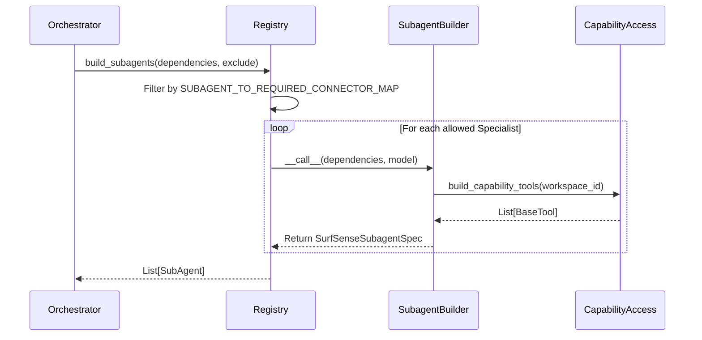

<!-- source: DeepWiki mcp.deepwiki.com · repo MODSetter/SurfSense · page 20.5 Adding New Agent Tools · fetched 2026-10-29 -->

# Adding New Agent Tools

Relevant source files

The following files were used as context for generating this wiki page:

- [surfsense_backend/alembic/versions/171_add_runs_and_tool_output_spills.py](surfsense_backend/alembic/versions/171_add_runs_and_tool_output_spills.py)
- [surfsense_backend/app/agents/chat/multi_agent_chat/constants.py](surfsense_backend/app/agents/chat/multi_agent_chat/constants.py)
- [surfsense_backend/app/agents/chat/multi_agent_chat/main_agent/middleware/context_editing/builder.py](surfsense_backend/app/agents/chat/multi_agent_chat/main_agent/middleware/context_editing/builder.py)
- [surfsense_backend/app/agents/chat/multi_agent_chat/main_agent/middleware/context_editing/middleware.py](surfsense_backend/app/agents/chat/multi_agent_chat/main_agent/middleware/context_editing/middleware.py)
- [surfsense_backend/app/agents/chat/multi_agent_chat/subagents/registry.py](surfsense_backend/app/agents/chat/multi_agent_chat/subagents/registry.py)
- [surfsense_backend/app/agents/chat/multi_agent_chat/subagents/shared/run_reader.py](surfsense_backend/app/agents/chat/multi_agent_chat/subagents/shared/run_reader.py)
- [surfsense_backend/app/capabilities/core/access/agent.py](surfsense_backend/app/capabilities/core/access/agent.py)
- [surfsense_backend/app/capabilities/core/access/rest.py](surfsense_backend/app/capabilities/core/access/rest.py)
- [surfsense_backend/app/capabilities/core/runs.py](surfsense_backend/app/capabilities/core/runs.py)
- [surfsense_backend/app/capabilities/web/__init__.py](surfsense_backend/app/capabilities/web/__init__.py)
- [surfsense_backend/app/capabilities/web/crawl/__init__.py](surfsense_backend/app/capabilities/web/crawl/__init__.py)
- [surfsense_backend/tests/integration/agents/multi_agent_chat/test_agent_turn.py](surfsense_backend/tests/integration/agents/multi_agent_chat/test_agent_turn.py)
- [surfsense_backend/tests/unit/agents/multi_agent_chat/test_prompt_resources.py](surfsense_backend/tests/unit/agents/multi_agent_chat/test_prompt_resources.py)
- [surfsense_backend/tests/unit/agents/multi_agent_chat/test_subagent_composition.py](surfsense_backend/tests/unit/agents/multi_agent_chat/test_subagent_composition.py)
- [surfsense_backend/tests/unit/agents/new_chat/test_context_editing.py](surfsense_backend/tests/unit/agents/new_chat/test_context_editing.py)
- [surfsense_backend/tests/unit/agents/test_import_all.py](surfsense_backend/tests/unit/agents/test_import_all.py)
- [surfsense_backend/tests/unit/capabilities/access/test_agent_tools.py](surfsense_backend/tests/unit/capabilities/access/test_agent_tools.py)
- [surfsense_backend/tests/unit/capabilities/access/test_rate_limit.py](surfsense_backend/tests/unit/capabilities/access/test_rate_limit.py)
- [surfsense_backend/tests/unit/capabilities/access/test_rest_router.py](surfsense_backend/tests/unit/capabilities/access/test_rest_router.py)
- [surfsense_backend/tests/unit/capabilities/test_billing.py](surfsense_backend/tests/unit/capabilities/test_billing.py)
- [surfsense_backend/tests/unit/capabilities/test_registry.py](surfsense_backend/tests/unit/capabilities/test_registry.py)
- [surfsense_backend/tests/unit/capabilities/test_run_truncation.py](surfsense_backend/tests/unit/capabilities/test_run_truncation.py)

This page provides a guide for creating and registering new tools in the SurfSense agent's tool registry. It details the sub-agent architecture, the dependency injection system, and the workflow for implementing new capabilities using the Capability Framework.

---

## Overview

SurfSense uses a **specialized sub-agent architecture** built on LangGraph. Instead of a single flat list of tools, the system organizes capabilities into "specialist" sub-agents (e.g., `google_search`, `instagram`, `knowledge_base`). Each sub-agent is a self-contained unit with its own system prompt, toolset, and output contract. [surfsense_backend/app/agents/chat/multi_agent_chat/subagents/registry.py:1-109]()

The tool system features:
- **Registry-based Discovery**: Centralized registration of sub-agent builders. [surfsense_backend/app/agents/chat/multi_agent_chat/subagents/registry.py:91-109]()
- **Capability Framework**: Tools are defined as "Capabilities" that automatically generate both REST API endpoints and LangChain tools. [surfsense_backend/app/capabilities/core/access/agent.py:1-10]()
- **Dependency Injection**: Automatic provision of database sessions and workspace context. [surfsense_backend/app/capabilities/core/access/agent.py:71-81]()
- **Connector Gating**: Tools are dynamically enabled or disabled based on the workspace's active data connectors. [surfsense_backend/app/agents/chat/multi_agent_chat/constants.py:31-61]()
- **Automated Billing**: Integrated credit gating and charging for billable tool executions. [surfsense_backend/app/capabilities/core/billing.py:14-16]()

---

## Agent Tool Architecture

The system bridges natural language requests to code entities through a hierarchical routing mechanism.

### Natural Language to Code Mapping

**Sources:** [surfsense_backend/app/agents/chat/multi_agent_chat/subagents/registry.py:91-109](), [surfsense_backend/app/agents/chat/multi_agent_chat/constants.py:31-61](), [surfsense_backend/app/capabilities/core/access/agent.py:35-50]()

---

## The Sub-Agent Registry

All specialists must be registered in the `SUBAGENT_BUILDERS_BY_NAME` dictionary. This registry maps a unique string identifier to a `SubagentBuilder` callable. [surfsense_backend/app/agents/chat/multi_agent_chat/subagents/registry.py:91-109]()

### Specialist Lifecycle

**Sources:** [surfsense_backend/app/agents/chat/multi_agent_chat/subagents/registry.py:179-200](), [surfsense_backend/app/capabilities/core/access/agent.py:35-50]()

### Registry Configuration
The registry is defined in `surfsense_backend/app/agents/chat/multi_agent_chat/subagents/registry.py`. Every specialist follows a strict directory structure:
- `agent.py`: Contains the `build_subagent` entry point.
- `description.md`: A natural language description used by the supervisor to route tasks. [surfsense_backend/app/agents/chat/multi_agent_chat/subagents/registry.py:121-130]()
- `system_prompt.md`: The internal logic and "playbook" for the specialist.
- `tools/`: Definitions of the specific tools (often generated via Capabilities).

**Sources:** [surfsense_backend/app/agents/chat/multi_agent_chat/subagents/registry.py:112-130](), [surfsense_backend/tests/unit/agents/multi_agent_chat/test_prompt_resources.py:32-38]()

---

## Dependency Injection and Capability Execution

When a sub-agent tool is executed, the `_capability_tool` adapter handles the lifecycle of the call. [surfsense_backend/app/capabilities/core/access/agent.py:65-109]()

### Execution Flow
1.  **Gate**: Checks if the workspace has sufficient credits for the billable unit. [surfsense_backend/app/capabilities/core/access/agent.py:83-85]()
2.  **Execute**: Runs the underlying `executor` function defined in the `Capability`. [surfsense_backend/app/capabilities/core/access/agent.py:89]()
3.  **Charge**: Debits the workspace owner's balance upon successful execution. [surfsense_backend/app/capabilities/core/access/agent.py:108]()
4.  **Record**: Persists the run details (input, output, duration) to the `runs` table. [surfsense_backend/app/capabilities/core/access/agent.py:112-124]()

**Sources:** [surfsense_backend/app/capabilities/core/access/agent.py:71-124](), [surfsense_backend/app/capabilities/core/billing.py:14-16]()

---

## Adding a New Specialist Tool

### 1. Define the Capability
Create a definition for the tool in the relevant capability directory (e.g., `surfsense_backend/app/capabilities/web/`). Define the `input_schema`, `output_schema`, and `executor`. [surfsense_backend/tests/unit/capabilities/test_registry.py:17-24]()

### 2. Register the Capability
Ensure the capability is imported in its namespace `__init__.py` to register it with the global store. [surfsense_backend/app/capabilities/web/__init__.py:1-6]()

### 3. Implement the Builder
In the specialist's `agent.py`, use `build_capability_tools` to generate the LangChain tools from your capabilities. [surfsense_backend/app/capabilities/core/access/agent.py:35-50]()

### 4. Register the Specialist
Add the specialist to the `SUBAGENT_BUILDERS_BY_NAME` registry and define its connector requirements in `constants.py`. [surfsense_backend/app/agents/chat/multi_agent_chat/subagents/registry.py:91-109](), [surfsense_backend/app/agents/chat/multi_agent_chat/constants.py:31-61]()

---

## Tool Output Handling and Citations

The agent framework handles large tool outputs by storing them and returning a "preview" to the LLM. [surfsense_backend/app/capabilities/core/access/agent.py:127-138]()

- **Inline Output**: If the serialized output is under `RUN_OUTPUT_CHAR_CAP`, it is returned directly. [surfsense_backend/app/capabilities/core/access/agent.py:128-129]()
- **Citations**: Tools automatically attach a citation to the response, allowing the LLM to reference the specific tool run. [surfsense_backend/app/capabilities/core/access/agent.py:145-158]()
- **Run Readers**: Every capability-using sub-agent is automatically equipped with `read_run` and `search_run` tools to paged through truncated results. [surfsense_backend/app/capabilities/core/access/agent.py:45-50]()

**Sources:** [surfsense_backend/app/capabilities/core/access/agent.py:1-10](), [surfsense_backend/app/capabilities/core/access/agent.py:127-158]()

---

## Testing and Guardrails

SurfSense includes strict unit tests to prevent silent degradation of the agent's capabilities. [surfsense_backend/tests/unit/agents/multi_agent_chat/test_subagent_composition.py:1-7]()

- **Registry Integrity**: `test_registry_contains_exactly_expected_subagents` ensures the roster of specialists matches the expected set. [surfsense_backend/tests/unit/agents/multi_agent_chat/test_subagent_composition.py:55-58]()
- **Resource Resolution**: `test_every_subagent_has_description_md` verifies that the natural language descriptions used for routing are present and non-empty. [surfsense_backend/tests/unit/agents/multi_agent_chat/test_prompt_resources.py:32-38]()
- **Billing Logic**: Tests in `test_billing.py` ensure that credits are only deducted for successful, billable actions. [surfsense_backend/tests/unit/capabilities/test_billing.py:76-93]()

**Sources:** [surfsense_backend/tests/unit/agents/multi_agent_chat/test_subagent_composition.py:28-48](), [surfsense_backend/tests/unit/agents/multi_agent_chat/test_prompt_resources.py:1-11]()

---

