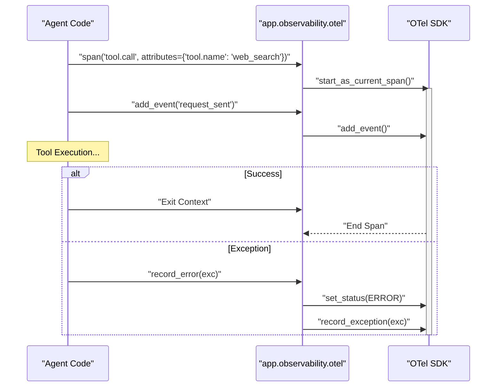

<!-- source: DeepWiki mcp.deepwiki.com · repo MODSetter/SurfSense · page 20.6 Observability and Monitoring · fetched 2026-10-29 -->

# Observability and Monitoring

<details>
<summary>Relevant source files</summary>

The following files were used as context for generating this wiki page:

- [.github/workflows/e2e-tests.yml](.github/workflows/e2e-tests.yml)
- [docker/docker-compose.e2e.yml](docker/docker-compose.e2e.yml)
- [docker/otel-collector/config.yaml](docker/otel-collector/config.yaml)
- [surfsense_backend/app/observability/__init__.py](surfsense_backend/app/observability/__init__.py)
- [surfsense_backend/app/observability/bootstrap.py](surfsense_backend/app/observability/bootstrap.py)
- [surfsense_backend/app/observability/metrics.py](surfsense_backend/app/observability/metrics.py)
- [surfsense_backend/app/observability/otel.py](surfsense_backend/app/observability/otel.py)
- [surfsense_backend/app/utils/perf.py](surfsense_backend/app/utils/perf.py)
- [surfsense_backend/scripts/docker/entrypoint.e2e.sh](surfsense_backend/scripts/docker/entrypoint.e2e.sh)
- [surfsense_backend/tests/e2e/auth_mint.py](surfsense_backend/tests/e2e/auth_mint.py)
- [surfsense_backend/tests/e2e/fakes/chat_llm.py](surfsense_backend/tests/e2e/fakes/chat_llm.py)
- [surfsense_backend/tests/e2e/fakes/clickup_module.py](surfsense_backend/tests/e2e/fakes/clickup_module.py)
- [surfsense_backend/tests/e2e/fakes/docling_service.py](surfsense_backend/tests/e2e/fakes/docling_service.py)
- [surfsense_backend/tests/e2e/fakes/fixtures/clickup_tasks.json](surfsense_backend/tests/e2e/fakes/fixtures/clickup_tasks.json)
- [surfsense_backend/tests/e2e/fakes/fixtures/gmail_messages.json](surfsense_backend/tests/e2e/fakes/fixtures/gmail_messages.json)
- [surfsense_backend/tests/e2e/fixtures/global_llm_config.yaml](surfsense_backend/tests/e2e/fixtures/global_llm_config.yaml)
- [surfsense_backend/tests/e2e/run_backend.py](surfsense_backend/tests/e2e/run_backend.py)
- [surfsense_backend/tests/e2e/run_celery.py](surfsense_backend/tests/e2e/run_celery.py)
- [surfsense_backend/tests/unit/observability/test_helpers.py](surfsense_backend/tests/unit/observability/test_helpers.py)
- [surfsense_backend/tests/unit/observability/test_otel.py](surfsense_backend/tests/unit/observability/test_otel.py)
- [surfsense_web/playwright.config.ts](surfsense_web/playwright.config.ts)
- [surfsense_web/tests/auth.setup.ts](surfsense_web/tests/auth.setup.ts)
- [surfsense_web/tests/documents/file-upload/journey.spec.ts](surfsense_web/tests/documents/file-upload/journey.spec.ts)
- [surfsense_web/tests/helpers/api/auth.ts](surfsense_web/tests/helpers/api/auth.ts)

</details>


SurfSense implements a comprehensive observability stack based on **OpenTelemetry (OTel)** to provide deep visibility into the backend's performance, AI agent reasoning steps, and background task execution. The system collects traces, metrics, and logs, exporting them to OTLP-compatible backends (e.g., Grafana, Jaeger, or Honeycomb).

## OpenTelemetry Architecture

The observability system is centralized in the `surfsense_backend/app/observability` module. It follows a "lazy initialization" pattern to ensure that the application remains functional even if OTel is disabled or the collector is unreachable [surfsense_backend/app/observability/otel.py:7-19]().

### Data Flow and Instrumentation

The system automatically instruments several third-party libraries using standard OpenTelemetry instrumentors:
*   **FastAPI**: Captures HTTP request/response cycles, excluding health and metrics endpoints [surfsense_backend/app/observability/bootstrap.py:146-161]().
*   **SQLAlchemy & Psycopg**: Monitors database query performance and connection pooling [surfsense_backend/app/observability/bootstrap.py:163-202]().
*   **Celery**: Tracks background task latency and execution outcomes [surfsense_backend/app/observability/bootstrap.py:234-245]().
*   **HTTPX & Redis**: Monitors outgoing API calls (e.g., to LLM providers) and cache interactions [surfsense_backend/app/observability/bootstrap.py:204-232]().

### Code-to-System Mapping: Observability Bootstrap

The following diagram illustrates how the `bootstrap.py` logic initializes the various OTel signals and links them to the underlying Python entities.

Title: OpenTelemetry Initialization Flow
```mermaid
graph TD
    subgraph "Natural Language Space"
        "Startup"["System Startup"]
        "Config"["Environment Config"]
        "Exporter"["OTLP Exporter"]
    end

    subgraph "Code Entity Space: app.observability.bootstrap"
        "init_otel"["init_otel()"]
        "is_otel_configured"["is_otel_configured()"]
        "build_resource"["_build_resource()"]
        "init_traces"["init_traces()"]
        "init_metrics"["init_metrics()"]
        "init_logs"["init_logs()"]
    end

    "Startup" --> "init_otel"
    "init_otel" --> "is_otel_configured"
    "is_otel_configured" -- "Check Env Vars" --> "Config"
    "init_otel" --> "build_resource"
    "build_resource" -- "Sets service.name" --> "surfsense-backend"
    "init_otel" --> "init_traces"
    "init_otel" --> "init_metrics"
    "init_otel" --> "init_logs"
    "init_traces" --> "Exporter"
```
Sources: [surfsense_backend/app/observability/bootstrap.py:33-115](), [surfsense_backend/app/observability/bootstrap.py:314-342]()

## Metrics Collection

SurfSense uses a custom metrics registry to track domain-specific events. These metrics use low-cardinality attributes to ensure they are performant and dashboard-friendly [surfsense_backend/app/observability/metrics.py:3-6]().

### Key Performance Indicators (KPIs)

| Metric Name | Unit | Description |
| :--- | :--- | :--- |
| `surfsense.model.call.duration` | ms | Latency of LLM provider requests [surfsense_backend/app/observability/metrics.py:120-124]() |
| `gen_ai.client.token.usage` | tokens | Token consumption (input/output) per model [surfsense_backend/app/observability/metrics.py:128-133]() |
| `surfsense.tool.call.duration` | ms | Time taken by Agent tools (e.g., `scrape_webpage`) [surfsense_backend/app/observability/metrics.py:137-142]() |
| `surfsense.kb.search.duration` | ms | Latency of vector/full-text hybrid search [surfsense_backend/app/observability/metrics.py:154-159]() |
| `surfsense.indexing.document.outcome` | count | Success/failure rates of document ingestion [surfsense_backend/app/observability/metrics.py:196-201]() |
| `surfsense.connector.sync.duration` | s | Duration of periodic connector sync tasks [surfsense_backend/app/observability/metrics.py:204-209]() |

### Exception Categorization
To avoid high-cardinality in error metrics, the system maps complex Python exceptions to a fixed set of categories such as `rate_limited`, `auth_failed`, or `network_failed` [surfsense_backend/app/observability/metrics.py:25-35](). This logic is implemented in `categorize_exception` [surfsense_backend/app/observability/metrics.py:75-87]().

Sources: [surfsense_backend/app/observability/metrics.py:111-235](), [surfsense_backend/tests/unit/observability/test_helpers.py:57-74]()

## Agent and Task Tracing

The system provides a specialized `span` context manager for manual instrumentation of high-level operations like agent reasoning or document processing [surfsense_backend/app/observability/otel.py:176-210]().

### Code-to-System Mapping: Span Management

Title: Agent Span Lifecycle

Sources: [surfsense_backend/app/observability/otel.py:110-126](), [surfsense_backend/app/observability/otel.py:176-210]()

## Performance Monitoring Utilities

In addition to OTel, SurfSense includes a localized `perf` utility for high-frequency logging and system resource snapshots.

### System Snapshots
The `system_snapshot()` function captures process-level resource usage, including Resident Set Size (RSS), CPU percentage, active threads, and open file descriptors [surfsense_backend/app/utils/perf.py:77-126](). 

### Memory Management
On Linux systems, the backend includes a `trim_native_heap()` utility that calls `malloc_trim(0)` to force the release of free memory back to the OS, mitigating potential memory bloat in long-running worker processes [surfsense_backend/app/utils/perf.py:158-179]().

### Logging Interceptors
The `RequestPerfMiddleware` calculates per-request timing, while the `[PERF]` logger provides a dedicated stream for timing critical blocks via `perf_timer` [surfsense_backend/app/utils/perf.py:39-56]().

Sources: [surfsense_backend/app/utils/perf.py:25-56](), [surfsense_backend/app/utils/perf.py:129-156]()

## Configuration and Deployment

Monitoring is controlled via environment variables. By default, OTel is disabled unless an endpoint is provided.

*   `OTEL_EXPORTER_OTLP_ENDPOINT`: The primary destination for all OTel signals [surfsense_backend/app/observability/otel.py:72-73]().
*   `SURFSENSE_DISABLE_OTEL`: A global kill-switch to bypass all instrumentation [surfsense_backend/app/observability/bootstrap.py:39]().
*   `OTEL_SERVICE_NAME`: Identifies the service in the monitoring UI (defaults to `surfsense-backend`) [surfsense_backend/app/observability/bootstrap.py:67]().

### Docker Integration
The repository includes a pre-configured OpenTelemetry Collector in `docker/otel-collector/config.yaml` to aggregate and route signals to backend storage [docker/otel-collector/config.yaml:1-5]().

Sources: [surfsense_backend/app/observability/bootstrap.py:33-50](), [surfsense_backend/tests/unit/observability/test_otel.py:30-50]()

---

