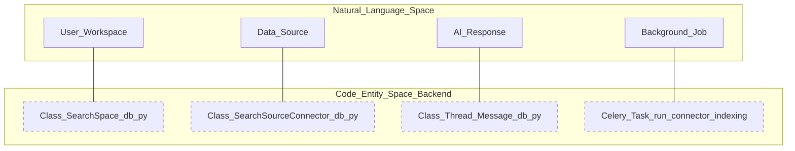
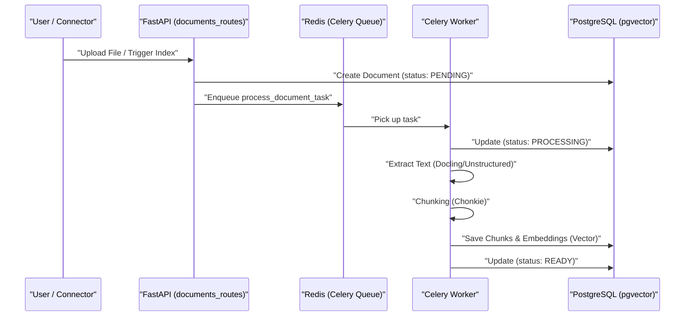
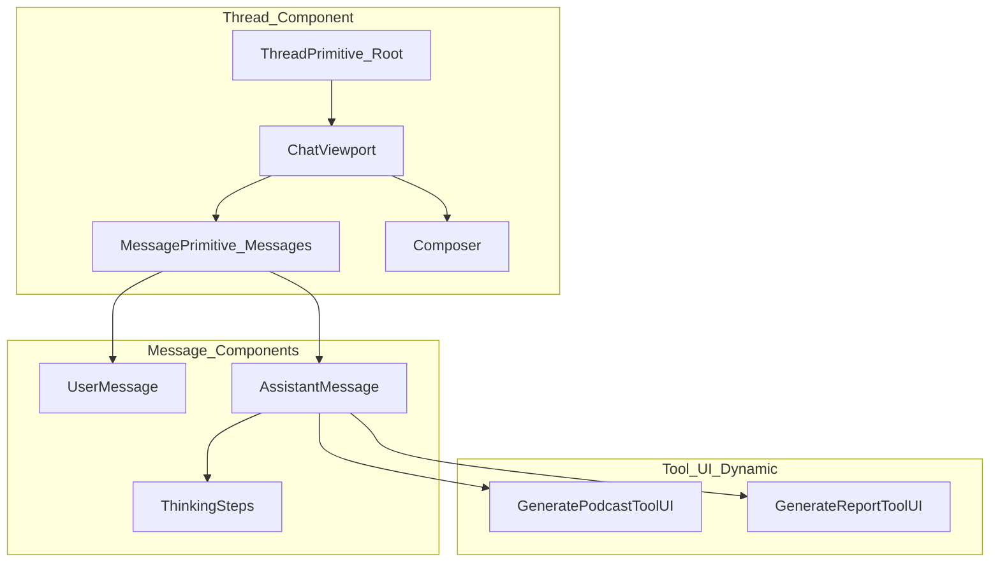

<!-- source: DeepWiki mcp.deepwiki.com · repo MODSetter/SurfSense · page 21 Glossary · fetched 2026-10-29 -->

# Glossary

Relevant source files

The following files were used as context for generating this wiki page:

- [.gitignore](.gitignore)
- [README.es.md](README.es.md)
- [README.hi.md](README.hi.md)
- [README.md](README.md)
- [README.pt-BR.md](README.pt-BR.md)
- [README.zh-CN.md](README.zh-CN.md)
- [VERSION](VERSION)
- [docker/.env.example](docker/.env.example)
- [docker/docker-compose.deps-only.yml](docker/docker-compose.deps-only.yml)
- [docker/docker-compose.dev.yml](docker/docker-compose.dev.yml)
- [docker/docker-compose.gpu.yml](docker/docker-compose.gpu.yml)
- [docker/docker-compose.yml](docker/docker-compose.yml)
- [docker/scripts/install.ps1](docker/scripts/install.ps1)
- [docker/scripts/install.sh](docker/scripts/install.sh)
- [docker/scripts/migrate-database.ps1](docker/scripts/migrate-database.ps1)
- [docker/scripts/migrate-database.sh](docker/scripts/migrate-database.sh)
- [surfsense_backend/.env.example](surfsense_backend/.env.example)
- [surfsense_backend/Dockerfile](surfsense_backend/Dockerfile)
- [surfsense_backend/app/agents/chat/multi_agent_chat/main_agent/graph/compile_graph_sync.py](surfsense_backend/app/agents/chat/multi_agent_chat/main_agent/graph/compile_graph_sync.py)
- [surfsense_backend/app/agents/chat/multi_agent_chat/main_agent/middleware/stack.py](surfsense_backend/app/agents/chat/multi_agent_chat/main_agent/middleware/stack.py)
- [surfsense_backend/app/agents/chat/multi_agent_chat/main_agent/runtime/agent_cache.py](surfsense_backend/app/agents/chat/multi_agent_chat/main_agent/runtime/agent_cache.py)
- [surfsense_backend/app/agents/chat/multi_agent_chat/main_agent/runtime/factory.py](surfsense_backend/app/agents/chat/multi_agent_chat/main_agent/runtime/factory.py)
- [surfsense_backend/app/agents/chat/multi_agent_chat/shared/middleware/filesystem/backends/resolver.py](surfsense_backend/app/agents/chat/multi_agent_chat/shared/middleware/filesystem/backends/resolver.py)
- [surfsense_backend/app/agents/chat/multi_agent_chat/shared/middleware/filesystem/index.py](surfsense_backend/app/agents/chat/multi_agent_chat/shared/middleware/filesystem/index.py)
- [surfsense_backend/app/agents/chat/multi_agent_chat/shared/middleware/filesystem/middleware/middleware.py](surfsense_backend/app/agents/chat/multi_agent_chat/shared/middleware/filesystem/middleware/middleware.py)
- [surfsense_backend/app/agents/chat/multi_agent_chat/shared/middleware/filesystem/tools/read_file/description.py](surfsense_backend/app/agents/chat/multi_agent_chat/shared/middleware/filesystem/tools/read_file/description.py)
- [surfsense_backend/app/agents/chat/multi_agent_chat/shared/middleware/filesystem/tools/read_file/index.py](surfsense_backend/app/agents/chat/multi_agent_chat/shared/middleware/filesystem/tools/read_file/index.py)
- [surfsense_backend/app/agents/chat/multi_agent_chat/subagents/builtins/knowledge_base/middleware_stack.py](surfsense_backend/app/agents/chat/multi_agent_chat/subagents/builtins/knowledge_base/middleware_stack.py)
- [surfsense_backend/app/agents/chat/multi_agent_chat/subagents/shared/subagent_builder.py](surfsense_backend/app/agents/chat/multi_agent_chat/subagents/shared/subagent_builder.py)
- [surfsense_backend/app/config/__init__.py](surfsense_backend/app/config/__init__.py)
- [surfsense_backend/app/connectors/composio_connector.py](surfsense_backend/app/connectors/composio_connector.py)
- [surfsense_backend/app/db.py](surfsense_backend/app/db.py)
- [surfsense_backend/app/routes/__init__.py](surfsense_backend/app/routes/__init__.py)
- [surfsense_backend/app/routes/composio_routes.py](surfsense_backend/app/routes/composio_routes.py)
- [surfsense_backend/app/routes/documents_routes.py](surfsense_backend/app/routes/documents_routes.py)
- [surfsense_backend/app/routes/search_source_connectors_routes.py](surfsense_backend/app/routes/search_source_connectors_routes.py)
- [surfsense_backend/app/schemas/documents.py](surfsense_backend/app/schemas/documents.py)
- [surfsense_backend/app/schemas/search_source_connector.py](surfsense_backend/app/schemas/search_source_connector.py)
- [surfsense_backend/app/services/composio_service.py](surfsense_backend/app/services/composio_service.py)
- [surfsense_backend/app/tasks/celery_tasks/connector_tasks.py](surfsense_backend/app/tasks/celery_tasks/connector_tasks.py)
- [surfsense_backend/app/tasks/celery_tasks/document_tasks.py](surfsense_backend/app/tasks/celery_tasks/document_tasks.py)
- [surfsense_backend/app/tasks/celery_tasks/schedule_checker_task.py](surfsense_backend/app/tasks/celery_tasks/schedule_checker_task.py)
- [surfsense_backend/app/tasks/celery_tasks/stale_notification_cleanup_task.py](surfsense_backend/app/tasks/celery_tasks/stale_notification_cleanup_task.py)
- [surfsense_backend/app/tasks/chat/persistence.py](surfsense_backend/app/tasks/chat/persistence.py)
- [surfsense_backend/app/tasks/chat/streaming/agent/event_loop.py](surfsense_backend/app/tasks/chat/streaming/agent/event_loop.py)
- [surfsense_backend/app/tasks/composio_indexer.py](surfsense_backend/app/tasks/composio_indexer.py)
- [surfsense_backend/app/tasks/connector_indexers/__init__.py](surfsense_backend/app/tasks/connector_indexers/__init__.py)
- [surfsense_backend/app/utils/periodic_scheduler.py](surfsense_backend/app/utils/periodic_scheduler.py)
- [surfsense_backend/pyproject.toml](surfsense_backend/pyproject.toml)
- [surfsense_backend/scripts/docker/entrypoint.sh](surfsense_backend/scripts/docker/entrypoint.sh)
- [surfsense_backend/tests/unit/middleware/test_filesystem_backends.py](surfsense_backend/tests/unit/middleware/test_filesystem_backends.py)
- [surfsense_backend/uv.lock](surfsense_backend/uv.lock)
- [surfsense_browser_extension/package.json](surfsense_browser_extension/package.json)
- [surfsense_desktop/package.json](surfsense_desktop/package.json)
- [surfsense_mcp/README.md](surfsense_mcp/README.md)
- [surfsense_web/.env.example](surfsense_web/.env.example)
- [surfsense_web/Dockerfile](surfsense_web/Dockerfile)
- [surfsense_web/app/docs/layout.tsx](surfsense_web/app/docs/layout.tsx)
- [surfsense_web/app/globals.css](surfsense_web/app/globals.css)
- [surfsense_web/app/layout.config.tsx](surfsense_web/app/layout.config.tsx)
- [surfsense_web/atoms/chat/current-thread.atom.ts](surfsense_web/atoms/chat/current-thread.atom.ts)
- [surfsense_web/atoms/chat/mentioned-documents.atom.ts](surfsense_web/atoms/chat/mentioned-documents.atom.ts)
- [surfsense_web/changelog/content/2026-07-05.mdx](surfsense_web/changelog/content/2026-07-05.mdx)
- [surfsense_web/components/assistant-ui/inline-mention-editor.tsx](surfsense_web/components/assistant-ui/inline-mention-editor.tsx)
- [surfsense_web/components/assistant-ui/mention-chip.tsx](surfsense_web/components/assistant-ui/mention-chip.tsx)
- [surfsense_web/components/assistant-ui/thread.tsx](surfsense_web/components/assistant-ui/thread.tsx)
- [surfsense_web/components/assistant-ui/user-message.tsx](surfsense_web/components/assistant-ui/user-message.tsx)
- [surfsense_web/components/layout/ui/header/Header.tsx](surfsense_web/components/layout/ui/header/Header.tsx)
- [surfsense_web/components/markdown-viewer.tsx](surfsense_web/components/markdown-viewer.tsx)
- [surfsense_web/components/new-chat/chat-header.tsx](surfsense_web/components/new-chat/chat-header.tsx)
- [surfsense_web/components/new-chat/chat-share-button.tsx](surfsense_web/components/new-chat/chat-share-button.tsx)
- [surfsense_web/components/new-chat/composer-suggestion-popup.tsx](surfsense_web/components/new-chat/composer-suggestion-popup.tsx)
- [surfsense_web/components/new-chat/document-mention-picker.tsx](surfsense_web/components/new-chat/document-mention-picker.tsx)
- [surfsense_web/components/new-chat/image-model-selector.tsx](surfsense_web/components/new-chat/image-model-selector.tsx)
- [surfsense_web/components/new-chat/model-selector.tsx](surfsense_web/components/new-chat/model-selector.tsx)
- [surfsense_web/components/new-chat/prompt-picker.tsx](surfsense_web/components/new-chat/prompt-picker.tsx)
- [surfsense_web/content/docs/connectors/index.mdx](surfsense_web/content/docs/connectors/index.mdx)
- [surfsense_web/content/docs/connectors/native/amazon.mdx](surfsense_web/content/docs/connectors/native/amazon.mdx)
- [surfsense_web/content/docs/connectors/native/indeed.mdx](surfsense_web/content/docs/connectors/native/indeed.mdx)
- [surfsense_web/content/docs/connectors/native/index.mdx](surfsense_web/content/docs/connectors/native/index.mdx)
- [surfsense_web/content/docs/connectors/native/instagram.mdx](surfsense_web/content/docs/connectors/native/instagram.mdx)
- [surfsense_web/content/docs/connectors/native/meta.json](surfsense_web/content/docs/connectors/native/meta.json)
- [surfsense_web/content/docs/connectors/native/walmart.mdx](surfsense_web/content/docs/connectors/native/walmart.mdx)
- [surfsense_web/content/docs/how-to/mcp-server.mdx](surfsense_web/content/docs/how-to/mcp-server.mdx)
- [surfsense_web/content/docs/manual-installation.mdx](surfsense_web/content/docs/manual-installation.mdx)
- [surfsense_web/lib/chat/mention-doc-key.ts](surfsense_web/lib/chat/mention-doc-key.ts)
- [surfsense_web/next.config.ts](surfsense_web/next.config.ts)
- [surfsense_web/package.json](surfsense_web/package.json)
- [surfsense_web/pnpm-lock.yaml](surfsense_web/pnpm-lock.yaml)
- [surfsense_web/public/announcements/competitive-intelligence.png](surfsense_web/public/announcements/competitive-intelligence.png)

This glossary defines the core domain concepts, technical jargon, and codebase-specific terms used throughout the SurfSense ecosystem. It serves as a reference for onboarding engineers to understand how abstract concepts (like "SearchSpaces") map to specific implementation details in the backend and frontend.

## Core Domain Concepts

### SearchSpace
A **SearchSpace** is the primary multi-tenant container in SurfSense. It acts as an isolated workspace where users, documents, connectors, and chat threads are scoped.
*   **Implementation**: Represented by the `SearchSpace` (often referenced as `Workspace`) model in the database [surfsense_backend/app/db.py:31]().
*   **Data Flow**: Most API requests require a `workspace_id` to ensure data isolation [surfsense_backend/app/routes/workspaces_routes.py]().
*   **UI**: Managed via the sidebar and workspace selector in the frontend [surfsense_web/components/assistant-ui/thread.tsx:110]().

### Connector
A **Connector** is a service integration that fetches data from external sources (e.g., Slack, Notion, GitHub) into a SearchSpace.
*   **Types**: Defined in the `SearchSourceConnectorType` enum [surfsense_backend/app/db.py:85-118]().
*   **Architecture**: Each connector typically has a dedicated route for setup [surfsense_backend/app/routes/search_source_connectors_routes.py:3]() and a corresponding indexing task in Celery [surfsense_backend/app/tasks/celery_tasks/connector_tasks.py]().
*   **Native Scrapers**: SurfSense includes high-performance scrapers for platforms like Reddit, TikTok, and YouTube that return structured JSON [README.md:55-66]().

### Artifact
An **Artifact** refers to a generated deliverable produced by the AI Agent, such as a Podcast, Report, or Video Presentation.
*   **Storage**: Managed via specific API endpoints like `/podcasts` [surfsense_backend/app/routes/__init__.py:111]() or `/video-presentations` [surfsense_backend/app/routes/__init__.py:113]().
*   **UI**: Rendered using specialized tool components in the chat interface [surfsense_web/components/assistant-ui/assistant-message.tsx:77-104]().

---

## Technical Jargon & Abbreviations

| Term | Definition | Code Pointer |
| :--- | :--- | :--- |
| **ETL** | Extract, Transform, Load. The pipeline that converts raw files/webpages into searchable chunks. Supports `DOCLING`, `UNSTRUCTURED`, and `LLAMACLOUD`. | [docker/.env.example:45]() |
| **RAG** | Retrieval-Augmented Generation. The process of fetching document chunks to provide context to the LLM. | [surfsense_backend/pyproject.toml:74]() |
| **HITL** | Human-in-the-Loop. A mechanism where the agent pauses for user approval before executing a tool call. | [surfsense_backend/app/routes/__init__.py:103]() |
| **MCP** | Model Context Protocol. A standard for exposing tools (e.g., `surfsense_reddit_scrape`) to AI agents like Claude or Cursor. | [surfsense_backend/app/db.py:113](), [README.md:49]() |
| **SSE** | Server-Sent Events. Used for streaming real-time chat responses. | [surfsense_backend/pyproject.toml:53]() |
| **Chonkie** | The library used for lightweight, high-performance RAG chunking. | [surfsense_backend/pyproject.toml:48](), [surfsense_backend/app/config/__init__.py:8]() |

---

## System Entity Mapping

The following diagram bridges Natural Language concepts used by users with the specific class names and file locations used by developers.

### Diagram: Concept to Code Mapping (Backend)

**Sources**: [surfsense_backend/app/db.py:31](), [surfsense_backend/app/db.py:41](), [surfsense_backend/app/tasks/celery_tasks/connector_tasks.py]()

---

## Implementation Details

### Document Lifecycle & Status
Documents transition through several states during the ETL process. This is tracked via a `JSONB` status field in the database.

*   **READY**: Fully indexed and searchable [surfsense_backend/app/db.py:151]().
*   **PENDING**: Queued for processing [surfsense_backend/app/db.py:156]().
*   **PROCESSING**: Currently being handled by a Celery worker [surfsense_backend/app/db.py:161]().
*   **FAILED**: Processing stopped; reason is stored in the status object [surfsense_backend/app/db.py:166]().

### Diagram: Document Processing Data Flow

**Sources**: [surfsense_backend/app/db.py:127-180](), [surfsense_backend/app/tasks/celery_tasks/document_tasks.py](), [surfsense_backend/app/routes/documents_routes.py]()

---

## Frontend State & UI Components

The frontend utilizes **Jotai** for atomic state management and **TanStack Query** for server state.

### Key Atoms
*   `currentThreadAtom`: Stores the ID and metadata of the active chat thread [surfsense_web/components/assistant-ui/thread.tsx:36]().
*   `mentionedDocumentsAtom`: Tracks documents explicitly tagged by the user using the `@` symbol [surfsense_web/components/assistant-ui/thread.tsx:39]().
*   `agentToolsAtom`: Manages the state of available and enabled tools for the current agent session [surfsense_web/components/assistant-ui/thread.tsx:30]().

### Diagram: Chat UI Component Hierarchy

**Sources**: [surfsense_web/components/assistant-ui/thread.tsx:158-185](), [surfsense_web/components/assistant-ui/assistant-message.tsx:77-104]()