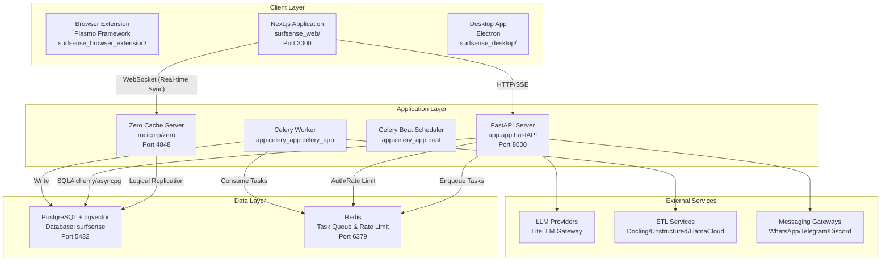
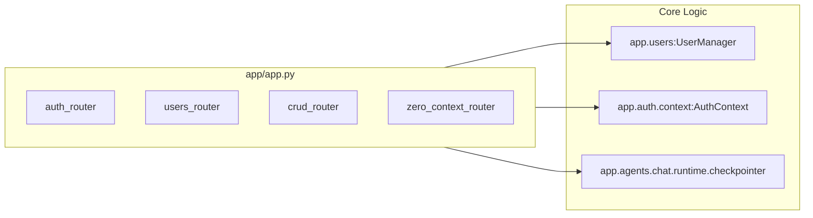

<!-- source: DeepWiki mcp.deepwiki.com · repo MODSetter/SurfSense · page 3 System Architecture · fetched 2026-10-29 -->

# System Architecture

Relevant source files

The following files were used as context for generating this wiki page:

- [VERSION](VERSION)
- [surfsense_backend/alembic/versions/154_remove_document_summary_llm.py](surfsense_backend/alembic/versions/154_remove_document_summary_llm.py)
- [surfsense_backend/alembic/versions/158_evolve_podcasts_lifecycle.py](surfsense_backend/alembic/versions/158_evolve_podcasts_lifecycle.py)
- [surfsense_backend/alembic/versions/166_add_pat_and_api_access.py](surfsense_backend/alembic/versions/166_add_pat_and_api_access.py)
- [surfsense_backend/alembic/versions/169_migrate_google_oauth_account_ids_to_sub.py](surfsense_backend/alembic/versions/169_migrate_google_oauth_account_ids_to_sub.py)
- [surfsense_backend/alembic/versions/92_add_refresh_tokens_table.py](surfsense_backend/alembic/versions/92_add_refresh_tokens_table.py)
- [surfsense_backend/app/app.py](surfsense_backend/app/app.py)
- [surfsense_backend/app/auth/csrf.py](surfsense_backend/app/auth/csrf.py)
- [surfsense_backend/app/auth/session_cookies.py](surfsense_backend/app/auth/session_cookies.py)
- [surfsense_backend/app/celery_app.py](surfsense_backend/app/celery_app.py)
- [surfsense_backend/app/routes/auth_routes.py](surfsense_backend/app/routes/auth_routes.py)
- [surfsense_backend/app/routes/users_routes.py](surfsense_backend/app/routes/users_routes.py)
- [surfsense_backend/app/schemas/auth.py](surfsense_backend/app/schemas/auth.py)
- [surfsense_backend/app/tasks/celery_tasks/gateway_tasks.py](surfsense_backend/app/tasks/celery_tasks/gateway_tasks.py)
- [surfsense_backend/app/users.py](surfsense_backend/app/users.py)
- [surfsense_backend/app/utils/refresh_tokens.py](surfsense_backend/app/utils/refresh_tokens.py)
- [surfsense_backend/app/zero_publication.py](surfsense_backend/app/zero_publication.py)
- [surfsense_backend/pyproject.toml](surfsense_backend/pyproject.toml)
- [surfsense_backend/scripts/revoke_refresh_tokens_cutover.py](surfsense_backend/scripts/revoke_refresh_tokens_cutover.py)
- [surfsense_backend/tests/unit/gateway/test_enqueue_received_sweep.py](surfsense_backend/tests/unit/gateway/test_enqueue_received_sweep.py)
- [surfsense_backend/tests/unit/gateway/test_process_inbound_event_task.py](surfsense_backend/tests/unit/gateway/test_process_inbound_event_task.py)
- [surfsense_backend/uv.lock](surfsense_backend/uv.lock)
- [surfsense_browser_extension/package.json](surfsense_browser_extension/package.json)
- [surfsense_desktop/package.json](surfsense_desktop/package.json)
- [surfsense_web/app/docs/layout.tsx](surfsense_web/app/docs/layout.tsx)
- [surfsense_web/app/globals.css](surfsense_web/app/globals.css)
- [surfsense_web/app/layout.config.tsx](surfsense_web/app/layout.config.tsx)
- [surfsense_web/components/markdown-viewer.tsx](surfsense_web/components/markdown-viewer.tsx)
- [surfsense_web/hooks/use-resolved-tabs.ts](surfsense_web/hooks/use-resolved-tabs.ts)
- [surfsense_web/lib/auth-errors.ts](surfsense_web/lib/auth-errors.ts)
- [surfsense_web/package.json](surfsense_web/package.json)
- [surfsense_web/pnpm-lock.yaml](surfsense_web/pnpm-lock.yaml)
- [surfsense_web/zero/queries/automations.ts](surfsense_web/zero/queries/automations.ts)
- [surfsense_web/zero/queries/chat.ts](surfsense_web/zero/queries/chat.ts)
- [surfsense_web/zero/queries/documents.ts](surfsense_web/zero/queries/documents.ts)
- [surfsense_web/zero/queries/folders.ts](surfsense_web/zero/queries/folders.ts)
- [surfsense_web/zero/queries/inbox.ts](surfsense_web/zero/queries/inbox.ts)
- [surfsense_web/zero/queries/index.ts](surfsense_web/zero/queries/index.ts)
- [surfsense_web/zero/queries/podcasts.ts](surfsense_web/zero/queries/podcasts.ts)
- [surfsense_web/zero/queries/user.ts](surfsense_web/zero/queries/user.ts)
- [surfsense_web/zero/schema/automations.ts](surfsense_web/zero/schema/automations.ts)
- [surfsense_web/zero/schema/chat.ts](surfsense_web/zero/schema/chat.ts)
- [surfsense_web/zero/schema/documents.ts](surfsense_web/zero/schema/documents.ts)
- [surfsense_web/zero/schema/inbox.ts](surfsense_web/zero/schema/inbox.ts)
- [surfsense_web/zero/schema/index.ts](surfsense_web/zero/schema/index.ts)
- [surfsense_web/zero/schema/podcasts.ts](surfsense_web/zero/schema/podcasts.ts)
- [surfsense_web/zero/schema/user.ts](surfsense_web/zero/schema/user.ts)

This page describes the overall system architecture of SurfSense, including its three-tier design, major components, data flow patterns, and technology stack. For details on specific subsystems, see [Component Overview](#3.1) for individual components, [Data Model and Database](#3.2) for database schema, and [Technology Stack](#3.3) for the complete list of frameworks and libraries.

## Overview: 3-Tier Architecture

SurfSense implements a classic three-tier architecture with clear separation between presentation, business logic, and data persistence layers. The system is designed for real-time synchronization using **Rocicorp Zero** and handles heavy processing through an asynchronous task queue.

### High-Level System Diagram

**Sources:** [surfsense_backend/app/app.py:75-81](), [surfsense_backend/app/celery_app.py:189-212](), [surfsense_backend/pyproject.toml:15-21](), [surfsense_backend/pyproject.toml:41-42]()

## Client Layer

### Next.js Web Application
The frontend is a Next.js 16+ application using the App Router. It integrates **Rocicorp Zero** for real-time state synchronization, ensuring that document status, notifications, and chat updates are reflected instantly without manual refreshes.

**Key Architectural Features:**
*   **Real-time Sync**: Uses `zero-cache` for optimistic UI updates and reactive queries across `chat`, `documents`, and `podcasts` [surfsense_web/package.json:85]().
*   **Markdown & Citations**: Renders AI responses with LaTeX support and interactive citation badges [surfsense_web/components/markdown-viewer.tsx:62-89]().
*   **Styling**: Utilizes Tailwind CSS v4 with an OKLCH color system for advanced theming [surfsense_web/app/globals.css:1-59]().

**Sources:** [surfsense_web/package.json:123-124](), [surfsense_web/app/globals.css:11-59](), [surfsense_web/components/markdown-viewer.tsx:15-18]()

### Browser Extension & Desktop
*   **Browser Extension**: A Plasmo-based extension that captures web content using `dom-to-semantic-markdown` [surfsense_browser_extension/package.json:21-36]().
*   **Desktop Application**: An Electron-based wrapper providing system-level integrations like local folder watching via `chokidar` and auto-updates [surfsense_desktop/package.json:37-46]().

## Application Layer

### FastAPI Backend
The backend acts as the central coordinator. It manages authentication via `fastapi-users`, coordinates AI agent execution, and provides a standardized API for the frontend and external integrations.

**Sources:** [surfsense_backend/app/app.py:57-67](), [surfsense_backend/app/users.py:54-61](), [surfsense_backend/app/app.py:27-30]()

### Celery & Task Processing
SurfSense offloads long-running tasks to Celery workers, ensuring the API remains responsive.
*   **Task Distribution**: Tasks are routed to specific queues like `document_tasks`, `podcasts.tasks.render`, and `video_presentation_tasks` [surfsense_backend/app/celery_app.py:193-212]().
*   **Observability**: Tasks are instrumented with OpenTelemetry to track queue latency and execution spans [surfsense_backend/app/celery_app.py:37-74]().
*   **Scheduling**: `Celery Beat` triggers periodic tasks such as connector re-indexing and stale notification cleanup [surfsense_backend/app/celery_app.py:198-204]().

**Sources:** [surfsense_backend/app/celery_app.py:189-212](), [surfsense_backend/app/celery_app.py:79-101]()

## Data Layer

### PostgreSQL & Zero Sync
PostgreSQL with `pgvector` is the source of truth.
*   **Vector Search**: Uses `pgvector` for storing and querying document embeddings [surfsense_backend/pyproject.toml:26]().
*   **Real-time Publication**: The `zero_publication.py` module defines the tables exposed to the `zero-cache` replication stream [surfsense_backend/app/zero_publication.py:1-20]().

### Redis
Redis serves as the backbone for:
1.  **Task Broker**: The primary message transport for Celery [surfsense_backend/app/celery_app.py:140]().
2.  **Rate Limiting**: Backend protection for sensitive endpoints using `SlowAPI` [surfsense_backend/app/app.py:75-81]().

**Sources:** [surfsense_backend/pyproject.toml:41-42](), [surfsense_backend/app/app.py:13-19]()

## Technology Stack Summary

| Tier | Component | Technology |
| :--- | :--- | :--- |
| **Frontend** | Framework | Next.js 16, TypeScript, Tailwind CSS v4 |
| | State/Sync | Rocicorp Zero, TanStack Query, Jotai, Zustand |
| **Backend** | Framework | FastAPI, Python 3.12+ |
| | AI/Agents | LangGraph, LiteLLM, DeepAgents, Chonkie |
| | Task Queue | Celery, Redis |
| **Database** | Primary | PostgreSQL + pgvector |
| | ETL/Parsing | Docling, Unstructured, LlamaCloud |
| **Messaging** | Gateways | Discord.py, Python-Telegram-Bot |

**Sources:** [surfsense_backend/pyproject.toml:1-90](), [surfsense_web/package.json:1-160](), [surfsense_backend/app/app.py:1-68]()

---

