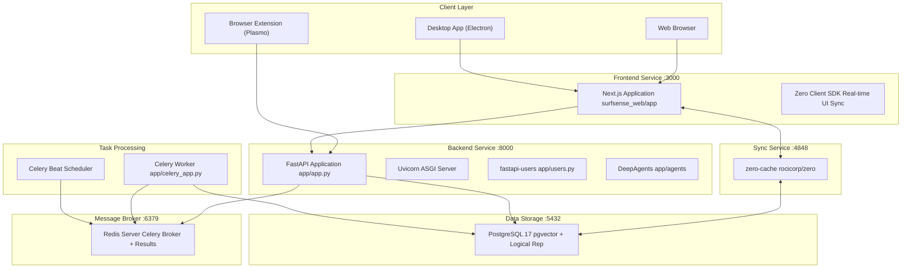
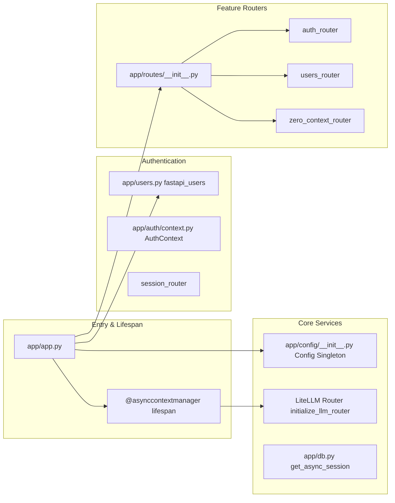

<!-- source: DeepWiki mcp.deepwiki.com · repo MODSetter/SurfSense · page 3.1 Component Overview · fetched 2026-10-29 -->

# Component Overview

Relevant source files

The following files were used as context for generating this wiki page:

- [.gitignore](.gitignore)
- [VERSION](VERSION)
- [docker/.env.example](docker/.env.example)
- [docker/docker-compose.deps-only.yml](docker/docker-compose.deps-only.yml)
- [docker/docker-compose.dev.yml](docker/docker-compose.dev.yml)
- [docker/docker-compose.gpu.yml](docker/docker-compose.gpu.yml)
- [docker/docker-compose.yml](docker/docker-compose.yml)
- [docker/scripts/install.ps1](docker/scripts/install.ps1)
- [docker/scripts/install.sh](docker/scripts/install.sh)
- [docker/scripts/migrate-database.ps1](docker/scripts/migrate-database.ps1)
- [docker/scripts/migrate-database.sh](docker/scripts/migrate-database.sh)
- [surfsense_backend/Dockerfile](surfsense_backend/Dockerfile)
- [surfsense_backend/alembic/versions/166_add_pat_and_api_access.py](surfsense_backend/alembic/versions/166_add_pat_and_api_access.py)
- [surfsense_backend/alembic/versions/169_migrate_google_oauth_account_ids_to_sub.py](surfsense_backend/alembic/versions/169_migrate_google_oauth_account_ids_to_sub.py)
- [surfsense_backend/alembic/versions/92_add_refresh_tokens_table.py](surfsense_backend/alembic/versions/92_add_refresh_tokens_table.py)
- [surfsense_backend/app/app.py](surfsense_backend/app/app.py)
- [surfsense_backend/app/auth/csrf.py](surfsense_backend/app/auth/csrf.py)
- [surfsense_backend/app/auth/session_cookies.py](surfsense_backend/app/auth/session_cookies.py)
- [surfsense_backend/app/celery_app.py](surfsense_backend/app/celery_app.py)
- [surfsense_backend/app/routes/auth_routes.py](surfsense_backend/app/routes/auth_routes.py)
- [surfsense_backend/app/routes/users_routes.py](surfsense_backend/app/routes/users_routes.py)
- [surfsense_backend/app/schemas/auth.py](surfsense_backend/app/schemas/auth.py)
- [surfsense_backend/app/tasks/celery_tasks/gateway_tasks.py](surfsense_backend/app/tasks/celery_tasks/gateway_tasks.py)
- [surfsense_backend/app/users.py](surfsense_backend/app/users.py)
- [surfsense_backend/app/utils/refresh_tokens.py](surfsense_backend/app/utils/refresh_tokens.py)
- [surfsense_backend/pyproject.toml](surfsense_backend/pyproject.toml)
- [surfsense_backend/scripts/docker/entrypoint.sh](surfsense_backend/scripts/docker/entrypoint.sh)
- [surfsense_backend/scripts/revoke_refresh_tokens_cutover.py](surfsense_backend/scripts/revoke_refresh_tokens_cutover.py)
- [surfsense_backend/tests/unit/gateway/test_enqueue_received_sweep.py](surfsense_backend/tests/unit/gateway/test_enqueue_received_sweep.py)
- [surfsense_backend/tests/unit/gateway/test_process_inbound_event_task.py](surfsense_backend/tests/unit/gateway/test_process_inbound_event_task.py)
- [surfsense_backend/uv.lock](surfsense_backend/uv.lock)
- [surfsense_browser_extension/package.json](surfsense_browser_extension/package.json)
- [surfsense_desktop/package.json](surfsense_desktop/package.json)
- [surfsense_web/.env.example](surfsense_web/.env.example)
- [surfsense_web/Dockerfile](surfsense_web/Dockerfile)
- [surfsense_web/app/docs/layout.tsx](surfsense_web/app/docs/layout.tsx)
- [surfsense_web/app/globals.css](surfsense_web/app/globals.css)
- [surfsense_web/app/layout.config.tsx](surfsense_web/app/layout.config.tsx)
- [surfsense_web/components/markdown-viewer.tsx](surfsense_web/components/markdown-viewer.tsx)
- [surfsense_web/lib/auth-errors.ts](surfsense_web/lib/auth-errors.ts)
- [surfsense_web/next.config.ts](surfsense_web/next.config.ts)
- [surfsense_web/package.json](surfsense_web/package.json)
- [surfsense_web/pnpm-lock.yaml](surfsense_web/pnpm-lock.yaml)

This page describes the major system components that comprise SurfSense and their architectural relationships. It covers the technical stack, service topology, and communication patterns between components, including real-time synchronization and background task orchestration.

## Purpose and Scope

SurfSense is built on a modern distributed architecture with clear separation of concerns:

- **Presentation Layer**: Next.js frontend serving the web UI and handling server-side rendering.
- **Application Layer**: FastAPI backend providing REST APIs, agentic reasoning, and business logic.
- **Task Processing Layer**: Celery workers handling asynchronous jobs like document indexing and media generation.
- **Real-time Sync Layer**: Rocicorp Zero (zero-cache) providing sub-millisecond data synchronization between the database and UI.
- **Data Layer**: PostgreSQL with `pgvector` for structured and vector data storage.
- **Messaging Layer**: Redis serving as the Celery message broker and result backend.

## System Component Topology

The following diagram shows the actual services, ports, and entry points used in SurfSense deployments:

**Sources:** [surfsense_backend/app/app.py:54-68](), [docker/docker-compose.yml:113-158](), [surfsense_web/package.json:123-131](), [surfsense_backend/pyproject.toml:41-42]()

## Component Service Matrix

| Component | Default Port | Process Type | Purpose | Configuration |
|-----------|-------------|--------------|---------|-------------------|
| **Frontend** | 3000 | Next.js Server | Web UI & Zero Query Resolver | `surfsense_web/.env` |
| **Backend API** | 8000 | Uvicorn ASGI | REST API & Agent Runtime | `surfsense_backend/.env` |
| **Zero Cache** | 4848 | Go/Node Service | Real-time DB-to-UI Sync | `ZERO_UPSTREAM_DB` |
| **PostgreSQL** | 5432 | Database Server | Vector DB & Relational Store | `DATABASE_URL` |
| **Redis** | 6379 | Cache/Broker | Celery Broker & Rate Limiter | `REDIS_URL` |
| **Celery Worker**| N/A | Background Proc | ETL & Long-running tasks | `SERVICE_ROLE=worker` |
| **Caddy Proxy** | 3929 | Reverse Proxy | Single Entry Point (Docker) | `proxy/Caddyfile` |

**Sources:** [docker/docker-compose.yml:86-112](), [docker/.env.example:61-73](), [surfsense_backend/app/celery_app.py:140-143]()

## FastAPI Backend Component

The backend is a FastAPI application configured for high-performance AI workloads, using `uvicorn` with the `asyncio` loop [docker/docker-compose.yml:131](). It integrates `fastapi-users` for authentication [surfsense_backend/pyproject.toml:47]() and `DeepAgents` for agentic orchestration [surfsense_backend/pyproject.toml:74]().

### Backend Architecture

**Sources:** [surfsense_backend/app/app.py:27-68](), [surfsense_backend/app/users.py:1-50](), [surfsense_backend/app/routes/auth_routes.py:58-62]()

### Configuration & LLM Routing
The backend uses a centralized configuration system that loads global LLM settings and manages providers via `LiteLLM` [surfsense_backend/pyproject.toml:72]().
- **Multi-Provider Support**: Integrates with 28+ providers including OpenAI, Anthropic, and local Ollama instances [docker/.env.example:47-54]().
- **Role-Based LLM Selection**: Different models can be assigned to functional roles like "Agent LLM" or "Document Summary LLM".
- **Observability**: Built-in OpenTelemetry instrumentation for FastAPI, SQLAlchemy, and Celery [surfsense_backend/pyproject.toml:75-85]().

**Sources:** [surfsense_backend/app/app.py:33-39](), [surfsense_backend/app/app.py:54-55]()

## Task Processing & Background Jobs

SurfSense uses Celery to offload heavy computations. The system is split into multiple specialized queues to prevent long-running tasks from blocking fast user-facing ones.

### Queue Strategy
- **Default Queue (`surfsense`)**: General purpose tasks including document indexing and re-indexing [surfsense_backend/app/celery_app.py:142]().
- **Task Distribution**: Tasks are included from various modules like `document_tasks`, `connector_tasks`, and `video_presentation_tasks` [surfsense_backend/app/celery_app.py:194-206]().

### Periodic Scheduling (Celery Beat)
The `celery_app.py` configures the task schedule [surfsense_backend/app/celery_app.py:188-213]():
- **Schedule Checker**: Periodically triggers the `schedule_checker_task` based on `SCHEDULE_CHECKER_INTERVAL` [surfsense_backend/app/celery_app.py:144-183]().
- **Stripe Reconciliation**: Validates pending credit purchases at configured intervals [surfsense_backend/app/celery_app.py:148-186]().
- **Cache Eviction**: Automated cleanup for ETL and indexing caches [surfsense_backend/app/celery_app.py:207-208]().

**Sources:** [surfsense_backend/app/celery_app.py:1-213]()

## Real-Time Synchronization (Zero)

A defining characteristic of SurfSense is its use of **Rocicorp Zero** for real-time UI updates.

1. **Logical Replication**: PostgreSQL must have logical replication enabled to allow `zero-cache` to stream changes [docker/docker-compose.yml:13-28]().
2. **Publication**: The system automatically creates a `zero_publication` to define which tables are replicated [docker/.env.example:109-112]().
3. **Zero-Cache**: A separate service (`rocicorp/zero`) acts as a WebSocket bridge between the browser and the database [docker/docker-compose.yml:110-111]().
4. **Query Resolver**: The frontend provides endpoints at `/api/zero/query` and `/api/zero/mutate` that `zero-cache` calls to authorize data access [docker/.env.example:134-147]().

**Sources:** [docker/docker-compose.yml:102-112](), [docker/.env.example:102-155]()

## Infrastructure & Deployment

SurfSense is designed for containerized deployment via Docker Compose, but supports manual installation.

### Docker Stack Composition
- **Caddy Proxy**: Handles SSL and routes traffic to `frontend`, `backend`, or `zero-cache` based on path [docker/docker-compose.yml:86-112]().
- **Migrations Container**: A short-lived service that runs `alembic upgrade head` and verifies the logical replication publication before other services start [docker/docker-compose.yml:35-48]().
- **Object Store**: Local file storage is mapped to `/app/.local_object_store` for document persistence [docker/docker-compose.yml:119]().

### ETL Service Options
SurfSense supports multiple ETL (Extract, Transform, Load) backends for document parsing, configured via `ETL_SERVICE` [docker/.env.example:44-45]():
- **DOCLING**: Local, privacy-friendly parsing (default) using the `docling` library [surfsense_backend/pyproject.toml:15]().
- **UNSTRUCTURED**: High-accuracy cloud-based parsing using `unstructured` [surfsense_backend/pyproject.toml:56-58]().
- **LLAMACLOUD**: Advanced multi-modal parsing using `llama-cloud-services` [surfsense_backend/pyproject.toml:21]().

**Sources:** [docker/docker-compose.yml:35-59](), [docker/.env.example:44-54](), [surfsense_backend/Dockerfile:110-118]()

---

