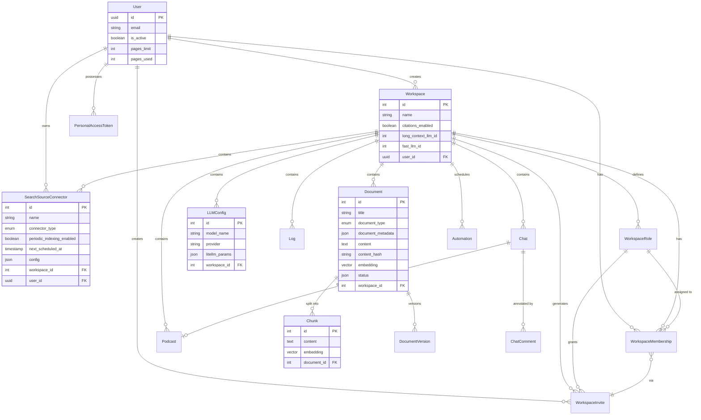
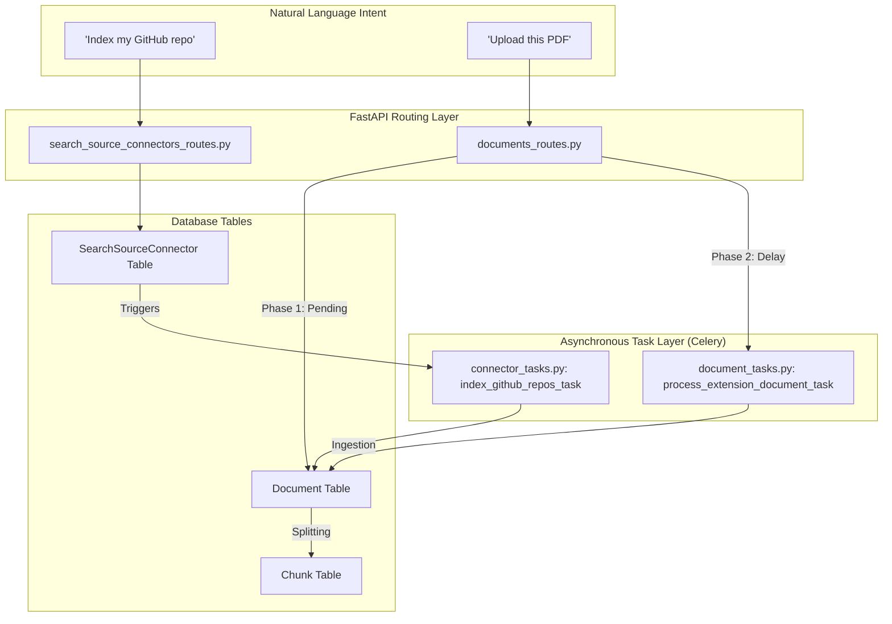

<!-- source: DeepWiki mcp.deepwiki.com · repo MODSetter/SurfSense · page 3.2 Data Model and Database · fetched 2026-10-29 -->

# Data Model and Database

Relevant source files

The following files were used as context for generating this wiki page:

- [surfsense_backend/.env.example](surfsense_backend/.env.example)
- [surfsense_backend/alembic/env.py](surfsense_backend/alembic/env.py)
- [surfsense_backend/alembic/versions/11_add_llm_config_table_and_relationships.py](surfsense_backend/alembic/versions/11_add_llm_config_table_and_relationships.py)
- [surfsense_backend/alembic/versions/12_add_logs_table.py](surfsense_backend/alembic/versions/12_add_logs_table.py)
- [surfsense_backend/alembic/versions/1_add_github_connector_enum.py](surfsense_backend/alembic/versions/1_add_github_connector_enum.py)
- [surfsense_backend/alembic/versions/2_add_linear_connector_enum.py](surfsense_backend/alembic/versions/2_add_linear_connector_enum.py)
- [surfsense_backend/alembic/versions/3_add_linear_connector_to_documenttype_.py](surfsense_backend/alembic/versions/3_add_linear_connector_to_documenttype_.py)
- [surfsense_backend/alembic/versions/4_add_linkup_api_enum.py](surfsense_backend/alembic/versions/4_add_linkup_api_enum.py)
- [surfsense_backend/alembic/versions/6_change_podcast_content_to_transcript.py](surfsense_backend/alembic/versions/6_change_podcast_content_to_transcript.py)
- [surfsense_backend/alembic/versions/7_remove_is_generated_column.py](surfsense_backend/alembic/versions/7_remove_is_generated_column.py)
- [surfsense_backend/alembic/versions/8_add_content_hash_to_documents.py](surfsense_backend/alembic/versions/8_add_content_hash_to_documents.py)
- [surfsense_backend/alembic/versions/9_add_discord_connector_enum_and_documenttype.py](surfsense_backend/alembic/versions/9_add_discord_connector_enum_and_documenttype.py)
- [surfsense_backend/alembic/versions/e55302644c51_add_github_connector_to_documenttype_.py](surfsense_backend/alembic/versions/e55302644c51_add_github_connector_to_documenttype_.py)
- [surfsense_backend/app/agents/chat/multi_agent_chat/subagents/builtins/indeed/system_prompt.md](surfsense_backend/app/agents/chat/multi_agent_chat/subagents/builtins/indeed/system_prompt.md)
- [surfsense_backend/app/config/__init__.py](surfsense_backend/app/config/__init__.py)
- [surfsense_backend/app/connectors/composio_connector.py](surfsense_backend/app/connectors/composio_connector.py)
- [surfsense_backend/app/db.py](surfsense_backend/app/db.py)
- [surfsense_backend/app/proprietary/platforms/google_search/fetch.py](surfsense_backend/app/proprietary/platforms/google_search/fetch.py)
- [surfsense_backend/app/proprietary/platforms/indeed_jobs/fetch.py](surfsense_backend/app/proprietary/platforms/indeed_jobs/fetch.py)
- [surfsense_backend/app/proprietary/platforms/indeed_jobs/scraper.py](surfsense_backend/app/proprietary/platforms/indeed_jobs/scraper.py)
- [surfsense_backend/app/routes/__init__.py](surfsense_backend/app/routes/__init__.py)
- [surfsense_backend/app/routes/composio_routes.py](surfsense_backend/app/routes/composio_routes.py)
- [surfsense_backend/app/routes/documents_routes.py](surfsense_backend/app/routes/documents_routes.py)
- [surfsense_backend/app/routes/search_source_connectors_routes.py](surfsense_backend/app/routes/search_source_connectors_routes.py)
- [surfsense_backend/app/schemas/documents.py](surfsense_backend/app/schemas/documents.py)
- [surfsense_backend/app/schemas/logs.py](surfsense_backend/app/schemas/logs.py)
- [surfsense_backend/app/schemas/search_source_connector.py](surfsense_backend/app/schemas/search_source_connector.py)
- [surfsense_backend/app/services/composio_service.py](surfsense_backend/app/services/composio_service.py)
- [surfsense_backend/app/services/task_logging_service.py](surfsense_backend/app/services/task_logging_service.py)
- [surfsense_backend/app/tasks/celery_tasks/connector_tasks.py](surfsense_backend/app/tasks/celery_tasks/connector_tasks.py)
- [surfsense_backend/app/tasks/celery_tasks/document_tasks.py](surfsense_backend/app/tasks/celery_tasks/document_tasks.py)
- [surfsense_backend/app/tasks/celery_tasks/schedule_checker_task.py](surfsense_backend/app/tasks/celery_tasks/schedule_checker_task.py)
- [surfsense_backend/app/tasks/celery_tasks/stale_notification_cleanup_task.py](surfsense_backend/app/tasks/celery_tasks/stale_notification_cleanup_task.py)
- [surfsense_backend/app/tasks/composio_indexer.py](surfsense_backend/app/tasks/composio_indexer.py)
- [surfsense_backend/app/tasks/connector_indexers/__init__.py](surfsense_backend/app/tasks/connector_indexers/__init__.py)
- [surfsense_backend/app/utils/browser_loop.py](surfsense_backend/app/utils/browser_loop.py)
- [surfsense_backend/app/utils/periodic_scheduler.py](surfsense_backend/app/utils/periodic_scheduler.py)
- [surfsense_backend/scripts/check_migration_flow.py](surfsense_backend/scripts/check_migration_flow.py)
- [surfsense_backend/tests/unit/platforms/google_search/test_fetch_concurrency.py](surfsense_backend/tests/unit/platforms/google_search/test_fetch_concurrency.py)
- [surfsense_backend/tests/unit/platforms/indeed_jobs/test_fetch_resilience.py](surfsense_backend/tests/unit/platforms/indeed_jobs/test_fetch_resilience.py)
- [surfsense_backend/tests/unit/platforms/indeed_jobs/test_scraper.py](surfsense_backend/tests/unit/platforms/indeed_jobs/test_scraper.py)
- [surfsense_web/content/docs/manual-installation.mdx](surfsense_web/content/docs/manual-installation.mdx)

This document provides technical documentation for the SurfSense database schema, entity relationships, and the Role-Based Access Control (RBAC) system. SurfSense utilizes **PostgreSQL** with the **pgvector** extension for hybrid semantic and keyword search.

## Overview

The SurfSense data model is designed around the `Workspace` (internally `SearchSpace`) entity, which serves as the primary multi-tenancy boundary. All documents, chats, connectors, and configurations are scoped to a workspace. Access control is managed through a granular RBAC system that allows for custom roles and workspace-level permissions.

The database architecture supports:
- **Vector Search**: Using `pgvector` for document and chunk embeddings [surfsense_backend/app/db.py:11-11]().
- **Full-Text Search**: Using PostgreSQL GIN indexes and `tsvector` [surfsense_backend/alembic/env.py:110-125]().
- **Multi-Tenancy**: Workspace isolation for all entities [surfsense_backend/app/db.py:406-486]().
- **Real-time Sync**: Leverages PostgreSQL logical replication via a `zero_publication` for Rocicorp Zero [surfsense_backend/alembic/env.py:127-129]().
- **Task Tracking**: Integration with Celery for background indexing and processing [surfsense_backend/app/tasks/celery_tasks/document_tasks.py:1-24]().

**Sources:** [surfsense_backend/app/db.py:1-1224](), [surfsense_backend/alembic/env.py:1-133]()

---

## Core Data Model

### Entity Relationship Diagram

**Sources:** [surfsense_backend/app/db.py:406-700](), [surfsense_backend/app/db.py:1000-1050]()

---

## Core Entities

### Workspace (SearchSpace)
The `Workspace` (internally mapped to the `workspaces` table) is the root container for all user data [surfsense_backend/app/db.py:406-486]().

| Field | Type | Description |
|-------|------|-------------|
| `id` | Integer (PK) | Unique identifier. |
| `name` | String(100) | Workspace name. |
| `citations_enabled`| Boolean | Toggle for AI response citations [surfsense_backend/app/db.py:413-413](). |
| `long_context_llm_id`| Integer | Preferred LLM for large context reasoning [surfsense_backend/app/db.py:415-415](). |
| `fast_llm_id` | Integer | Preferred LLM for low-latency queries [surfsense_backend/app/db.py:416-416](). |

### Document and Chunk
Documents represent ingested content from files, URLs, or connectors. To facilitate RAG, documents are split into `Chunk` entities [surfsense_backend/app/db.py:336-400]().

- **Document Status**: Stored as a `JSONB` field using the `DocumentStatus` helper class to track `pending`, `processing`, `ready`, or `failed` states [surfsense_backend/app/db.py:127-148]().
- **Deduplication**: `content_hash` and `unique_identifier_hash` are used to prevent redundant ingestion of the same file content [surfsense_backend/app/db.py:348-350]().
- **Vector Storage**: The `embedding` column uses the `Vector` type from `pgvector` for semantic similarity [surfsense_backend/app/db.py:353-353]().

### SearchSourceConnector
Connectors manage integrations with external platforms like Notion, GitHub, Slack, or Google Drive [surfsense_backend/app/db.py:492-524]().

- **Periodic Indexing**: Fields `next_scheduled_at` and `indexing_frequency_minutes` allow the `schedule_checker_task` to trigger background syncs via Celery [surfsense_backend/app/schemas/search_source_connector.py:35-56]().
- **Composio Integration**: Supports unified OAuth flows for Google Drive, Gmail, and Calendar via the `ComposioService` [surfsense_backend/app/services/composio_service.py:49-80]().
- **MCP Connectors**: Allows user-defined tools via the Model Context Protocol [surfsense_backend/app/schemas/search_source_connector.py:87-110]().

**Sources:** [surfsense_backend/app/db.py:85-118](), [surfsense_backend/app/routes/search_source_connectors_routes.py:1-19]()

---

## Role-Based Access Control (RBAC)

SurfSense implements a hierarchical RBAC system defined at the workspace level.

### Permission Structure
Permissions are defined as granular strings (e.g., `DOCUMENTS_CREATE`, `CHATS_READ`) [surfsense_backend/app/db.py:136-195]().
- **Wildcard**: The `*` permission grants full access to all resources in a workspace [surfsense_backend/app/db.py:814-814]().
- **Enforcement**: Access is verified in FastAPI routes using the `check_permission` utility [surfsense_backend/app/routes/documents_routes.py:72-81]().

### Default Roles
Every workspace is initialized with four system roles [surfsense_backend/app/db.py:883-921]():
1. **Owner**: Root access to all settings and data.
2. **Admin**: Can manage members, roles, and workspace-wide configurations.
3. **Editor**: Can ingest documents, create connectors, and manage chats.
4. **Viewer**: Read-only access to existing documents and chat history.

**Sources:** [surfsense_backend/app/db.py:568-603](), [surfsense_backend/app/utils/rbac.py:1-50]()

---

## Data Flow: Natural Language to Code Entity

This diagram bridges the user's intent to the specific code modules and database tables involved.

**Sources:** [surfsense_backend/app/routes/documents_routes.py:135-155](), [surfsense_backend/app/tasks/celery_tasks/connector_tasks.py:159-175]()

---

## Database Migrations and Lifecycle

SurfSense uses **Alembic** for schema evolution and PostgreSQL features for performance.

- **Initialization**: On startup, the application can run DDL via `Base.metadata.create_all` if `DB_BOOTSTRAP_ON_STARTUP` is set [surfsense_backend/.env.example:4-9]().
- **Search Optimization**: Migrations include specific instructions for `tsvector` columns and GIN indexes to support high-performance full-text search [surfsense_backend/alembic/env.py:110-125]().
- **Real-time Sync (Zero)**: The `zero_publication` is created during migrations to allow the `zero-cache` service to listen for row changes [surfsense_backend/alembic/env.py:127-129]().
- **Heartbeat Mechanism**: To prevent stale "processing" states if a worker dies, the system uses a Redis-backed heartbeat tracked by `indexing:heartbeat:{notification_id}` [surfsense_backend/app/tasks/celery_tasks/document_tasks.py:64-92]().

**Sources:** [surfsense_backend/alembic/env.py:1-150](), [surfsense_backend/app/db.py:1220-1230]()

---

