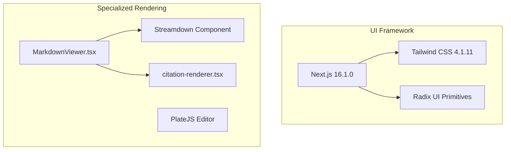

<!-- source: DeepWiki mcp.deepwiki.com · repo MODSetter/SurfSense · page 3.3 Technology Stack · fetched 2026-10-29 -->

# Technology Stack

<details>
<summary>Relevant source files</summary>

The following files were used as context for generating this wiki page:

- [.vscode/settings.json](.vscode/settings.json)
- [VERSION](VERSION)
- [surfsense_backend/pyproject.toml](surfsense_backend/pyproject.toml)
- [surfsense_backend/uv.lock](surfsense_backend/uv.lock)
- [surfsense_browser_extension/.gitignore](surfsense_browser_extension/.gitignore)
- [surfsense_browser_extension/package.json](surfsense_browser_extension/package.json)
- [surfsense_desktop/package.json](surfsense_desktop/package.json)
- [surfsense_web/.gitignore](surfsense_web/.gitignore)
- [surfsense_web/app/(home)/login/layout.tsx](surfsense_web/app/(home)/login/layout.tsx)
- [surfsense_web/app/(home)/register/layout.tsx](surfsense_web/app/(home)/register/layout.tsx)
- [surfsense_web/app/api/zero/query/route.ts](surfsense_web/app/api/zero/query/route.ts)
- [surfsense_web/app/dashboard/[workspace_id]/team/page.tsx](surfsense_web/app/dashboard/[workspace_id]/team/page.tsx)
- [surfsense_web/app/dashboard/dashboard-shell.tsx](surfsense_web/app/dashboard/dashboard-shell.tsx)
- [surfsense_web/app/desktop/login/layout.tsx](surfsense_web/app/desktop/login/layout.tsx)
- [surfsense_web/app/docs/layout.tsx](surfsense_web/app/docs/layout.tsx)
- [surfsense_web/app/globals.css](surfsense_web/app/globals.css)
- [surfsense_web/app/layout.config.tsx](surfsense_web/app/layout.config.tsx)
- [surfsense_web/atoms/agent/agent-flags-query.atom.ts](surfsense_web/atoms/agent/agent-flags-query.atom.ts)
- [surfsense_web/atoms/user/user-mutation.atoms.ts](surfsense_web/atoms/user/user-mutation.atoms.ts)
- [surfsense_web/atoms/user/user-query.atoms.ts](surfsense_web/atoms/user/user-query.atoms.ts)
- [surfsense_web/biome.json](surfsense_web/biome.json)
- [surfsense_web/components/markdown-viewer.tsx](surfsense_web/components/markdown-viewer.tsx)
- [surfsense_web/components/providers/ZeroProvider.tsx](surfsense_web/components/providers/ZeroProvider.tsx)
- [surfsense_web/components/providers/runtime-config.server.tsx](surfsense_web/components/providers/runtime-config.server.tsx)
- [surfsense_web/components/providers/runtime-config.tsx](surfsense_web/components/providers/runtime-config.tsx)
- [surfsense_web/package.json](surfsense_web/package.json)
- [surfsense_web/pnpm-lock.yaml](surfsense_web/pnpm-lock.yaml)
- [surfsense_web/types/zero.d.ts](surfsense_web/types/zero.d.ts)
- [surfsense_web/zero/queries/authz.ts](surfsense_web/zero/queries/authz.ts)

</details>


This document provides a comprehensive reference of the technologies, frameworks, and libraries used across all components of SurfSense: the backend API server, the web frontend, the desktop application, and the browser extension.

The backend initializes its technology stack through its dependency manifest and configuration modules. The frontend uses Next.js 16 with the App Router, while the desktop app leverages Electron with a dedicated build process [surfsense_desktop/package.json:7-17]().

---

## Backend Technology Stack

The backend is a Python 3.12+ application built on async frameworks and AI/ML libraries. All dependencies are managed via `uv` [surfsense_backend/pyproject.toml:105-134]().

### Core Framework & API

| Technology | Version | Purpose |
|------------|---------|---------|
| **FastAPI** | 0.115.8 | Primary async web framework [surfsense_backend/pyproject.toml:16]() |
| **Uvicorn** | 0.34.0 | ASGI server implementation [surfsense_backend/pyproject.toml:36]() |
| **Alembic** | 1.13.0 | Database migration management [surfsense_backend/pyproject.toml:7]() |
| **Tornado** | 6.5.5 | Supporting async networking [surfsense_backend/pyproject.toml:11]() |

### Database & Storage Layer

```mermaid
graph TB
    subgraph "Storage Layer"
        [app/db.py] --> PostgreSQL["PostgreSQL"]
        PostgreSQL --> PGVector["pgvector 0.3.6"]
        [app/search] --> ES["Elasticsearch 9.1.1"]
        [app/tasks] --> Redis["Redis 5.2.1"]
    end
    
    subgraph "ORM & Drivers"
        SQLAlchemy["SQLAlchemy (via FastAPI-Users)"]
        AsyncPG["asyncpg 0.30.0"]
        Psycopg["psycopg 3.3.2"]
    end
    
    PostgreSQL --- AsyncPG
    PostgreSQL --- Psycopg
```

| Technology | Purpose |
|------------|---------|
| **PostgreSQL** | Primary relational database |
| **pgvector** | Vector similarity search extension (0.3.6) [surfsense_backend/pyproject.toml:26]() |
| **asyncpg** | Async PostgreSQL driver (0.30.0) [surfsense_backend/pyproject.toml:8]() |
| **psycopg** | Robust PostgreSQL adapter for Python (3.3.2) [surfsense_backend/pyproject.toml:50]() |
| **Elasticsearch** | Full-text and hybrid search (9.1.1) [surfsense_backend/pyproject.toml:39]() |
| **Redis** | Celery broker and result backend (5.2.1) [surfsense_backend/pyproject.toml:42]() |

**Sources:** [surfsense_backend/pyproject.toml:1-89](), [surfsense_backend/uv.lock:1-109]()

### AI, Agents & ML Libraries

SurfSense employs a sophisticated AI stack centered around LangGraph for stateful orchestration and LiteLLM for model abstraction.

| Technology | Version | Purpose |
|------------|---------|---------|
| **LangGraph** | 1.1.3 | Orchestration for stateful AI agents [surfsense_backend/pyproject.toml:68]() |
| **LiteLLM** | 1.83.7 | Unified gateway for 100+ LLM providers [surfsense_backend/pyproject.toml:72]() |
| **DeepAgents** | 0.4.12 | Framework for conversational AI reasoning [surfsense_backend/pyproject.toml:74]() |
| **Chonkie** | 1.5.0 | Advanced RAG chunking and embedding utilities [surfsense_backend/pyproject.toml:48]() |
| **Docling** | 2.15.0 | High-fidelity document parsing and ETL [surfsense_backend/pyproject.toml:15]() |
| **Unstructured** | 0.18.31 | Partitioning and extraction for diverse file types [surfsense_backend/pyproject.toml:56]() |
| **Kokoro** | 0.9.4 | Local high-quality text-to-speech for artifacts [surfsense_backend/pyproject.toml:20]() |
| **Faster-Whisper**| 1.1.0 | Fast speech-to-text inference [surfsense_backend/pyproject.toml:40]() |

**Sources:** [surfsense_backend/pyproject.toml:1-89](), [surfsense_backend/uv.lock:1-109]()

### Proprietary Scraping & Stealth
SurfSense includes a specialized scraping tier for social platforms and live data.

| Technology | Purpose |
|------------|---------|
| **Scrapling** | Stealthy web fetching and browser automation (0.4.11) [surfsense_backend/pyproject.toml:88]() |
| **Trafilatura** | Web scraping and main text extraction [surfsense_backend/pyproject.toml:46]() |
| **Fake-Useragent**| Spoofing browser headers for anti-bot bypass [surfsense_backend/pyproject.toml:45]() |

---

## Frontend Technology Stack

The web frontend is a Next.js 16 application built with React 19 and a focus on real-time synchronization.

### Core Framework & State

| Technology | Version | Purpose |
|------------|---------|---------|
| **Next.js** | 16.1.0 | React framework with App Router and Turbopack [surfsense_web/package.json:123]() |
| **React** | 19.2.3 | Core UI library [surfsense_web/package.json:134]() |
| **Jotai** | 2.15.1 | Atomic state management [surfsense_web/package.json:113]() |
| **TanStack Query**| 5.90.7 | Async server state management [surfsense_web/package.json:91]() |
| **Zero (Rocicorp)**| 1.6.0 | Real-time sync engine [surfsense_web/package.json:85]() |

SurfSense uses **Zero** for real-time data synchronization. The `ZeroProvider` manages the connection state and handles authentication refreshes, ensuring the local cache stays in sync with the backend [surfsense_web/components/providers/ZeroProvider.tsx:62-121]().

### UI & Rendering



| Technology | Purpose |
|------------|---------|
| **Tailwind CSS** | Styling engine (4.1.11) [surfsense_web/package.json:180]() |
| **OKLCH Colors** | Modern color system defined in CSS variables [surfsense_web/app/globals.css:16-59]() |
| **Radix UI** | Accessible primitive components [surfsense_web/package.json:60-81]() |
| **PlateJS** | Rich text editor framework for document editing [surfsense_web/package.json:128]() |
| **Streamdown** | Real-time markdown streaming with math/code support [surfsense_web/components/markdown-viewer.tsx:3-207]() |

**Sources:** [surfsense_web/package.json:1-185](), [surfsense_web/app/globals.css:1-155](), [surfsense_web/components/markdown-viewer.tsx:1-216]()

---

## Desktop & Browser Extension

### Desktop (Electron)
The desktop app wraps the Next.js frontend using Electron 42.

| Technology | Purpose |
|------------|---------|
| **Electron** | Cross-platform desktop shell (42.4.0) [surfsense_desktop/package.json:31]() |
| **Chokidar** | Local folder watching for automatic document indexing [surfsense_desktop/package.json:39]() |
| **Electron Store** | Persistent local configuration storage [surfsense_desktop/package.json:40]() |
| **Electron Updater**| Automated update delivery system [surfsense_desktop/package.json:41]() |

### Browser Extension (Plasmo)
Built with the Plasmo framework for cross-browser compatibility and rapid development.

| Technology | Purpose |
|------------|---------|
| **Plasmo** | Extension development framework (0.90.5) [surfsense_browser_extension/package.json:36]() |
| **dom-to-semantic-markdown** | Content extraction and markdown conversion [surfsense_browser_extension/package.json:33]() |
| **Linkedom** | Lightweight DOM implementation for background processing [surfsense_browser_extension/package.json:34]() |

**Sources:** [surfsense_desktop/package.json:1-47](), [surfsense_browser_extension/package.json:1-72]()

---

## Observability & Operations

SurfSense implements full-stack observability and modern development workflows.

| Technology | Purpose |
|------------|---------|
| **OpenTelemetry** | Distributed tracing and metrics across backend services [surfsense_backend/pyproject.toml:75-85]() |
| **PostHog** | Product analytics and session recording [surfsense_web/package.json:59, 130]() |
| **Drizzle Kit** | Database schema management and migrations for Zero [surfsense_web/package.json:177]() |
| **Biome** | High-performance toolchain for web linting and formatting [surfsense_web/package.json:162]() |

**Sources:** [surfsense_backend/pyproject.toml:75-85](), [surfsense_web/package.json:1-185]()

---

