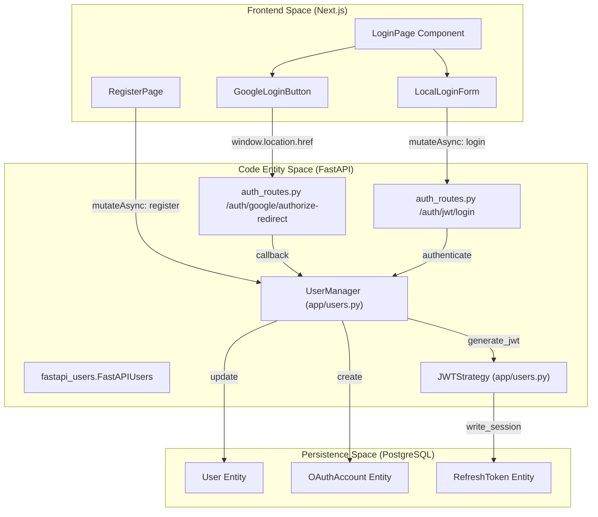
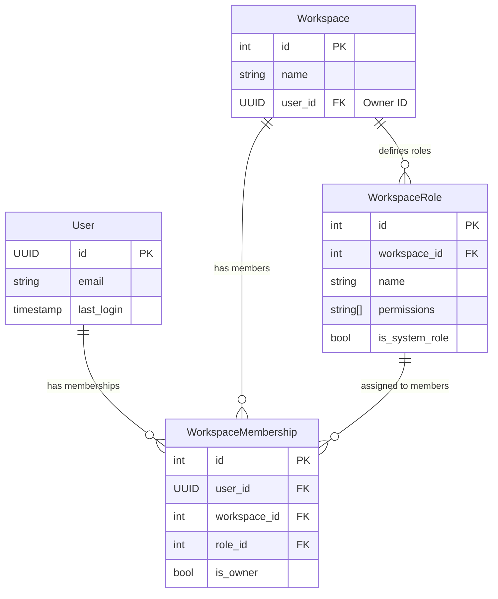

<!-- source: DeepWiki mcp.deepwiki.com · repo MODSetter/SurfSense · page 4 Authentication and Authorization · fetched 2026-10-29 -->

# Authentication and Authorization

<details>
<summary>Relevant source files</summary>

The following files were used as context for generating this wiki page:

- [surfsense_backend/alembic/versions/166_add_pat_and_api_access.py](surfsense_backend/alembic/versions/166_add_pat_and_api_access.py)
- [surfsense_backend/alembic/versions/169_migrate_google_oauth_account_ids_to_sub.py](surfsense_backend/alembic/versions/169_migrate_google_oauth_account_ids_to_sub.py)
- [surfsense_backend/alembic/versions/92_add_refresh_tokens_table.py](surfsense_backend/alembic/versions/92_add_refresh_tokens_table.py)
- [surfsense_backend/app/app.py](surfsense_backend/app/app.py)
- [surfsense_backend/app/auth/csrf.py](surfsense_backend/app/auth/csrf.py)
- [surfsense_backend/app/auth/session_cookies.py](surfsense_backend/app/auth/session_cookies.py)
- [surfsense_backend/app/celery_app.py](surfsense_backend/app/celery_app.py)
- [surfsense_backend/app/routes/auth_routes.py](surfsense_backend/app/routes/auth_routes.py)
- [surfsense_backend/app/routes/users_routes.py](surfsense_backend/app/routes/users_routes.py)
- [surfsense_backend/app/schemas/auth.py](surfsense_backend/app/schemas/auth.py)
- [surfsense_backend/app/tasks/celery_tasks/gateway_tasks.py](surfsense_backend/app/tasks/celery_tasks/gateway_tasks.py)
- [surfsense_backend/app/users.py](surfsense_backend/app/users.py)
- [surfsense_backend/app/utils/refresh_tokens.py](surfsense_backend/app/utils/refresh_tokens.py)
- [surfsense_backend/scripts/revoke_refresh_tokens_cutover.py](surfsense_backend/scripts/revoke_refresh_tokens_cutover.py)
- [surfsense_backend/tests/unit/gateway/test_enqueue_received_sweep.py](surfsense_backend/tests/unit/gateway/test_enqueue_received_sweep.py)
- [surfsense_backend/tests/unit/gateway/test_process_inbound_event_task.py](surfsense_backend/tests/unit/gateway/test_process_inbound_event_task.py)
- [surfsense_desktop/src/modules/shortcuts.ts](surfsense_desktop/src/modules/shortcuts.ts)
- [surfsense_web/app/(home)/login/GoogleLoginButton.tsx](surfsense_web/app/(home)/login/GoogleLoginButton.tsx)
- [surfsense_web/app/(home)/login/LocalLoginForm.tsx](surfsense_web/app/(home)/login/LocalLoginForm.tsx)
- [surfsense_web/app/(home)/login/page.tsx](surfsense_web/app/(home)/login/page.tsx)
- [surfsense_web/app/(home)/page.tsx](surfsense_web/app/(home)/page.tsx)
- [surfsense_web/app/(home)/register/page.tsx](surfsense_web/app/(home)/register/page.tsx)
- [surfsense_web/app/auth/callback/loading.tsx](surfsense_web/app/auth/callback/loading.tsx)
- [surfsense_web/app/dashboard/layout.tsx](surfsense_web/app/dashboard/layout.tsx)
- [surfsense_web/app/dashboard/loading.tsx](surfsense_web/app/dashboard/loading.tsx)
- [surfsense_web/app/dashboard/page.tsx](surfsense_web/app/dashboard/page.tsx)
- [surfsense_web/app/desktop/login/page.tsx](surfsense_web/app/desktop/login/page.tsx)
- [surfsense_web/atoms/ui/loading.atoms.ts](surfsense_web/atoms/ui/loading.atoms.ts)
- [surfsense_web/components/UserDropdown.tsx](surfsense_web/components/UserDropdown.tsx)
- [surfsense_web/components/desktop/shortcut-recorder.tsx](surfsense_web/components/desktop/shortcut-recorder.tsx)
- [surfsense_web/components/json-metadata-viewer.tsx](surfsense_web/components/json-metadata-viewer.tsx)
- [surfsense_web/components/providers/GlobalLoadingProvider.tsx](surfsense_web/components/providers/GlobalLoadingProvider.tsx)
- [surfsense_web/hooks/use-global-loading.ts](surfsense_web/hooks/use-global-loading.ts)
- [surfsense_web/lib/auth-errors.ts](surfsense_web/lib/auth-errors.ts)

</details>


## Purpose and Scope

This document covers SurfSense's security architecture, including user authentication and role-based access control (RBAC). It explains how users authenticate (via Google OAuth or local email/password), how permissions are defined and enforced, and how the multi-tenant RBAC system controls access to resources within SearchSpaces.

For information about SearchSpace isolation and multi-tenancy concepts, see [SearchSpace and Multi-Tenancy](#5). For details on user management and invitations, see [Team Management](#5.2).

---

## Authentication System

SurfSense supports two primary authentication methods, configured via the `AUTH_TYPE` environment variable: `GOOGLE` for OAuth 2.0 with Google, or `LOCAL` for traditional email/password authentication. The system also supports Personal Access Tokens (PATs) and external chat platform authentication for the messaging gateway.

### Authentication Types

| Authentication Type | Configuration | User Management Library | Token Type |
|-------------------|---------------|------------------------|------------|
| `GOOGLE` | OAuth 2.0 credentials | `fastapi-users` with Google OAuth | JWT |
| `LOCAL` | Email/password | `fastapi-users` with database backend | JWT |
| `PAT` | User-generated tokens | Custom resolver | Bearer Token (prefixed `ss-`) |

**Sources:** [surfsense_backend/app/users.py:45-51](), [surfsense_backend/app/utils/pat.py:35-37](), [surfsense_backend/app/app.py:58-63]()

### User Model

The `User` model extends `SQLAlchemyBaseUserTableUUID` from `fastapi-users`, providing standard user fields (id, email, hashed_password, is_active, is_verified, is_superuser).

- **Google OAuth:** Overrides `oauth_callback` in the `UserManager` class to capture Google profile data including `display_name` and `avatar_url` via the Google People API [surfsense_backend/app/users.py:66-129]().
- **Post-Registration:** The `on_after_register` hook automatically creates a default workspace, default RBAC roles, and system prompt defaults upon user registration [surfsense_backend/app/users.py:151-200]().
- **Last Login:** Tracks user activity via the `last_login` timestamp updated on every successful login in the `on_after_login` hook [surfsense_backend/app/users.py:131-145]().

**Sources:** [surfsense_backend/app/db.py:849-928](), [surfsense_backend/app/users.py:54-200]()

### Authentication Flow



**Diagram: Authentication Flow and Components**

The authentication system uses `fastapi-users` with a `JWTStrategy` backend [surfsense_backend/app/users.py:13](). Session management includes both short-lived access tokens and persistent refresh tokens stored in the `RefreshToken` table [surfsense_backend/app/utils/refresh_tokens.py:1-20]().

**Sources:** [surfsense_backend/app/users.py:1-150](), [surfsense_web/app/(home)/login/page.tsx:1-185](), [surfsense_web/app/(home)/login/LocalLoginForm.tsx:18-83](), [surfsense_web/app/(home)/login/GoogleLoginButton.tsx:38-55]()

### Messaging Gateway Authentication

For external platforms (Telegram, WhatsApp, Slack, Discord), the gateway uses an "auth invariant" pattern. It resolves an `ExternalChatBinding` to a system user context using `AuthContext.system()` to bypass traditional session-based auth while maintaining user scoping [surfsense_backend/app/gateway/agent_invoke.py:67-68]().

**Sources:** [surfsense_backend/app/gateway/agent_invoke.py:58-70](), [surfsense_backend/app/gateway/auth_invariant.py:1-20]()

For details, see [Authentication System](#4.1).

---

## Role-Based Access Control (RBAC)

SurfSense implements a comprehensive RBAC system scoped to SearchSpaces (Workspaces). Each SearchSpace has its own set of roles, memberships, and invitations.

### Permission Model

Permissions are defined as string constants following a `resource:action` format within the `Permission` enum [surfsense_backend/app/db.py:136-195]().

| Resource Category | Permission Examples |
|------------------|-------------------|
| Documents | `documents:create`, `documents:read`, `documents:update`, `documents:delete` |
| Chats | `chats:create`, `chats:read`, `chats:update`, `chats:delete` |
| Connectors | `connectors:create`, `connectors:read`, `connectors:update`, `connectors:delete` |
| Members | `members:invite`, `members:view`, `members:remove`, `members:manage_roles` |
| Full Access | `*` (wildcard grants all permissions) |

**Sources:** [surfsense_backend/app/db.py:136-195]()

### RBAC Database Schema



**Diagram: RBAC Entity Relationships**

The core entities for RBAC are `User`, `Workspace` (SearchSpace), `WorkspaceRole`, and `WorkspaceMembership` [surfsense_backend/app/db.py:528-847](). The `WorkspaceMembership` table acts as the join table connecting users to specific workspaces with a designated role [surfsense_backend/app/db.py:752-799]().

**Sources:** [surfsense_backend/app/db.py:528-847]()

### Default Roles

Upon creation of a SearchSpace, the system initializes default roles: **Owner**, **Admin**, **Editor**, and **Viewer** via `get_default_roles_config()` [surfsense_backend/app/db.py:198-296](). The `is_owner` flag on a membership provides an additional layer of protection, preventing the workspace creator from being removed or downgraded [surfsense_backend/app/db.py:752-799]().

For details, see [RBAC and Permissions](#4.2).

---

## Permission Enforcement

Authorization is enforced at the API route level using the `check_permission` utility or manual session queries.

### check_permission Utility

The `check_permission` function validates that:
1. The user has an active `WorkspaceMembership` for the target `workspace_id`.
2. The role assigned to that membership contains the `required_permission` string or the wildcard `*`.

```python
# Conceptual example of usage
await check_permission(
    session,
    user,
    workspace_id,
    Permission.DOCUMENTS_CREATE.value,
    "You don't have permission to upload documents"
)
```

**Sources:** [surfsense_backend/app/utils/rbac.py:1-50](), [surfsense_backend/app/db.py:984-1004]()

### Gateway Authorization

The messaging gateway uses `assert_authorization_invariant` to ensure that an external chat binding (e.g., a Telegram chat) is correctly linked to a valid user and workspace before invoking the AI agent, preventing cross-tenant access from external platforms [surfsense_backend/app/gateway/auth_invariant.py:10-30]().

**Sources:** [surfsense_backend/app/gateway/agent_invoke.py:67-70](), [surfsense_backend/app/gateway/auth_invariant.py:1-40]()

---

