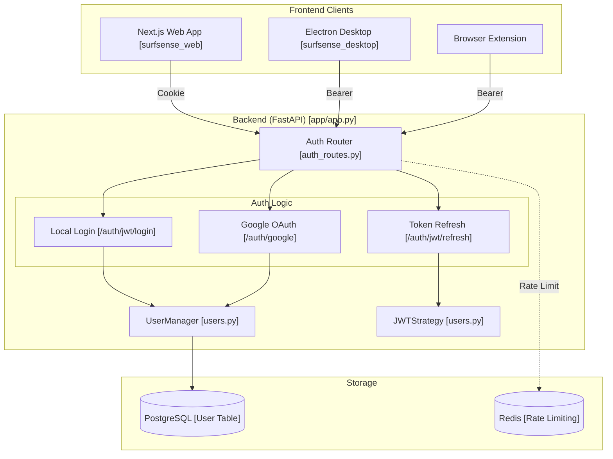
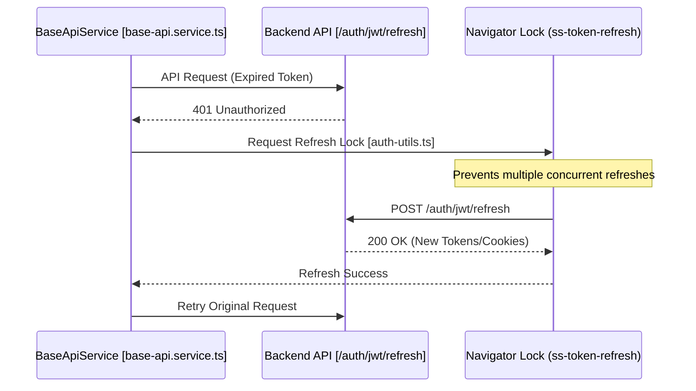

<!-- source: DeepWiki mcp.deepwiki.com · repo MODSetter/SurfSense · page 4.1 Authentication System · fetched 2026-10-29 -->

# Authentication System

Relevant source files

The following files were used as context for generating this wiki page:

- [surfsense_backend/alembic/versions/166_add_pat_and_api_access.py](surfsense_backend/alembic/versions/166_add_pat_and_api_access.py)
- [surfsense_backend/alembic/versions/169_migrate_google_oauth_account_ids_to_sub.py](surfsense_backend/alembic/versions/169_migrate_google_oauth_account_ids_to_sub.py)
- [surfsense_backend/alembic/versions/92_add_refresh_tokens_table.py](surfsense_backend/alembic/versions/92_add_refresh_tokens_table.py)
- [surfsense_backend/app/app.py](surfsense_backend/app/app.py)
- [surfsense_backend/app/auth/csrf.py](surfsense_backend/app/auth/csrf.py)
- [surfsense_backend/app/auth/session_cookies.py](surfsense_backend/app/auth/session_cookies.py)
- [surfsense_backend/app/celery_app.py](surfsense_backend/app/celery_app.py)
- [surfsense_backend/app/routes/auth_routes.py](surfsense_backend/app/routes/auth_routes.py)
- [surfsense_backend/app/routes/users_routes.py](surfsense_backend/app/routes/users_routes.py)
- [surfsense_backend/app/schemas/auth.py](surfsense_backend/app/schemas/auth.py)
- [surfsense_backend/app/tasks/celery_tasks/gateway_tasks.py](surfsense_backend/app/tasks/celery_tasks/gateway_tasks.py)
- [surfsense_backend/app/users.py](surfsense_backend/app/users.py)
- [surfsense_backend/app/utils/refresh_tokens.py](surfsense_backend/app/utils/refresh_tokens.py)
- [surfsense_backend/scripts/revoke_refresh_tokens_cutover.py](surfsense_backend/scripts/revoke_refresh_tokens_cutover.py)
- [surfsense_backend/tests/unit/gateway/test_enqueue_received_sweep.py](surfsense_backend/tests/unit/gateway/test_enqueue_received_sweep.py)
- [surfsense_backend/tests/unit/gateway/test_process_inbound_event_task.py](surfsense_backend/tests/unit/gateway/test_process_inbound_event_task.py)
- [surfsense_desktop/src/modules/shortcuts.ts](surfsense_desktop/src/modules/shortcuts.ts)
- [surfsense_web/app/(home)/[slug]/page.tsx](surfsense_web/app/(home)/[slug]/page.tsx)
- [surfsense_web/app/(home)/login/GoogleLoginButton.tsx](surfsense_web/app/(home)/login/GoogleLoginButton.tsx)
- [surfsense_web/app/(home)/login/LocalLoginForm.tsx](surfsense_web/app/(home)/login/LocalLoginForm.tsx)
- [surfsense_web/app/(home)/login/page.tsx](surfsense_web/app/(home)/login/page.tsx)
- [surfsense_web/app/(home)/page.tsx](surfsense_web/app/(home)/page.tsx)
- [surfsense_web/app/(home)/register/page.tsx](surfsense_web/app/(home)/register/page.tsx)
- [surfsense_web/app/auth/callback/loading.tsx](surfsense_web/app/auth/callback/loading.tsx)
- [surfsense_web/app/dashboard/layout.tsx](surfsense_web/app/dashboard/layout.tsx)
- [surfsense_web/app/dashboard/loading.tsx](surfsense_web/app/dashboard/loading.tsx)
- [surfsense_web/app/dashboard/page.tsx](surfsense_web/app/dashboard/page.tsx)
- [surfsense_web/app/desktop/login/page.tsx](surfsense_web/app/desktop/login/page.tsx)
- [surfsense_web/atoms/ui/loading.atoms.ts](surfsense_web/atoms/ui/loading.atoms.ts)
- [surfsense_web/components/UserDropdown.tsx](surfsense_web/components/UserDropdown.tsx)
- [surfsense_web/components/desktop/shortcut-recorder.tsx](surfsense_web/components/desktop/shortcut-recorder.tsx)
- [surfsense_web/components/json-metadata-viewer.tsx](surfsense_web/components/json-metadata-viewer.tsx)
- [surfsense_web/components/providers/GlobalLoadingProvider.tsx](surfsense_web/components/providers/GlobalLoadingProvider.tsx)
- [surfsense_web/contracts/types/auth.types.ts](surfsense_web/contracts/types/auth.types.ts)
- [surfsense_web/contracts/types/index.ts](surfsense_web/contracts/types/index.ts)
- [surfsense_web/contracts/types/user.types.ts](surfsense_web/contracts/types/user.types.ts)
- [surfsense_web/hooks/use-global-loading.ts](surfsense_web/hooks/use-global-loading.ts)
- [surfsense_web/lib/apis/auth-api.service.ts](surfsense_web/lib/apis/auth-api.service.ts)
- [surfsense_web/lib/apis/base-api.service.ts](surfsense_web/lib/apis/base-api.service.ts)
- [surfsense_web/lib/auth-errors.ts](surfsense_web/lib/auth-errors.ts)
- [surfsense_web/lib/auth-utils.ts](surfsense_web/lib/auth-utils.ts)
- [surfsense_web/lib/connectors-marketing/amazon.tsx](surfsense_web/lib/connectors-marketing/amazon.tsx)
- [surfsense_web/lib/connectors-marketing/indeed.tsx](surfsense_web/lib/connectors-marketing/indeed.tsx)
- [surfsense_web/lib/connectors-marketing/index.ts](surfsense_web/lib/connectors-marketing/index.ts)
- [surfsense_web/lib/connectors-marketing/walmart.tsx](surfsense_web/lib/connectors-marketing/walmart.tsx)
- [surfsense_web/lib/error.ts](surfsense_web/lib/error.ts)
- [surfsense_web/lib/utils.ts](surfsense_web/lib/utils.ts)

## Purpose and Scope

This document details the authentication mechanisms in SurfSense, covering local email/password authentication, Google OAuth integration, session management via JWT, and Personal Access Token (PAT) verification. The system is designed to provide secure, cross-platform identity verification for the web application, desktop client, and browser extension.

---

## Authentication Architecture Overview

SurfSense implements a multi-modal authentication system primarily driven by the `fastapi-users` library on the backend and a combination of secure cookies and Bearer tokens on the frontend.

| Authentication Method | Code Entity | Storage Mechanism |
|-------------------|-------------------|-------------|
| **Web Session** | `auth_backend` [surfsense_backend/app/users.py:67]() | HTTP-Only Cookie (`surfsense`) |
| **Desktop/Extension** | `JWTStrategy` [surfsense_backend/app/users.py:13]() | Bearer Token in Header |
| **API/PAT** | `resolve_pat` [surfsense_backend/app/utils/pat.py:36]() | `X-API-Key` Header |

**Authentication Flow Architecture**

**Sources:**
- [surfsense_backend/app/app.py:57-66]()
- [surfsense_backend/app/users.py:54-130]()
- [surfsense_web/lib/apis/base-api.service.ts:109-132]()

---

## Local Authentication (JWT)

Local authentication is used when `AUTH_TYPE` is set to `LOCAL`. It involves standard email/password registration and login flows.

### Registration and Onboarding

When a user registers via `UserManager.on_after_register` [surfsense_backend/app/users.py:151](), the system automatically:
1. Creates a default personal workspace named "My Workspace" [surfsense_backend/app/users.py:161-165]().
2. Initializes default RBAC roles (Owner, Admin, Editor, Viewer) for that workspace [surfsense_backend/app/users.py:170-186]().
3. Populates the user's account with system default prompts from `SYSTEM_PROMPT_DEFAULTS` [surfsense_backend/app/users.py:197-199]().

### Login and Token Issuance

The login flow is initiated by the `LocalLoginForm` [surfsense_web/app/(home)/login/LocalLoginForm.tsx:34](), which calls the `login` mutation.

- **Web Clients**: Use `credentials: "include"` in fetch requests to receive and send JWTs inside HTTP-only cookies [surfsense_web/lib/apis/base-api.service.ts:149]().
- **Desktop Clients**: Use the `getDesktopAccessToken` helper [surfsense_web/lib/apis/base-api.service.ts:114]() to retrieve tokens managed by the Electron bridge. If the token is missing, the user is redirected to `/desktop/login` [surfsense_web/lib/apis/base-api.service.ts:135-140]().

**Sources:**
- [surfsense_backend/app/users.py:151-199]()
- [surfsense_web/app/(home)/login/LocalLoginForm.tsx:34-82]()
- [surfsense_web/lib/apis/base-api.service.ts:109-150]()

---

## Google OAuth Flow

SurfSense supports Google OAuth 2.0. To prevent CSRF issues in cross-origin environments (like Safari or Firefox), the system uses a specific `authorize-redirect` endpoint.

### Redirect-Based Authorization
Instead of a client-side fetch, the `GoogleLoginButton` redirects the browser directly to the backend endpoint `/auth/google/authorize-redirect` [surfsense_web/app/(home)/login/GoogleLoginButton.tsx:54]().

1. **Initiation**: User clicks "Continue with Google".
2. **Backend Redirect**: The backend sets a CSRF cookie in a same-site context and redirects to Google [surfsense_web/app/(home)/login/GoogleLoginButton.tsx:49-53]().
3. **Callback**: Google redirects back to the callback endpoint.
4. **Profile Sync**: The `UserManager.oauth_callback` [surfsense_backend/app/users.py:66-129]() fetches the user's Google profile (name and avatar) via the Google People API [surfsense_backend/app/users.py:99-105]() and updates the local `User` record.

**Sources:**
- [surfsense_web/app/(home)/login/GoogleLoginButton.tsx:42-55]()
- [surfsense_backend/app/users.py:66-129]()

---

## JWT and Session Management

SurfSense uses a dual-token system (Access + Refresh) to balance security and user experience.

### Token Refresh Logic
The `BaseApiService` handles automatic token refreshing when a `401 Unauthorized` is encountered [surfsense_web/lib/apis/base-api.service.ts:198-210]().

### Desktop Session Persistence
In the Electron application, session management is delegated to the `electronAPI`. The `refreshSession` utility [surfsense_web/lib/auth-utils.ts:209-226]() checks for the desktop environment and calls `window.electronAPI.refreshAccessToken()` [surfsense_web/lib/auth-utils.ts:183]().

**Sources:**
- [surfsense_web/lib/apis/base-api.service.ts:198-210]()
- [surfsense_web/lib/auth-utils.ts:181-226]()

---

## API Key and PAT Verification

For programmatic access and external integrations (like the MCP server), SurfSense supports Personal Access Tokens (PAT).

- **Prefix**: All PATs start with a specific prefix defined in `PAT_PREFIX` [surfsense_backend/app/utils/pat.py:36]().
- **Verification**: The `resolve_pat` function [surfsense_backend/app/utils/pat.py:36]() validates the token against the database and calls `maybe_touch_last_used` to update the `last_used_at` timestamp.
- **Middleware**: API keys are typically passed in headers for programmatic access, while the frontend provides a management UI at `/dashboard/api-key` [surfsense_web/components/UserDropdown.tsx:75-79]().

**Sources:**
- [surfsense_backend/app/utils/pat.py:36]()
- [surfsense_web/components/UserDropdown.tsx:75-79]()

---

## Security and Rate Limiting

To protect against brute-force and enumeration attacks, SurfSense implements several security layers:

1. **OWASP Compliance**: The `UserManager` returns generic error messages for failed logins to prevent user enumeration [surfsense_backend/app/users.py:54-61]().
2. **Rate Limiting**: Auth endpoints are protected by `SlowAPI` using Redis for storage [surfsense_backend/app/app.py:75-81]().
3. **Error Sanitization**: 500-level errors are sanitized to `GENERIC_5XX_MESSAGE` to prevent leaking sensitive internal state [surfsense_backend/app/app.py:138-141]().
4. **CSRF Protection**: The `CsrfOriginMiddleware` [surfsense_backend/app/app.py:32]() and strict cookie policies ensure only trusted origins can interact with sensitive auth routes.

**Sources:**
- [surfsense_backend/app/app.py:75-141]()
- [surfsense_backend/app/users.py:54-61]()

---

