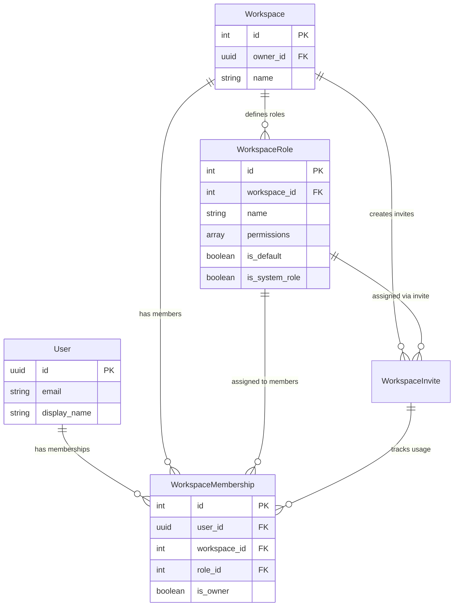
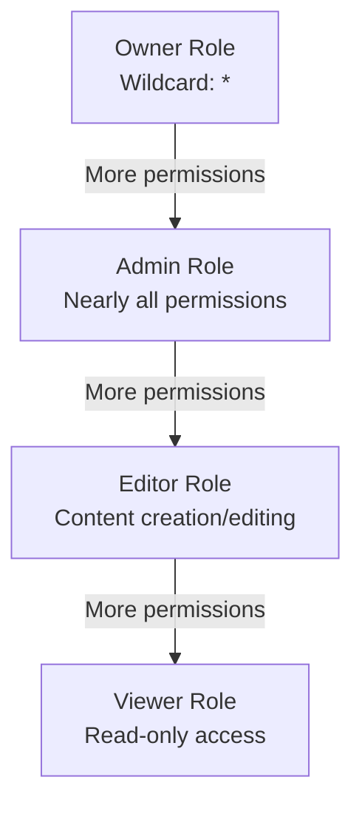
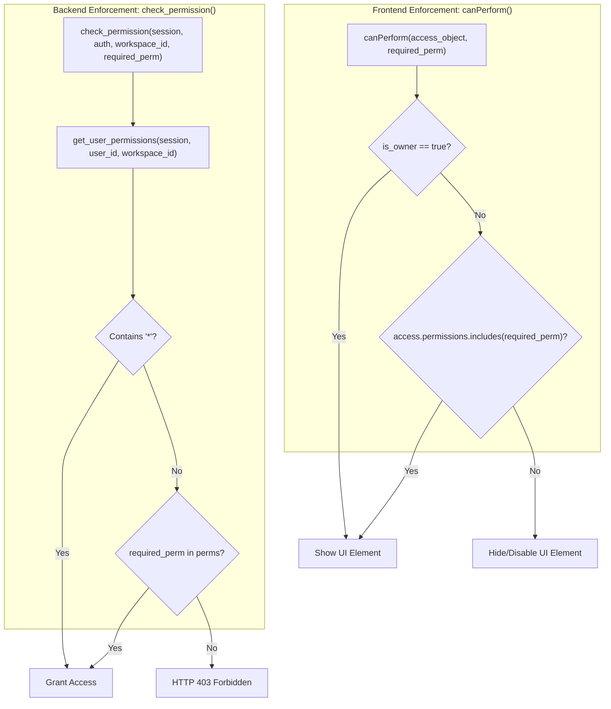

<!-- source: DeepWiki mcp.deepwiki.com · repo MODSetter/SurfSense · page 4.2 RBAC and Permissions · fetched 2026-10-29 -->

# RBAC and Permissions

<details>
<summary>Relevant source files</summary>

The following files were used as context for generating this wiki page:

- [surfsense_backend/alembic/versions/103_add_last_login_to_user.py](surfsense_backend/alembic/versions/103_add_last_login_to_user.py)
- [surfsense_backend/app/gateway/accounts.py](surfsense_backend/app/gateway/accounts.py)
- [surfsense_backend/app/gateway/agent_invoke.py](surfsense_backend/app/gateway/agent_invoke.py)
- [surfsense_backend/app/gateway/auth_invariant.py](surfsense_backend/app/gateway/auth_invariant.py)
- [surfsense_backend/app/gateway/bindings.py](surfsense_backend/app/gateway/bindings.py)
- [surfsense_backend/app/gateway/inbox.py](surfsense_backend/app/gateway/inbox.py)
- [surfsense_backend/app/gateway/inbox_processor.py](surfsense_backend/app/gateway/inbox_processor.py)
- [surfsense_backend/app/gateway/pairing.py](surfsense_backend/app/gateway/pairing.py)
- [surfsense_backend/app/gateway/ratelimit.py](surfsense_backend/app/gateway/ratelimit.py)
- [surfsense_backend/app/gateway/registry.py](surfsense_backend/app/gateway/registry.py)
- [surfsense_backend/app/gateway/thread_lock.py](surfsense_backend/app/gateway/thread_lock.py)
- [surfsense_backend/app/routes/agent_action_log_route.py](surfsense_backend/app/routes/agent_action_log_route.py)
- [surfsense_backend/app/routes/agent_permissions_route.py](surfsense_backend/app/routes/agent_permissions_route.py)
- [surfsense_backend/app/routes/rbac_routes.py](surfsense_backend/app/routes/rbac_routes.py)
- [surfsense_backend/app/schemas/rbac_schemas.py](surfsense_backend/app/schemas/rbac_schemas.py)
- [surfsense_backend/app/utils/rbac.py](surfsense_backend/app/utils/rbac.py)
- [surfsense_backend/tests/unit/gateway/test_pairing.py](surfsense_backend/tests/unit/gateway/test_pairing.py)
- [surfsense_web/atoms/public-chat-snapshots/public-chat-snapshots-query.atoms.ts](surfsense_web/atoms/public-chat-snapshots/public-chat-snapshots-query.atoms.ts)
- [surfsense_web/components/assistant-ui/connector-popup/connector-configs/components/discord-config.tsx](surfsense_web/components/assistant-ui/connector-popup/connector-configs/components/discord-config.tsx)
- [surfsense_web/components/assistant-ui/connector-popup/connector-configs/components/slack-config.tsx](surfsense_web/components/assistant-ui/connector-popup/connector-configs/components/slack-config.tsx)
- [surfsense_web/components/public-chat-snapshots/public-chat-snapshot-row.tsx](surfsense_web/components/public-chat-snapshots/public-chat-snapshot-row.tsx)
- [surfsense_web/components/public-chat-snapshots/public-chat-snapshots-list.tsx](surfsense_web/components/public-chat-snapshots/public-chat-snapshots-list.tsx)
- [surfsense_web/components/public-chat-snapshots/public-chat-snapshots-manager.tsx](surfsense_web/components/public-chat-snapshots/public-chat-snapshots-manager.tsx)
- [surfsense_web/components/settings/general-settings-manager.tsx](surfsense_web/components/settings/general-settings-manager.tsx)
- [surfsense_web/components/settings/prompt-config-manager.tsx](surfsense_web/components/settings/prompt-config-manager.tsx)
- [surfsense_web/components/settings/roles-manager.tsx](surfsense_web/components/settings/roles-manager.tsx)
- [surfsense_web/components/ui/alert.tsx](surfsense_web/components/ui/alert.tsx)
- [surfsense_web/contracts/types/chat-threads.types.ts](surfsense_web/contracts/types/chat-threads.types.ts)
- [surfsense_web/contracts/types/members.types.ts](surfsense_web/contracts/types/members.types.ts)
- [surfsense_web/contracts/types/permissions.types.ts](surfsense_web/contracts/types/permissions.types.ts)
- [surfsense_web/contracts/types/public-chat.types.ts](surfsense_web/contracts/types/public-chat.types.ts)
- [surfsense_web/lib/apis/chat-threads-api.service.ts](surfsense_web/lib/apis/chat-threads-api.service.ts)
- [surfsense_web/lib/apis/invites-api.service.ts](surfsense_web/lib/apis/invites-api.service.ts)
- [surfsense_web/lib/apis/members-api.service.ts](surfsense_web/lib/apis/members-api.service.ts)
- [surfsense_web/lib/apis/permissions-api.service.ts](surfsense_web/lib/apis/permissions-api.service.ts)
- [surfsense_web/lib/apis/public-chat-api.service.ts](surfsense_web/lib/apis/public-chat-api.service.ts)
- [surfsense_web/lib/apis/roles-api.service.ts](surfsense_web/lib/apis/roles-api.service.ts)

</details>


## Purpose and Scope

This page documents SurfSense's Role-Based Access Control (RBAC) system and permission model. It covers granular permissions, role definitions, membership management, permission checking utilities, and how authorization is enforced across API routes.

For authentication mechanisms (JWT, OAuth, bearer tokens), see [Authentication System](4.1). For SearchSpace multi-tenancy and invitation system, see [SearchSpace and Multi-Tenancy](5). This page focuses on how permissions are defined, assigned to roles, and checked during resource access.

---

## Permission System Overview

### Permission Enum

SurfSense implements **granular resource-level permissions** using a string-based enum. Each permission follows the format `resource:action`, allowing fine-grained control over what users can do within a SearchSpace.

**Permission Format:**

```
resource:action
```

Examples: `documents:read`, `chats:create`, `connectors:delete`

**Permission Categories:**

```mermaid
graph TB
    Perms["Permission Enum"]
    
    subgraph "Document Permissions"
        DOCS_C["documents:create"]
        DOCS_R["documents:read"]
        DOCS_U["documents:update"]
        DOCS_D["documents:delete"]
    end
    
    subgraph "Chat Permissions"
        CHATS_C["chats:create"]
        CHATS_R["chats:read"]
        CHATS_U["chats:update"]
        CHATS_D["chats:delete"]
    end
    
    subgraph "Connector Permissions"
        CONN_C["connectors:create"]
        CONN_R["connectors:read"]
        CONN_U["connectors:update"]
        CONN_D["connectors:delete"]
    end
    
    subgraph "LLM Config Permissions"
        LLM_C["llm_configs:create"]
        LLM_R["llm_configs:read"]
        LLM_U["llm_configs:update"]
        LLM_D["llm_configs:delete"]
    end
    
    subgraph "Podcast Permissions"
        POD_C["podcasts:create"]
        POD_R["podcasts:read"]
        POD_U["podcasts:update"]
        POD_D["podcasts:delete"]
    end
    
    subgraph "Member Management"
        MEM_I["members:invite"]
        MEM_V["members:view"]
        MEM_R["members:remove"]
        MEM_M["members:manage_roles"]
    end
    
    subgraph "Role Management"
        ROLE_C["roles:create"]
        ROLE_R["roles:read"]
        ROLE_U["roles:update"]
        ROLE_D["roles:delete"]
    end
    
    subgraph "Settings & Logs"
        SET_V["settings:view"]
        SET_U["settings:update"]
        SET_D["settings:delete"]
        LOG_R["logs:read"]
        LOG_D["logs:delete"]
    end

    subgraph "Automation Permissions"
        AUTO_C["automations:create"]
        AUTO_R["automations:read"]
        AUTO_U["automations:update"]
        AUTO_D["automations:delete"]
        AUTO_X["automations:execute"]
    end

    subgraph "Sharing Permissions"
        PUB_V["public_sharing:view"]
        PUB_D["public_sharing:delete"]
    end
    
    subgraph "Wildcard"
        FULL["* (FULL_ACCESS)"]
    end
    
    Perms --> DOCS_C & DOCS_R & DOCS_U & DOCS_D
    Perms --> CHATS_C & CHATS_R & CHATS_U & CHATS_D
    Perms --> CONN_C & CONN_R & CONN_U & CONN_D
    Perms --> LLM_C & LLM_R & LLM_U & LLM_D
    Perms --> POD_C & POD_R & POD_U & POD_D
    Perms --> MEM_I & MEM_V & MEM_R & MEM_M
    Perms --> ROLE_C & ROLE_R & ROLE_U & ROLE_D
    Perms --> SET_V & SET_U & SET_D & LOG_R & LOG_D
    Perms --> AUTO_C & AUTO_R & AUTO_U & AUTO_D & AUTO_X
    Perms --> PUB_V & PUB_D
    Perms --> FULL
```



**Permission Definitions:**

| Permission | Resource | Action | Description |
|-----------|----------|--------|-------------|
| `documents:create` | Documents | Create | Upload new documents |
| `documents:read` | Documents | Read | View document content |
| `documents:update` | Documents | Update | Edit document metadata or content |
| `documents:delete` | Documents | Delete | Remove documents |
| `chats:create` | Chats | Create | Start new chat sessions |
| `chats:read` | Chats | Read | View chat history |
| `chats:update` | Chats | Update | Modify chat messages |
| `chats:delete` | Chats | Delete | Remove chat sessions |
| `llm_configs:create` | LLM Configs | Create | Add new LLM configurations |
| `llm_configs:read` | LLM Configs | Read | View LLM configurations |
| `llm_configs:update` | LLM Configs | Update | Modify LLM settings |
| `llm_configs:delete` | LLM Configs | Delete | Remove LLM configurations |
| `podcasts:create` | Podcasts | Create | Generate new podcasts |
| `podcasts:read` | Podcasts | Read | Listen to podcasts |
| `podcasts:update` | Podcasts | Update | Modify podcast metadata |
| `podcasts:delete` | Podcasts | Delete | Remove podcasts |
| `connectors:create` | Connectors | Create | Add new data source connectors |
| `connectors:read` | Connectors | Read | View connector configurations |
| `connectors:update` | Connectors | Update | Modify connector settings |
| `connectors:delete` | Connectors | Delete | Remove connectors |
| `automations:create`| Automations | Create | Create scheduled agent tasks |
| `automations:execute`| Automations | Execute| Manually trigger agent tasks |
| `public_sharing:view`| Sharing | View | View public chat snapshots |
| `*` | All | All | Full access wildcard (grants all permissions) |

**Sources:** [surfsense_backend/app/routes/rbac_routes.py:65-122](), [surfsense_web/components/settings/roles-manager.tsx:180-190]()

### Wildcard Permission

The special `*` permission grants **full access** to all resources and actions. It acts as a superuser flag within a SearchSpace. Only the **Owner** role has this wildcard permission by default.

**Sources:** [surfsense_backend/app/routes/rbac_routes.py:121](), [surfsense_backend/app/utils/rbac.py:40-41]()

---

## Role-Based Access Control

### RBAC Data Model

SurfSense's RBAC system consists of three core entities: `WorkspaceRole`, `WorkspaceMembership`, and `WorkspaceInvite`. Each SearchSpace maintains its own isolated set of roles and memberships.

**RBAC Entity Relationships:**



**Sources:** [surfsense_backend/app/routes/rbac_routes.py:22-28](), [surfsense_backend/app/schemas/rbac_schemas.py:1-100]()

### WorkspaceRole Model

The `WorkspaceRole` entity defines named collections of permissions within a SearchSpace.

| Field | Type | Purpose |
|-------|------|---------|
| `id` | Integer | Primary key |
| `workspace_id` | Integer (FK) | Workspace this role belongs to |
| `name` | String | Role display name (e.g., "Owner", "Editor") |
| `permissions` | List[String] | List of permission strings |
| `is_default` | Boolean | Assigned to new members by default |
| `is_system_role` | Boolean | Built-in role (cannot be deleted) |

**Sources:** [surfsense_backend/app/routes/rbac_routes.py:159-225]()

---

## Default System Roles and Presets

### Predefined Role Hierarchy

SurfSense creates **four system roles** automatically when a SearchSpace is created. These roles provide a standard permission hierarchy.

**Role Hierarchy:**



### Owner Role
**Permissions:** `["*"]` (wildcard - full access). Full access to all search space resources and settings. Original creator automatically gets this role.
**Sources:** [surfsense_backend/app/routes/rbac_routes.py:121](), [surfsense_backend/app/utils/rbac.py:40-41]()

### Admin Role
**Permissions:** Comprehensive management access. Can manage members, roles, connectors, and settings.
**Sources:** [surfsense_backend/app/routes/rbac_routes.py:102-111]()

### Editor Role
**Permissions:** Content creation and editing. Can create and edit documents, chats, and podcasts. 
**Preset includes:** `documents:create`, `documents:update`, `chats:create`, `podcasts:create`, `automations:execute`.
**Sources:** [surfsense_web/components/settings/roles-manager.tsx:192-223]()

### Viewer Role
**Permissions:** Read-only access to all resources.
**Preset includes:** `documents:read`, `chats:read`, `podcasts:read`, `connectors:read`.
**Sources:** [surfsense_web/components/settings/roles-manager.tsx:224-241]()

---

## Permission Checking Utilities

### Core Permission Logic

SurfSense provides utility functions for checking user permissions. These functions support the **wildcard `*` permission** which short-circuits checks.

**Permission Checking Flow:**



**Sources:** [surfsense_backend/app/utils/rbac.py:14-45](), [surfsense_web/atoms/members/members-query.atoms.ts:30]()

---

## Authorization Enforcement in API Routes

### Backend Enforcement

The `check_permission` function provides centralized enforcement. It is used as a guard in FastAPI route handlers.

**Example: Role Management Guard**
```python
# surfsense_backend/app/routes/rbac_routes.py
await check_permission(
    session,
    auth,
    workspace_id,
    Permission.ROLES_CREATE.value,
    "You don't have permission to create roles",
)
```
**Sources:** [surfsense_backend/app/routes/rbac_routes.py:170-176]()

### Frontend Enforcement

The frontend application uses the `canPerform` utility and `myAccessAtom` to toggle UI elements based on the current user's permissions within a workspace.

**Example: Public Chat Management**
```typescript
// surfsense_web/components/public-chat-snapshots/public-chat-snapshots-manager.tsx
const { data: access } = useAtomValue(myAccessAtom);
const canView = !!access && (access.is_owner || (access.permissions?.includes("public_sharing:view") ?? false));
const canDelete = !!access && (access.is_owner || (access.permissions?.includes("public_sharing:delete") ?? false));
```
**Sources:** [surfsense_web/components/public-chat-snapshots/public-chat-snapshots-manager.tsx:55-61]()

### External Surface Authorization (Gateway)

For external surfaces like Telegram or Slack, SurfSense enforces an **Authorization Invariant**. Before an agent can be invoked via a messaging platform, the system verifies that the binding between the external peer and the SurfSense user is valid and active.

**Sources:** [surfsense_backend/app/gateway/agent_invoke.py:67-68](), [surfsense_backend/app/gateway/auth_invariant.py:1-50]()

---

## Membership and Roles Management UI

Users with `roles:read` and `members:view` permissions can access the Team and Roles settings.

1.  **Members List**: Displays all users in the workspace, their assigned roles, and allows updating roles or removing members (requires `members:manage_roles` or `members:remove`).
2.  **Roles Manager**: Allows creating and editing custom roles by selecting granular permissions from categories like Documents, AI Chats, Automations, and Connectors.
3.  **Role Presets**: Provides "Editor", "Viewer", and "Contributor" templates to quickly bootstrap permissions.

**Sources:** [surfsense_web/components/settings/roles-manager.tsx:1-266](), [surfsense_web/lib/apis/members-api.service.ts:21-121]()

---

