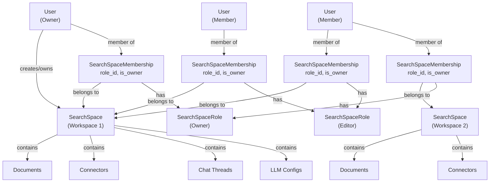
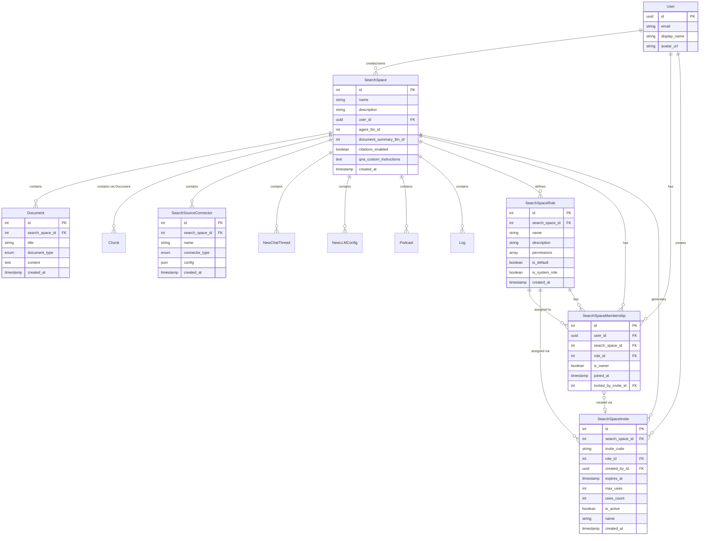
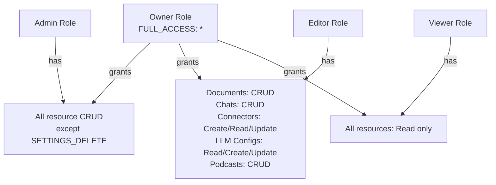
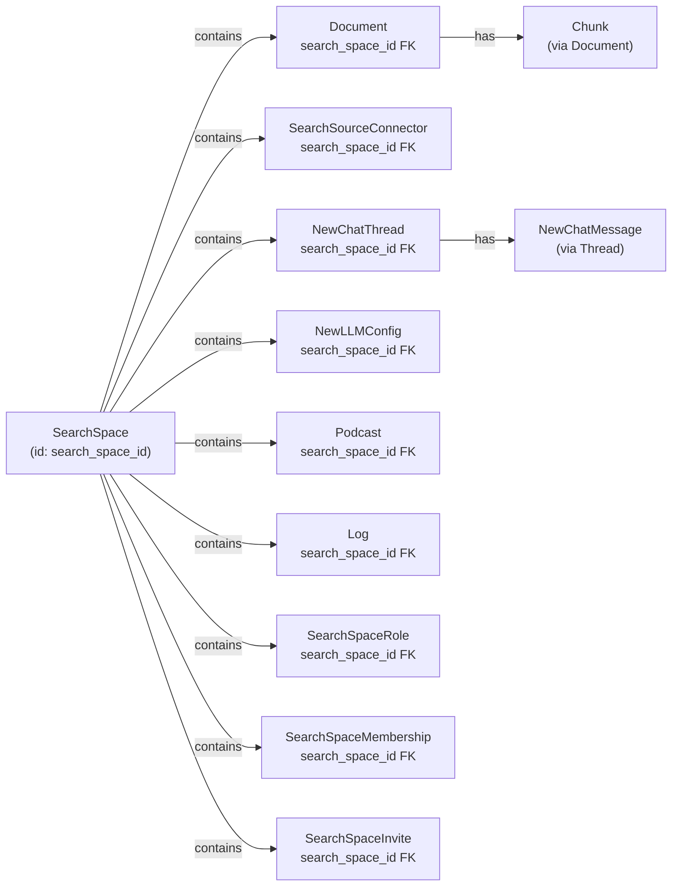

<!-- source: DeepWiki mcp.deepwiki.com · repo MODSetter/SurfSense · page 5 SearchSpace and Multi-Tenancy · fetched 2026-10-29 -->

# SearchSpace and Multi-Tenancy

<details>
<summary>Relevant source files</summary>

The following files were used as context for generating this wiki page:

- [surfsense_backend/.env.example](surfsense_backend/.env.example)
- [surfsense_backend/alembic/versions/103_add_last_login_to_user.py](surfsense_backend/alembic/versions/103_add_last_login_to_user.py)
- [surfsense_backend/app/config/__init__.py](surfsense_backend/app/config/__init__.py)
- [surfsense_backend/app/connectors/composio_connector.py](surfsense_backend/app/connectors/composio_connector.py)
- [surfsense_backend/app/db.py](surfsense_backend/app/db.py)
- [surfsense_backend/app/gateway/accounts.py](surfsense_backend/app/gateway/accounts.py)
- [surfsense_backend/app/gateway/agent_invoke.py](surfsense_backend/app/gateway/agent_invoke.py)
- [surfsense_backend/app/gateway/auth_invariant.py](surfsense_backend/app/gateway/auth_invariant.py)
- [surfsense_backend/app/gateway/bindings.py](surfsense_backend/app/gateway/bindings.py)
- [surfsense_backend/app/gateway/inbox.py](surfsense_backend/app/gateway/inbox.py)
- [surfsense_backend/app/gateway/inbox_processor.py](surfsense_backend/app/gateway/inbox_processor.py)
- [surfsense_backend/app/gateway/pairing.py](surfsense_backend/app/gateway/pairing.py)
- [surfsense_backend/app/gateway/ratelimit.py](surfsense_backend/app/gateway/ratelimit.py)
- [surfsense_backend/app/gateway/registry.py](surfsense_backend/app/gateway/registry.py)
- [surfsense_backend/app/gateway/thread_lock.py](surfsense_backend/app/gateway/thread_lock.py)
- [surfsense_backend/app/routes/__init__.py](surfsense_backend/app/routes/__init__.py)
- [surfsense_backend/app/routes/agent_action_log_route.py](surfsense_backend/app/routes/agent_action_log_route.py)
- [surfsense_backend/app/routes/agent_permissions_route.py](surfsense_backend/app/routes/agent_permissions_route.py)
- [surfsense_backend/app/routes/composio_routes.py](surfsense_backend/app/routes/composio_routes.py)
- [surfsense_backend/app/routes/documents_routes.py](surfsense_backend/app/routes/documents_routes.py)
- [surfsense_backend/app/routes/rbac_routes.py](surfsense_backend/app/routes/rbac_routes.py)
- [surfsense_backend/app/routes/search_source_connectors_routes.py](surfsense_backend/app/routes/search_source_connectors_routes.py)
- [surfsense_backend/app/schemas/documents.py](surfsense_backend/app/schemas/documents.py)
- [surfsense_backend/app/schemas/rbac_schemas.py](surfsense_backend/app/schemas/rbac_schemas.py)
- [surfsense_backend/app/schemas/search_source_connector.py](surfsense_backend/app/schemas/search_source_connector.py)
- [surfsense_backend/app/services/composio_service.py](surfsense_backend/app/services/composio_service.py)
- [surfsense_backend/app/tasks/celery_tasks/connector_tasks.py](surfsense_backend/app/tasks/celery_tasks/connector_tasks.py)
- [surfsense_backend/app/tasks/celery_tasks/document_tasks.py](surfsense_backend/app/tasks/celery_tasks/document_tasks.py)
- [surfsense_backend/app/tasks/celery_tasks/schedule_checker_task.py](surfsense_backend/app/tasks/celery_tasks/schedule_checker_task.py)
- [surfsense_backend/app/tasks/celery_tasks/stale_notification_cleanup_task.py](surfsense_backend/app/tasks/celery_tasks/stale_notification_cleanup_task.py)
- [surfsense_backend/app/tasks/composio_indexer.py](surfsense_backend/app/tasks/composio_indexer.py)
- [surfsense_backend/app/tasks/connector_indexers/__init__.py](surfsense_backend/app/tasks/connector_indexers/__init__.py)
- [surfsense_backend/app/utils/periodic_scheduler.py](surfsense_backend/app/utils/periodic_scheduler.py)
- [surfsense_backend/app/utils/rbac.py](surfsense_backend/app/utils/rbac.py)
- [surfsense_backend/tests/unit/gateway/test_pairing.py](surfsense_backend/tests/unit/gateway/test_pairing.py)
- [surfsense_web/content/docs/manual-installation.mdx](surfsense_web/content/docs/manual-installation.mdx)
- [surfsense_web/contracts/types/members.types.ts](surfsense_web/contracts/types/members.types.ts)
- [surfsense_web/contracts/types/permissions.types.ts](surfsense_web/contracts/types/permissions.types.ts)
- [surfsense_web/lib/apis/invites-api.service.ts](surfsense_web/lib/apis/invites-api.service.ts)
- [surfsense_web/lib/apis/members-api.service.ts](surfsense_web/lib/apis/members-api.service.ts)
- [surfsense_web/lib/apis/permissions-api.service.ts](surfsense_web/lib/apis/permissions-api.service.ts)
- [surfsense_web/lib/apis/roles-api.service.ts](surfsense_web/lib/apis/roles-api.service.ts)

</details>


## Purpose and Scope

This document explains the SearchSpace concept and how it enables multi-tenancy in SurfSense. A SearchSpace is the primary workspace container that isolates data and controls access for teams. All resources (documents, chats, connectors, LLM configs) are scoped to a SearchSpace, and team members interact through role-based access control.

For details on authentication and authorization mechanisms, see [Authentication and Authorization](#4). For information on the role-based permission system, see [RBAC and Permissions](#4.2).

## SearchSpace Overview

The `SearchSpace` is the fundamental unit of data isolation and collaboration in SurfSense. Each SearchSpace:

- Contains all user resources (documents, connectors, chats, LLM configurations) [surfsense_backend/app/db.py:528-609]()
- Has a single owner who created it [surfsense_backend/app/db.py:545]()
- Can have multiple members with assigned roles [surfsense_backend/app/db.py:752-799]()
- Maintains its own permission structure with custom roles [surfsense_backend/app/db.py:715-750]()
- Operates independently from other SearchSpaces

**Sources:** [surfsense_backend/app/db.py:528-609](), [surfsense_backend/app/db.py:752-799](), [surfsense_backend/app/db.py:715-750]()

## Multi-Tenancy Architecture



The architecture supports:
- Users can be members of multiple SearchSpaces [surfsense_backend/app/db.py:752-799]()
- Each SearchSpace has independent resources [surfsense_backend/app/db.py:553-609]()
- Membership associates users with SearchSpaces through roles [surfsense_backend/app/db.py:770]()
- Complete data isolation between SearchSpaces

**Sources:** [surfsense_backend/app/db.py:752-799](), [surfsense_backend/app/db.py:528-609]()

## Database Schema

### Core Tables



The schema enforces multi-tenancy through:
- All resources have `search_space_id` foreign key [surfsense_backend/app/db.py:553-609]()
- Cascading deletes (deleting SearchSpace removes all resources) [surfsense_backend/app/db.py:560]()
- Unique constraints scoped to SearchSpace [surfsense_backend/app/db.py:794]()
- Membership-based access control [surfsense_backend/app/db.py:752]()

**Sources:** [surfsense_backend/app/db.py:528-847]()

### SearchSpace Model Fields

| Field | Type | Description |
|-------|------|-------------|
| `id` | Integer | Primary key [surfsense_backend/app/db.py:529]() |
| `name` | String(100) | Workspace name [surfsense_backend/app/db.py:531]() |
| `description` | String(500) | Optional description [surfsense_backend/app/db.py:532]() |
| `citations_enabled` | Boolean | Enable/disable citations globally [surfsense_backend/app/db.py:536]() |
| `qna_custom_instructions` | Text | Custom system instructions [surfsense_backend/app/db.py:537]() |
| `agent_llm_id` | Integer | LLM config for chat/agent operations [surfsense_backend/app/db.py:541]() |
| `document_summary_llm_id` | Integer | LLM config for document summarization [surfsense_backend/app/db.py:543]() |
| `user_id` | UUID | Owner user ID (foreign key) [surfsense_backend/app/db.py:545]() |
| `created_at` | Timestamp | Creation timestamp [surfsense_backend/app/db.py:549]() |

**Sources:** [surfsense_backend/app/db.py:528-551]()

## Permission System

### Permission Enum

SurfSense defines granular permissions organized by resource category in the `Permission` enum:

- **Documents**: `DOCUMENTS_CREATE`, `DOCUMENTS_READ`, `DOCUMENTS_UPDATE`, `DOCUMENTS_DELETE`
- **Chats**: `CHATS_CREATE`, `CHATS_READ`, `CHATS_UPDATE`, `CHATS_DELETE`
- **LLM Configs**: `LLM_CONFIGS_CREATE`, `LLM_CONFIGS_READ`, `LLM_CONFIGS_UPDATE`, `LLM_CONFIGS_DELETE`
- **Connectors**: `CONNECTORS_CREATE`, `CONNECTORS_READ`, `CONNECTORS_UPDATE`, `CONNECTORS_DELETE`
- **Members**: `MEMBERS_INVITE`, `MEMBERS_VIEW`, `MEMBERS_REMOVE`, `MEMBERS_MANAGE_ROLES`
- **Roles**: `ROLES_CREATE`, `ROLES_READ`, `ROLES_UPDATE`, `ROLES_DELETE`
- **Settings**: `SETTINGS_VIEW`, `SETTINGS_UPDATE`, `SETTINGS_DELETE`
- **Wildcard**: `FULL_ACCESS` (`*`)

**Sources:** [surfsense_backend/app/db.py:137-196]()

### Default Role Permissions



Default role permission sets defined in `DEFAULT_ROLE_PERMISSIONS`:

| Role | Permissions | Can Delete SearchSpace |
|------|-------------|------------------------|
| Owner | `["*"]` (full access wildcard) | Yes |
| Admin | All CRUD on resources except `SETTINGS_DELETE` | No |
| Editor | Documents, Chats, Podcasts CRUD; Connectors Create/Read/Update; LLM Configs Read/Create/Update | No |
| Viewer | Read-only access to all resources | No |

**Sources:** [surfsense_backend/app/db.py:199-297](), [surfsense_backend/app/db.py:1050-1088]()

### SearchSpaceRole Model

```python
class SearchSpaceRole(DeclarativeBase):
    # ...
    name = Column(String(100), nullable=False, index=True)
    description = Column(String(500), nullable=True)
    permissions = Column(ARRAY(String), nullable=False, default=[])
    is_default = Column(Boolean, nullable=False, default=False)
    is_system_role = Column(Boolean, nullable=False, default=False)
    search_space_id = Column(Integer, ForeignKey("searchspaces.id", ondelete="CASCADE"))
```

Key features:
- **Custom roles**: Users can create roles with custom permission sets [surfsense_backend/app/db.py:715-750]()
- **System roles**: Default roles (Owner, Admin, Editor, Viewer) cannot be deleted (`is_system_role=True`) [surfsense_backend/app/db.py:734]()
- **Default role**: One role can be marked as default for new invites (`is_default=True`) [surfsense_backend/app/db.py:733]()
- **Unique constraint**: Role names are unique per SearchSpace [surfsense_backend/app/db.py:743]()

**Sources:** [surfsense_backend/app/db.py:715-750]()

## Resource Scoping

### Scoped Resources

All major resources are scoped to a SearchSpace via foreign key:



**Sources:** [surfsense_backend/app/db.py:553-609]()

### Permission Checking Implementation

Permission checks occur at the API route level using the `check_permission()` function:

```python
# Example from document creation in documents_routes.py
await check_permission(
    session,
    auth,
    request.workspace_id,
    Permission.DOCUMENTS_CREATE.value,
    "You don't have permission to create documents in this workspace",
)
```

The `check_permission()` function retrieves the user's membership, loads the assigned role, and verifies if the required permission string is present or if the `FULL_ACCESS` wildcard is used.

**Sources:** [surfsense_backend/app/routes/documents_routes.py:72-81](), [surfsense_backend/app/utils/rbac.py:80]()

## Membership Model

### SearchSpaceMembership

```python
class SearchSpaceMembership(DeclarativeBase):
    # ...
    user_id = Column(UUID(as_uuid=True), ForeignKey("user.id", ondelete="CASCADE"))
    search_space_id = Column(Integer, ForeignKey("searchspaces.id", ondelete="CASCADE"))
    role_id = Column(Integer, ForeignKey("search_space_roles.id", ondelete="SET NULL"))
    is_owner = Column(Boolean, nullable=False, default=False)
    joined_at = Column(TIMESTAMP(timezone=True), default=lambda: datetime.now(UTC))
    invited_by_invite_id = Column(Integer, ForeignKey("search_space_invites.id"))
```

Key fields:
- **`user_id`**: Links to User table [surfsense_backend/app/db.py:768]()
- **`search_space_id`**: Links to SearchSpace [surfsense_backend/app/db.py:769]()
- **`role_id`**: Assigned role [surfsense_backend/app/db.py:770]()
- **`is_owner`**: Marks the SearchSpace creator [surfsense_backend/app/db.py:771]()
- **`invited_by_invite_id`**: Tracks which invite was used [surfsense_backend/app/db.py:773]()

**Sources:** [surfsense_backend/app/db.py:752-799]()

## Invitation System

### SearchSpaceInvite Model

```python
class SearchSpaceInvite(DeclarativeBase):
    # ...
    invite_code = Column(String(64), nullable=False, unique=True, index=True)
    search_space_id = Column(Integer, ForeignKey("searchspaces.id", ondelete="CASCADE"))
    role_id = Column(Integer, ForeignKey("search_space_roles.id", ondelete="SET NULL"))
    created_by_id = Column(UUID(as_uuid=True), ForeignKey("user.id", ondelete="SET NULL"))
    expires_at = Column(TIMESTAMP(timezone=True), nullable=True)
    max_uses = Column(Integer, nullable=True)
    uses_count = Column(Integer, nullable=False, default=0)
    is_active = Column(Boolean, nullable=False, default=True)
    name = Column(String(100), nullable=True)
```

Invite features include secure `invite_code` generation, optional expiration, usage limits, and manual activation toggles.

**Sources:** [surfsense_backend/app/db.py:801-847]()

## Multi-Account Connector Support

Connectors support multiple accounts per SearchSpace and user through a composite unique constraint:

```python
# Unique constraint in SearchSourceConnector
UniqueConstraint(
    "workspace_id",
    "user_id",
    "connector_type",
    "name",
    name="uq_workspace_user_connector_type_name",
)
```

This enables multiple instances of the same connector type (e.g., multiple Google Drive accounts) within a single workspace.

**Sources:** [surfsense_backend/app/db.py:648-654](), [surfsense_backend/app/routes/search_source_connectors_routes.py:17-19]()

## Child Pages

For more detailed technical information, see:
- [SearchSpace Architecture](#5.1) — Detailed isolation and resource scoping mechanics.
- [Team Management](#5.2) — Interface for role assignment and member oversight.
- [Membership and Invitations](#5.3) — The invitation lifecycle and secure joining flow.

## Key Takeaways

1. **SearchSpace** is the fundamental unit of workspace isolation and data scoping.
2. **All resources** belong to exactly one SearchSpace via `search_space_id`.
3. **Membership** links users to SearchSpaces with assigned roles.
4. **Permissions** are granular and checked at the API route level.
5. **Owners** have permanent full access; **members** have role-based access.
6. **Multi-tenancy** is enforced through foreign keys, unique constraints, and cascading deletes.

---

