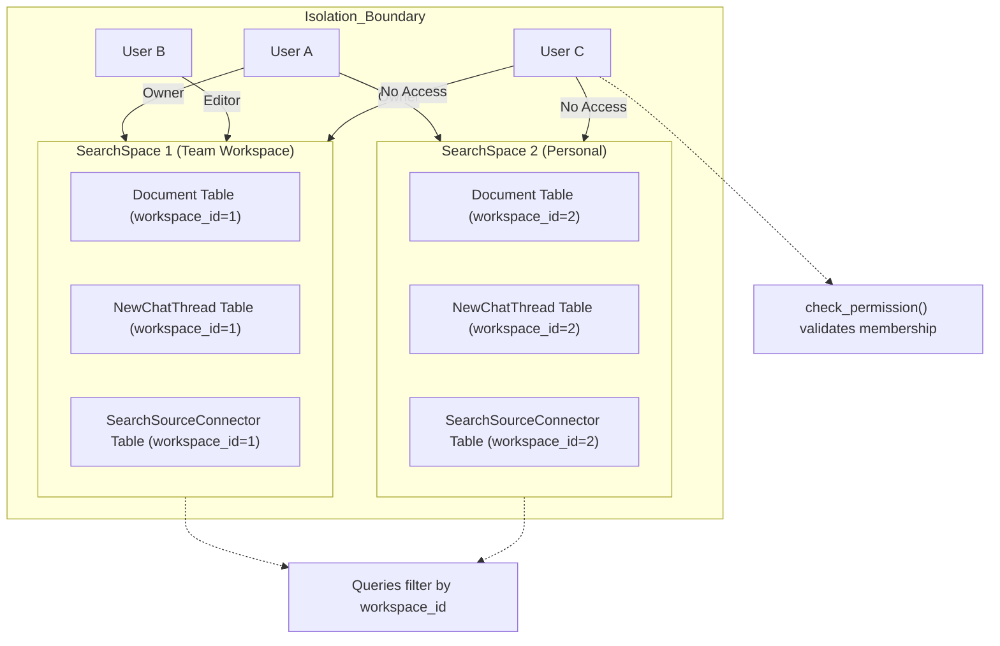
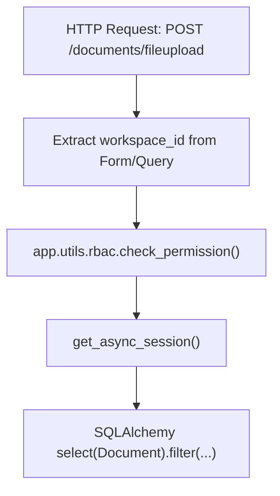
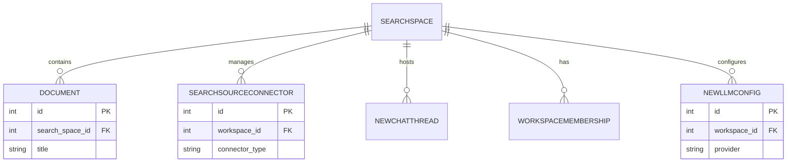

<!-- source: DeepWiki mcp.deepwiki.com · repo MODSetter/SurfSense · page 5.1 SearchSpace Architecture · fetched 2026-10-29 -->

# SearchSpace Architecture

<details>
<summary>Relevant source files</summary>

The following files were used as context for generating this wiki page:

- [.vscode/settings.json](.vscode/settings.json)
- [surfsense_backend/.env.example](surfsense_backend/.env.example)
- [surfsense_backend/app/config/__init__.py](surfsense_backend/app/config/__init__.py)
- [surfsense_backend/app/connectors/composio_connector.py](surfsense_backend/app/connectors/composio_connector.py)
- [surfsense_backend/app/db.py](surfsense_backend/app/db.py)
- [surfsense_backend/app/routes/__init__.py](surfsense_backend/app/routes/__init__.py)
- [surfsense_backend/app/routes/composio_routes.py](surfsense_backend/app/routes/composio_routes.py)
- [surfsense_backend/app/routes/documents_routes.py](surfsense_backend/app/routes/documents_routes.py)
- [surfsense_backend/app/routes/search_source_connectors_routes.py](surfsense_backend/app/routes/search_source_connectors_routes.py)
- [surfsense_backend/app/schemas/documents.py](surfsense_backend/app/schemas/documents.py)
- [surfsense_backend/app/schemas/search_source_connector.py](surfsense_backend/app/schemas/search_source_connector.py)
- [surfsense_backend/app/services/composio_service.py](surfsense_backend/app/services/composio_service.py)
- [surfsense_backend/app/tasks/celery_tasks/connector_tasks.py](surfsense_backend/app/tasks/celery_tasks/connector_tasks.py)
- [surfsense_backend/app/tasks/celery_tasks/document_tasks.py](surfsense_backend/app/tasks/celery_tasks/document_tasks.py)
- [surfsense_backend/app/tasks/celery_tasks/schedule_checker_task.py](surfsense_backend/app/tasks/celery_tasks/schedule_checker_task.py)
- [surfsense_backend/app/tasks/celery_tasks/stale_notification_cleanup_task.py](surfsense_backend/app/tasks/celery_tasks/stale_notification_cleanup_task.py)
- [surfsense_backend/app/tasks/composio_indexer.py](surfsense_backend/app/tasks/composio_indexer.py)
- [surfsense_backend/app/tasks/connector_indexers/__init__.py](surfsense_backend/app/tasks/connector_indexers/__init__.py)
- [surfsense_backend/app/utils/periodic_scheduler.py](surfsense_backend/app/utils/periodic_scheduler.py)
- [surfsense_browser_extension/.gitignore](surfsense_browser_extension/.gitignore)
- [surfsense_web/.gitignore](surfsense_web/.gitignore)
- [surfsense_web/app/(home)/login/layout.tsx](surfsense_web/app/(home)/login/layout.tsx)
- [surfsense_web/app/(home)/register/layout.tsx](surfsense_web/app/(home)/register/layout.tsx)
- [surfsense_web/app/api/zero/query/route.ts](surfsense_web/app/api/zero/query/route.ts)
- [surfsense_web/app/dashboard/[workspace_id]/team/page.tsx](surfsense_web/app/dashboard/[workspace_id]/team/page.tsx)
- [surfsense_web/app/dashboard/dashboard-shell.tsx](surfsense_web/app/dashboard/dashboard-shell.tsx)
- [surfsense_web/app/desktop/login/layout.tsx](surfsense_web/app/desktop/login/layout.tsx)
- [surfsense_web/atoms/agent/agent-flags-query.atom.ts](surfsense_web/atoms/agent/agent-flags-query.atom.ts)
- [surfsense_web/atoms/user/user-mutation.atoms.ts](surfsense_web/atoms/user/user-mutation.atoms.ts)
- [surfsense_web/atoms/user/user-query.atoms.ts](surfsense_web/atoms/user/user-query.atoms.ts)
- [surfsense_web/biome.json](surfsense_web/biome.json)
- [surfsense_web/components/providers/ZeroProvider.tsx](surfsense_web/components/providers/ZeroProvider.tsx)
- [surfsense_web/components/providers/runtime-config.server.tsx](surfsense_web/components/providers/runtime-config.server.tsx)
- [surfsense_web/components/providers/runtime-config.tsx](surfsense_web/components/providers/runtime-config.tsx)
- [surfsense_web/content/docs/manual-installation.mdx](surfsense_web/content/docs/manual-installation.mdx)
- [surfsense_web/types/zero.d.ts](surfsense_web/types/zero.d.ts)
- [surfsense_web/zero/queries/authz.ts](surfsense_web/zero/queries/authz.ts)

</details>


## Purpose and Scope

This document describes the **SearchSpace** entity, which serves as SurfSense's primary workspace and multi-tenancy boundary. A SearchSpace is the fundamental organizational unit that scopes all user resources including documents, chats, connectors, and LLM configurations. This page covers the SearchSpace data model, resource scoping mechanisms, and implementation of workspace isolation.

For information about user membership and roles, see **5.2 Team Management**. For the broader RBAC permission model, see **4.2 RBAC and Permissions**.

---

## SearchSpace as Tenant Boundary

The `SearchSpace` (often referred to as `workspace` in the API and frontend) is SurfSense's multi-tenancy primitive. Each SearchSpace acts as an isolated container where:

- All resources (documents, chats, connectors, LLM configs, artifacts) belong to exactly one SearchSpace [surfsense_backend/app/db.py:431-477]().
- Users can be members of multiple SearchSpaces with different roles in each [surfsense_backend/app/db.py:341-355]().
- Data isolation is enforced via `search_space_id` (or `workspace_id`) filters on all database queries [surfsense_backend/app/routes/documents_routes.py:210-217]().
- Real-time synchronization via **Rocicorp Zero** is scoped to the user's workspace context [surfsense_web/components/providers/ZeroProvider.tsx:34-51]().

**Title: SearchSpace Isolation Model**

**Sources:** [surfsense_backend/app/db.py:397-477](), [surfsense_backend/app/utils/rbac.py:20-45]()

---

## SearchSpace Database Model

The `SearchSpace` class is defined in `surfsense_backend/app/db.py` and maps to the `searchspaces` table.

### Core Schema
| Field | Type | Description |
|-------|------|-------------|
| `id` | `Integer` | Primary key. |
| `name` | `String(100)` | Workspace display name [surfsense_backend/app/db.py:403](). |
| `user_id` | `UUID` | The creator/owner of the workspace [surfsense_backend/app/db.py:406](). |
| `agent_llm_id` | `Integer` | Reference to the LLM used for chat agents [surfsense_backend/app/db.py:416](). |
| `document_summary_llm_id`| `Integer` | Reference to the LLM used for ETL summarization [surfsense_backend/app/db.py:418](). |

### LLM Preference Resolution
SearchSpaces allow overriding global LLM settings. The `agent_llm_id` and `document_summary_llm_id` fields resolve as follows:
- **Positive ID**: References a `NewLLMConfig` entry created by the user within that workspace.
- **Negative ID**: References a global preset defined in `global_llm_config.yaml` [surfsense_backend/app/config/__init__.py:68-84]().
- **NULL**: Falls back to the system default provider.

**Sources:** [surfsense_backend/app/db.py:396-430](), [surfsense_backend/app/config/__init__.py:27-55]()

---

## Resource Scoping Implementation

All resource access is strictly guarded by the `check_permission` utility, which verifies that the `AuthContext` user has the required `Permission` for the target `workspace_id`.

### Code Flow: API Scoping Enforcement
**Title: SearchSpace Scoping Enforcement Flow**


### Route Examples
*   **Documents**: Retrieval is filtered by `search_space_id` provided in the query params [surfsense_backend/app/routes/documents_routes.py:210-217]().
*   **Connectors**: Listing connectors requires a `workspace_id` and checks `Permission.CONNECTORS_READ` [surfsense_backend/app/routes/search_source_connectors_routes.py:212-229]().
*   **Background Tasks**: Celery tasks for indexing (e.g., `index_notion_pages_task`) receive `workspace_id` as a parameter to ensure data is ingested into the correct tenant boundary [surfsense_backend/app/tasks/celery_tasks/connector_tasks.py:118-126]().

**Sources:** [surfsense_backend/app/routes/documents_routes.py:158-165](), [surfsense_backend/app/routes/search_source_connectors_routes.py:212-229](), [surfsense_backend/app/tasks/celery_tasks/connector_tasks.py:118-126]()

---

## Entity Relationships

The `SearchSpace` model maintains a one-to-many relationship with almost all other system entities using `cascade="all, delete-orphan"`.

**Title: SearchSpace Entity Relationship Diagram**


### Cascading Deletion
When a `SearchSpace` is deleted, the system uses background Celery tasks to clean up large volumes of data. The `delete_document_task` handles batch deletion of `Chunk` records and storage blobs before the `Document` row is removed, preventing transaction timeouts on large workspaces [surfsense_backend/app/tasks/celery_tasks/document_tasks.py:148-181]().

**Sources:** [surfsense_backend/app/db.py:431-477](), [surfsense_backend/app/tasks/celery_tasks/document_tasks.py:153-181]()

---

## Connector Constraints

`SearchSourceConnector` entities include a unique constraint to prevent duplicate configurations of the same connector type within a single SearchSpace for a specific user.

```python
# From surfsense_backend/app/db.py:481-488
__table_args__ = (
    UniqueConstraint(
        "search_space_id",
        "user_id", 
        "connector_type",
        name="uq_searchspace_user_connector_type",
    ),
)
```

This ensures that while a user can have a "Notion" connector in multiple workspaces, they can only have one "Notion" configuration per workspace [surfsense_backend/app/routes/search_source_connectors_routes.py:17-19]().

**Sources:** [surfsense_backend/app/db.py:481-488](), [surfsense_backend/app/routes/search_source_connectors_routes.py:17-19]()

---

## SearchSpace Lifecycle

### 1. Creation
When a user creates a workspace, the backend inserts the `SearchSpace` record and immediately assigns the creator an `Owner` role via `WorkspaceMembership`. Default roles are backfilled if they don't exist.

### 2. Frontend Initialization
The frontend uses the `ZeroProvider` to establish a real-time sync connection. The `fetchZeroContext` function retrieves the user's current workspace context, which determines which data the Rocicorp Zero cache will replicate to the browser [surfsense_web/components/providers/ZeroProvider.tsx:34-51]().

### 3. Periodic Indexing
The `schedule_checker_task` runs periodically (default 5m) to find all connectors across all SearchSpaces that are due for re-indexing [surfsense_backend/app/config/__init__.py:73](). It dispatches Celery tasks scoped to the specific `workspace_id` of the connector [surfsense_backend/app/routes/search_source_connectors_routes.py:75-79]().

**Sources:** [surfsense_web/components/providers/ZeroProvider.tsx:34-51](), [surfsense_backend/.env.example:73](), [surfsense_backend/app/routes/search_source_connectors_routes.py:75-79]()

---

