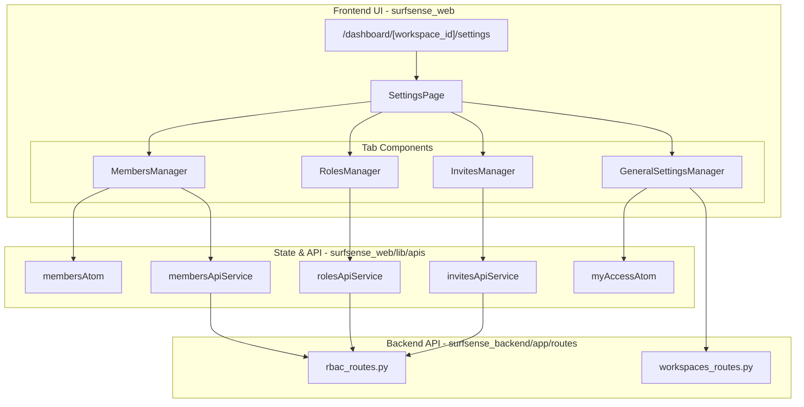
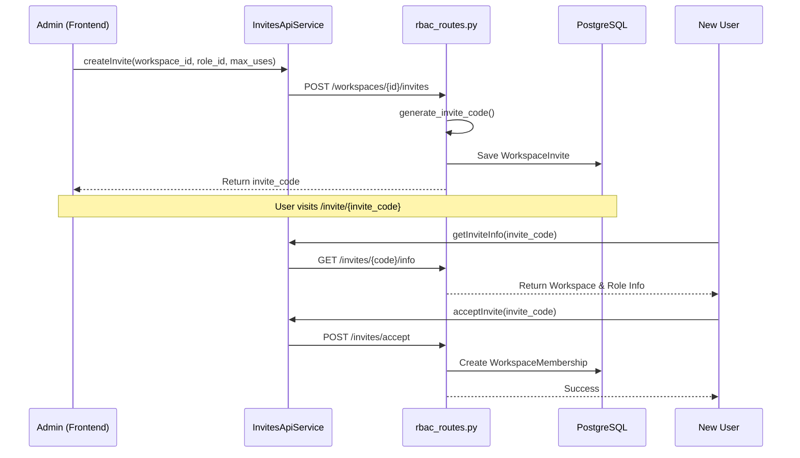

<!-- source: DeepWiki mcp.deepwiki.com · repo MODSetter/SurfSense · page 5.2 Team Management · fetched 2026-10-29 -->

# Team Management

Relevant source files

The following files were used as context for generating this wiki page:

- [surfsense_backend/alembic/versions/103_add_last_login_to_user.py](surfsense_backend/alembic/versions/103_add_last_login_to_user.py)
- [surfsense_backend/app/gateway/accounts.py](surfsense_backend/app/gateway/accounts.py)
- [surfsense_backend/app/gateway/agent_invoke.py](surfsense_backend/app/gateway/agent_invoke.py)
- [surfsense_backend/app/gateway/auth_invariant.py](surfsense_backend/app/gateway/auth_invariant.py)
- [surfsense_backend/app/gateway/bindings.py](surfsense_backend/app/gateway/bindings.py)
- [surfsense_backend/app/gateway/inbox.py](surfsense_backend/app/gateway/inbox.py)
- [surfsense_backend/app/gateway/inbox_processor.py](surfsense_backend/app/gateway/inbox_processor.py)
- [surfsense_backend/app/gateway/pairing.py](surfsense_backend/app/gateway/pairing.py)
- [surfsense_backend/app/gateway/ratelimit.py](surfsense_backend/app/gateway/ratelimit.py)
- [surfsense_backend/app/gateway/registry.py](surfsense_backend/app/gateway/registry.py)
- [surfsense_backend/app/gateway/thread_lock.py](surfsense_backend/app/gateway/thread_lock.py)
- [surfsense_backend/app/routes/agent_action_log_route.py](surfsense_backend/app/routes/agent_action_log_route.py)
- [surfsense_backend/app/routes/agent_permissions_route.py](surfsense_backend/app/routes/agent_permissions_route.py)
- [surfsense_backend/app/routes/rbac_routes.py](surfsense_backend/app/routes/rbac_routes.py)
- [surfsense_backend/app/schemas/rbac_schemas.py](surfsense_backend/app/schemas/rbac_schemas.py)
- [surfsense_backend/app/utils/rbac.py](surfsense_backend/app/utils/rbac.py)
- [surfsense_backend/tests/unit/gateway/test_pairing.py](surfsense_backend/tests/unit/gateway/test_pairing.py)
- [surfsense_web/atoms/public-chat-snapshots/public-chat-snapshots-query.atoms.ts](surfsense_web/atoms/public-chat-snapshots/public-chat-snapshots-query.atoms.ts)
- [surfsense_web/components/assistant-ui/connector-popup/connector-configs/components/discord-config.tsx](surfsense_web/components/assistant-ui/connector-popup/connector-configs/components/discord-config.tsx)
- [surfsense_web/components/assistant-ui/connector-popup/connector-configs/components/slack-config.tsx](surfsense_web/components/assistant-ui/connector-popup/connector-configs/components/slack-config.tsx)
- [surfsense_web/components/public-chat-snapshots/public-chat-snapshot-row.tsx](surfsense_web/components/public-chat-snapshots/public-chat-snapshot-row.tsx)
- [surfsense_web/components/public-chat-snapshots/public-chat-snapshots-list.tsx](surfsense_web/components/public-chat-snapshots/public-chat-snapshots-list.tsx)
- [surfsense_web/components/public-chat-snapshots/public-chat-snapshots-manager.tsx](surfsense_web/components/public-chat-snapshots/public-chat-snapshots-manager.tsx)
- [surfsense_web/components/settings/general-settings-manager.tsx](surfsense_web/components/settings/general-settings-manager.tsx)
- [surfsense_web/components/settings/prompt-config-manager.tsx](surfsense_web/components/settings/prompt-config-manager.tsx)
- [surfsense_web/components/settings/roles-manager.tsx](surfsense_web/components/settings/roles-manager.tsx)
- [surfsense_web/components/ui/alert.tsx](surfsense_web/components/ui/alert.tsx)
- [surfsense_web/contracts/types/chat-threads.types.ts](surfsense_web/contracts/types/chat-threads.types.ts)
- [surfsense_web/contracts/types/members.types.ts](surfsense_web/contracts/types/members.types.ts)
- [surfsense_web/contracts/types/permissions.types.ts](surfsense_web/contracts/types/permissions.types.ts)
- [surfsense_web/contracts/types/public-chat.types.ts](surfsense_web/contracts/types/public-chat.types.ts)
- [surfsense_web/lib/apis/chat-threads-api.service.ts](surfsense_web/lib/apis/chat-threads-api.service.ts)
- [surfsense_web/lib/apis/invites-api.service.ts](surfsense_web/lib/apis/invites-api.service.ts)
- [surfsense_web/lib/apis/members-api.service.ts](surfsense_web/lib/apis/members-api.service.ts)
- [surfsense_web/lib/apis/permissions-api.service.ts](surfsense_web/lib/apis/permissions-api.service.ts)
- [surfsense_web/lib/apis/public-chat-api.service.ts](surfsense_web/lib/apis/public-chat-api.service.ts)
- [surfsense_web/lib/apis/roles-api.service.ts](surfsense_web/lib/apis/roles-api.service.ts)

## Purpose and Scope

This document describes the Team Management UI and associated systems in SurfSense. Team Management provides interfaces for managing SearchSpace members, roles, and invitation links. It enables Owners and Admins to control who has access to a SearchSpace and what permissions they hold.

For information about the underlying multi-tenant architecture and SearchSpace concept, see [SearchSpace Architecture](5.1). For details about the permission system and role-based access control, see [RBAC and Permissions](4.2). For the invitation lifecycle and membership creation, see [Membership and Invitations](5.3).

---

## Team Management Page Structure

The Team Management interface is primarily hosted within the workspace settings and consists of three main modules: Members, Roles, and Invites. Access to these features is strictly controlled by the permission system.

**Page Structure and Data Flow Diagram**

**Sources:** [surfsense_web/components/settings/roles-manager.tsx:272-284](), [surfsense_web/components/settings/general-settings-manager.tsx:24-36](), [surfsense_web/lib/apis/members-api.service.ts:21-39](), [surfsense_backend/app/routes/rbac_routes.py:1-11]()

### Permission Requirements

The backend enforces granular permissions for all team-related actions. The `PERMISSION_DESCRIPTIONS` mapping provides a human-readable reference for these controls:

- `members:invite`: Send invitations to new team members [surfsense_backend/app/routes/rbac_routes.py:99-99]().
- `members:view`: View the list of team members [surfsense_backend/app/routes/rbac_routes.py:100-100]().
- `members:remove`: Remove members from the workspace [surfsense_backend/app/routes/rbac_routes.py:101-101]().
- `members:manage_roles`: Assign and change member roles [surfsense_backend/app/routes/rbac_routes.py:102-102]().
- `roles:create`, `roles:read`, `roles:update`, `roles:delete`: CRUD operations for custom roles [surfsense_backend/app/routes/rbac_routes.py:104-107]().
- `public_sharing:view`, `public_sharing:delete`: Manage public chat snapshots [surfsense_web/components/public-chat-snapshots/public-chat-snapshots-manager.tsx:56-61]().

**Sources:** [surfsense_backend/app/routes/rbac_routes.py:65-122](), [surfsense_web/components/settings/roles-manager.tsx:148-159]()

---

## Members Management

The Members interface allows administrators to view, update, and remove workspace participants. It resolves user identities using a `memberMap` to display names, emails, and avatars [surfsense_web/components/public-chat-snapshots/public-chat-snapshots-manager.tsx:40-52]().

### Member Operations

#### Updating Member Roles
Administrators with `members:manage_roles` can modify a member's role ID. This is handled by `membersApiService.updateMember` which calls the `PUT` endpoint at `/api/v1/workspaces/{workspace_id}/members/{membership_id}` [surfsense_web/lib/apis/members-api.service.ts:44-61]().

#### Removing Members
Members can be removed using `membersApiService.deleteMember` [surfsense_web/lib/apis/members-api.service.ts:66-80](). Users can also remove themselves from a workspace using the `leaveWorkspace` method [surfsense_web/lib/apis/members-api.service.ts:85-99]().

**Sources:** [surfsense_web/lib/apis/members-api.service.ts:21-118](), [surfsense_web/components/public-chat-snapshots/public-chat-snapshot-row.tsx:61-61]()

---

## Roles and Permissions Management

The `RolesManager` component provides a detailed interface for configuring custom roles. It categorizes permissions into functional areas such as Documents, AI Chats, Automations, and Connectors [surfsense_web/components/settings/roles-manager.tsx:78-178]().

### Role Presets
SurfSense includes predefined role templates to simplify setup:
- **Editor**: Create and edit content, but no administrative access [surfsense_web/components/settings/roles-manager.tsx:192-223]().
- **Viewer**: Read-only access with commenting capabilities [surfsense_web/components/settings/roles-manager.tsx:224-241]().
- **Contributor**: Can manage their own content [surfsense_web/components/settings/roles-manager.tsx:242-266]().

### Role CRUD
Custom roles are managed through the `rolesApiService`:
- **Create**: `POST /workspaces/{workspace_id}/roles` [surfsense_backend/app/routes/rbac_routes.py:155-164]().
- **Update**: `PUT /workspaces/{workspace_id}/roles/{role_id}` [surfsense_backend/app/routes/rbac_routes.py:246-256]().
- **Delete**: `DELETE /workspaces/{workspace_id}/roles/{role_id}` [surfsense_backend/app/routes/rbac_routes.py:302-311]().

**Sources:** [surfsense_web/components/settings/roles-manager.tsx:78-266](), [surfsense_backend/app/routes/rbac_routes.py:152-320]()

---

## Invitation System

The invitation system allows adding members via shareable links with configurable roles and usage limits.

### Invitation Lifecycle

**Sources:** [surfsense_web/lib/apis/invites-api.service.ts:28-142](), [surfsense_backend/app/routes/rbac_routes.py:52-52](), [surfsense_backend/app/routes/rbac_routes.py:322-380]()

---

## Public Chat Snapshots

Team management includes controlling public access to chat snapshots. Snapshots are static versions of chat threads that can be shared via a unique token [surfsense_web/contracts/types/chat-threads.types.ts:6-12]().

- **Manager**: `PublicChatSnapshotsManager` handles the listing and deletion of snapshots [surfsense_web/components/public-chat-snapshots/public-chat-snapshots-manager.tsx:30-52]().
- **Permissions**: Viewing requires `public_sharing:view`, and deletion requires `public_sharing:delete` [surfsense_web/components/public-chat-snapshots/public-chat-snapshots-manager.tsx:56-61]().
- **Data**: Each snapshot tracks `message_count`, `created_at`, and the `created_by_user_id` [surfsense_web/contracts/types/chat-threads.types.ts:50-59]().

**Sources:** [surfsense_web/components/public-chat-snapshots/public-chat-snapshots-manager.tsx:1-153](), [surfsense_web/contracts/types/chat-threads.types.ts:1-81]()

---

## External Gateway Access and Authorization

Team management extends to external chat surfaces (Telegram, WhatsApp, Slack, Discord). Access is governed by `ExternalChatBinding`.

### Authorization Invariants
Before an agent is invoked for an external surface, the system asserts authorization:

1. **Identity Verification**: `assert_authorization_invariant` checks if the external account is correctly bound to a SurfSense user [surfsense_backend/app/gateway/agent_invoke.py:67-67]().
2. **Context Creation**: `AuthContext.system(user, source="gateway")` is used to maintain the user's workspace permissions during the agent turn [surfsense_backend/app/gateway/agent_invoke.py:68-68]().
3. **Thread Binding**: The system resolves or creates a thread specific to the external peer (e.g., Slack thread ID or Discord channel) [surfsense_backend/app/gateway/inbox_processor.py:150-170]().
4. **Thread Locking**: `acquire_thread_lock` prevents concurrent agent turns on the same thread [surfsense_backend/app/gateway/agent_invoke.py:72-73]().

**Sources:** [surfsense_backend/app/gateway/agent_invoke.py:58-73](), [surfsense_backend/app/gateway/inbox_processor.py:150-201](), [surfsense_backend/app/gateway/accounts.py:20-27]()

---

