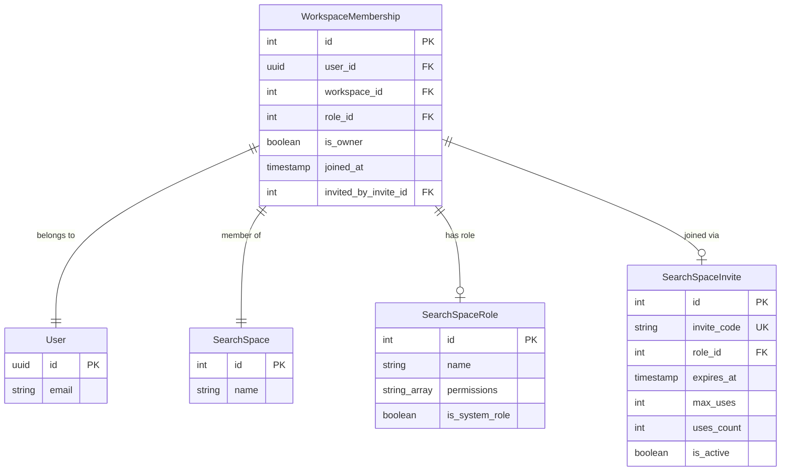
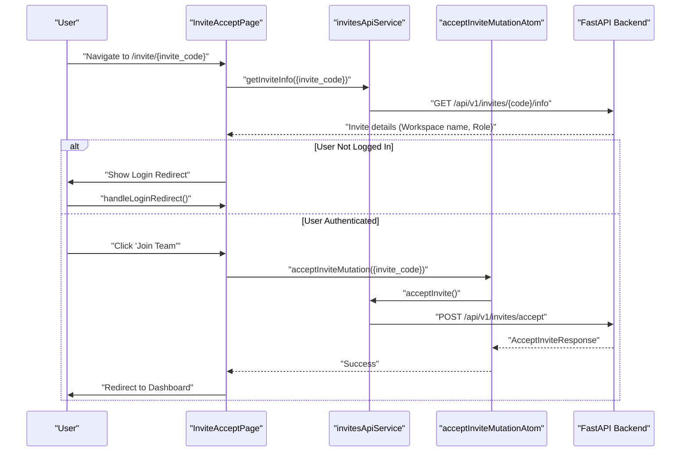

<!-- source: DeepWiki mcp.deepwiki.com · repo MODSetter/SurfSense · page 5.3 Membership and Invitations · fetched 2026-10-29 -->

# Membership and Invitations

<details>
<summary>Relevant source files</summary>

The following files were used as context for generating this wiki page:

- [surfsense_backend/alembic/versions/129_obsidian_plugin_vault_identity.py](surfsense_backend/alembic/versions/129_obsidian_plugin_vault_identity.py)
- [surfsense_backend/app/prompts/system_defaults.py](surfsense_backend/app/prompts/system_defaults.py)
- [surfsense_backend/app/routes/prompts_routes.py](surfsense_backend/app/routes/prompts_routes.py)
- [surfsense_backend/app/schemas/prompts.py](surfsense_backend/app/schemas/prompts.py)
- [surfsense_backend/tests/unit/test_error_contract.py](surfsense_backend/tests/unit/test_error_contract.py)
- [surfsense_web/app/api/v1/[...path]/route.ts](surfsense_web/app/api/v1/[...path]/route.ts)
- [surfsense_web/app/auth/[...path]/route.ts](surfsense_web/app/auth/[...path]/route.ts)
- [surfsense_web/app/invite/[invite_code]/page.tsx](surfsense_web/app/invite/[invite_code]/page.tsx)
- [surfsense_web/app/verify-token/route.ts](surfsense_web/app/verify-token/route.ts)
- [surfsense_web/atoms/chat-comments/comments-mutation.atoms.ts](surfsense_web/atoms/chat-comments/comments-mutation.atoms.ts)
- [surfsense_web/atoms/invites/invites-mutation.atoms.ts](surfsense_web/atoms/invites/invites-mutation.atoms.ts)
- [surfsense_web/atoms/members/members-mutation.atoms.ts](surfsense_web/atoms/members/members-mutation.atoms.ts)
- [surfsense_web/atoms/prompts/prompts-mutation.atoms.ts](surfsense_web/atoms/prompts/prompts-mutation.atoms.ts)
- [surfsense_web/atoms/roles/roles-mutation.atoms.ts](surfsense_web/atoms/roles/roles-mutation.atoms.ts)
- [surfsense_web/contracts/types/invites.types.ts](surfsense_web/contracts/types/invites.types.ts)
- [surfsense_web/contracts/types/prompts.types.ts](surfsense_web/contracts/types/prompts.types.ts)
- [surfsense_web/hooks/use-comments.ts](surfsense_web/hooks/use-comments.ts)
- [surfsense_web/lib/apis/prompts-api.service.ts](surfsense_web/lib/apis/prompts-api.service.ts)
- [surfsense_web/lib/query-client/client.ts](surfsense_web/lib/query-client/client.ts)

</details>


This page documents the user membership and invitation system within SearchSpaces. It covers how users join SearchSpaces, how invitations are created and managed, and how memberships link to the role-based permission system.

For information about the broader RBAC system and permissions, see [RBAC and Permissions](#4.2). For the SearchSpace architecture itself, see [SearchSpace Architecture](#5.1).

---

## Overview

The membership system controls user access to SearchSpaces through two primary mechanisms:

1.  **WorkspaceMembership**: Links users to SearchSpaces (workspaces) with specific roles, defining what actions they can perform [surfsense_backend/app/db.py:607-638]().
2.  **SearchSpaceInvite**: Enables SearchSpace owners/admins to generate shareable invite links that allow new users to join [surfsense_backend/app/db.py:641-686]().

When a SearchSpace is created, the creator automatically receives an owner membership with the "Owner" role. Additional users can join through invite links, receiving roles specified by the invite creator.

---

## Database Schema

### Core Models

The membership system consists of three interconnected tables:

| Model | Purpose | Key Fields |
| :--- | :--- | :--- |
| `WorkspaceMembership` | Tracks user membership in SearchSpaces | `user_id`, `workspace_id`, `role_id`, `is_owner`, `joined_at` |
| `SearchSpaceInvite` | Stores invite links for joining SearchSpaces | `invite_code`, `role_id`, `expires_at`, `max_uses`, `uses_count` |
| `SearchSpaceRole` | Defines roles with permission sets | `name`, `permissions[]`, `is_system_role` |

**SearchSpaceMembership Schema**



**Sources:** [surfsense_backend/app/db.py:607-686](), [surfsense_backend/app/db.py:554-589]()

### Unique Constraints

The system enforces the following constraints:

*   **One membership per user per SearchSpace**: `UniqueConstraint("user_id", "workspace_id")` prevents duplicate memberships [surfsense_backend/app/db.py:615-619]().
*   **Unique invite codes**: Each invite has a globally unique `invite_code` [surfsense_backend/app/db.py:650]().
*   **Unique role names per SearchSpace**: `UniqueConstraint("workspace_id", "name")` prevents duplicate role names within a SearchSpace [surfsense_backend/app/db.py:562-566]().

---

## Membership Lifecycle

### Owner Membership Creation

When a user creates a SearchSpace, an owner membership is automatically created during the RBAC backfill process or when the SearchSpace is first initialized with default roles.

**Sources:** [surfsense_backend/app/db.py:607-638]()

### Default Roles

Four system roles are typically created for each SearchSpace:

| Role | Permissions | Description |
| :--- | :--- | :--- |
| Owner | `["*"]` (full access) | Complete control over the SearchSpace |
| Admin | Extensive permissions | Can manage resources and members |
| Editor | Create/edit documents, chats | Standard member role |
| Viewer | Read-only access | Cannot modify resources |

**Sources:** [surfsense_backend/app/db.py:554-589](), [surfsense_backend/app/prompts/system_defaults.py:1-81]()

---

## Invitation System

### Invite Creation

Invites are created by users with appropriate permissions. Each invite includes:

**SearchSpaceInvite Fields**

| Field | Type | Purpose | Nullable |
| :--- | :--- | :--- | :--- |
| `invite_code` | `String` | Unique identifier for the invite URL | No |
| `workspace_id` | `Integer` | SearchSpace this invite grants access to | No |
| `role_id` | `Integer` | Role to assign when invite is used | Yes |
| `expires_at` | `Timestamp` | Expiration date/time | Yes |
| `max_uses` | `Integer` | Maximum number of times invite can be used | Yes |
| `uses_count` | `Integer` | Current usage count | No |
| `is_active` | `Boolean` | Whether invite is currently active | No |

**Sources:** [surfsense_backend/app/db.py:641-686](), [surfsense_web/contracts/types/invites.types.ts:1-20]()

### Invite Acceptance Flow

The `InviteAcceptPage` handles the frontend logic for users joining via a link [surfsense_web/app/invite/[invite_code]/page.tsx:39-43]().



**Sources:** [surfsense_web/app/invite/[invite_code]/page.tsx:43-135](), [surfsense_web/atoms/invites/invites-mutation.atoms.ts:76-89]()

### API Endpoints and Mutations

The frontend uses `jotai-tanstack-query` mutation atoms to interact with the invitation API.

| Atom | Function | API Service Call |
| :--- | :--- | :--- |
| `createInviteMutationAtom` | Creates a new invite link | `invitesApiService.createInvite` |
| `updateInviteMutationAtom` | Modifies invite settings | `invitesApiService.updateInvite` |
| `deleteInviteMutationAtom` | Revokes an invite | `invitesApiService.deleteInvite` |
| `acceptInviteMutationAtom` | Processes a user joining | `invitesApiService.acceptInvite` |

**Sources:** [surfsense_web/atoms/invites/invites-mutation.atoms.ts:16-89]()

---

## Member Management

### Member Operations

Administrators can manage existing members through the following mutation atoms:

*   **Update Member**: `updateMemberMutationAtom` calls `membersApiService.updateMember` to change a user's role [surfsense_web/atoms/members/members-mutation.atoms.ts:15-31]().
*   **Remove Member**: `deleteMemberMutationAtom` calls `membersApiService.deleteMember` to evict a user from the workspace [surfsense_web/atoms/members/members-mutation.atoms.ts:33-49]().
*   **Leave Workspace**: `leaveWorkspaceMutationAtom` allows a user to remove their own membership [surfsense_web/atoms/members/members-mutation.atoms.ts:51-67]().

### Permission Integration

The backend ensures that users have the correct membership before allowing actions. For example, in prompt creation, the system verifies workspace membership:

```python
# surfsense_backend/app/routes/prompts_routes.py:41-52
if body.workspace_id is not None:
    membership = await session.execute(
        select(WorkspaceMembership).where(
            WorkspaceMembership.user_id == user.id,
            WorkspaceMembership.workspace_id == body.workspace_id,
        )
    )
    if not membership.scalar_one_or_none():
        raise HTTPException(
            status_code=403,
            detail="You are not a member of this workspace",
        )
```

**Sources:** [surfsense_backend/app/routes/prompts_routes.py:41-52]()

---

## Invitation Validation Rules

The backend validates invites using the following logic:

1.  **Existence**: The `invite_code` must exist in the database.
2.  **Status**: `is_active` must be true.
3.  **Expiration**: If `expires_at` is set, it must be in the future.
4.  **Usage Limits**: If `max_uses` is set, `uses_count` must be less than `max_uses`.
5.  **Duplicate Membership**: If the user is already a member of the workspace, the invitation is considered fulfilled.

**Sources:** [surfsense_backend/app/db.py:641-686](), [surfsense_web/app/invite/[invite_code]/page.tsx:63-108]()

---

## Key Technical Components

### Frontend API Proxying
All invitation and membership requests are proxied through the Next.js API route `proxy` function to the FastAPI backend [surfsense_web/app/api/v1/[...path]/route.ts:40-64]().

### Data Flow for Accepting Invites

```mermaid
graph TD
    subgraph "Frontend_NextJS"
        "UI_InviteAcceptPage"
        "Atom_acceptInviteMutationAtom"
        "Service_invitesApiService"
    end

    subgraph "Backend_FastAPI"
        "Route_accept_invite"
        "DB_Op_Update_Membership"
    end

    "UI_InviteAcceptPage" -->|Trigger| "Atom_acceptInviteMutationAtom"
    "Atom_acceptInviteMutationAtom" -->|Call| "Service_invitesApiService"
    "Service_invitesApiService" -->|POST| "Route_accept_invite"
    "Route_accept_invite" -->|SQL| "DB_Op_Update_Membership"
```

**Sources:** [surfsense_web/app/invite/[invite_code]/page.tsx:90-108](), [surfsense_web/atoms/invites/invites-mutation.atoms.ts:76-89](), [surfsense_backend/app/db.py:607-686]()

---

