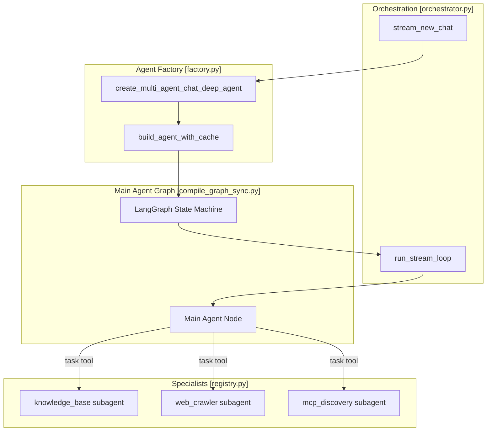
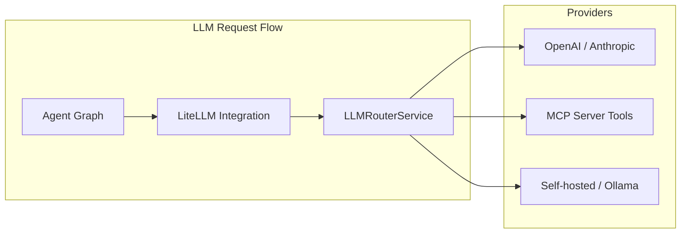

<!-- source: DeepWiki mcp.deepwiki.com · repo MODSetter/SurfSense · page 6.1 Agent Architecture · fetched 2026-10-29 -->

# Agent Architecture

Relevant source files

The following files were used as context for generating this wiki page:

- [surfsense_backend/app/agents/chat/anonymous_chat/agent.py](surfsense_backend/app/agents/chat/anonymous_chat/agent.py)
- [surfsense_backend/app/agents/chat/multi_agent_chat/constants.py](surfsense_backend/app/agents/chat/multi_agent_chat/constants.py)
- [surfsense_backend/app/agents/chat/multi_agent_chat/main_agent/graph/compile_graph_sync.py](surfsense_backend/app/agents/chat/multi_agent_chat/main_agent/graph/compile_graph_sync.py)
- [surfsense_backend/app/agents/chat/multi_agent_chat/main_agent/middleware/stack.py](surfsense_backend/app/agents/chat/multi_agent_chat/main_agent/middleware/stack.py)
- [surfsense_backend/app/agents/chat/multi_agent_chat/main_agent/runtime/agent_cache.py](surfsense_backend/app/agents/chat/multi_agent_chat/main_agent/runtime/agent_cache.py)
- [surfsense_backend/app/agents/chat/multi_agent_chat/main_agent/runtime/factory.py](surfsense_backend/app/agents/chat/multi_agent_chat/main_agent/runtime/factory.py)
- [surfsense_backend/app/agents/chat/multi_agent_chat/main_agent/system_prompt/prompts/identity/private.md](surfsense_backend/app/agents/chat/multi_agent_chat/main_agent/system_prompt/prompts/identity/private.md)
- [surfsense_backend/app/agents/chat/multi_agent_chat/main_agent/system_prompt/prompts/identity/team.md](surfsense_backend/app/agents/chat/multi_agent_chat/main_agent/system_prompt/prompts/identity/team.md)
- [surfsense_backend/app/agents/chat/multi_agent_chat/main_agent/system_prompt/prompts/kb_first.md](surfsense_backend/app/agents/chat/multi_agent_chat/main_agent/system_prompt/prompts/kb_first.md)
- [surfsense_backend/app/agents/chat/multi_agent_chat/main_agent/system_prompt/prompts/routing.md](surfsense_backend/app/agents/chat/multi_agent_chat/main_agent/system_prompt/prompts/routing.md)
- [surfsense_backend/app/agents/chat/multi_agent_chat/shared/middleware/filesystem/backends/resolver.py](surfsense_backend/app/agents/chat/multi_agent_chat/shared/middleware/filesystem/backends/resolver.py)
- [surfsense_backend/app/agents/chat/multi_agent_chat/shared/middleware/filesystem/index.py](surfsense_backend/app/agents/chat/multi_agent_chat/shared/middleware/filesystem/index.py)
- [surfsense_backend/app/agents/chat/multi_agent_chat/shared/middleware/filesystem/middleware/middleware.py](surfsense_backend/app/agents/chat/multi_agent_chat/shared/middleware/filesystem/middleware/middleware.py)
- [surfsense_backend/app/agents/chat/multi_agent_chat/shared/middleware/filesystem/tools/read_file/description.py](surfsense_backend/app/agents/chat/multi_agent_chat/shared/middleware/filesystem/tools/read_file/description.py)
- [surfsense_backend/app/agents/chat/multi_agent_chat/shared/middleware/filesystem/tools/read_file/index.py](surfsense_backend/app/agents/chat/multi_agent_chat/shared/middleware/filesystem/tools/read_file/index.py)
- [surfsense_backend/app/agents/chat/multi_agent_chat/subagents/builtins/deliverables/tools/podcast.py](surfsense_backend/app/agents/chat/multi_agent_chat/subagents/builtins/deliverables/tools/podcast.py)
- [surfsense_backend/app/agents/chat/multi_agent_chat/subagents/builtins/knowledge_base/middleware_stack.py](surfsense_backend/app/agents/chat/multi_agent_chat/subagents/builtins/knowledge_base/middleware_stack.py)
- [surfsense_backend/app/agents/chat/multi_agent_chat/subagents/registry.py](surfsense_backend/app/agents/chat/multi_agent_chat/subagents/registry.py)
- [surfsense_backend/app/agents/chat/multi_agent_chat/subagents/shared/subagent_builder.py](surfsense_backend/app/agents/chat/multi_agent_chat/subagents/shared/subagent_builder.py)
- [surfsense_backend/app/tasks/chat/streaming/agent/__init__.py](surfsense_backend/app/tasks/chat/streaming/agent/__init__.py)
- [surfsense_backend/app/tasks/chat/streaming/agent/builder.py](surfsense_backend/app/tasks/chat/streaming/agent/builder.py)
- [surfsense_backend/app/tasks/chat/streaming/agent/event_loop.py](surfsense_backend/app/tasks/chat/streaming/agent/event_loop.py)
- [surfsense_backend/app/tasks/chat/streaming/flows/__init__.py](surfsense_backend/app/tasks/chat/streaming/flows/__init__.py)
- [surfsense_backend/app/tasks/chat/streaming/flows/new_chat/__init__.py](surfsense_backend/app/tasks/chat/streaming/flows/new_chat/__init__.py)
- [surfsense_backend/app/tasks/chat/streaming/flows/new_chat/auto_pin.py](surfsense_backend/app/tasks/chat/streaming/flows/new_chat/auto_pin.py)
- [surfsense_backend/app/tasks/chat/streaming/flows/new_chat/initial_thinking_step.py](surfsense_backend/app/tasks/chat/streaming/flows/new_chat/initial_thinking_step.py)
- [surfsense_backend/app/tasks/chat/streaming/flows/new_chat/input_state.py](surfsense_backend/app/tasks/chat/streaming/flows/new_chat/input_state.py)
- [surfsense_backend/app/tasks/chat/streaming/flows/new_chat/llm_capability.py](surfsense_backend/app/tasks/chat/streaming/flows/new_chat/llm_capability.py)
- [surfsense_backend/app/tasks/chat/streaming/flows/new_chat/orchestrator.py](surfsense_backend/app/tasks/chat/streaming/flows/new_chat/orchestrator.py)
- [surfsense_backend/app/tasks/chat/streaming/flows/new_chat/persistence_spawn.py](surfsense_backend/app/tasks/chat/streaming/flows/new_chat/persistence_spawn.py)
- [surfsense_backend/app/tasks/chat/streaming/flows/new_chat/runtime_context.py](surfsense_backend/app/tasks/chat/streaming/flows/new_chat/runtime_context.py)
- [surfsense_backend/app/tasks/chat/streaming/flows/new_chat/title_gen.py](surfsense_backend/app/tasks/chat/streaming/flows/new_chat/title_gen.py)
- [surfsense_backend/app/tasks/chat/streaming/flows/resume_chat/__init__.py](surfsense_backend/app/tasks/chat/streaming/flows/resume_chat/__init__.py)
- [surfsense_backend/app/tasks/chat/streaming/flows/resume_chat/orchestrator.py](surfsense_backend/app/tasks/chat/streaming/flows/resume_chat/orchestrator.py)
- [surfsense_backend/app/tasks/chat/streaming/handlers/tools/deliverables/generate_podcast/emission.py](surfsense_backend/app/tasks/chat/streaming/handlers/tools/deliverables/generate_podcast/emission.py)
- [surfsense_backend/app/tasks/chat/streaming/handlers/tools/deliverables/generate_podcast/thinking.py](surfsense_backend/app/tasks/chat/streaming/handlers/tools/deliverables/generate_podcast/thinking.py)
- [surfsense_backend/tests/integration/agents/multi_agent_chat/test_agent_turn.py](surfsense_backend/tests/integration/agents/multi_agent_chat/test_agent_turn.py)
- [surfsense_backend/tests/unit/agents/multi_agent_chat/test_prompt_resources.py](surfsense_backend/tests/unit/agents/multi_agent_chat/test_prompt_resources.py)
- [surfsense_backend/tests/unit/agents/multi_agent_chat/test_subagent_composition.py](surfsense_backend/tests/unit/agents/multi_agent_chat/test_subagent_composition.py)
- [surfsense_backend/tests/unit/agents/test_import_all.py](surfsense_backend/tests/unit/agents/test_import_all.py)
- [surfsense_backend/tests/unit/middleware/test_filesystem_backends.py](surfsense_backend/tests/unit/middleware/test_filesystem_backends.py)

## Purpose and Scope

This page documents the Deep Agent framework that powers SurfSense's conversational AI capabilities. It covers the LangGraph-based architecture, state management, tool registry system, system prompt configuration, and LiteLLM integration. This architecture is designed for stateful, multimodal interactions with support for hybrid search and human-in-the-loop (HITL) workflows.

## Overview

SurfSense implements a stateful conversational agent using **LangGraph**, enabling persistent conversation state and complex reasoning loops. The core entry point for chat turns is the `stream_new_chat` orchestrator [surfsense_backend/app/tasks/chat/streaming/flows/new_chat/orchestrator.py:125-147](), which manages the lifecycle of a request from validation to SSE streaming.

Key architectural capabilities include:
- **Stateful Conversations**: Durable memory via LangGraph checkpointers [surfsense_backend/app/tasks/chat/streaming/flows/shared/pre_stream_setup.py:89-91]().
- **Tool Calling**: Dynamic invocation of registered tools based on LLM reasoning.
- **Multi-Agent Specialist Routing**: A "Main Agent" router delegates complex tasks to specialized subagents (e.g., `knowledge_base`, `web_crawler`, `mcp_discovery`) via the `task` tool [surfsense_backend/app/agents/chat/multi_agent_chat/main_agent/middleware/stack.py:3-15]().
- **Streaming Responses**: Real-time token and event delivery via the Vercel AI SDK Data Stream Protocol (SSE) [surfsense_backend/app/tasks/chat/streaming/flows/new_chat/orchestrator.py:155-156]().
- **Model Flexibility**: Support for 100+ models via LiteLLM with automatic load balancing and failover.
- **Token Tracking**: Per-turn usage accumulation and cost attribution.

**Sources**: [surfsense_backend/app/tasks/chat/streaming/flows/new_chat/orchestrator.py:1-18](), [surfsense_backend/app/agents/chat/multi_agent_chat/main_agent/middleware/stack.py:1-15]()

## LangGraph Agent Architecture

The agent is implemented as a directed graph where nodes represent processing steps and edges define the control flow. SurfSense uses a middleware-heavy architecture to inject capabilities like persistence, permissions, and resilience.

### Agent Workflow Diagram
This diagram maps the high-level logic to the specific code entities involved in a chat turn.

**Sources**: [surfsense_backend/app/tasks/chat/streaming/flows/new_chat/orchestrator.py:125-147](), [surfsense_backend/app/agents/chat/multi_agent_chat/main_agent/runtime/factory.py:59-83](), [surfsense_backend/app/agents/chat/multi_agent_chat/main_agent/runtime/agent_cache.py:38-61](), [surfsense_backend/app/agents/chat/multi_agent_chat/subagents/registry.py:91-109]()

### State Management
The agent's runtime state is managed through several layers:
1.  **LangGraph State**: The core conversation history (`messages`), workspace context, and metadata.
2.  **Filesystem Staging**: The `KnowledgeBasePersistenceMiddleware` tracks staged filesystem changes (e.g., `dirty_paths`, `staged_dirs`) during a turn, committing them to the database at the end of the turn [surfsense_backend/app/tasks/chat/streaming/agent/event_loop.py:86-103]().
3.  **Intent and Contract**: The `file_operation_contract` tracks the agent's intent (e.g., `file_write`) to enforce safety and quality gates [surfsense_backend/app/tasks/chat/streaming/agent/event_loop.py:122-144]().

## Multi-Agent Registry and Specialists

SurfSense utilizes a "Main Agent" that acts as a pure router [surfsense_backend/app/agents/chat/multi_agent_chat/main_agent/middleware/stack.py:3-7](). It delegates work to specialists defined in the `SUBAGENT_BUILDERS_BY_NAME` registry [surfsense_backend/app/agents/chat/multi_agent_chat/subagents/registry.py:91-109]().

### Specialist Roster
Specialists are gated by the connectors available in a workspace [surfsense_backend/app/agents/chat/multi_agent_chat/constants.py:31-61]().

| Specialist | Responsibility | Required Connector Token |
|-----------|----------------|--------------------------|
| `knowledge_base` | All filesystem reads/writes and RAG | None (Built-in) |
| `mcp_discovery` | Unified access to Slack, Jira, Notion, etc. | `SLACK_CONNECTOR`, `NOTION_CONNECTOR`, etc. |
| `web_crawler` | Scraping and crawling web pages | None (Built-in) |
| `google_drive` | Native Google Drive file interaction | `GOOGLE_DRIVE_FILE` |
| `reddit` / `tiktok` | Platform-specific social scraping | None (Built-in) |

**Sources**: [surfsense_backend/app/agents/chat/multi_agent_chat/subagents/registry.py:91-109](), [surfsense_backend/app/agents/chat/multi_agent_chat/constants.py:31-61](), [surfsense_backend/tests/unit/agents/multi_agent_chat/test_subagent_composition.py:28-48]()

## Middleware Stack

The agent's behavior is heavily customized through a middleware stack assembled in `build_main_agent_deepagent_middleware` [surfsense_backend/app/agents/chat/multi_agent_chat/main_agent/middleware/stack.py:101-121]().

Key Middlewares:
- **`SurfSenseCheckpointedSubAgentMiddleware`**: Handles the execution and HITL pausing of subagents called via the `task` tool [surfsense_backend/app/agents/chat/multi_agent_chat/main_agent/middleware/stack.py:81-83]().
- **`KnowledgeBasePersistenceMiddleware`**: Manages the persistence of staged filesystem operations [surfsense_backend/app/agents/chat/multi_agent_chat/main_agent/middleware/stack.py:90]().
- **`FilesystemBackendResolver`**: Dynamically switches between `KBPostgresBackend` (Cloud) and `MultiRootLocalFolderBackend` (Desktop) based on the user's session [surfsense_backend/app/agents/chat/multi_agent_chat/shared/middleware/filesystem/backends/resolver.py:31-46]().
- **`PermissionMiddleware`**: Enforces RBAC and tool-level allow-lists [surfsense_backend/app/agents/chat/multi_agent_chat/main_agent/middleware/stack.py:50-52]().

**Sources**: [surfsense_backend/app/agents/chat/multi_agent_chat/main_agent/middleware/stack.py:101-121](), [surfsense_backend/app/agents/chat/multi_agent_chat/shared/middleware/filesystem/backends/resolver.py:1-22]()

## LLM Integration and LiteLLM

SurfSense uses **LiteLLM** to provide a unified interface for over 100 LLM providers.

### Agent Caching
To reduce cold-start latency (TTFT), SurfSense caches the compiled LangGraph instances. The cache key is a stable hash of the system prompt, tool definitions, MCP tool surface, and feature flags [surfsense_backend/app/agents/chat/multi_agent_chat/main_agent/runtime/agent_cache.py:102-125]().

### Prompt Caching
LiteLLM prompt caching is applied during agent creation to optimize costs and performance for long-running conversations [surfsense_backend/app/agents/chat/multi_agent_chat/main_agent/runtime/factory.py:86]().

**Sources**: [surfsense_backend/app/agents/chat/multi_agent_chat/main_agent/runtime/agent_cache.py:64-86](), [surfsense_backend/app/agents/chat/multi_agent_chat/main_agent/runtime/factory.py:86]()

## Human-in-the-Loop (HITL) Architecture

The agent supports HITL via the `stream_resume_chat` orchestrator [surfsense_backend/app/tasks/chat/streaming/flows/resume_chat/orchestrator.py:100-111](). This flow is triggered when a subagent execution pauses for user approval (e.g., before writing to a sensitive connector).

1.  **Interrupt**: A subagent middleware detects a sensitive action and raises an interrupt.
2.  **Checkpoint**: LangGraph saves the state to the checkpointer.
3.  **Resume**: The user provides decisions (approve/deny) which are routed back to the specific `tool_call_id` [surfsense_backend/app/tasks/chat/streaming/flows/resume_chat/orchestrator.py:112-116]().

**Sources**: [surfsense_backend/app/tasks/chat/streaming/flows/resume_chat/orchestrator.py:1-13](), [surfsense_backend/app/agents/chat/multi_agent_chat/main_agent/middleware/checkpointed_subagent_middleware/__init__.py]()

---

