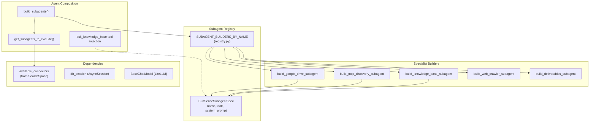
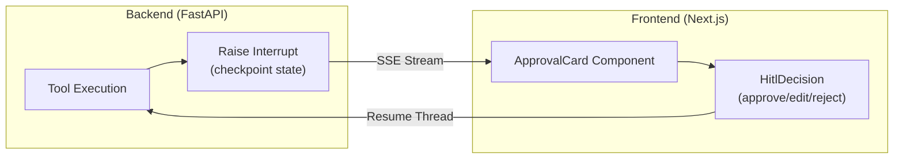

<!-- source: DeepWiki mcp.deepwiki.com · repo MODSetter/SurfSense · page 6.2 Built-in Tools · fetched 2026-10-29 -->

# Built-in Tools

Relevant source files

The following files were used as context for generating this wiki page:

- [surfsense_backend/alembic/versions/171_add_runs_and_tool_output_spills.py](surfsense_backend/alembic/versions/171_add_runs_and_tool_output_spills.py)
- [surfsense_backend/app/agents/chat/multi_agent_chat/main_agent/middleware/context_editing/builder.py](surfsense_backend/app/agents/chat/multi_agent_chat/main_agent/middleware/context_editing/builder.py)
- [surfsense_backend/app/agents/chat/multi_agent_chat/main_agent/middleware/context_editing/middleware.py](surfsense_backend/app/agents/chat/multi_agent_chat/main_agent/middleware/context_editing/middleware.py)
- [surfsense_backend/app/agents/chat/multi_agent_chat/subagents/shared/run_reader.py](surfsense_backend/app/agents/chat/multi_agent_chat/subagents/shared/run_reader.py)
- [surfsense_backend/app/capabilities/core/access/agent.py](surfsense_backend/app/capabilities/core/access/agent.py)
- [surfsense_backend/app/capabilities/core/access/rest.py](surfsense_backend/app/capabilities/core/access/rest.py)
- [surfsense_backend/app/capabilities/core/runs.py](surfsense_backend/app/capabilities/core/runs.py)
- [surfsense_backend/app/capabilities/web/__init__.py](surfsense_backend/app/capabilities/web/__init__.py)
- [surfsense_backend/app/capabilities/web/crawl/__init__.py](surfsense_backend/app/capabilities/web/crawl/__init__.py)
- [surfsense_backend/tests/unit/agents/new_chat/test_context_editing.py](surfsense_backend/tests/unit/agents/new_chat/test_context_editing.py)
- [surfsense_backend/tests/unit/capabilities/access/test_agent_tools.py](surfsense_backend/tests/unit/capabilities/access/test_agent_tools.py)
- [surfsense_backend/tests/unit/capabilities/access/test_rate_limit.py](surfsense_backend/tests/unit/capabilities/access/test_rate_limit.py)
- [surfsense_backend/tests/unit/capabilities/access/test_rest_router.py](surfsense_backend/tests/unit/capabilities/access/test_rest_router.py)
- [surfsense_backend/tests/unit/capabilities/test_billing.py](surfsense_backend/tests/unit/capabilities/test_billing.py)
- [surfsense_backend/tests/unit/capabilities/test_registry.py](surfsense_backend/tests/unit/capabilities/test_registry.py)
- [surfsense_backend/tests/unit/capabilities/test_run_truncation.py](surfsense_backend/tests/unit/capabilities/test_run_truncation.py)
- [surfsense_web/atoms/automations/automations-mutation.atoms.ts](surfsense_web/atoms/automations/automations-mutation.atoms.ts)
- [surfsense_web/atoms/automations/automations-query.atoms.ts](surfsense_web/atoms/automations/automations-query.atoms.ts)
- [surfsense_web/components/assistant-ui/chat-viewport.tsx](surfsense_web/components/assistant-ui/chat-viewport.tsx)
- [surfsense_web/components/new-chat/chat-example-prompts.tsx](surfsense_web/components/new-chat/chat-example-prompts.tsx)
- [surfsense_web/components/providers/PostHogProvider.tsx](surfsense_web/components/providers/PostHogProvider.tsx)
- [surfsense_web/components/providers/PostHogReferral.tsx](surfsense_web/components/providers/PostHogReferral.tsx)
- [surfsense_web/components/tool-ui/automation/create-automation.tsx](surfsense_web/components/tool-ui/automation/create-automation.tsx)
- [surfsense_web/components/tool-ui/gmail/create-draft.tsx](surfsense_web/components/tool-ui/gmail/create-draft.tsx)
- [surfsense_web/components/tool-ui/gmail/send-email.tsx](surfsense_web/components/tool-ui/gmail/send-email.tsx)
- [surfsense_web/components/tool-ui/gmail/trash-email.tsx](surfsense_web/components/tool-ui/gmail/trash-email.tsx)
- [surfsense_web/components/tool-ui/gmail/update-draft.tsx](surfsense_web/components/tool-ui/gmail/update-draft.tsx)
- [surfsense_web/components/tool-ui/google-calendar/create-event.tsx](surfsense_web/components/tool-ui/google-calendar/create-event.tsx)
- [surfsense_web/components/tool-ui/google-calendar/delete-event.tsx](surfsense_web/components/tool-ui/google-calendar/delete-event.tsx)
- [surfsense_web/components/tool-ui/google-calendar/update-event.tsx](surfsense_web/components/tool-ui/google-calendar/update-event.tsx)
- [surfsense_web/components/tool-ui/google-drive/create-file.tsx](surfsense_web/components/tool-ui/google-drive/create-file.tsx)
- [surfsense_web/components/tool-ui/google-drive/trash-file.tsx](surfsense_web/components/tool-ui/google-drive/trash-file.tsx)
- [surfsense_web/components/tool-ui/linear/create-linear-issue.tsx](surfsense_web/components/tool-ui/linear/create-linear-issue.tsx)
- [surfsense_web/components/tool-ui/linear/delete-linear-issue.tsx](surfsense_web/components/tool-ui/linear/delete-linear-issue.tsx)
- [surfsense_web/components/tool-ui/linear/update-linear-issue.tsx](surfsense_web/components/tool-ui/linear/update-linear-issue.tsx)
- [surfsense_web/components/tool-ui/notion/create-notion-page.tsx](surfsense_web/components/tool-ui/notion/create-notion-page.tsx)
- [surfsense_web/components/tool-ui/notion/delete-notion-page.tsx](surfsense_web/components/tool-ui/notion/delete-notion-page.tsx)
- [surfsense_web/components/tool-ui/notion/update-notion-page.tsx](surfsense_web/components/tool-ui/notion/update-notion-page.tsx)
- [surfsense_web/contracts/enums/toolIcons.tsx](surfsense_web/contracts/enums/toolIcons.tsx)
- [surfsense_web/contracts/types/automation.types.ts](surfsense_web/contracts/types/automation.types.ts)
- [surfsense_web/hooks/use-automation-eligible-models.ts](surfsense_web/hooks/use-automation-eligible-models.ts)
- [surfsense_web/hooks/use-automation-runs.ts](surfsense_web/hooks/use-automation-runs.ts)
- [surfsense_web/hooks/use-automation.ts](surfsense_web/hooks/use-automation.ts)
- [surfsense_web/hooks/use-automations.ts](surfsense_web/hooks/use-automations.ts)
- [surfsense_web/instrumentation-client.ts](surfsense_web/instrumentation-client.ts)
- [surfsense_web/lib/apis/automations-api.service.ts](surfsense_web/lib/apis/automations-api.service.ts)
- [surfsense_web/lib/automations/builder-schema.ts](surfsense_web/lib/automations/builder-schema.ts)
- [surfsense_web/lib/chat/parse-mention-segments.ts](surfsense_web/lib/chat/parse-mention-segments.ts)
- [surfsense_web/lib/posthog/events.ts](surfsense_web/lib/posthog/events.ts)
- [surfsense_web/public/homepage/hero_realtime/RealTimeChatGif.gif](surfsense_web/public/homepage/hero_realtime/RealTimeChatGif.gif)
- [surfsense_web/public/homepage/hero_realtime/RealTimeCommentsFlow.gif](surfsense_web/public/homepage/hero_realtime/RealTimeCommentsFlow.gif)
- [surfsense_web/public/homepage/hero_tutorial/general_assist.gif](surfsense_web/public/homepage/hero_tutorial/general_assist.gif)
- [surfsense_web/public/homepage/hero_tutorial/quick_assist.gif](surfsense_web/public/homepage/hero_tutorial/quick_assist.gif)

This page documents the built-in tools available to the SurfSense AI agent. These tools extend the agent's capabilities beyond text generation, enabling it to search knowledge bases, generate podcasts, perform native platform scraping, and interact with third-party apps via the Model Context Protocol (MCP).

## Tool Registry and Subagent System

SurfSense utilizes a multi-agent architecture where the main agent delegates tasks to specialized subagents. These subagents are registered in a central registry and are dynamically composed based on the connectors available in a SearchSpace. The frontend maps these backend tool names to user-friendly icons and display names [surfsense_web/contracts/enums/toolIcons.tsx:37-109]().

**Subagent Composition Rules**
- **Gating**: Subagents are gated by connector availability. For example, the `google_drive` subagent is only included if a `GOOGLE_DRIVE_FILE` token is present in the workspace [surfsense_backend/app/agents/chat/multi_agent_chat/constants.py:57-57]().
- **Tool Injection**: The `ask_knowledge_base` tool is automatically injected into every non-KB subagent to allow specialists to query internal knowledge [surfsense_backend/app/agents/chat/multi_agent_chat/subagents/registry.py:158-168]().
- **MCP Consolidation**: Most third-party connectors (Slack, Notion, Jira) have been migrated to the `mcp_discovery` subagent, which dynamically discovers tools via hosted MCP servers [surfsense_backend/app/agents/chat/multi_agent_chat/constants.py:42-55]().

**Sources:** [surfsense_backend/app/agents/chat/multi_agent_chat/subagents/registry.py:85-101](), [surfsense_backend/app/agents/chat/multi_agent_chat/constants.py:31-59](), [surfsense_web/contracts/enums/toolIcons.tsx:37-109]()

## knowledge_base (Search)

The `knowledge_base` subagent provides the primary interface for RAG (Retrieval-Augmented Generation). It uses the `ConnectorService` to perform hybrid searches across all indexed content.

### Parameters and Capabilities
The underlying search logic supports filtering by date, document IDs, and connector types [surfsense_backend/app/services/connector_service.py:426-440]().

| Feature | Implementation |
|---------|----------------|
| **Hybrid Search** | Combines semantic vector search and full-text search with RRF fusion [surfsense_backend/app/services/connector_service.py:532-550](). |
| **External Search** | Integrates Tavily, SearxNG, and Linkup for real-time web data [surfsense_backend/app/services/connector_service.py:318-402](). |
| **Source Attribution** | Returns chunk IDs used to generate `[[citation:chunk_id]]` markers in the frontend. |

**Sources:** [surfsense_backend/app/services/connector_service.py:23-402](), [surfsense_backend/app/agents/chat/multi_agent_chat/subagents/builtins/knowledge_base/agent.py:30-32]()

## deliverables (Artifact Generation)

The `deliverables` subagent manages the creation of complex artifacts like podcasts and images. These tools are rendered with specific icons in the UI, such as `Podcast` for `generate_podcast` [surfsense_web/contracts/enums/toolIcons.tsx:39-39]().

### generate_podcast
Converts content into audio dialogues. It supports multiple TTS providers via LiteLLM, including local Kokoro, OpenAI, and Azure [surfsense_web/content/docs/manual-installation.mdx:80-82]().
- **Fast Generation**: Optimized to generate a 3-minute podcast in under 20 seconds using parallel segment synthesis.
- **Dialogue Scripting**: The agent first generates a host/guest script before synthesis.

### generate_image
Enables the agent to create visual content. This tool is routed through the `ImageGenRouterService` which selects the appropriate provider (e.g., OpenAI DALL-E 3, Flux via Fal.ai) based on global configuration and model capabilities [surfsense_backend/app/services/image_gen_router_service.py:15-45]().

**Sources:** [surfsense_backend/app/agents/chat/multi_agent_chat/subagents/builtins/deliverables/tools/generate_image.py:10-25](), [surfsense_backend/app/services/image_gen_router_service.py:50-80](), [surfsense_web/contracts/enums/toolIcons.tsx:39-44]()

## Platform-Specific Scrapers

SurfSense includes specialized scrapers for social platforms and marketplaces. These are exposed as subagents (e.g., `reddit`, `tiktok`, `instagram`, `amazon`) and use stealth browser automation to bypass anti-bot measures.

| Subagent | Capabilities |
|----------|--------------|
| **Instagram** | Scrapes posts, profiles, and media metadata [surfsense_backend/app/agents/chat/multi_agent_chat/subagents/builtins/instagram/tools/index.py:5-15](). |
| **Reddit** | Extracts threads, comments, and subreddit trends. |
| **Amazon** | Retrieves product details, reviews, and pricing. |
| **YouTube** | Fetches video transcripts and metadata. |

**Sources:** [surfsense_backend/app/agents/chat/multi_agent_chat/subagents/builtins/instagram/agent.py:10-20](), [surfsense_backend/app/agents/chat/multi_agent_chat/subagents/registry.py:85-101]()

## Human-in-the-Loop (HITL) Tools

For tools that perform destructive actions or create content in external apps, SurfSense implements a HITL approval flow. This is handled via `InterruptResult` and specialized React components in the frontend that allow users to approve, edit, or reject the action [surfsense_web/components/tool-ui/google-drive/create-file.tsx:17-23]().

### Supported HITL Actions

| Tool | HITL Component | Features |
|------|----------------|----------|
| **Google Drive** | `ApprovalCard` [surfsense_web/components/tool-ui/google-drive/create-file.tsx:102-111]() | Supports selecting accounts, parent folders, and editing file content [surfsense_web/components/tool-ui/google-drive/create-file.tsx:125-134](). |
| **Notion** | `ApprovalCard` [surfsense_web/components/tool-ui/notion/create-notion-page.tsx:91-99]() | Allows workspace selection and rich-text editing of page content via `PlateEditor` [surfsense_web/components/tool-ui/notion/create-notion-page.tsx:7-22](). |
| **Linear** | `ApprovalCard` [surfsense_web/components/tool-ui/linear/create-linear-issue.tsx:121-129]() | Enables editing of issue title, description, state, priority, and labels [surfsense_web/components/tool-ui/linear/update-linear-issue.tsx:164-184](). |
| **Destructive** | `Trash/Delete UI` [surfsense_web/components/tool-ui/google-drive/trash-file.tsx:129-158]() | Includes a `delete_from_kb` toggle to sync external deletion with the internal knowledge base [surfsense_web/components/tool-ui/google-drive/trash-file.tsx:154-154](). |

The `ApprovalCard` components utilize the `useHitlPhase` hook to manage UI states (pending, processing, complete, rejected) [surfsense_web/components/tool-ui/google-drive/trash-file.tsx:136-136]().

**Sources:** [surfsense_web/components/tool-ui/google-drive/trash-file.tsx:129-158](), [surfsense_web/components/tool-ui/notion/delete-notion-page.tsx:106-134](), [surfsense_web/components/tool-ui/linear/delete-linear-issue.tsx:100-126](), [surfsense_web/components/tool-ui/linear/update-linear-issue.tsx:164-184]()

## Web Scraping and Link Preview

### scrape_webpage
Uses **Firecrawl** (if API key is provided) or falls back to local **Playwright** (Chromium) to extract content from URLs [surfsense_web/content/docs/docker-installation.mdx:223-223](). It converts the rendered HTML into clean Markdown for the LLM. In the UI, this tool is represented by the `ScanLine` icon [surfsense_web/contracts/enums/toolIcons.tsx:46-46]().

### link_preview
Fetches Open Graph metadata to render rich cards in the chat. This is often invoked automatically when the agent encounters a URL it hasn't indexed yet.

**Sources:** [surfsense_backend/app/agents/chat/multi_agent_chat/subagents/builtins/web_crawler/agent.py:15-25](), [surfsense_web/content/docs/docker-installation.mdx:215-225](), [surfsense_web/contracts/enums/toolIcons.tsx:46-46]()

---

