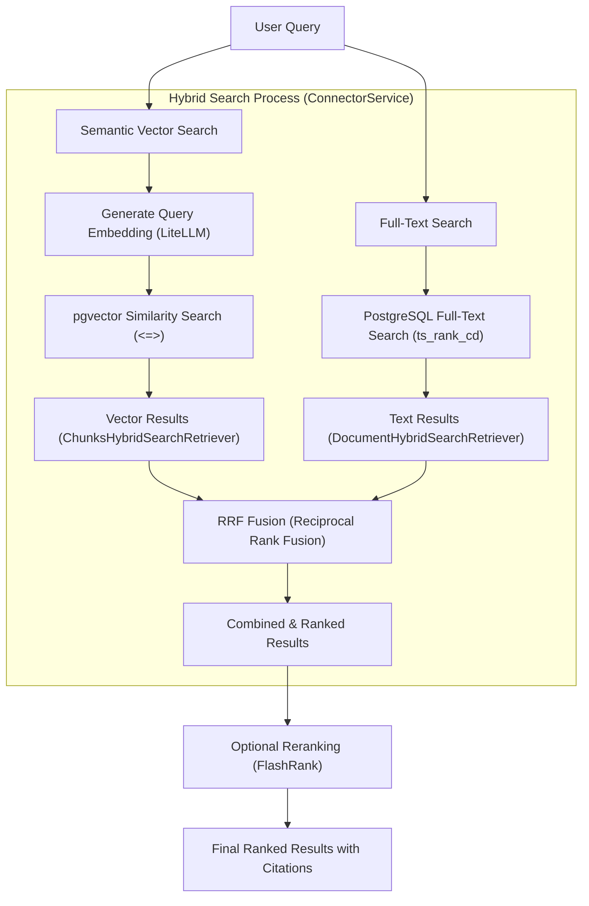
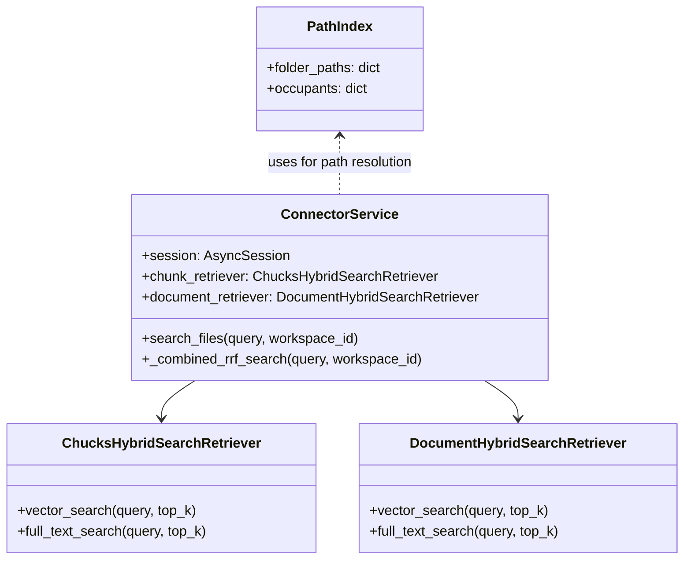

<!-- source: DeepWiki mcp.deepwiki.com · repo MODSetter/SurfSense · page 6.3 Search and Retrieval · fetched 2026-10-29 -->

# Search and Retrieval

<details>
<summary>Relevant source files</summary>

The following files were used as context for generating this wiki page:

- [surfsense_backend/app/agents/chat/multi_agent_chat/main_agent/middleware/anonymous_document/middleware.py](surfsense_backend/app/agents/chat/multi_agent_chat/main_agent/middleware/anonymous_document/middleware.py)
- [surfsense_backend/app/agents/chat/multi_agent_chat/main_agent/middleware/knowledge_tree/middleware.py](surfsense_backend/app/agents/chat/multi_agent_chat/main_agent/middleware/knowledge_tree/middleware.py)
- [surfsense_backend/app/agents/chat/runtime/llm_config.py](surfsense_backend/app/agents/chat/runtime/llm_config.py)
- [surfsense_backend/app/agents/chat/runtime/mention_resolver.py](surfsense_backend/app/agents/chat/runtime/mention_resolver.py)
- [surfsense_backend/app/agents/chat/runtime/path_resolver.py](surfsense_backend/app/agents/chat/runtime/path_resolver.py)
- [surfsense_backend/app/agents/chat/runtime/references/documents/resolver.py](surfsense_backend/app/agents/chat/runtime/references/documents/resolver.py)
- [surfsense_backend/app/retriever/chunks_hybrid_search.py](surfsense_backend/app/retriever/chunks_hybrid_search.py)
- [surfsense_backend/app/retriever/documents_hybrid_search.py](surfsense_backend/app/retriever/documents_hybrid_search.py)
- [surfsense_backend/app/services/connector_service.py](surfsense_backend/app/services/connector_service.py)
- [surfsense_backend/app/services/llm_router_service.py](surfsense_backend/app/services/llm_router_service.py)
- [surfsense_backend/app/services/llm_service.py](surfsense_backend/app/services/llm_service.py)
- [surfsense_backend/app/services/token_tracking_service.py](surfsense_backend/app/services/token_tracking_service.py)
- [surfsense_backend/app/tasks/chat/streaming/flows/shared/llm_bundle.py](surfsense_backend/app/tasks/chat/streaming/flows/shared/llm_bundle.py)
- [surfsense_backend/tests/unit/agents/new_chat/test_mention_resolver.py](surfsense_backend/tests/unit/agents/new_chat/test_mention_resolver.py)
- [surfsense_backend/tests/unit/middleware/test_knowledge_tree.py](surfsense_backend/tests/unit/middleware/test_knowledge_tree.py)
- [surfsense_backend/tests/unit/observability/test_retriever_otel.py](surfsense_backend/tests/unit/observability/test_retriever_otel.py)
- [surfsense_web/components/assistant-ui/token-usage-context.tsx](surfsense_web/components/assistant-ui/token-usage-context.tsx)

</details>


## Purpose and Scope

This document describes the hybrid search and retrieval system that powers knowledge base queries in SurfSense. The system combines semantic vector search with full-text keyword search, merges results using Reciprocal Rank Fusion (RRF), and applies reranking for improved relevance. The architecture supports both chunk-level and document-level retrieval strategies, integrated with a citation system for transparent source attribution.

For information about how the AI agent uses these search capabilities, see page 6.1 (Agent Architecture). For details on citation generation, see page 6.4 (Citations and Source Attribution).

## Overview

The search and retrieval system implements a sophisticated hybrid search architecture that combines multiple techniques to deliver highly relevant results:

1.  **Semantic Vector Search**: Uses embeddings stored in PostgreSQL's `pgvector` extension for semantic similarity matching.
2.  **Full-Text Search**: Performs keyword-based search using PostgreSQL's full-text search capabilities (`tsvector`/`tsquery`).
3.  **Reciprocal Rank Fusion (RRF)**: Merges results from both search methods to leverage the strengths of each.
4.  **Two-Tier Retrieval**: Supports both chunk-level (granular) and document-level (contextual) search.
5.  **Reranking**: Applies cross-encoder models to improve relevance ordering.

### Search Data Flow


**Hybrid Search Architecture with RRF Fusion**

The system operates through the `ConnectorService` class, which coordinates searches across different data sources and applies the hybrid search methodology to each.

Sources: [surfsense_backend/app/services/connector_service.py:25-30](), [surfsense_backend/app/services/connector_service.py:128-162]()

## Two-Tier Retrieval Architecture

The system implements a two-tier retrieval strategy that operates at both chunk and document levels, encapsulated in specialized retriever classes.

### Chunk-Level Retrieval
Searches individual text segments, providing granular matching for specific facts.
- **Retriever Class**: `ChucksHybridSearchRetriever` [surfsense_backend/app/retriever/chunks_hybrid_search.py:49-58]()
- **Search Target**: Individual `Chunk` records in the database.
- **Similarity Search**: Uses the `<=>` operator for cosine distance in `pgvector` [surfsense_backend/app/retriever/chunks_hybrid_search.py:114-114]().
- **Full-Text Search**: Uses `to_tsvector` on `Chunk.content` [surfsense_backend/app/retriever/chunks_hybrid_search.py:161-162]().

### Document-Level Retrieval
Searches entire documents using summary embeddings to find relevant context.
- **Retriever Class**: `DocumentHybridSearchRetriever` [surfsense_backend/app/retriever/documents_hybrid_search.py:48-56]()
- **Search Target**: `Document` records with summary embeddings.
- **Returns**: Chunks belonging to matched documents to provide full context [surfsense_backend/app/retriever/documents_hybrid_search.py:202-203]().

### Virtual Path Resolution
SurfSense uses a virtual filesystem abstraction for documents, mapping database entities to path-like strings (e.g., `/documents/folder/file.xml`).
- **Path Resolver**: `path_resolver.py` provides the logic to convert `Document` rows to virtual paths and back [surfsense_backend/app/agents/chat/runtime/path_resolver.py:1-13]().
- **Mention Resolution**: The `@mention` system resolves these virtual paths to specific document IDs during query processing [surfsense_backend/app/agents/chat/runtime/mention_resolver.py:18-24]().

### Code Entity to Retrieval Space Mapping


Sources: [surfsense_backend/app/services/connector_service.py:25-30](), [surfsense_backend/app/agents/chat/runtime/path_resolver.py:85-98]()

## Hybrid Search Implementation

### Semantic Vector Search
Uses the `pgvector` extension for similarity search on embeddings.
- **Implementation**: The system generates a query embedding using `config.embedding_model_instance.embed` [surfsense_backend/app/retriever/chunks_hybrid_search.py:91-93]().
- **Filtering**: Queries are strictly scoped by `workspace_id` [surfsense_backend/app/retriever/chunks_hybrid_search.py:104-104]().
- **Instrumentation**: Search calls are wrapped in `_instrument_search` decorators to track performance via OpenTelemetry [surfsense_backend/app/retriever/chunks_hybrid_search.py:13-46]().

### Full-Text Search
Uses PostgreSQL's native full-text search capabilities for keyword matching.
- **Ranking**: Results are ordered by `ts_rank_cd(tsvector, tsquery).desc()` [surfsense_backend/app/retriever/chunks_hybrid_search.py:182-182]().
- **Language**: Default configuration uses "english" for text processing [surfsense_backend/app/retriever/chunks_hybrid_search.py:161-162]().

Sources: [surfsense_backend/app/retriever/chunks_hybrid_search.py:60-128](), [surfsense_backend/app/retriever/chunks_hybrid_search.py:131-194]()

## Reciprocal Rank Fusion (RRF)

The `_combined_rrf_search()` method merges results from multiple retrieval strategies.

### RRF Implementation Details
The RRF implementation uses a constant `k = 60` to balance the influence of high-ranking results. It calculates scores based on the rank position in both the chunk-level and document-level result sets, then merges them at the document level.

```python
# RRF logic in _combined_rrf_search
k = 60
rrf_scores = {}
for doc_id in all_doc_ids:
    # rank is 0-indexed position in result list
    chunk_score = 1.0 / (k + chunk_rank) if chunk_rank else 0
    doc_score = 1.0 / (k + doc_rank) if doc_rank else 0
    rrf_scores[doc_id] = chunk_score + doc_score
```

Sources: [surfsense_backend/app/services/connector_service.py:178-200](), [surfsense_backend/app/services/connector_service.py:216-338]()

## Token Tracking and Optimization

Search and retrieval operations are monitored for cost and context window efficiency.

### Token Tracking
- **Service**: `TokenTrackingService` uses a `TurnTokenAccumulator` to group all LLM calls within a single request turn [surfsense_backend/app/services/token_tracking_service.py:67-71]().
- **Metadata Registration**: Resolves model IDs to display names and providers for UI attribution [surfsense_backend/app/services/token_tracking_service.py:79-88]().

### LLM Sanitization
- **Class**: `SanitizedChatLiteLLM` [surfsense_backend/app/agents/chat/runtime/llm_config.py:64-67]().
- **Role**: Strips provider-specific content blocks (e.g., `<thinking>` tags from reasoning models) and normalizes bare strings to ensure compatibility across Azure, OpenAI, and Anthropic [surfsense_backend/app/services/llm_router_service.py:64-73]().

Sources: [surfsense_backend/app/services/token_tracking_service.py:1-13](), [surfsense_backend/app/agents/chat/runtime/llm_config.py:64-107](), [surfsense_backend/app/services/llm_router_service.py:64-97]()

## Search Result Format and Citations

### Source IDs and Citations
The `ConnectorService` maintains a `source_id_counter` to ensure unique identifiers for retrieved content, even across different sessions or external sources [surfsense_backend/app/services/connector_service.py:31-36]().
- **Initialization**: The counter is initialized based on existing chunk counts for a workspace [surfsense_backend/app/services/connector_service.py:38-53]().
- **Citation Markers**: These IDs are used to generate `[[citation:chunk_id]]` markers in agent responses.

### Result Structure
The system returns a tuple containing:
1.  **Result Object**: A dictionary containing source metadata (`id`, `name`, `type`, `sources`) [surfsense_backend/app/services/connector_service.py:119-124]().
2.  **Files/Docs**: The raw `Document` and `Chunk` objects used by the agent for context [surfsense_backend/app/services/connector_service.py:126-126]().

Sources: [surfsense_backend/app/services/connector_service.py:31-61](), [surfsense_backend/app/services/connector_service.py:112-126]()

---

