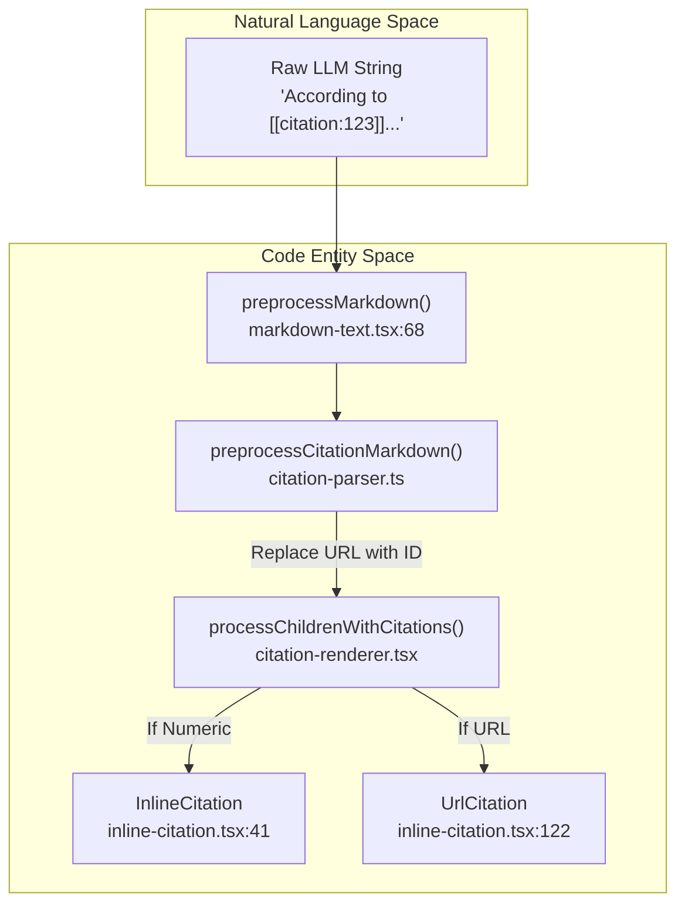
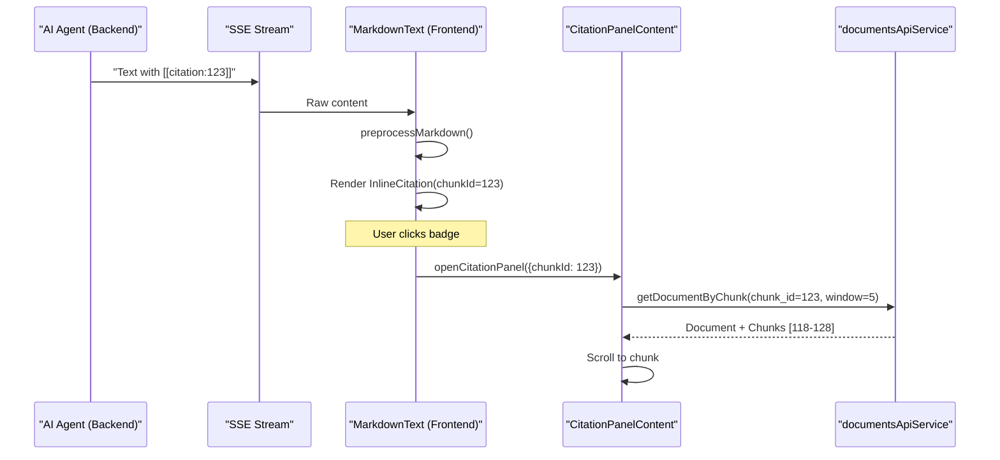

<!-- source: DeepWiki mcp.deepwiki.com · repo MODSetter/SurfSense · page 6.4 Citations and Source Attribution · fetched 2026-10-29 -->

# Citations and Source Attribution

Relevant source files

The following files were used as context for generating this wiki page:

- [surfsense_web/app/api/contact/route.ts](surfsense_web/app/api/contact/route.ts)
- [surfsense_web/app/db/index.ts](surfsense_web/app/db/index.ts)
- [surfsense_web/app/db/schema.ts](surfsense_web/app/db/schema.ts)
- [surfsense_web/components/assistant-ui/assistant-message.tsx](surfsense_web/components/assistant-ui/assistant-message.tsx)
- [surfsense_web/components/assistant-ui/inline-citation.tsx](surfsense_web/components/assistant-ui/inline-citation.tsx)
- [surfsense_web/components/assistant-ui/markdown-text.tsx](surfsense_web/components/assistant-ui/markdown-text.tsx)
- [surfsense_web/components/citation-panel/citation-panel.tsx](surfsense_web/components/citation-panel/citation-panel.tsx)
- [surfsense_web/components/contact/contact-form.tsx](surfsense_web/components/contact/contact-form.tsx)
- [surfsense_web/components/homepage/community-strip.tsx](surfsense_web/components/homepage/community-strip.tsx)
- [surfsense_web/components/homepage/footer-new.tsx](surfsense_web/components/homepage/footer-new.tsx)
- [surfsense_web/components/homepage/navbar.tsx](surfsense_web/components/homepage/navbar.tsx)
- [surfsense_web/components/pricing.tsx](surfsense_web/components/pricing.tsx)
- [surfsense_web/components/public-chat/public-chat-view.tsx](surfsense_web/components/public-chat/public-chat-view.tsx)
- [surfsense_web/components/public-chat/public-thread.tsx](surfsense_web/components/public-chat/public-thread.tsx)
- [surfsense_web/components/tool-ui/citation/_adapter.tsx](surfsense_web/components/tool-ui/citation/_adapter.tsx)
- [surfsense_web/components/tool-ui/citation/citation-hover-popover.tsx](surfsense_web/components/tool-ui/citation/citation-hover-popover.tsx)
- [surfsense_web/components/tool-ui/citation/citation.tsx](surfsense_web/components/tool-ui/citation/citation.tsx)
- [surfsense_web/components/tool-ui/citation/index.ts](surfsense_web/components/tool-ui/citation/index.ts)
- [surfsense_web/components/tool-ui/citation/schema.ts](surfsense_web/components/tool-ui/citation/schema.ts)
- [surfsense_web/components/tool-ui/index.ts](surfsense_web/components/tool-ui/index.ts)
- [surfsense_web/components/tool-ui/shared/media/index.ts](surfsense_web/components/tool-ui/shared/media/index.ts)
- [surfsense_web/components/tool-ui/shared/media/safe-navigation.ts](surfsense_web/components/tool-ui/shared/media/safe-navigation.ts)
- [surfsense_web/components/tool-ui/shared/media/sanitize-href.ts](surfsense_web/components/tool-ui/shared/media/sanitize-href.ts)
- [surfsense_web/components/tool-ui/shared/schema.ts](surfsense_web/components/tool-ui/shared/schema.ts)
- [surfsense_web/drizzle.config.ts](surfsense_web/drizzle.config.ts)

This page documents the citation system that generates `[[citation:chunk_id]]` markers in LLM responses and enables transparent source attribution. The system provides inline citations that users can click to view the exact document chunk referenced, with automatic numbering and de-duplication for knowledge base chunks and rich metadata for URL-based sources.

---

## Overview

The citation system provides transparent source attribution by embedding chunk references directly in LLM responses. The system consists of:

- **Backend Citation Format**: Instructing the LLM to output `[[citation:CHUNK_ID]]` markers with explicit chunk IDs.
- **Frontend Citation Parsing**: Regex-based extraction and transformation into interactive components during markdown rendering [surfsense_web/components/assistant-ui/markdown-text.tsx:68-106]().
- **Dual Attribution Models**:
    - **Numeric Chunks**: References to indexed knowledge base documents (e.g., `[[citation:123]]`) [surfsense_web/components/assistant-ui/inline-citation.tsx:41-62]().
    - **URL Citations**: References to scraped or linked web pages (e.g., `[[citation:https://example.com]]`) [surfsense_web/components/assistant-ui/inline-citation.tsx:122-140]().
- **Contextual Metadata**: A `CitationMetadataProvider` that tracks snippets and titles for external sources [surfsense_web/components/assistant-ui/citation-metadata-context.tsx:1-50]().
- **Source Detail View**: A sidebar panel or mobile drawer for inspecting the specific text segment cited [surfsense_web/components/citation-panel/citation-panel.tsx:28-80]().

**Sources**: [surfsense_web/components/assistant-ui/markdown-text.tsx:108-123](), [surfsense_web/components/assistant-ui/inline-citation.tsx:1-40]()

---

## Citation Markers and Parsing

### Citation Marker Syntax

The system supports two primary formats of citation markers within the LLM's raw text response:

| Citation Type | Format | Example | Implementation |
|--------------|--------|---------|----------------|
| Knowledge Base Chunk | `[[citation:CHUNK_ID]]` | `[[citation:456]]` | `NumericChunkCitation` |
| URL / Web Source | `[[citation:URL]]` | `[[citation:https://...]]` | `UrlCitation` |

### Preprocessing Pipeline

Before markdown is parsed into HTML/React elements, the raw content undergoes a preprocessing step in `MarkdownText` to prevent GFM (GitHub Flavored Markdown) autolinks from breaking citation markers [surfsense_web/components/assistant-ui/markdown-text.tsx:68-75]().

Title: "Citation Parsing and Rendering Pipeline"

**Sources**: [surfsense_web/components/assistant-ui/markdown-text.tsx:68-123](), [surfsense_web/components/citations/citation-renderer.tsx:24-25]()

---

## Citation UI Components

### Numeric Chunk Citations

When a numeric `chunk_id` is detected, the system renders an `InlineCitation`. Clicking this badge opens the `CitationPanelContent` which displays the cited chunk surrounded by its original context [surfsense_web/components/assistant-ui/inline-citation.tsx:64-109]().

- **Context Window**: The UI requests the cited chunk plus a window of adjacent chunks (default ±5) to provide context [surfsense_web/components/citation-panel/citation-panel.tsx:15-39]().
- **Visual Highlight**: The specific cited chunk is visually distinguished with a primary border and background [surfsense_web/components/citation-panel/citation-panel.tsx:145-177]().
- **Auto-Scroll**: The panel uses `requestAnimationFrame` to ensure the cited chunk is scrolled into view immediately upon opening [surfsense_web/components/citation-panel/citation-panel.tsx:55-70]().

### URL and Web Citations

For URL-based citations, the system renders a `UrlCitation` component. This provides a compact chip showing the source domain and favicon [surfsense_web/components/assistant-ui/inline-citation.tsx:122-140]().

- **Hover Popover**: On desktop, hovering over a URL citation reveals a `CitationHoverPopover` containing the page title and a snippet of the content [surfsense_web/components/tool-ui/citation/citation.tsx:86-123]().
- **Favicon Integration**: Favicons are dynamically resolved using Google's favicon service based on the source domain [surfsense_web/components/tool-ui/citation/citation.tsx:135-139]().
- **Mobile Sources Drawer**: On mobile devices, citations are aggregated into a summary button (e.g., "3 sources") that opens a bottom drawer listing all references [surfsense_web/components/assistant-ui/assistant-message.tsx:130-198]().

**Sources**: [surfsense_web/components/assistant-ui/inline-citation.tsx:64-140](), [surfsense_web/components/citation-panel/citation-panel.tsx:15-70](), [surfsense_web/components/tool-ui/citation/citation.tsx:86-123]()

---

## Data Flow: Source Attribution

Title: "Citation Data Flow: Retrieval to Display"

**Sources**: [surfsense_web/components/assistant-ui/markdown-text.tsx:108-123](), [surfsense_web/components/citation-panel/citation-panel.tsx:28-52](), [surfsense_web/lib/apis/documents-api.service.ts:34-36]()

---

## Implementation Details

### Citation Metadata Context

Metadata for citations (titles, snippets, and URLs) is managed via the `CitationMetadataProvider`. This allows the UI to associate rich information with raw URLs even if that data arrives out-of-band or is extracted from tool outputs [surfsense_web/components/assistant-ui/citation-metadata-context.tsx:15-36]().

- **useAllCitationMetadata**: A hook used by the mobile drawer to list every source referenced in a specific assistant message [surfsense_web/components/assistant-ui/assistant-message.tsx:110-128]().
- **useCitationMetadata(url)**: A hook for individual citation chips to retrieve their specific display properties [surfsense_web/components/assistant-ui/inline-citation.tsx:126-126]().

### Safe Navigation

To protect users, all citation links are sanitized before navigation. The system uses `sanitizeHref` and `openSafeNavigationHref` to ensure that links are valid and handled appropriately within the environment (e.g., opening in a system browser for the Electron desktop app) [surfsense_web/components/tool-ui/shared/media/safe-navigation.ts:1-20]().

### Document Access from Citations

From the citation panel, users can transition directly to the full document view in the workspace editor by clicking the "Open" button, which triggers the `openEditorPanelAtom` [surfsense_web/components/citation-panel/citation-panel.tsx:72-79]().

**Sources**: [surfsense_web/components/assistant-ui/citation-metadata-context.tsx:1-50](), [surfsense_web/components/citation-panel/citation-panel.tsx:72-79](), [surfsense_web/components/tool-ui/shared/media/safe-navigation.ts:1-20]()

---

