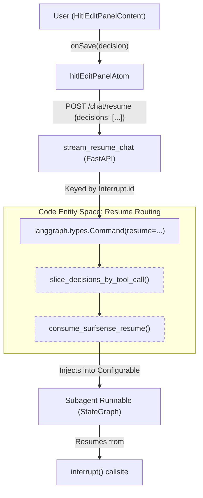
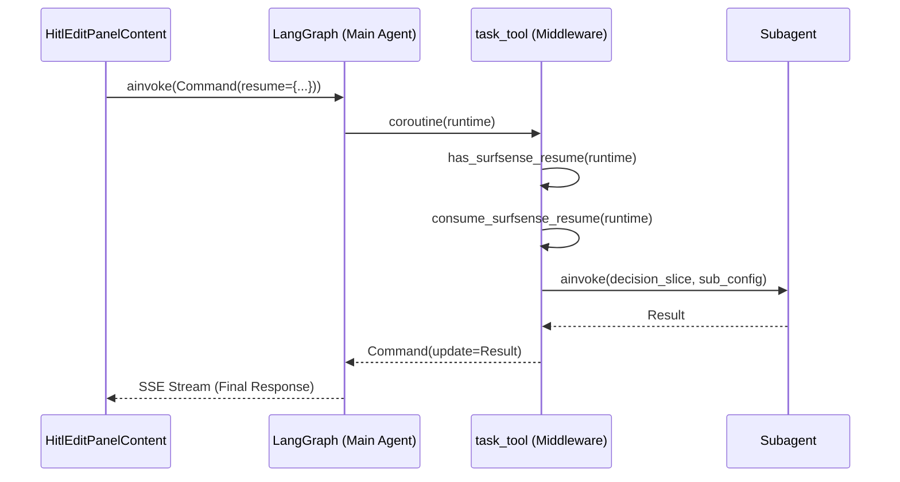

<!-- source: DeepWiki mcp.deepwiki.com · repo MODSetter/SurfSense · page 6.5 Human-in-the-Loop (HITL) · fetched 2026-10-29 -->

# Human-in-the-Loop (HITL)

Relevant source files

The following files were used as context for generating this wiki page:

- [surfsense_backend/app/agents/chat/multi_agent_chat/main_agent/middleware/checkpointed_subagent_middleware/config.py](surfsense_backend/app/agents/chat/multi_agent_chat/main_agent/middleware/checkpointed_subagent_middleware/config.py)
- [surfsense_backend/app/agents/chat/multi_agent_chat/main_agent/middleware/checkpointed_subagent_middleware/constants.py](surfsense_backend/app/agents/chat/multi_agent_chat/main_agent/middleware/checkpointed_subagent_middleware/constants.py)
- [surfsense_backend/app/agents/chat/multi_agent_chat/subagents/builtins/knowledge_base/ask_knowledge_base_tool.py](surfsense_backend/app/agents/chat/multi_agent_chat/subagents/builtins/knowledge_base/ask_knowledge_base_tool.py)
- [surfsense_backend/app/agents/chat/multi_agent_chat/subagents/shared/invocation.py](surfsense_backend/app/agents/chat/multi_agent_chat/subagents/shared/invocation.py)
- [surfsense_backend/app/routes/editor_routes.py](surfsense_backend/app/routes/editor_routes.py)
- [surfsense_backend/app/tasks/celery_tasks/document_reindex_tasks.py](surfsense_backend/app/tasks/celery_tasks/document_reindex_tasks.py)
- [surfsense_backend/tests/integration/test_document_versioning.py](surfsense_backend/tests/integration/test_document_versioning.py)
- [surfsense_backend/tests/unit/agents/multi_agent_chat/__init__.py](surfsense_backend/tests/unit/agents/multi_agent_chat/__init__.py)
- [surfsense_backend/tests/unit/agents/multi_agent_chat/middleware/__init__.py](surfsense_backend/tests/unit/agents/multi_agent_chat/middleware/__init__.py)
- [surfsense_backend/tests/unit/agents/multi_agent_chat/middleware/checkpointed_subagent_middleware/__init__.py](surfsense_backend/tests/unit/agents/multi_agent_chat/middleware/checkpointed_subagent_middleware/__init__.py)
- [surfsense_backend/tests/unit/agents/multi_agent_chat/middleware/checkpointed_subagent_middleware/test_hitl_bridge.py](surfsense_backend/tests/unit/agents/multi_agent_chat/middleware/checkpointed_subagent_middleware/test_hitl_bridge.py)
- [surfsense_backend/tests/unit/agents/multi_agent_chat/middleware/checkpointed_subagent_middleware/test_parallel_heterogeneous_decisions.py](surfsense_backend/tests/unit/agents/multi_agent_chat/middleware/checkpointed_subagent_middleware/test_parallel_heterogeneous_decisions.py)
- [surfsense_backend/tests/unit/agents/multi_agent_chat/middleware/checkpointed_subagent_middleware/test_parallel_partial_pause_routing.py](surfsense_backend/tests/unit/agents/multi_agent_chat/middleware/checkpointed_subagent_middleware/test_parallel_partial_pause_routing.py)
- [surfsense_backend/tests/unit/agents/multi_agent_chat/middleware/checkpointed_subagent_middleware/test_parallel_reject_only_routing.py](surfsense_backend/tests/unit/agents/multi_agent_chat/middleware/checkpointed_subagent_middleware/test_parallel_reject_only_routing.py)
- [surfsense_backend/tests/unit/agents/multi_agent_chat/middleware/checkpointed_subagent_middleware/test_parallel_resume_command_keying.py](surfsense_backend/tests/unit/agents/multi_agent_chat/middleware/checkpointed_subagent_middleware/test_parallel_resume_command_keying.py)
- [surfsense_backend/tests/unit/agents/multi_agent_chat/middleware/checkpointed_subagent_middleware/test_parallel_tasks.py](surfsense_backend/tests/unit/agents/multi_agent_chat/middleware/checkpointed_subagent_middleware/test_parallel_tasks.py)
- [surfsense_backend/tests/unit/agents/multi_agent_chat/middleware/checkpointed_subagent_middleware/test_resume_decision_routing.py](surfsense_backend/tests/unit/agents/multi_agent_chat/middleware/checkpointed_subagent_middleware/test_resume_decision_routing.py)
- [surfsense_backend/tests/unit/agents/multi_agent_chat/middleware/checkpointed_subagent_middleware/test_resume_helpers.py](surfsense_backend/tests/unit/agents/multi_agent_chat/middleware/checkpointed_subagent_middleware/test_resume_helpers.py)
- [surfsense_backend/tests/unit/agents/multi_agent_chat/middleware/checkpointed_subagent_middleware/test_subagent_invoke_config.py](surfsense_backend/tests/unit/agents/multi_agent_chat/middleware/checkpointed_subagent_middleware/test_subagent_invoke_config.py)
- [surfsense_backend/tests/unit/connector_indexers/test_local_folder_scan.py](surfsense_backend/tests/unit/connector_indexers/test_local_folder_scan.py)
- [surfsense_backend/tests/unit/tasks/chat/streaming/test_interrupt_inspector_all.py](surfsense_backend/tests/unit/tasks/chat/streaming/test_interrupt_inspector_all.py)
- [surfsense_desktop/src/modules/agent-filesystem.ts](surfsense_desktop/src/modules/agent-filesystem.ts)
- [surfsense_web/atoms/tabs/tabs.atom.ts](surfsense_web/atoms/tabs/tabs.atom.ts)
- [surfsense_web/components/editor-panel/editor-panel.tsx](surfsense_web/components/editor-panel/editor-panel.tsx)
- [surfsense_web/components/editor/source-code-editor.tsx](surfsense_web/components/editor/source-code-editor.tsx)
- [surfsense_web/components/layout/hooks/useSidebarState.ts](surfsense_web/components/layout/hooks/useSidebarState.ts)
- [surfsense_web/components/layout/ui/right-panel/RightPanel.tsx](surfsense_web/components/layout/ui/right-panel/RightPanel.tsx)
- [surfsense_web/components/layout/ui/sidebar/LocalFilesystemBrowser.tsx](surfsense_web/components/layout/ui/sidebar/LocalFilesystemBrowser.tsx)
- [surfsense_web/components/layout/ui/sidebar/SidebarCollapseButton.tsx](surfsense_web/components/layout/ui/sidebar/SidebarCollapseButton.tsx)
- [surfsense_web/components/layout/ui/tabs/DocumentTabContent.tsx](surfsense_web/components/layout/ui/tabs/DocumentTabContent.tsx)
- [surfsense_web/components/layout/ui/tabs/TabBar.tsx](surfsense_web/components/layout/ui/tabs/TabBar.tsx)
- [surfsense_web/components/onboarding-tour.tsx](surfsense_web/components/onboarding-tour.tsx)
- [surfsense_web/components/ui/shortcut-kbd.tsx](surfsense_web/components/ui/shortcut-kbd.tsx)
- [surfsense_web/hooks/use-platform-shortcut.ts](surfsense_web/hooks/use-platform-shortcut.ts)
- [surfsense_web/hooks/use-zero-document-type-counts.ts](surfsense_web/hooks/use-zero-document-type-counts.ts)
- [surfsense_web/lib/agent-filesystem.ts](surfsense_web/lib/agent-filesystem.ts)
- [surfsense_web/tests/helpers/api/documents.ts](surfsense_web/tests/helpers/api/documents.ts)

The Human-in-the-Loop (HITL) system in SurfSense provides a mechanism to pause agent execution for user intervention. This is primarily used when an agent needs to perform high-stakes actions (e.g., modifying external data, sending messages) or when it requires clarification before proceeding. The system leverages LangGraph's checkpointing and interrupt capabilities to maintain state while waiting for asynchronous user approval.

## System Architecture and Implementation

The HITL system is built around the concept of "checkpointed subagents." When a main agent delegates a task to a subagent that requires approval, the execution is suspended at a specific node using the `interrupt` function [[surfsense_backend/tests/unit/agents/multi_agent_chat/middleware/checkpointed_subagent_middleware/test_hitl_bridge.py:36-47]]().

### Key Components

| Component | Responsibility |
| :--- | :--- |
| **`task` tool** | A specialized tool that wraps subagent execution and manages the bridge between the parent graph and the subagent's checkpointed state [[surfsense_backend/tests/unit/agents/multi_agent_chat/middleware/checkpointed_subagent_middleware/test_hitl_bridge.py:85-93]](). |
| **`interrupt`** | A LangGraph primitive used inside subagent nodes to halt execution and return a requested action to the UI [[surfsense_backend/tests/unit/agents/multi_agent_chat/middleware/checkpointed_subagent_middleware/test_hitl_bridge.py:36-47]](). |
| **`HitlEditPanelContent`** | The React component responsible for rendering the HITL approval UI, allowing users to review and edit tool arguments before execution [[surfsense_web/components/layout/ui/right-panel/RightPanel.tsx:46-52]](). |
| **`hitlEditPanelAtom`** | Jotai atom that manages the visibility and data state of the HITL editing interface [[surfsense_web/components/layout/ui/right-panel/RightPanel.tsx:19-19]](). |

### HITL Decision Flow (Natural Language to Code)

This diagram illustrates how a user's intent to "Approve" an action travels from the frontend through the backend routing logic into the paused LangGraph state.

**Sources:** [[surfsense_backend/app/agents/chat/multi_agent_chat/main_agent/middleware/checkpointed_subagent_middleware/config.py:7-10]](), [[surfsense_backend/tests/unit/agents/multi_agent_chat/middleware/checkpointed_subagent_middleware/test_hitl_bridge.py:107-115]](), [[surfsense_backend/tests/unit/agents/multi_agent_chat/middleware/checkpointed_subagent_middleware/test_parallel_resume_command_keying.py:40-47]](), [[surfsense_web/components/layout/ui/right-panel/RightPanel.tsx:99-99]]()

## Decision Routing and Slicing

SurfSense supports parallel tool execution where multiple subagents might be paused simultaneously. To handle this, the system uses a side-channel keyed by `tool_call_id`.

### Parallel Execution Handling
When the main agent state has multiple pending interrupts, LangGraph requires decisions to be keyed by the specific `Interrupt.id` [[surfsense_backend/tests/unit/agents/multi_agent_chat/middleware/checkpointed_subagent_middleware/test_parallel_resume_command_keying.py:3-12]](). 

1. **`collect_pending_tool_calls`**: Scans the current state for all tools currently in an "interrupt" status.
2. **`slice_decisions_by_tool_call`**: Matches the flat list of decisions provided by the user to the corresponding `tool_call_id` based on the order they were emitted [[surfsense_backend/tests/unit/agents/multi_agent_chat/middleware/checkpointed_subagent_middleware/test_parallel_heterogeneous_decisions.py:155-160]]().
3. **`consume_surfsense_resume`**: Retrieves and removes the decision payload for a specific tool call from the `RunnableConfig`, ensuring sibling tools are not affected [[surfsense_backend/tests/unit/agents/multi_agent_chat/middleware/checkpointed_subagent_middleware/test_resume_helpers.py:27-40]]().

### Resume Logic Sequence

**Sources:** [[surfsense_backend/tests/unit/agents/multi_agent_chat/middleware/checkpointed_subagent_middleware/test_hitl_bridge.py:107-123]](), [[surfsense_backend/app/agents/chat/multi_agent_chat/main_agent/middleware/checkpointed_subagent_middleware/config.py:7-10]](), [[surfsense_backend/tests/unit/agents/multi_agent_chat/middleware/checkpointed_subagent_middleware/test_resume_helpers.py:92-103]]()

## Approval UI and Editor Panel

The frontend integrates HITL via the `RightPanel`, which manages several context-sensitive surfaces including the `HitlEditPanelContent` [[surfsense_web/components/layout/ui/right-panel/RightPanel.tsx:46-52]]().

- **Panel Width**: The HITL edit panel is configured with a default width of 640px to accommodate complex tool argument editing [[surfsense_web/components/layout/ui/right-panel/RightPanel.tsx:168-168]]().
- **State Transition**: When an HITL event is detected, the `RightPanel` switches the active tab to `hitl-edit` and expands the panel if it was collapsed [[surfsense_web/components/layout/ui/right-panel/RightPanel.tsx:183-189]]().
- **Source Code Integration**: For tool calls involving code or markdown (like `save_document`), the system can leverage the `SourceCodeEditor` (Monaco-based) to allow users to verify the exact content being written [[surfsense_web/components/editor/source-code-editor.tsx:22-30]]().

## Checkpointed Subagent Middleware

The `task` tool acts as a middleware that manages the lifecycle of subagents. It is responsible for:
- **Persistence**: Ensuring the subagent uses the same `thread_id` and checkpointing slot as the parent's tool call [[surfsense_backend/tests/unit/agents/multi_agent_chat/middleware/checkpointed_subagent_middleware/test_hitl_bridge.py:71-79]]().
- **State Restoration**: Re-invoking the subagent with the `surfsense_resume_value` when a user provides a decision [[surfsense_backend/tests/unit/agents/multi_agent_chat/middleware/checkpointed_subagent_middleware/test_hitl_bridge.py:107-115]]().
- **Error Handling**: Raising a `RuntimeError` if a subagent is found in a paused state but no resume value is provided in the configuration [[surfsense_backend/tests/unit/agents/multi_agent_chat/middleware/checkpointed_subagent_middleware/test_hitl_bridge.py:150-155]]().

**Sources:**
- [[surfsense_backend/tests/unit/agents/multi_agent_chat/middleware/checkpointed_subagent_middleware/test_hitl_bridge.py:1-160]]()
- [[surfsense_web/components/layout/ui/right-panel/RightPanel.tsx:88-101]]()
- [[surfsense_web/components/layout/ui/right-panel/RightPanel.tsx:164-197]]()
- [[surfsense_backend/app/agents/chat/multi_agent_chat/main_agent/middleware/checkpointed_subagent_middleware/config.py:1-15]]()

---

