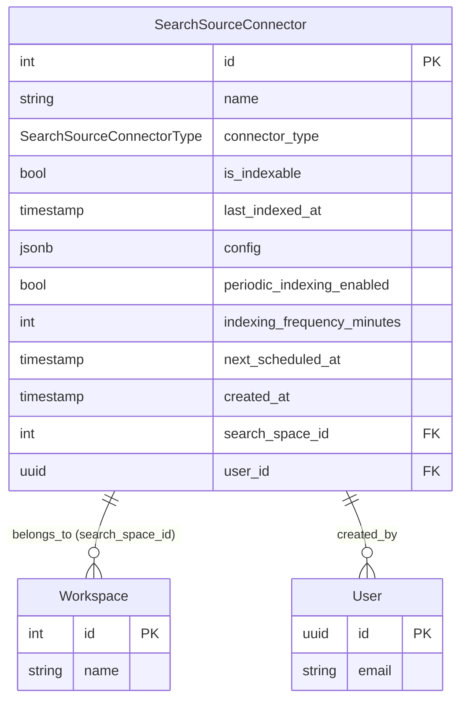

<!-- source: DeepWiki mcp.deepwiki.com · repo MODSetter/SurfSense · page 7 Connector System · fetched 2026-10-29 -->

# Connector System

<details>
<summary>Relevant source files</summary>

The following files were used as context for generating this wiki page:

- [surfsense_backend/app/agents/chat/runtime/llm_config.py](surfsense_backend/app/agents/chat/runtime/llm_config.py)
- [surfsense_backend/app/retriever/chunks_hybrid_search.py](surfsense_backend/app/retriever/chunks_hybrid_search.py)
- [surfsense_backend/app/retriever/documents_hybrid_search.py](surfsense_backend/app/retriever/documents_hybrid_search.py)
- [surfsense_backend/app/services/connector_service.py](surfsense_backend/app/services/connector_service.py)
- [surfsense_backend/app/services/llm_router_service.py](surfsense_backend/app/services/llm_router_service.py)
- [surfsense_backend/app/services/llm_service.py](surfsense_backend/app/services/llm_service.py)
- [surfsense_backend/app/services/token_tracking_service.py](surfsense_backend/app/services/token_tracking_service.py)
- [surfsense_backend/app/tasks/chat/streaming/flows/shared/llm_bundle.py](surfsense_backend/app/tasks/chat/streaming/flows/shared/llm_bundle.py)
- [surfsense_backend/app/utils/validators.py](surfsense_backend/app/utils/validators.py)
- [surfsense_backend/tests/unit/observability/test_retriever_otel.py](surfsense_backend/tests/unit/observability/test_retriever_otel.py)
- [surfsense_web/components/assistant-ui/connector-popup/components/connector-card.tsx](surfsense_web/components/assistant-ui/connector-popup/components/connector-card.tsx)
- [surfsense_web/components/assistant-ui/connector-popup/components/connector-dialog-header.tsx](surfsense_web/components/assistant-ui/connector-popup/components/connector-dialog-header.tsx)
- [surfsense_web/components/assistant-ui/connector-popup/connect-forms/connector-benefits.ts](surfsense_web/components/assistant-ui/connector-popup/connect-forms/connector-benefits.ts)
- [surfsense_web/components/assistant-ui/connector-popup/connect-forms/index.tsx](surfsense_web/components/assistant-ui/connector-popup/connect-forms/index.tsx)
- [surfsense_web/components/assistant-ui/connector-popup/connector-configs/index.tsx](surfsense_web/components/assistant-ui/connector-popup/connector-configs/index.tsx)
- [surfsense_web/components/assistant-ui/connector-popup/connector-configs/views/connector-connect-view.tsx](surfsense_web/components/assistant-ui/connector-popup/connector-configs/views/connector-connect-view.tsx)
- [surfsense_web/components/assistant-ui/connector-popup/connector-configs/views/connector-edit-view.tsx](surfsense_web/components/assistant-ui/connector-popup/connector-configs/views/connector-edit-view.tsx)
- [surfsense_web/components/assistant-ui/connector-popup/connector-configs/views/indexing-configuration-view.tsx](surfsense_web/components/assistant-ui/connector-popup/connector-configs/views/indexing-configuration-view.tsx)
- [surfsense_web/components/assistant-ui/connector-popup/constants/connector-constants.ts](surfsense_web/components/assistant-ui/connector-popup/constants/connector-constants.ts)
- [surfsense_web/components/assistant-ui/connector-popup/hooks/use-connector-dialog.ts](surfsense_web/components/assistant-ui/connector-popup/hooks/use-connector-dialog.ts)
- [surfsense_web/components/assistant-ui/connector-popup/tabs/active-connectors-tab.tsx](surfsense_web/components/assistant-ui/connector-popup/tabs/active-connectors-tab.tsx)
- [surfsense_web/components/assistant-ui/connector-popup/tabs/all-connectors-tab.tsx](surfsense_web/components/assistant-ui/connector-popup/tabs/all-connectors-tab.tsx)
- [surfsense_web/components/assistant-ui/connector-popup/views/connector-accounts-list-view.tsx](surfsense_web/components/assistant-ui/connector-popup/views/connector-accounts-list-view.tsx)
- [surfsense_web/components/assistant-ui/connector-popup/views/youtube-crawler-view.tsx](surfsense_web/components/assistant-ui/connector-popup/views/youtube-crawler-view.tsx)
- [surfsense_web/components/assistant-ui/token-usage-context.tsx](surfsense_web/components/assistant-ui/token-usage-context.tsx)

</details>


The Connector System enables SurfSense to integrate with 28+ data source integrations through a unified architecture. It supports OAuth-based connectors (Google Drive, Slack, Notion, etc.), API-based connectors (Tavily, SearxNG, Elasticsearch), and web crawlers. The system handles authentication, configuration validation, periodic reindexing via Celery, and hybrid search across all connected data sources.

For information about how connector data flows through the document processing pipeline, see [Document Management](#8). For details on how connector search results are integrated into the AI agent, see [Search and Retrieval](#6.3).

---

## System Architecture

### Database Model

The connector system is built around the `SearchSourceConnector` table which stores connector configurations and state:



**Connector Type Enum**: The system supports a wide range of types defined in `SearchSourceConnectorType`.

| Category | Examples |
|----------|----------------|
| **OAuth Connectors** | `SLACK_CONNECTOR`, `NOTION_CONNECTOR`, `GITHUB_CONNECTOR`, `GOOGLE_DRIVE_CONNECTOR`, `AIRTABLE_CONNECTOR` |
| **API/Live Connectors** | `LINEAR_CONNECTOR`, `JIRA_CONNECTOR`, `CLICKUP_CONNECTOR`, `CONFLUENCE_CONNECTOR` |
| **Crawlers** | `WEBCRAWLER_CONNECTOR`, `YOUTUBE_CONNECTOR` |
| **Special** | `MCP_CONNECTOR` (Model Context Protocol), `OBSIDIAN_CONNECTOR` |

**Sources**: [surfsense_backend/app/db.py:85-118](), [surfsense_backend/app/db.py:611-645]()

---

### Connector Lifecycle Management

The `useConnectorDialog` hook in the frontend manages the complex state transitions for connectors, from discovery to configuration and indexing.

```mermaid
graph TB
    subgraph "Frontend [surfsense_web]"
        [useConnectorDialog.ts] -- "Manages" --> [connectorDialogOpenAtom]
        [useConnectorDialog.ts] -- "Calls" --> [createConnectorMutationAtom]
        [useConnectorDialog.ts] -- "Calls" --> [indexConnectorMutationAtom]
        [useConnectorDialog.ts] -- "Calls" --> [updateConnectorMutationAtom]
    end

    subgraph "Backend [surfsense_backend]"
        [POST /search-source-connectors]
        [POST /search-source-connectors/id/index]
        [PUT /search-source-connectors/id]
    end

    [createConnectorMutationAtom] --> [POST /search-source-connectors]
    [indexConnectorMutationAtom] --> [POST /search-source-connectors/id/index]
    [updateConnectorMutationAtom] --> [PUT /search-source-connectors/id]
```

**Sources**: [surfsense_web/components/assistant-ui/connector-popup/hooks/use-connector-dialog.ts:61-122](), [surfsense_web/components/assistant-ui/connector-popup/hooks/use-connector-dialog.ts:144-178]()

---

## Connector Architecture

The system utilizes a class-based architecture for specific integrations and a generic service layer for routing requests. For details, see [Connector Architecture](#7.1).

**Key Entities**:
- `SearchSourceConnector`: Database model representing a configured integration instance [surfsense_backend/app/db.py:611-645]().
- `ConnectorService`: Backend service that orchestrates multi-source search using `ChucksHybridSearchRetriever` and `DocumentHybridSearchRetriever` [surfsense_backend/app/services/connector_service.py:25-30]().

---

## Connector Types

SurfSense categorizes connectors based on their operational mode:
- **Live Connectors**: Operate in real-time without background indexing. These often use the Model Context Protocol (MCP) [surfsense_web/components/assistant-ui/connector-popup/constants/connector-constants.ts:40-56]().
- **Indexable Connectors**: Periodically sync data into the vector database. They support date-range filtering and periodic sync configurations [surfsense_web/components/assistant-ui/connector-popup/connector-configs/views/indexing-configuration-view.tsx:183-202]().
- **Deprecated Connectors**: Legacy connectors like `DISCORD_CONNECTOR` or `TAVILY_API` that are hidden from the catalog unless already connected [surfsense_web/components/assistant-ui/connector-popup/constants/connector-constants.ts:23-34]().

For a full list and categorization, see [Connector Types](#7.2).

---

## Connector Management UI

The user interface is centered around the `ConnectorPopup` managed by `useConnectorDialog`. It provides:
- **Catalog View**: Browsing available integrations categorized by OAuth, Crawlers, and Others [surfsense_web/components/assistant-ui/connector-popup/tabs/all-connectors-tab.tsx:57-114]().
- **Active View**: Managing existing connections and monitoring sync status [surfsense_web/components/assistant-ui/connector-popup/tabs/active-connectors-tab.tsx:32-151]().
- **Account Management**: Support for multiple accounts per provider (e.g., multiple Gmail accounts) via `ConnectorAccountsListView` [surfsense_web/components/assistant-ui/connector-popup/views/connector-accounts-list-view.tsx:35-46]().

For details, see [Connector Management UI](#7.3).

---

## OAuth Integration Flow

OAuth connectors utilize a standardized redirect flow. The system supports a standardized `authEndpoint` for each connector type [surfsense_web/components/assistant-ui/connector-popup/constants/connector-constants.ts:59-161]().

**Key Components**:
- **State Tracking**: Uses `OAUTH_RESULT_COOKIE` to handle callbacks and `parseOAuthCallbackResult` to extract outcomes [surfsense_web/components/assistant-ui/connector-popup/hooks/use-connector-dialog.ts:49-59]().
- **Re-authentication**: Automatic detection of expired tokens via `connector.config.auth_expired` and UI prompts for re-auth [surfsense_web/components/assistant-ui/connector-popup/connector-configs/views/connector-edit-view.tsx:83-123]().

For details, see [OAuth Integration Flow](#7.4).

---

## Periodic Indexing

SurfSense ensures data remains fresh through a background indexing system.

```mermaid
graph LR
    ["Celery Beat"] -- "Triggers" --> ["check_and_trigger_scheduled_indexing"]
    ["check_and_trigger_scheduled_indexing"] -- "Enqueues" --> ["index_connector_task"]
    ["index_connector_task"] -- "Updates" --> ["SearchSourceConnector.last_indexed_at"]
```

**Key Features**:
- **Auto-Indexing**: Connectors can be set to automatically index upon connection with default frequencies (e.g., daily) [surfsense_web/components/assistant-ui/connector-popup/hooks/use-connector-dialog.ts:144-178]().
- **Configurable Frequency**: Users can set intervals (e.g., 15 mins, hour, 6 hours, 12 hours, day, week) [surfsense_web/components/assistant-ui/connector-popup/hooks/use-connector-dialog.ts:125-142]().
- **Vision LLM Support**: Specific connectors (Google Drive, Dropbox, OneDrive) support enabling Vision LLM for processing visual content during indexing [surfsense_web/components/assistant-ui/connector-popup/connector-configs/views/connector-edit-view.tsx:27-33]().

For details, see [Periodic Indexing](#7.5).

**Sources**: [surfsense_web/components/assistant-ui/connector-popup/hooks/use-connector-dialog.ts:125-178](), [surfsense_web/components/assistant-ui/connector-popup/connector-configs/views/connector-edit-view.tsx:27-33]()

---

