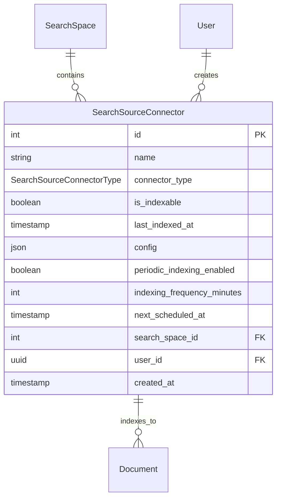
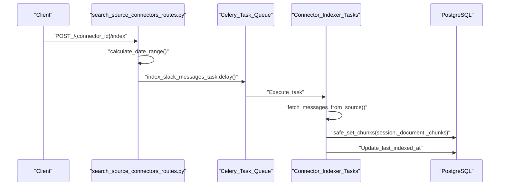

<!-- source: DeepWiki mcp.deepwiki.com · repo MODSetter/SurfSense · page 7.1 Connector Architecture · fetched 2026-10-29 -->

# Connector Architecture

<details>
<summary>Relevant source files</summary>

The following files were used as context for generating this wiki page:

- [surfsense_backend/app/agents/chat/runtime/llm_config.py](surfsense_backend/app/agents/chat/runtime/llm_config.py)
- [surfsense_backend/app/connectors/google_calendar_connector.py](surfsense_backend/app/connectors/google_calendar_connector.py)
- [surfsense_backend/app/connectors/google_gmail_connector.py](surfsense_backend/app/connectors/google_gmail_connector.py)
- [surfsense_backend/app/retriever/chunks_hybrid_search.py](surfsense_backend/app/retriever/chunks_hybrid_search.py)
- [surfsense_backend/app/retriever/documents_hybrid_search.py](surfsense_backend/app/retriever/documents_hybrid_search.py)
- [surfsense_backend/app/services/connector_service.py](surfsense_backend/app/services/connector_service.py)
- [surfsense_backend/app/services/llm_router_service.py](surfsense_backend/app/services/llm_router_service.py)
- [surfsense_backend/app/services/llm_service.py](surfsense_backend/app/services/llm_service.py)
- [surfsense_backend/app/services/token_tracking_service.py](surfsense_backend/app/services/token_tracking_service.py)
- [surfsense_backend/app/tasks/chat/streaming/flows/shared/llm_bundle.py](surfsense_backend/app/tasks/chat/streaming/flows/shared/llm_bundle.py)
- [surfsense_backend/app/tasks/connector_indexers/base.py](surfsense_backend/app/tasks/connector_indexers/base.py)
- [surfsense_backend/app/tasks/document_processors/base.py](surfsense_backend/app/tasks/document_processors/base.py)
- [surfsense_backend/app/tasks/document_processors/circleback_processor.py](surfsense_backend/app/tasks/document_processors/circleback_processor.py)
- [surfsense_backend/tests/unit/observability/test_retriever_otel.py](surfsense_backend/tests/unit/observability/test_retriever_otel.py)
- [surfsense_web/components/assistant-ui/token-usage-context.tsx](surfsense_web/components/assistant-ui/token-usage-context.tsx)

</details>


## Purpose and Scope

This document describes the connector system architecture that enables SurfSense to integrate with 28+ external data sources. It covers the core `SearchSourceConnector` entity, the `ConnectorService` class that provides unified search across connectors, the API routes for connector management, and the lifecycle from connector creation through indexing and search integration.

For information about specific connector types and their configurations, see [Connector Types](#7.2). For the UI components that manage connectors, see [Connector Management UI](#7.3). For OAuth-specific flows, see [OAuth Integration Flow](#7.4). For periodic indexing details, see [Periodic Indexing](#7.5).

---

## Core Architecture

The connector system is built around three primary components:

1.  **`SearchSourceConnector` model** - Database entity storing connector configuration [surfsense_backend/app/db.py:611-644]().
2.  **`ConnectorService` class** - Service layer providing a unified search interface and RRF fusion [surfsense_backend/app/services/connector_service.py:25-30]().
3.  **API routes** - REST endpoints for connector lifecycle management [surfsense_backend/app/routes/search_source_connectors_routes.py:1-19]().

### SearchSourceConnector Entity



**Sources:** [surfsense_backend/app/db.py:611-644]()

The `SearchSourceConnector` model defines the following key fields:

| Field | Type | Purpose |
| :--- | :--- | :--- |
| `name` | String | User-friendly connector name |
| `connector_type` | Enum | One of 28 connector types defined in `SearchSourceConnectorType` [surfsense_backend/app/db.py:59-84]() |
| `is_indexable` | Boolean | Whether connector supports content indexing |
| `config` | JSON | Connector-specific configuration (API keys, OAuth tokens, etc.) |
| `periodic_indexing_enabled` | Boolean | Enable automatic reindexing |
| `indexing_frequency_minutes` | Integer | Reindex interval (if periodic enabled) |
| `next_scheduled_at` | Timestamp | When next indexing is scheduled |
| `search_space_id` | Foreign Key | Parent search space (workspace) |
| `user_id` | Foreign Key | User who created the connector |

**Sources:** [surfsense_backend/app/db.py:611-644]()

---

## Connector Lifecycle

```mermaid
stateDiagram-v2
    [*] --> "Created" : "POST_/search-source-connectors"
    "Created" --> "Configured" : "User_provides_config"
    "Configured" --> "Indexing" : "POST_/{connector_id}/index"
    "Indexing" --> "Indexed" : "Celery_task_completes"
    "Indexed" --> "Searching" : "ConnectorService.search_files()"
    "Indexed" --> "Reindexing" : "Periodic_schedule_triggers"
    "Reindexing" --> "Indexed" : "Update_complete"
    "Indexed" --> "Updated" : "PUT_/{connector_id}"
    "Updated" --> "Indexed" : "Config_changed"
    "Indexed" --> [*] : "DELETE_/{connector_id}"
```

**Sources:** [surfsense_backend/app/routes/search_source_connectors_routes.py:112-541](), [surfsense_backend/app/services/connector_service.py:62-69]()

### 1. Creation

Connectors are created via `POST /search-source-connectors` with a `SearchSourceConnectorCreate` schema [surfsense_backend/app/routes/search_source_connectors_routes.py:112-212]().

The creation process:
1.  Validates user permissions.
2.  Checks for duplicate connectors (one per type per search space, except for specific types like MCP) [surfsense_backend/app/routes/search_source_connectors_routes.py:141-154]().
3.  Validates `config` field against connector type requirements [surfsense_backend/app/schemas/search_source_connector.py:23-31]().
4.  Automatically sets `next_scheduled_at` if periodic indexing is enabled [surfsense_backend/app/routes/search_source_connectors_routes.py:175-191]().

**Sources:** [surfsense_backend/app/routes/search_source_connectors_routes.py:112-212](), [surfsense_backend/app/schemas/search_source_connector.py:13-56]()

### 2. Configuration & Authentication

The `config` field stores connector-specific settings. SurfSense handles diverse authentication methods:

*   **OAuth (Native & Composio)**: Managed by classes like `GoogleGmailConnector` [surfsense_backend/app/connectors/google_gmail_connector.py:55-78]() and `SlackHistory` [surfsense_backend/app/connectors/slack_history.py:27-54]().
*   **API Keys**: Standard configuration for search APIs (Tavily, SearxNG).
*   **Subprocess CLI**: `GitHubConnector` uses the `gitingest` CLI via subprocess to avoid async event loop conflicts in Celery [surfsense_backend/app/connectors/github_connector.py:41-49]().

**Sources:** [surfsense_backend/app/connectors/google_gmail_connector.py:79-112](), [surfsense_backend/app/connectors/slack_history.py:55-85](), [surfsense_backend/app/connectors/github_connector.py:65-84]()

### 3. Indexing

Indexing is triggered via `POST /search-source-connectors/{connector_id}/index` [surfsense_backend/app/routes/search_source_connectors_routes.py:544-846]().



**Sources:** [surfsense_backend/app/routes/search_source_connectors_routes.py:544-846](), [surfsense_backend/app/tasks/connector_indexers/base.py:34-50]()

### 4. Token Management & Security

SurfSense implements automatic token refreshing and encryption for sensitive connector credentials:

*   **Encryption**: Uses `TokenEncryption` with the system `SECRET_KEY` to encrypt tokens before storing them in the database [surfsense_backend/app/connectors/google_gmail_connector.py:137-162]().
*   **Auto-Refresh**: Connectors like `GoogleCalendarConnector` check for token expiration and use `refresh_token` to obtain new credentials during indexing [surfsense_backend/app/connectors/google_calendar_connector.py:84-110]().

**Sources:** [surfsense_backend/app/connectors/google_gmail_connector.py:112-162](), [surfsense_backend/app/connectors/slack_history.py:138-158]()

---

## ConnectorService Class

The `ConnectorService` class is the central gateway for retrieving knowledge from connectors. It integrates hybrid search retrievers to find indexed content [surfsense_backend/app/services/connector_service.py:25-30]().

### Key Functionalities

#### `_combined_rrf_search`
This internal method merges results from chunk-level and document-level hybrid searches using Reciprocal Rank Fusion (RRF) [surfsense_backend/app/services/connector_service.py:128-162]().

1.  **Chunk Search**: Uses `ChucksHybridSearchRetriever` for vector and full-text search on chunks [surfsense_backend/app/retriever/chunks_hybrid_search.py:49-57]().
2.  **Document Search**: Uses `DocumentHybridSearchRetriever` for searching document-level summaries [surfsense_backend/app/retriever/documents_hybrid_search.py:48-56]().
3.  **Fusion**: Combines ranks to provide the most relevant context for the LLM [surfsense_backend/app/services/connector_service.py:178-183]().

**Sources:** [surfsense_backend/app/services/connector_service.py:128-162](), [surfsense_backend/app/retriever/chunks_hybrid_search.py:197-206]()

#### `search_files`
Specialized search for uploaded or connector-synced files within a workspace [surfsense_backend/app/services/connector_service.py:62-92](). It returns standardized `sources_info` and `langchain_documents` for agent consumption [surfsense_backend/app/services/connector_service.py:112-126]().

**Sources:** [surfsense_backend/app/services/connector_service.py:62-126]()

---

## Retrieval & Search Architecture

SurfSense uses a two-tier hybrid search strategy to maximize retrieval quality.

```mermaid
graph TB
    subgraph "Natural_Language_Space"
        "UserQuery"["User_Query_Text"]
    end

    subgraph "Code_Entity_Space"
        "CS"["ConnectorService"]
        "CHSR"["ChucksHybridSearchRetriever"]
        "DHSR"["DocumentHybridSearchRetriever"]
        "LiteLLM"["litellm_Router/Service"]
    end

    subgraph "Storage"
        "PG"["PostgreSQL_pgvector"]
        "DocTable"["Document_Table"]
        "ChunkTable"["Chunk_Table"]
    end

    "UserQuery" --> "CS"
    "CS" --> "CHSR"
    "CS" --> "DHSR"
    "CHSR" -->|"vector_search()"| "ChunkTable"
    "CHSR" -->|"full_text_search()"| "ChunkTable"
    "DHSR" -->|"vector_search()"| "DocTable"
    "DHSR" -->|"full_text_search()"| "DocTable"
    "PG" -.-> "DocTable"
    "PG" -.-> "ChunkTable"
```

**Sources:** [surfsense_backend/app/services/connector_service.py:25-30](), [surfsense_backend/app/retriever/chunks_hybrid_search.py:60-80](), [surfsense_backend/app/retriever/documents_hybrid_search.py:59-79]()

### Instrumentation and Observability
Search operations are instrumented using OpenTelemetry to track performance and result counts:
*   `_instrument_search` decorator records search duration and result counts [surfsense_backend/app/retriever/chunks_hybrid_search.py:13-46]().
*   Performance logs track embedding time and DB query latency [surfsense_backend/app/retriever/chunks_hybrid_search.py:94-98]().

**Sources:** [surfsense_backend/app/retriever/chunks_hybrid_search.py:13-46](), [surfsense_backend/app/retriever/documents_hybrid_search.py:12-45]()

---

## Integration with LLM Services

Connectors provide the context that the `LLMService` and `LLMRouterService` use to generate answers.

*   **Token Tracking**: All LLM calls triggered by connector search or agent turns are tracked via `TokenTrackingService` [surfsense_backend/app/services/token_tracking_service.py:2-6]().
*   **Router Integration**: The `LLMRouterService` handles load balancing and failover for the LLM providers used during processing [surfsense_backend/app/services/llm_router_service.py:104-111]().

**Sources:** [surfsense_backend/app/services/llm_service.py:96-100](), [surfsense_backend/app/services/llm_router_service.py:104-116](), [surfsense_backend/app/services/token_tracking_service.py:67-78]()

---

## Summary of Key Components

| Component | Class/Module | Primary Responsibility |
| :--- | :--- | :--- |
| **Service Layer** | `ConnectorService` | Unified search API, RRF fusion logic. |
| **Retrievers** | `ChucksHybridSearchRetriever` | Vector/Keyword search on content chunks. |
| **OAuth Handler** | `GoogleGmailConnector` | OAuth credential lifecycle, Gmail API interaction. |
| **CLI Connector** | `GitHubConnector` | Subprocess-based repository ingestion via `gitingest`. |
| **Base Indexer** | `surfsense_backend/app/tasks/connector_indexers/base.py` | Shared indexing utilities (hashing, duplicate checks). |

**Sources:** [surfsense_backend/app/services/connector_service.py:25-30](), [surfsense_backend/app/retriever/chunks_hybrid_search.py:49-57](), [surfsense_backend/app/connectors/google_gmail_connector.py:55-57](), [surfsense_backend/app/connectors/github_connector.py:41-47](), [surfsense_backend/app/tasks/connector_indexers/base.py:1-6]()

---

