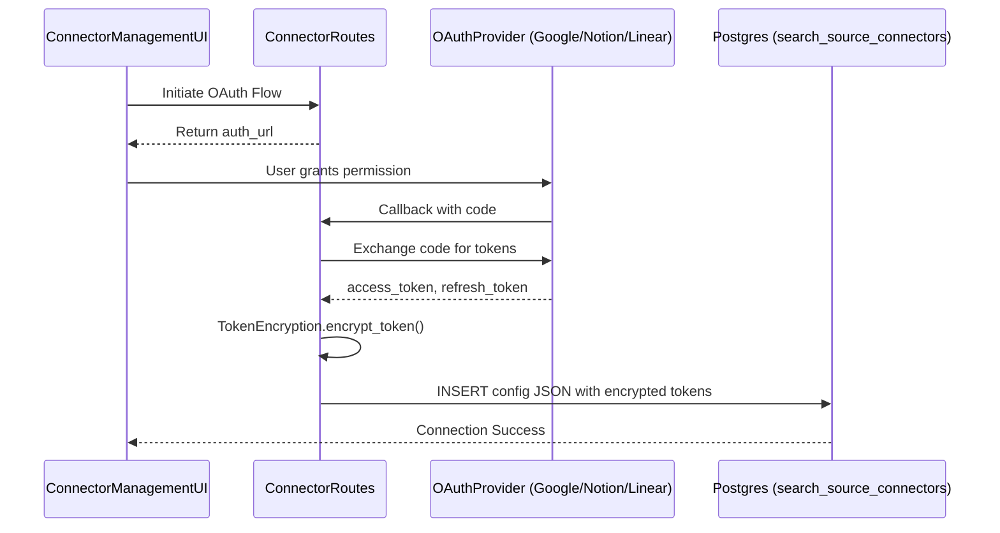
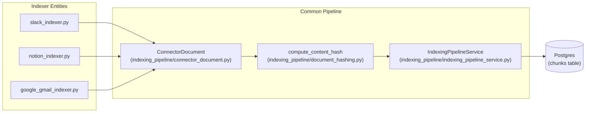

<!-- source: DeepWiki mcp.deepwiki.com · repo MODSetter/SurfSense · page 7.2 Connector Types · fetched 2026-10-29 -->

# Connector Types

Relevant source files

The following files were used as context for generating this wiki page:

- [surfsense_backend/app/connectors/github_connector.py](surfsense_backend/app/connectors/github_connector.py)
- [surfsense_backend/app/connectors/linear_connector.py](surfsense_backend/app/connectors/linear_connector.py)
- [surfsense_backend/app/connectors/notion_history.py](surfsense_backend/app/connectors/notion_history.py)
- [surfsense_backend/app/connectors/slack_history.py](surfsense_backend/app/connectors/slack_history.py)
- [surfsense_backend/app/schemas/slack_auth_credentials.py](surfsense_backend/app/schemas/slack_auth_credentials.py)
- [surfsense_backend/app/tasks/connector_indexers/airtable_indexer.py](surfsense_backend/app/tasks/connector_indexers/airtable_indexer.py)
- [surfsense_backend/app/tasks/connector_indexers/bookstack_indexer.py](surfsense_backend/app/tasks/connector_indexers/bookstack_indexer.py)
- [surfsense_backend/app/tasks/connector_indexers/clickup_indexer.py](surfsense_backend/app/tasks/connector_indexers/clickup_indexer.py)
- [surfsense_backend/app/tasks/connector_indexers/confluence_indexer.py](surfsense_backend/app/tasks/connector_indexers/confluence_indexer.py)
- [surfsense_backend/app/tasks/connector_indexers/discord_indexer.py](surfsense_backend/app/tasks/connector_indexers/discord_indexer.py)
- [surfsense_backend/app/tasks/connector_indexers/github_indexer.py](surfsense_backend/app/tasks/connector_indexers/github_indexer.py)
- [surfsense_backend/app/tasks/connector_indexers/google_calendar_indexer.py](surfsense_backend/app/tasks/connector_indexers/google_calendar_indexer.py)
- [surfsense_backend/app/tasks/connector_indexers/google_gmail_indexer.py](surfsense_backend/app/tasks/connector_indexers/google_gmail_indexer.py)
- [surfsense_backend/app/tasks/connector_indexers/linear_indexer.py](surfsense_backend/app/tasks/connector_indexers/linear_indexer.py)
- [surfsense_backend/app/tasks/connector_indexers/luma_indexer.py](surfsense_backend/app/tasks/connector_indexers/luma_indexer.py)
- [surfsense_backend/app/tasks/connector_indexers/notion_indexer.py](surfsense_backend/app/tasks/connector_indexers/notion_indexer.py)
- [surfsense_backend/app/tasks/connector_indexers/slack_indexer.py](surfsense_backend/app/tasks/connector_indexers/slack_indexer.py)
- [surfsense_backend/app/tasks/connector_indexers/teams_indexer.py](surfsense_backend/app/tasks/connector_indexers/teams_indexer.py)
- [surfsense_web/components/assistant-ui/connector-popup/components/date-range-selector.tsx](surfsense_web/components/assistant-ui/connector-popup/components/date-range-selector.tsx)
- [surfsense_web/components/assistant-ui/connector-popup/components/periodic-sync-config.tsx](surfsense_web/components/assistant-ui/connector-popup/components/periodic-sync-config.tsx)
- [surfsense_web/components/assistant-ui/connector-popup/connect-forms/components/baidu-search-api-connect-form.tsx](surfsense_web/components/assistant-ui/connector-popup/connect-forms/components/baidu-search-api-connect-form.tsx)
- [surfsense_web/components/assistant-ui/connector-popup/connect-forms/components/bookstack-connect-form.tsx](surfsense_web/components/assistant-ui/connector-popup/connect-forms/components/bookstack-connect-form.tsx)
- [surfsense_web/components/assistant-ui/connector-popup/connect-forms/components/circleback-connect-form.tsx](surfsense_web/components/assistant-ui/connector-popup/connect-forms/components/circleback-connect-form.tsx)
- [surfsense_web/components/assistant-ui/connector-popup/connect-forms/components/elasticsearch-connect-form.tsx](surfsense_web/components/assistant-ui/connector-popup/connect-forms/components/elasticsearch-connect-form.tsx)
- [surfsense_web/components/assistant-ui/connector-popup/connect-forms/components/github-connect-form.tsx](surfsense_web/components/assistant-ui/connector-popup/connect-forms/components/github-connect-form.tsx)
- [surfsense_web/components/assistant-ui/connector-popup/connect-forms/components/linkup-api-connect-form.tsx](surfsense_web/components/assistant-ui/connector-popup/connect-forms/components/linkup-api-connect-form.tsx)
- [surfsense_web/components/assistant-ui/connector-popup/connect-forms/components/luma-connect-form.tsx](surfsense_web/components/assistant-ui/connector-popup/connect-forms/components/luma-connect-form.tsx)
- [surfsense_web/components/assistant-ui/connector-popup/connect-forms/components/searxng-connect-form.tsx](surfsense_web/components/assistant-ui/connector-popup/connect-forms/components/searxng-connect-form.tsx)
- [surfsense_web/components/assistant-ui/connector-popup/connect-forms/components/tavily-api-connect-form.tsx](surfsense_web/components/assistant-ui/connector-popup/connect-forms/components/tavily-api-connect-form.tsx)
- [surfsense_web/components/assistant-ui/connector-popup/connector-configs/components/composio-drive-config.tsx](surfsense_web/components/assistant-ui/connector-popup/connector-configs/components/composio-drive-config.tsx)
- [surfsense_web/components/assistant-ui/connector-popup/connector-configs/components/google-drive-config.tsx](surfsense_web/components/assistant-ui/connector-popup/connector-configs/components/google-drive-config.tsx)
- [surfsense_web/components/assistant-ui/connector-popup/connector-configs/components/onedrive-config.tsx](surfsense_web/components/assistant-ui/connector-popup/connector-configs/components/onedrive-config.tsx)
- [surfsense_web/components/connectors/google-drive-folder-tree.tsx](surfsense_web/components/connectors/google-drive-folder-tree.tsx)
- [surfsense_web/contracts/enums/connector.ts](surfsense_web/contracts/enums/connector.ts)
- [surfsense_web/contracts/enums/connectorIcons.tsx](surfsense_web/contracts/enums/connectorIcons.tsx)
- [surfsense_web/contracts/types/connector.types.ts](surfsense_web/contracts/types/connector.types.ts)
- [surfsense_web/lib/apis/connectors-api.service.ts](surfsense_web/lib/apis/connectors-api.service.ts)
- [surfsense_web/lib/connectors/utils.ts](surfsense_web/lib/connectors/utils.ts)

SurfSense supports 28+ connector types, ranging from real-time Search APIs to deep knowledge base indexing. Connectors are categorized by their function: Search APIs (real-time results), Knowledge Bases (indexable documentation), Project Management, Communication, Calendar/Email, and Web Crawlers.

## Connector Type Taxonomy

The `searchSourceConnectorTypeEnum` defines all supported integrations. Connectors are fundamentally divided by their indexing capability, which determines if they store content in the vector database or provide real-time tool-calling capabilities.

```mermaid
graph TB
    subgraph "Connector Type Enum"
        Root["searchSourceConnectorTypeEnum<br/>(connector.types.ts:4-36)"]
    end
    
    subgraph "Search APIs (Non-Indexable)"
        TAVILY["TAVILY_API"]
        SEARXNG["SEARXNG_API"]
        LINKUP["LINKUP_API"]
        BAIDU["BAIDU_SEARCH_API"]
    end
    
    subgraph "Knowledge Bases (Indexable)"
        NOTION["NOTION_CONNECTOR"]
        CONFLUENCE["CONFLUENCE_CONNECTOR"]
        BOOKSTACK["BOOKSTACK_CONNECTOR"]
        ELASTICSEARCH["ELASTICSEARCH_CONNECTOR"]
        OBSIDIAN["OBSIDIAN_CONNECTOR"]
    end
    
    subgraph "Project Management (Indexable)"
        GITHUB["GITHUB_CONNECTOR"]
        LINEAR["LINEAR_CONNECTOR"]
        JIRA["JIRA_CONNECTOR"]
        CLICKUP["CLICKUP_CONNECTOR"]
        AIRTABLE["AIRTABLE_CONNECTOR"]
    end
    
    subgraph "Communication (Indexable)"
        SLACK["SLACK_CONNECTOR"]
        DISCORD["DISCORD_CONNECTOR"]
        TEAMS["TEAMS_CONNECTOR"]
    end
    
    subgraph "Cloud & Productivity"
        GDRIVE["GOOGLE_DRIVE_CONNECTOR"]
        GMAIL["GOOGLE_GMAIL_CONNECTOR"]
        GCAL["GOOGLE_CALENDAR_CONNECTOR"]
        ONEDRIVE["ONEDRIVE_CONNECTOR"]
        DROPBOX["DROPBOX_CONNECTOR"]
    end

    subgraph "Specialized"
        CRAWLER["WEBCRAWLER_CONNECTOR"]
        YOUTUBE["YOUTUBE_CONNECTOR"]
        MCP["MCP_CONNECTOR"]
    end
    
    Root --> TAVILY
    Root --> SEARXNG
    Root --> LINKUP
    Root --> BAIDU
    Root --> NOTION
    Root --> CONFLUENCE
    Root --> BOOKSTACK
    Root --> ELASTICSEARCH
    Root --> GITHUB
    Root --> LINEAR
    Root --> JIRA
    Root --> CLICKUP
    Root --> AIRTABLE
    Root --> SLACK
    Root --> DISCORD
    Root --> TEAMS
    Root --> GDRIVE
    Root --> GMAIL
    Root --> GCAL
    Root --> ONEDRIVE
    Root --> DROPBOX
    Root --> CRAWLER
    Root --> YOUTUBE
    Root --> MCP
```

**Sources:** [surfsense_web/contracts/types/connector.types.ts:4-36](), [surfsense_web/lib/connectors/utils.ts:2-37]()

## OAuth Connectors

OAuth connectors utilize a secure redirect flow to acquire `access_token` and `refresh_token` credentials. SurfSense implements token encryption for stored credentials to ensure security at rest.

### Supported OAuth Integrations
*   **Google Suite:** Gmail, Calendar, and Drive. Supports both native and Composio-mediated connections. The system uses specific connector types like `COMPOSIO_GOOGLE_CALENDAR_CONNECTOR` to differentiate between integration methods [surfsense_backend/app/tasks/connector_indexers/google_calendar_indexer.py:36-39]().
*   **Notion:** Supports OAuth2 and legacy integration tokens. It includes logic to detect legacy tokens and recommend upgrading to OAuth [surfsense_backend/app/tasks/connector_indexers/notion_indexer.py:195-199]().
*   **Slack:** Uses bot tokens with auto-refresh support handled via the `SlackHistory` connector class [surfsense_backend/app/tasks/connector_indexers/slack_indexer.py:196-197]().
*   **Linear:** Implements auto-refresh capability for expired tokens using the `refresh_linear_token` utility [surfsense_backend/app/connectors/linear_connector.py:178-201]().

### Data Flow: OAuth Credential Handling
Sensitive tokens are encrypted before storage in the database using the `TokenEncryption` utility [surfsense_backend/app/connectors/notion_history.py:153-167]().

**Sources:** [surfsense_backend/app/connectors/notion_history.py:115-178](), [surfsense_backend/app/connectors/linear_connector.py:102-176](), [surfsense_backend/app/tasks/connector_indexers/google_calendar_indexer.py:172-192]()

## API Connectors (Real-time Search)

These connectors do not index content. Instead, they are used as tools by the Agent system to fetch live data during a conversation.

| Type | Display Name | implementation |
| :--- | :--- | :--- |
| `TAVILY_API` | Tavily API | Used for high-quality AI search results |
| `SEARXNG_API` | SearxNG | Privacy-focused metasearch engine |
| `BAIDU_SEARCH_API` | Baidu Search | Specialized for Chinese language web content |
| `LINKUP_API` | Linkup | Real-time web search and ground truth |

**Sources:** [surfsense_web/contracts/types/connector.types.ts:5-9](), [surfsense_web/lib/connectors/utils.ts:4-8]()

## Indexing Pipeline

Indexable connectors transform external data into a unified `ConnectorDocument` format before sending it to the `IndexingPipelineService`.

### Indexing Lifecycle
1.  **Fetch:** The indexer (e.g., `notion_indexer.py`) retrieves raw data via specialized connector clients like `NotionHistoryConnector` [surfsense_backend/app/tasks/connector_indexers/notion_indexer.py:163-186]().
2.  **Map:** Raw data is converted to a `ConnectorDocument`. This includes mapping metadata like `event_id` for Calendar or `message_id` for Gmail [surfsense_backend/app/tasks/connector_indexers/google_calendar_indexer.py:49-89](), [surfsense_backend/app/tasks/connector_indexers/google_gmail_indexer.py:101-149]().
3.  **Batching (Communication):** For Slack and Discord, messages are grouped into batches (e.g., `SLACK_BATCH_SIZE = 100`) to preserve conversational context and reduce DB overhead [surfsense_backend/app/tasks/connector_indexers/slack_indexer.py:49-52](), [surfsense_backend/app/tasks/connector_indexers/discord_indexer.py:49-52]().
4.  **Process:** The `IndexingPipelineService` handles chunking and embedding generation [surfsense_backend/app/tasks/connector_indexers/notion_indexer.py:18-21]().

**Sources:** [surfsense_backend/app/tasks/connector_indexers/notion_indexer.py:39-68](), [surfsense_backend/app/tasks/connector_indexers/slack_indexer.py:116-152](), [surfsense_backend/app/tasks/connector_indexers/google_gmail_indexer.py:152-179]()

## Connector Management UI

The frontend uses a centralized API service and configuration components to manage various integrations.

*   **API Service:** `ConnectorsApiService` handles CRUD operations and specialized tasks like listing GitHub repositories or Google Drive folders [surfsense_web/lib/apis/connectors-api.service.ts:42-231]().
*   **Icon Registry:** `getConnectorIcon` maps connector names to specific SVG assets or Lucide icons for consistent UI representation [surfsense_web/contracts/enums/connectorIcons.tsx:16-145]().
*   **Config Components:** Specific UI components like `GoogleDriveConfig` allow users to select specific folders/files and set indexing options such as `incremental_sync` [surfsense_web/components/assistant-ui/connector-popup/connector-configs/components/google-drive-config.tsx:85-154]().

**Sources:** [surfsense_web/lib/apis/connectors-api.service.ts:42-129](), [surfsense_web/contracts/enums/connectorIcons.tsx:25-89](), [surfsense_web/components/assistant-ui/connector-popup/connector-configs/components/google-drive-config.tsx:39-43]()

---

