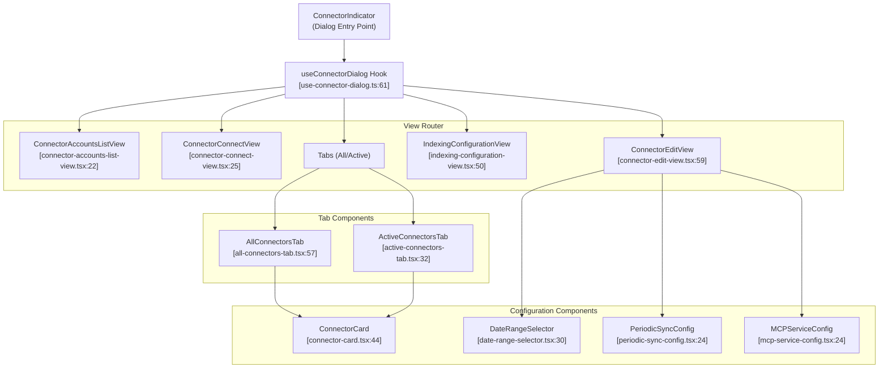
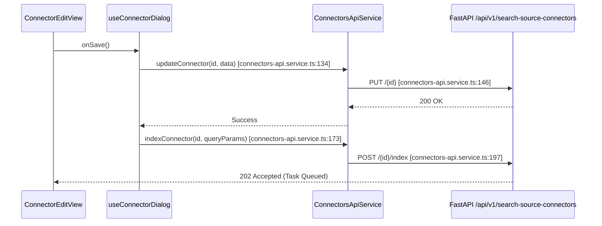

<!-- source: DeepWiki mcp.deepwiki.com · repo MODSetter/SurfSense · page 7.3 Connector Management UI · fetched 2026-10-29 -->

# Connector Management UI

Relevant source files

The following files were used as context for generating this wiki page:

- [surfsense_backend/app/utils/validators.py](surfsense_backend/app/utils/validators.py)
- [surfsense_web/components/assistant-ui/connector-popup/components/connector-card.tsx](surfsense_web/components/assistant-ui/connector-popup/components/connector-card.tsx)
- [surfsense_web/components/assistant-ui/connector-popup/components/connector-dialog-header.tsx](surfsense_web/components/assistant-ui/connector-popup/components/connector-dialog-header.tsx)
- [surfsense_web/components/assistant-ui/connector-popup/components/connector-status-badge.tsx](surfsense_web/components/assistant-ui/connector-popup/components/connector-status-badge.tsx)
- [surfsense_web/components/assistant-ui/connector-popup/components/connector-warning-banner.tsx](surfsense_web/components/assistant-ui/connector-popup/components/connector-warning-banner.tsx)
- [surfsense_web/components/assistant-ui/connector-popup/components/date-range-selector.tsx](surfsense_web/components/assistant-ui/connector-popup/components/date-range-selector.tsx)
- [surfsense_web/components/assistant-ui/connector-popup/components/periodic-sync-config.tsx](surfsense_web/components/assistant-ui/connector-popup/components/periodic-sync-config.tsx)
- [surfsense_web/components/assistant-ui/connector-popup/config/connector-status-config.example.json](surfsense_web/components/assistant-ui/connector-popup/config/connector-status-config.example.json)
- [surfsense_web/components/assistant-ui/connector-popup/config/connector-status-config.json](surfsense_web/components/assistant-ui/connector-popup/config/connector-status-config.json)
- [surfsense_web/components/assistant-ui/connector-popup/config/connector-status-config.ts](surfsense_web/components/assistant-ui/connector-popup/config/connector-status-config.ts)
- [surfsense_web/components/assistant-ui/connector-popup/connect-forms/connector-benefits.ts](surfsense_web/components/assistant-ui/connector-popup/connect-forms/connector-benefits.ts)
- [surfsense_web/components/assistant-ui/connector-popup/connect-forms/index.tsx](surfsense_web/components/assistant-ui/connector-popup/connect-forms/index.tsx)
- [surfsense_web/components/assistant-ui/connector-popup/connector-configs/components/composio-drive-config.tsx](surfsense_web/components/assistant-ui/connector-popup/connector-configs/components/composio-drive-config.tsx)
- [surfsense_web/components/assistant-ui/connector-popup/connector-configs/components/google-drive-config.tsx](surfsense_web/components/assistant-ui/connector-popup/connector-configs/components/google-drive-config.tsx)
- [surfsense_web/components/assistant-ui/connector-popup/connector-configs/components/onedrive-config.tsx](surfsense_web/components/assistant-ui/connector-popup/connector-configs/components/onedrive-config.tsx)
- [surfsense_web/components/assistant-ui/connector-popup/connector-configs/index.tsx](surfsense_web/components/assistant-ui/connector-popup/connector-configs/index.tsx)
- [surfsense_web/components/assistant-ui/connector-popup/connector-configs/views/connector-connect-view.tsx](surfsense_web/components/assistant-ui/connector-popup/connector-configs/views/connector-connect-view.tsx)
- [surfsense_web/components/assistant-ui/connector-popup/connector-configs/views/connector-edit-view.tsx](surfsense_web/components/assistant-ui/connector-popup/connector-configs/views/connector-edit-view.tsx)
- [surfsense_web/components/assistant-ui/connector-popup/connector-configs/views/indexing-configuration-view.tsx](surfsense_web/components/assistant-ui/connector-popup/connector-configs/views/indexing-configuration-view.tsx)
- [surfsense_web/components/assistant-ui/connector-popup/constants/connector-constants.ts](surfsense_web/components/assistant-ui/connector-popup/constants/connector-constants.ts)
- [surfsense_web/components/assistant-ui/connector-popup/hooks/use-connector-dialog.ts](surfsense_web/components/assistant-ui/connector-popup/hooks/use-connector-dialog.ts)
- [surfsense_web/components/assistant-ui/connector-popup/hooks/use-connector-status.ts](surfsense_web/components/assistant-ui/connector-popup/hooks/use-connector-status.ts)
- [surfsense_web/components/assistant-ui/connector-popup/tabs/active-connectors-tab.tsx](surfsense_web/components/assistant-ui/connector-popup/tabs/active-connectors-tab.tsx)
- [surfsense_web/components/assistant-ui/connector-popup/tabs/all-connectors-tab.tsx](surfsense_web/components/assistant-ui/connector-popup/tabs/all-connectors-tab.tsx)
- [surfsense_web/components/assistant-ui/connector-popup/views/connector-accounts-list-view.tsx](surfsense_web/components/assistant-ui/connector-popup/views/connector-accounts-list-view.tsx)
- [surfsense_web/components/assistant-ui/connector-popup/views/youtube-crawler-view.tsx](surfsense_web/components/assistant-ui/connector-popup/views/youtube-crawler-view.tsx)
- [surfsense_web/components/connectors/google-drive-folder-tree.tsx](surfsense_web/components/connectors/google-drive-folder-tree.tsx)
- [surfsense_web/contracts/enums/connector.ts](surfsense_web/contracts/enums/connector.ts)
- [surfsense_web/contracts/enums/connectorIcons.tsx](surfsense_web/contracts/enums/connectorIcons.tsx)
- [surfsense_web/contracts/types/connector.types.ts](surfsense_web/contracts/types/connector.types.ts)
- [surfsense_web/lib/apis/connectors-api.service.ts](surfsense_web/lib/apis/connectors-api.service.ts)
- [surfsense_web/lib/connectors/utils.ts](surfsense_web/lib/connectors/utils.ts)

## Purpose and Scope

The Connector Management UI provides the frontend interface for browsing, connecting, and managing 28+ data sources within SurfSense. It is implemented as a unified dialog (`ConnectorIndicator`) that handles diverse integration types including OAuth-based SaaS (Google, Slack, Notion), API-based tools (GitHub, Elasticsearch), and web crawlers.

The UI manages the entire connector lifecycle:
1.  **Discovery**: Browsing the catalog of available integrations via `AllConnectorsTab` [surfsense_web/components/assistant-ui/connector-popup/tabs/all-connectors-tab.tsx:57]().
2.  **Authentication**: Handling OAuth redirects or form-based credential entry [surfsense_web/components/assistant-ui/connector-popup/hooks/use-connector-dialog.ts:61]().
3.  **Configuration**: Selecting specific folders or server configurations via `ConnectorConfigComponent` [surfsense_web/components/assistant-ui/connector-popup/connector-configs/views/connector-edit-view.tsx:126]().
4.  **Indexing**: Configuring historical date ranges and periodic sync frequencies [surfsense_web/components/assistant-ui/connector-popup/connector-configs/views/indexing-configuration-view.tsx:183]().
5.  **Management**: Monitoring indexing status, re-authenticating expired tokens, and managing multiple accounts via `ConnectorAccountsListView` [surfsense_web/components/assistant-ui/connector-popup/views/connector-accounts-list-view.tsx:22]().

---

## Component Architecture

The UI is built as a stateful modal dialog that orchestrates multiple views. State is centralized in the `useConnectorDialog` hook which utilizes Jotai atoms for global synchronization.

### Core Component Hierarchy

**Sources:** [surfsense_web/components/assistant-ui/connector-popup/hooks/use-connector-dialog.ts:61-125](), [surfsense_web/components/assistant-ui/connector-popup/tabs/all-connectors-tab.tsx:57-70](), [surfsense_web/components/assistant-ui/connector-popup/tabs/active-connectors-tab.tsx:32-41](), [surfsense_web/components/assistant-ui/connector-popup/connector-configs/views/connector-edit-view.tsx:126-134]()

---

## View Modes and Navigation

The `useConnectorDialog` hook manages view transitions. For multi-account connectors (like Gmail or Slack), the UI provides a list view to manage individual instances.

### View Mode Routing Logic

| View Mode | Trigger | Component |
| :--- | :--- | :--- |
| **Catalog** | `activeTab === "all"` | `AllConnectorsTab` |
| **Active** | `activeTab === "active"` | `ActiveConnectorsTab` |
| **Connect Form** | `connectingConnectorType` set | `ConnectorConnectView` |
| **Post-OAuth Setup** | `indexingConfig` set | `IndexingConfigurationView` |
| **Edit/Manage** | `editingConnector` set | `ConnectorEditView` |
| **Accounts List** | `viewingAccountsType` set | `ConnectorAccountsListView` |

**Sources:** [surfsense_web/components/assistant-ui/connector-popup/hooks/use-connector-dialog.ts:71-122](), [surfsense_web/components/assistant-ui/connector-popup/views/connector-accounts-list-view.tsx:22-46]()

---

## Connection Flows

### OAuth Connection Flow
For connectors in the `OAUTH_CONNECTORS` list, the system uses a redirect-based flow.

1.  **Initiation**: The UI triggers an OAuth flow via backend endpoints defined in `connector-constants.ts` (e.g., `/api/v1/auth/google/drive/connector/add/`) [surfsense_web/components/assistant-ui/connector-popup/constants/connector-constants.ts:65]().
2.  **Redirect**: The browser redirects to the provider.
3.  **Callback Processing**: Upon return, the UI reads the `OAUTH_RESULT_COOKIE` to determine success [surfsense_web/components/assistant-ui/connector-popup/hooks/use-connector-dialog.ts:49-54]().
4.  **Post-Connect Setup**: `IndexingConfigurationView` is displayed to configure initial indexing parameters [surfsense_web/components/assistant-ui/connector-popup/connector-configs/views/indexing-configuration-view.tsx:50]().

### Form-Based Connection (API/MCP)
For non-OAuth connectors like GitHub or custom MCP servers:

1.  **View Selection**: `ConnectorConnectView` renders a specific form via `getConnectFormComponent(connectorType)` [surfsense_web/components/assistant-ui/connector-popup/connector-configs/views/connector-connect-view.tsx:53-56]().
2.  **Data Submission**: The form data is passed to `createConnectorMutationAtom` which calls the `ConnectorsApiService.createConnector` method [surfsense_web/lib/apis/connectors-api.service.ts:99-129]().

**Sources:** [surfsense_web/components/assistant-ui/connector-popup/constants/connector-constants.ts:59-161](), [surfsense_web/components/assistant-ui/connector-popup/hooks/use-connector-dialog.ts:49-68](), [surfsense_web/lib/apis/connectors-api.service.ts:99-129]()

---

## Indexing and Management

### Configuration Management
`ConnectorEditView` provides controls for adjusting the data ingestion behavior of an existing connector.

*   **Date Range**: Users select `startDate` and `endDate` for the crawl. Future dates are allowed for `GOOGLE_CALENDAR_CONNECTOR` and `LUMA_CONNECTOR` [surfsense_web/components/assistant-ui/connector-popup/connector-configs/views/indexing-configuration-view.tsx:190-202]().
*   **Periodic Sync**: Background re-indexing frequency is configured via `PeriodicSyncConfig`, with options ranging from 15 minutes to 1 week [surfsense_web/components/assistant-ui/connector-popup/hooks/use-connector-dialog.ts:125-142]().
*   **Vision LLM**: For file-based connectors (Drive, Dropbox, OneDrive), users can enable Vision LLM support [surfsense_web/components/assistant-ui/connector-popup/connector-configs/views/connector-edit-view.tsx:27-33]().

### Real-time Status Tracking
The `ConnectorCard` and `ActiveConnectorsTab` provide live feedback:

*   **Syncing Status**: Displays a `Spinner` and "Syncing" text when the connector ID is present in the `indexingConnectorIds` set [surfsense_web/components/assistant-ui/connector-popup/components/connector-card.tsx:115-119]().
*   **Document Counts**: Summarizes the total documents ingested by a connector type [surfsense_web/components/assistant-ui/connector-popup/tabs/active-connectors-tab.tsx:53-62]().
*   **Re-authentication**: Detects expired tokens and provides a `handleReauth` trigger that hits the backend re-auth endpoint [surfsense_web/components/assistant-ui/connector-popup/connector-configs/views/connector-edit-view.tsx:94-123]().

**Sources:** [surfsense_web/components/assistant-ui/connector-popup/connector-configs/views/connector-edit-view.tsx:27-33](), [surfsense_web/components/assistant-ui/connector-popup/components/connector-card.tsx:115-139](), [surfsense_web/components/assistant-ui/connector-popup/tabs/active-connectors-tab.tsx:161-172]()

---

## Deprecation and Migration
SurfSense enforces deprecation for legacy connectors replaced by MCP or consolidated web search.

*   **Deprecated Types**: Defined in `DEPRECATED_CONNECTOR_TYPES`. Includes Discord, Teams, and various search APIs (Tavily, SearxNG) [surfsense_web/components/assistant-ui/connector-popup/constants/connector-constants.ts:23-34]().
*   **UI Treatment**: Deprecated connectors are hidden from the catalog unless already connected. New connection attempts are refused [surfsense_web/components/assistant-ui/connector-popup/constants/connector-constants.ts:7-12]().
*   **Backend Enforcement**: The `raise_if_connector_deprecated` function in the backend returns an HTTP 410 status code for these types [surfsense_backend/app/utils/validators.py:43-65]().

**Sources:** [surfsense_web/components/assistant-ui/connector-popup/constants/connector-constants.ts:23-34](), [surfsense_backend/app/utils/validators.py:24-40](), [surfsense_backend/app/utils/validators.py:43-65]()

---

## Technical Data Flow

**Sources:** [surfsense_web/lib/apis/connectors-api.service.ts:134-149](), [surfsense_web/lib/apis/connectors-api.service.ts:173-203](), [surfsense_web/components/assistant-ui/connector-popup/connector-configs/views/connector-edit-view.tsx:51-54]()

---

