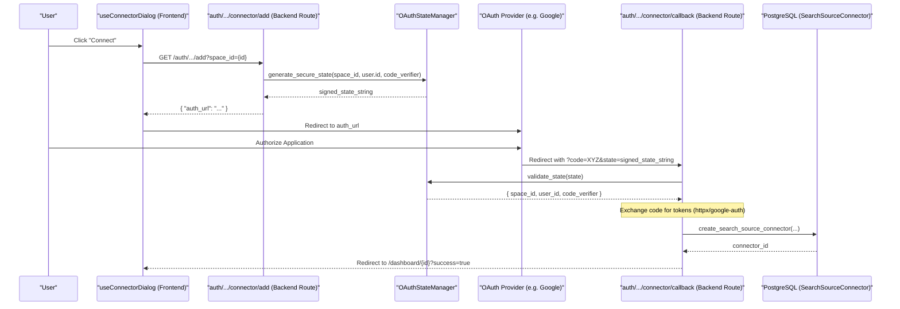
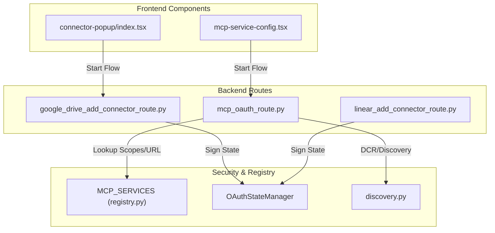

<!-- source: DeepWiki mcp.deepwiki.com · repo MODSetter/SurfSense · page 7.4 OAuth Integration Flow · fetched 2026-10-29 -->

# OAuth Integration Flow

Relevant source files

The following files were used as context for generating this wiki page:

- [surfsense_backend/app/routes/airtable_add_connector_route.py](surfsense_backend/app/routes/airtable_add_connector_route.py)
- [surfsense_backend/app/routes/confluence_add_connector_route.py](surfsense_backend/app/routes/confluence_add_connector_route.py)
- [surfsense_backend/app/routes/discord_add_connector_route.py](surfsense_backend/app/routes/discord_add_connector_route.py)
- [surfsense_backend/app/routes/google_calendar_add_connector_route.py](surfsense_backend/app/routes/google_calendar_add_connector_route.py)
- [surfsense_backend/app/routes/google_drive_add_connector_route.py](surfsense_backend/app/routes/google_drive_add_connector_route.py)
- [surfsense_backend/app/routes/google_gmail_add_connector_route.py](surfsense_backend/app/routes/google_gmail_add_connector_route.py)
- [surfsense_backend/app/routes/jira_add_connector_route.py](surfsense_backend/app/routes/jira_add_connector_route.py)
- [surfsense_backend/app/routes/linear_add_connector_route.py](surfsense_backend/app/routes/linear_add_connector_route.py)
- [surfsense_backend/app/routes/mcp_oauth_route.py](surfsense_backend/app/routes/mcp_oauth_route.py)
- [surfsense_backend/app/routes/notion_add_connector_route.py](surfsense_backend/app/routes/notion_add_connector_route.py)
- [surfsense_backend/app/routes/slack_add_connector_route.py](surfsense_backend/app/routes/slack_add_connector_route.py)
- [surfsense_backend/app/services/mcp_oauth/__init__.py](surfsense_backend/app/services/mcp_oauth/__init__.py)
- [surfsense_backend/app/services/mcp_oauth/discovery.py](surfsense_backend/app/services/mcp_oauth/discovery.py)
- [surfsense_backend/app/services/mcp_oauth/registry.py](surfsense_backend/app/services/mcp_oauth/registry.py)
- [surfsense_web/components/assistant-ui/connector-popup/connector-configs/components/mcp-service-config.tsx](surfsense_web/components/assistant-ui/connector-popup/connector-configs/components/mcp-service-config.tsx)
- [surfsense_web/components/assistant-ui/connector-popup/connector-configs/components/mcp-trusted-tools.tsx](surfsense_web/components/assistant-ui/connector-popup/connector-configs/components/mcp-trusted-tools.tsx)

This document details the OAuth 2.0 authentication flow used to connect external data sources (connectors) to SurfSense. OAuth enables users to grant SurfSense access to their data from providers like Google, Slack, Notion, and others without sharing credentials.

For information about connector types and architecture, see [Connector Architecture](7.1). For non-OAuth connector setup, see [Connector Management UI](7.3).

---

## OAuth Flow Overview

SurfSense implements a standard OAuth 2.0 authorization code flow for connector types. The flow consists of five main stages:

1.  **Initiation**: User clicks "Connect" on an OAuth connector.
2.  **Authorization Request**: Frontend requests authorization URL from backend.
3.  **User Authorization**: User is redirected to provider's OAuth consent screen.
4.  **Callback Processing**: Provider redirects back with authorization code.
5.  **Token Exchange & Storage**: Backend exchanges code for access tokens and creates/updates the connector.

The system handles both native OAuth connectors and **MCP (Model Context Protocol)** OAuth services which support Dynamic Client Registration (DCR).

---

## OAuth Connector Configuration

### Supported OAuth Connectors

The system supports a wide range of OAuth connector types, categorized by their underlying service implementation:

| Category | Connector Types | Route Implementation |
| :--- | :--- | :--- |
| **Google** | Gmail, Drive, Calendar | `google_drive_add_connector_route.py`, `google_gmail_add_connector_route.py`, `google_calendar_add_connector_route.py` |
| **Productivity** | Notion, Airtable, Linear | `notion_add_connector_route.py`, `airtable_add_connector_route.py`, `linear_add_connector_route.py` |
| **Communication** | Slack, Discord | `slack_add_connector_route.py`, `discord_add_connector_route.py` |
| **Enterprise** | Jira, Confluence, ClickUp | `jira_add_connector_route.py`, `confluence_add_connector_route.py` |
| **MCP Services** | Linear, Jira, Slack, Airtable, ClickUp | `mcp_oauth_route.py` |

**Sources:** [surfsense_backend/app/db.py:85-118](), [surfsense_backend/app/routes/google_drive_add_connector_route.py:8-11](), [surfsense_backend/app/routes/mcp_oauth_route.py:1-6](), [surfsense_backend/app/services/mcp_oauth/registry.py:95-197]()

### Backend Security Utilities

OAuth security is managed via `OAuthStateManager` for state signature/verification and `TokenEncryption` for storing sensitive tokens in the database.

*   **State Management**: The `OAuthStateManager` encodes `space_id`, `user_id`, and `code_verifier` (for PKCE) into a secure HMAC-signed string to prevent CSRF attacks [surfsense_backend/app/routes/google_drive_add_connector_route.py:143-146]().
*   **Token Encryption**: The `TokenEncryption` class encrypts access and refresh tokens using the system `SECRET_KEY` before persisting them to the `SearchSourceConnector.config` JSONB column [surfsense_backend/app/routes/google_drive_add_connector_route.py:72-79]().
*   **PKCE Implementation**: For providers like Airtable and MCP services, the system generates a `code_challenge` and `code_verifier` pair using `generate_pkce_pair()` [surfsense_backend/app/routes/airtable_add_connector_route.py:111-117](), [surfsense_backend/app/routes/mcp_oauth_route.py:32-36]().

---

## Complete OAuth Flow Sequence

The following diagram bridges the **Natural Language Space** of user actions to the **Code Entity Space** of backend routes and security managers.

### System Flow Diagram

**Sources:** [surfsense_backend/app/routes/google_drive_add_connector_route.py:113-166](), [surfsense_backend/app/routes/airtable_add_connector_route.py:147-212](), [surfsense_backend/app/routes/slack_add_connector_route.py:81-132]()

---

## Specialized OAuth Flows

### 1. Google Ecosystem (Drive, Gmail, Calendar)
SurfSense uses the `google_auth_oauthlib.flow.Flow` to handle Google authentication. It explicitly requests `offline` access and `prompt="consent"` to ensure a `refresh_token` is provided for background indexing [surfsense_backend/app/routes/google_drive_add_connector_route.py:149-154]().
*   **Scopes**: Scopes are restricted per connector type (e.g., `https://www.googleapis.com/auth/calendar.events` for Calendar) [surfsense_backend/app/routes/google_calendar_add_connector_route.py:41-42]().
*   **Re-authentication**: Routes like `/auth/google/drive/connector/reauth` allow existing connectors to refresh or upgrade their scopes [surfsense_backend/app/routes/google_drive_add_connector_route.py:168-175]().

### 2. MCP OAuth (Generic Route)
The Generic MCP OAuth route (`mcp_oauth_route.py`) handles services with official MCP servers. It implements a sophisticated flow including discovery and optional Dynamic Client Registration (DCR) [surfsense_backend/app/routes/mcp_oauth_route.py:1-6]().
*   **Discovery**: Calls `discover_oauth_metadata` to dynamically fetch provider endpoints from the MCP server URL [surfsense_backend/app/routes/mcp_oauth_route.py:182-185]().
*   **DCR**: If `supports_dcr=True` in the `MCPServiceConfig`, the backend calls `register_client` to obtain unique credentials for that specific installation [surfsense_backend/app/routes/mcp_oauth_route.py:200-204]().
*   **Metadata Enrichment**: After token exchange, the system attempts to fetch account metadata (like Slack team names or Airtable emails) to provide a better UI experience [surfsense_backend/app/routes/mcp_oauth_route.py:43-60]().

### 3. Atlassian Flow (Jira & Confluence)
Jira and Confluence use Atlassian's 3LO (Three-Legged OAuth). After obtaining a token, the backend must call the `accessible-resources` API to identify the specific `cloud_id` for the user's instance [surfsense_backend/app/routes/jira_add_connector_route.py:42](), [surfsense_backend/app/routes/confluence_add_connector_route.py:41]().

---

## Token Storage and Security

Once the `code` is exchanged for tokens, they are stored in the `SearchSourceConnector` table's `config` JSONB column.

| Key in `config` | Purpose | Code Reference |
| :--- | :--- | :--- |
| `access_token` | Short-lived token for API calls (Encrypted) | [surfsense_backend/app/routes/airtable_add_connector_route.py:236]() |
| `refresh_token` | Long-lived token used to refresh access (Encrypted) | [surfsense_backend/app/routes/airtable_add_connector_route.py:237]() |
| `expires_at` | ISO timestamp of access token expiration | [surfsense_backend/app/routes/airtable_add_connector_route.py:238]() |
| `token_type` | Usually "Bearer" | [surfsense_backend/app/routes/linear_add_connector_route.py:270]() |

**Sources:** [surfsense_backend/app/db.py:31](), [surfsense_backend/app/routes/airtable_add_connector_route.py:236-240](), [surfsense_backend/app/routes/linear_add_connector_route.py:266-275]()

---

## Error Handling and Redirects

The callback routes handle failure modes by redirecting users back to the frontend with specific error codes:
1.  **User Denial**: If the user cancels the OAuth prompt, the backend redirects to the frontend with `?error={service}_oauth_denied` [surfsense_backend/app/routes/airtable_add_connector_route.py:170-191]().
2.  **State Mismatch**: If the HMAC signature in the `state` parameter is invalid or expired, a `400 Bad Request` is raised to prevent CSRF [surfsense_backend/app/routes/airtable_add_connector_route.py:201-208]().
3.  **Deprecation**: Certain connectors (like Discord) may be checked for deprecation status before initiating the flow [surfsense_backend/app/routes/discord_add_connector_route.py:98-99]().

### Implementation Mapping

**Sources:** [surfsense_backend/app/routes/mcp_oauth_route.py:163-175](), [surfsense_backend/app/services/mcp_oauth/registry.py:95-103](), [surfsense_backend/app/utils/oauth_security.py:1-48](), [surfsense_web/components/assistant-ui/connector-popup/connector-configs/components/mcp-service-config.tsx:1-20]()

---

