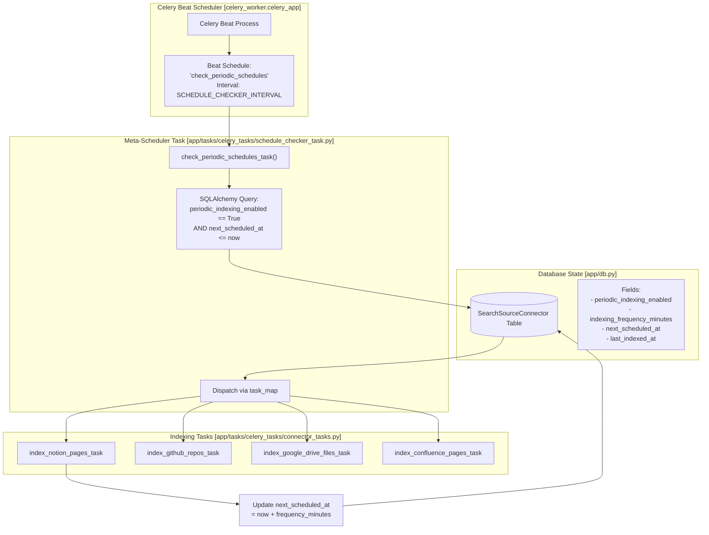

<!-- source: DeepWiki mcp.deepwiki.com · repo MODSetter/SurfSense · page 7.5 Periodic Indexing · fetched 2026-10-29 -->

# Periodic Indexing

<details>
<summary>Relevant source files</summary>

The following files were used as context for generating this wiki page:

- [surfsense_backend/.env.example](surfsense_backend/.env.example)
- [surfsense_backend/app/config/__init__.py](surfsense_backend/app/config/__init__.py)
- [surfsense_backend/app/connectors/composio_connector.py](surfsense_backend/app/connectors/composio_connector.py)
- [surfsense_backend/app/db.py](surfsense_backend/app/db.py)
- [surfsense_backend/app/routes/__init__.py](surfsense_backend/app/routes/__init__.py)
- [surfsense_backend/app/routes/composio_routes.py](surfsense_backend/app/routes/composio_routes.py)
- [surfsense_backend/app/routes/documents_routes.py](surfsense_backend/app/routes/documents_routes.py)
- [surfsense_backend/app/routes/search_source_connectors_routes.py](surfsense_backend/app/routes/search_source_connectors_routes.py)
- [surfsense_backend/app/schemas/documents.py](surfsense_backend/app/schemas/documents.py)
- [surfsense_backend/app/schemas/search_source_connector.py](surfsense_backend/app/schemas/search_source_connector.py)
- [surfsense_backend/app/services/composio_service.py](surfsense_backend/app/services/composio_service.py)
- [surfsense_backend/app/services/confluence/kb_sync_service.py](surfsense_backend/app/services/confluence/kb_sync_service.py)
- [surfsense_backend/app/services/dropbox/kb_sync_service.py](surfsense_backend/app/services/dropbox/kb_sync_service.py)
- [surfsense_backend/app/services/gmail/kb_sync_service.py](surfsense_backend/app/services/gmail/kb_sync_service.py)
- [surfsense_backend/app/services/google_calendar/kb_sync_service.py](surfsense_backend/app/services/google_calendar/kb_sync_service.py)
- [surfsense_backend/app/services/google_drive/kb_sync_service.py](surfsense_backend/app/services/google_drive/kb_sync_service.py)
- [surfsense_backend/app/services/linear/__init__.py](surfsense_backend/app/services/linear/__init__.py)
- [surfsense_backend/app/services/linear/kb_sync_service.py](surfsense_backend/app/services/linear/kb_sync_service.py)
- [surfsense_backend/app/services/notion/__init__.py](surfsense_backend/app/services/notion/__init__.py)
- [surfsense_backend/app/services/notion/kb_sync_service.py](surfsense_backend/app/services/notion/kb_sync_service.py)
- [surfsense_backend/app/services/onedrive/__init__.py](surfsense_backend/app/services/onedrive/__init__.py)
- [surfsense_backend/app/services/onedrive/kb_sync_service.py](surfsense_backend/app/services/onedrive/kb_sync_service.py)
- [surfsense_backend/app/tasks/celery_tasks/connector_tasks.py](surfsense_backend/app/tasks/celery_tasks/connector_tasks.py)
- [surfsense_backend/app/tasks/celery_tasks/document_tasks.py](surfsense_backend/app/tasks/celery_tasks/document_tasks.py)
- [surfsense_backend/app/tasks/celery_tasks/schedule_checker_task.py](surfsense_backend/app/tasks/celery_tasks/schedule_checker_task.py)
- [surfsense_backend/app/tasks/celery_tasks/stale_notification_cleanup_task.py](surfsense_backend/app/tasks/celery_tasks/stale_notification_cleanup_task.py)
- [surfsense_backend/app/tasks/composio_indexer.py](surfsense_backend/app/tasks/composio_indexer.py)
- [surfsense_backend/app/tasks/connector_indexers/__init__.py](surfsense_backend/app/tasks/connector_indexers/__init__.py)
- [surfsense_backend/app/utils/periodic_scheduler.py](surfsense_backend/app/utils/periodic_scheduler.py)
- [surfsense_web/content/docs/manual-installation.mdx](surfsense_web/content/docs/manual-installation.mdx)

</details>


## Purpose and Scope

The periodic indexing system enables automatic, scheduled retrieval and indexing of content from external data sources. Users can configure connectors to automatically sync data from platforms like Notion, GitHub, Confluence, and Google Drive at regular intervals, ensuring their knowledge base stays up-to-date without manual intervention [surfsense_backend/app/schemas/search_source_connector.py:35-41]().

This document covers the meta-scheduler architecture, Celery Beat integration, the `check_periodic_schedules_task`, frequency configuration options, and the integration with the background task system. Note that "Live" connectors (e.g., Slack, Linear, Jira) have moved to real-time agent tools and are excluded from periodic background indexing [surfsense_backend/app/tasks/celery_tasks/schedule_checker_task.py:47-49]().

## Meta-Scheduler Architecture

The periodic indexing system uses a **meta-scheduler pattern** rather than creating individual Celery Beat schedules for each connector. This design avoids the limitation where dynamic schedules require a Beat restart to be discovered. Instead, a single recurring task polls the database for work.

### Meta-Scheduler Pattern: Code-to-System Mapping

The following diagram bridges the high-level scheduling logic with the specific Python classes and tasks implemented in the backend.



**Sources:** [surfsense_backend/app/tasks/celery_tasks/schedule_checker_task.py:17-67](), [surfsense_backend/.env.example:58-73]()

## The check_periodic_schedules_task

The core of the meta-scheduler is the `check_periodic_schedules_task`. It is a Celery task that runs at a frequency defined by the `SCHEDULE_CHECKER_INTERVAL` environment variable (defaulting to 5 minutes) [surfsense_backend/.env.example:73]().

### Task Execution Flow

The task implementation in `_check_and_trigger_schedules` performs the following logic:

1.  **Queries for due connectors**: Uses an `AsyncSession` to filter `SearchSourceConnector` records where `periodic_indexing_enabled` is true and `next_scheduled_at` is less than or equal to the current UTC time [surfsense_backend/app/tasks/celery_tasks/schedule_checker_task.py:31-39]().
2.  **Concurrency Protection**:
    *   **Redis Lock**: Invokes `acquire_connector_indexing_lock(connector.id)` to ensure a task isn't already running for that specific connector [surfsense_backend/app/utils/indexing_locks.py:1-20]().
    *   **Notification Status**: Checks for existing `in_progress` notifications for that connector to prevent duplicate task piling [surfsense_backend/app/tasks/celery_tasks/schedule_checker_task.py:110-124]().
3.  **Task Dispatch**: Maps the `connector_type` to a specific Celery task and triggers it via `.delay()` [surfsense_backend/app/tasks/celery_tasks/schedule_checker_task.py:126-160]().

### Connector-to-Task Mapping

The `task_map` associates the `SearchSourceConnectorType` enum with the corresponding background worker task [surfsense_backend/app/tasks/celery_tasks/schedule_checker_task.py:59-67]():

| Connector Type | Task Function | File Path |
| :--- | :--- | :--- |
| `NOTION_CONNECTOR` | `index_notion_pages_task` | [app/tasks/celery_tasks/connector_tasks.py:118-138]() |
| `GITHUB_CONNECTOR` | `index_github_repos_task` | [app/tasks/celery_tasks/connector_tasks.py:159-175]() |
| `CONFLUENCE_CONNECTOR` | `index_confluence_pages_task` | [app/tasks/celery_tasks/connector_tasks.py:196-212]() |
| `GOOGLE_DRIVE_CONNECTOR` | `index_google_drive_files_task` | [app/tasks/celery_tasks/connector_tasks.py:233-249]() |

**Sources:** [surfsense_backend/app/tasks/celery_tasks/schedule_checker_task.py:27-160](), [surfsense_backend/app/tasks/celery_tasks/connector_tasks.py:1-250]()

## Implementation Details

### Redis Heartbeat Mechanism
To ensure system reliability, indexing tasks implement a heartbeat mechanism. While an indexing task is running, a background coroutine `_run_indexing_heartbeat_loop` refreshes a Redis key every 60 seconds [surfsense_backend/app/routes/search_source_connectors_routes.py:98-123]().

If a worker crashes, the heartbeat expires (TTL of 120s). The `stale_notification_cleanup_task` detects the missing key and marks the notification + connector as failed [surfsense_backend/app/tasks/celery_tasks/document_tasks.py:64-69]().

### Code Entity Association

This diagram shows the relationship between the database models, the scheduling logic, and the reliability components.

```mermaid
classDiagram
    class SearchSourceConnector {
        +Boolean periodic_indexing_enabled
        +Integer indexing_frequency_minutes
        +DateTime next_scheduled_at
        +DateTime last_indexed_at
    }
    class CeleryBeat {
        +check_periodic_schedules_task()
    }
    class IndexingTasks {
        +index_notion_pages_task()
        +index_github_repos_task()
        +index_google_drive_files_task()
    }
    class RedisHeartbeat {
        +HEARTBEAT_TTL_SECONDS
        +HEARTBEAT_REFRESH_INTERVAL
        +indexing:heartbeat:{notification_id}
    }

    CeleryBeat ..> SearchSourceConnector : "Queries due"
    CeleryBeat ..> IndexingTasks : "Triggers via .delay()"
    IndexingTasks ..> RedisHeartbeat : "Maintains loop"
    IndexingTasks ..> SearchSourceConnector : "Updates last_indexed_at"
```

**Sources:** [surfsense_backend/app/db.py:127-148](), [surfsense_backend/app/routes/search_source_connectors_routes.py:87-95](), [surfsense_backend/app/tasks/celery_tasks/connector_tasks.py:25-62]()

## Frequency Configuration and Validation

Periodic indexing configuration is managed via Pydantic schemas which enforce strict validation before data reaches the database [surfsense_backend/app/schemas/search_source_connector.py:13-22]().

*   **Validation**: The `validate_periodic_indexing` model validator ensures that `indexing_frequency_minutes` is provided and positive if `periodic_indexing_enabled` is true. It also restricts periodic indexing to "indexable" connectors [surfsense_backend/app/schemas/search_source_connector.py:35-56]().
*   **Initial Scheduling**: When a connector is created or updated via routes (e.g., `POST /search-source-connectors/`), the `next_scheduled_at` is initially calculated using `create_periodic_schedule` which sets the first run to `now + frequency` [surfsense_backend/app/utils/periodic_scheduler.py:13-35]().
*   **Cleanup**: If periodic indexing is disabled, the `delete_periodic_schedule` utility is called to nullify the scheduling fields in the database [surfsense_backend/app/utils/periodic_scheduler.py:61-74]().

**Sources:** [surfsense_backend/app/schemas/search_source_connector.py:34-56](), [surfsense_backend/app/routes/search_source_connectors_routes.py:75-79](), [surfsense_backend/app/utils/periodic_scheduler.py:1-74]()

---

