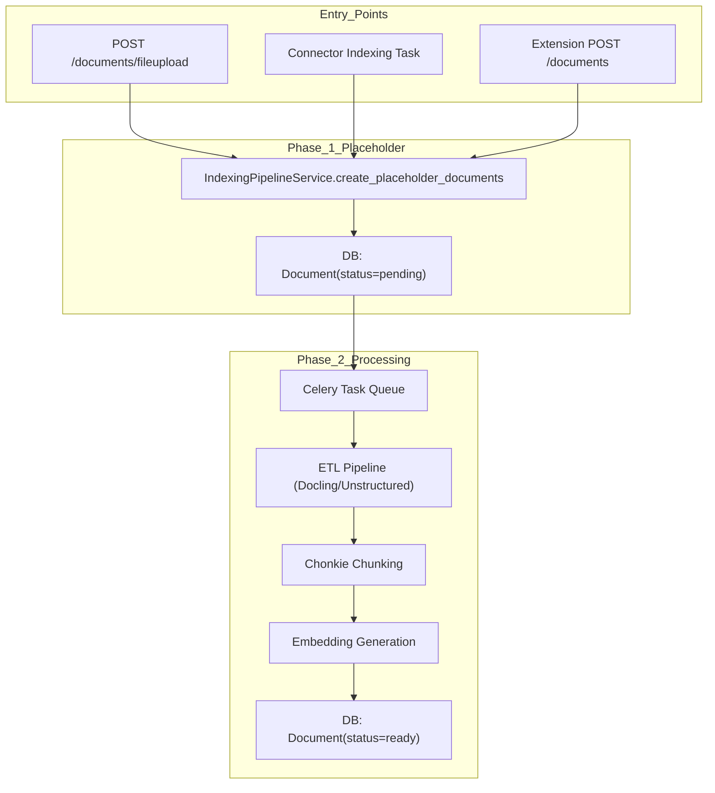
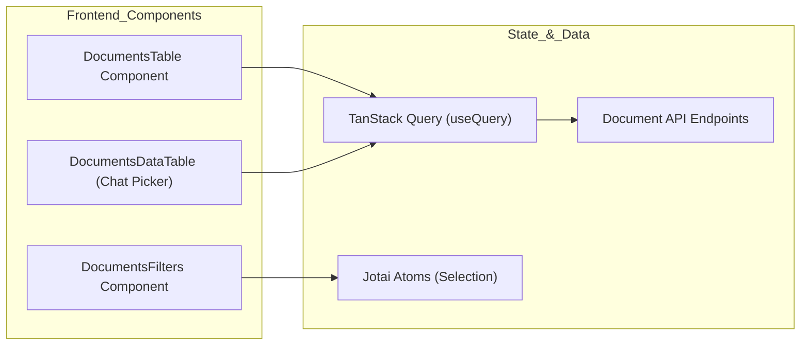

<!-- source: DeepWiki mcp.deepwiki.com · repo MODSetter/SurfSense · page 8 Document Management · fetched 2026-10-29 -->

# Document Management

Relevant source files

The following files were used as context for generating this wiki page:

- [surfsense_backend/.env.example](surfsense_backend/.env.example)
- [surfsense_backend/app/config/__init__.py](surfsense_backend/app/config/__init__.py)
- [surfsense_backend/app/connectors/composio_connector.py](surfsense_backend/app/connectors/composio_connector.py)
- [surfsense_backend/app/db.py](surfsense_backend/app/db.py)
- [surfsense_backend/app/indexing_pipeline/__init__.py](surfsense_backend/app/indexing_pipeline/__init__.py)
- [surfsense_backend/app/indexing_pipeline/adapters/__init__.py](surfsense_backend/app/indexing_pipeline/adapters/__init__.py)
- [surfsense_backend/app/indexing_pipeline/adapters/file_upload_adapter.py](surfsense_backend/app/indexing_pipeline/adapters/file_upload_adapter.py)
- [surfsense_backend/app/indexing_pipeline/connector_document.py](surfsense_backend/app/indexing_pipeline/connector_document.py)
- [surfsense_backend/app/indexing_pipeline/document_persistence.py](surfsense_backend/app/indexing_pipeline/document_persistence.py)
- [surfsense_backend/app/indexing_pipeline/indexing_pipeline_service.py](surfsense_backend/app/indexing_pipeline/indexing_pipeline_service.py)
- [surfsense_backend/app/indexing_pipeline/pipeline_logger.py](surfsense_backend/app/indexing_pipeline/pipeline_logger.py)
- [surfsense_backend/app/routes/__init__.py](surfsense_backend/app/routes/__init__.py)
- [surfsense_backend/app/routes/composio_routes.py](surfsense_backend/app/routes/composio_routes.py)
- [surfsense_backend/app/routes/documents_routes.py](surfsense_backend/app/routes/documents_routes.py)
- [surfsense_backend/app/routes/search_source_connectors_routes.py](surfsense_backend/app/routes/search_source_connectors_routes.py)
- [surfsense_backend/app/schemas/documents.py](surfsense_backend/app/schemas/documents.py)
- [surfsense_backend/app/schemas/search_source_connector.py](surfsense_backend/app/schemas/search_source_connector.py)
- [surfsense_backend/app/services/composio_service.py](surfsense_backend/app/services/composio_service.py)
- [surfsense_backend/app/services/task_dispatcher.py](surfsense_backend/app/services/task_dispatcher.py)
- [surfsense_backend/app/tasks/celery_tasks/connector_tasks.py](surfsense_backend/app/tasks/celery_tasks/connector_tasks.py)
- [surfsense_backend/app/tasks/celery_tasks/document_tasks.py](surfsense_backend/app/tasks/celery_tasks/document_tasks.py)
- [surfsense_backend/app/tasks/celery_tasks/schedule_checker_task.py](surfsense_backend/app/tasks/celery_tasks/schedule_checker_task.py)
- [surfsense_backend/app/tasks/celery_tasks/stale_notification_cleanup_task.py](surfsense_backend/app/tasks/celery_tasks/stale_notification_cleanup_task.py)
- [surfsense_backend/app/tasks/composio_indexer.py](surfsense_backend/app/tasks/composio_indexer.py)
- [surfsense_backend/app/tasks/connector_indexers/__init__.py](surfsense_backend/app/tasks/connector_indexers/__init__.py)
- [surfsense_backend/app/utils/periodic_scheduler.py](surfsense_backend/app/utils/periodic_scheduler.py)
- [surfsense_backend/tests/conftest.py](surfsense_backend/tests/conftest.py)
- [surfsense_backend/tests/integration/conftest.py](surfsense_backend/tests/integration/conftest.py)
- [surfsense_backend/tests/integration/document_upload/conftest.py](surfsense_backend/tests/integration/document_upload/conftest.py)
- [surfsense_backend/tests/integration/indexing_pipeline/adapters/__init__.py](surfsense_backend/tests/integration/indexing_pipeline/adapters/__init__.py)
- [surfsense_backend/tests/integration/indexing_pipeline/adapters/test_file_upload_adapter.py](surfsense_backend/tests/integration/indexing_pipeline/adapters/test_file_upload_adapter.py)
- [surfsense_backend/tests/integration/indexing_pipeline/test_index_document.py](surfsense_backend/tests/integration/indexing_pipeline/test_index_document.py)
- [surfsense_backend/tests/integration/indexing_pipeline/test_prepare_for_indexing.py](surfsense_backend/tests/integration/indexing_pipeline/test_prepare_for_indexing.py)
- [surfsense_backend/tests/unit/connector_indexers/test_confluence_parallel.py](surfsense_backend/tests/unit/connector_indexers/test_confluence_parallel.py)
- [surfsense_backend/tests/unit/connector_indexers/test_linear_parallel.py](surfsense_backend/tests/unit/connector_indexers/test_linear_parallel.py)
- [surfsense_backend/tests/unit/connector_indexers/test_notion_parallel.py](surfsense_backend/tests/unit/connector_indexers/test_notion_parallel.py)
- [surfsense_backend/tests/unit/indexing_pipeline/conftest.py](surfsense_backend/tests/unit/indexing_pipeline/conftest.py)
- [surfsense_backend/tests/unit/indexing_pipeline/test_connector_document.py](surfsense_backend/tests/unit/indexing_pipeline/test_connector_document.py)
- [surfsense_backend/tests/unit/indexing_pipeline/test_document_chunker.py](surfsense_backend/tests/unit/indexing_pipeline/test_document_chunker.py)
- [surfsense_backend/tests/unit/indexing_pipeline/test_index_batch_parallel.py](surfsense_backend/tests/unit/indexing_pipeline/test_index_batch_parallel.py)
- [surfsense_web/content/docs/manual-installation.mdx](surfsense_web/content/docs/manual-installation.mdx)

## Purpose and Scope

The Document Management subsystem handles the complete lifecycle of documents in SurfSense, from ingestion through processing to storage and retrieval. This includes file uploads, content from browser extensions, and documents from various connectors (Slack, Notion, GitHub, etc.).

This page covers:
- Document data model and types
- Document ingestion pipeline and ETL services
- Processing, chunking, and embedding generation
- Document management UI for browsing and searching
- CRUD operations and REST API
- Storage architecture with PostgreSQL and pgvector

For details on the specific ingestion methods, see [Document Ingestion Pipeline](#8.1). For technical details on Chonkie-based chunking, see [Document Processing and Chunking](#8.2). For UI documentation, see [Document Management UI](#8.3). For API references, see [Document API](#8.4).

---

## Document Data Model

### Core Entities

SurfSense uses two primary database entities for document storage, linked via a one-to-many relationship.

| Entity | Table | Purpose |
|--------|-------|---------|
| `Document` | `documents` | Stores document metadata, original content, summary, and source hashes. |
| `Chunk` | `chunks` | Stores document fragments with high-dimensional embeddings for semantic search. |

**Document Schema:** [surfsense_backend/app/db.py:310-410]()
- `title`: Display name of the document.
- `content`: Full extracted text (usually in Markdown).
- `document_type`: Enum defining the source (e.g., `FILE`, `NOTION_CONNECTOR`).
- `status`: JSONB field tracking processing state (`pending`, `processing`, `ready`, `failed`).
- `unique_identifier_hash`: SHA-256 hash to prevent duplicates from connectors.

**Chunk Schema:** [surfsense_backend/app/db.py:440-480]()
- `content`: The text fragment.
- `embedding`: `Vector` type (pgvector) for similarity search.
- `document_id`: Foreign key to the parent document.

**Sources:**
- [surfsense_backend/app/db.py:310-480]()
- [surfsense_backend/app/db.py:127-181]() (DocumentStatus helper)

### Document Types

The system supports a wide array of sources via the `DocumentType` enum. It includes native types and legacy mappings for backward compatibility with Composio-based connectors.

| Category | Types |
|----------|-------|
| **Manual** | `FILE` (Uploads), `NOTE`, `EXTENSION` (Browser Capture) |
| **Cloud/SaaS** | `GOOGLE_DRIVE_FILE`, `NOTION_CONNECTOR`, `SLACK_CONNECTOR`, `GITHUB_CONNECTOR`, `LINEAR_CONNECTOR`, `JIRA_CONNECTOR` |
| **Local** | `LOCAL_FOLDER_FILE`, `OBSIDIAN_CONNECTOR` |
| **Media** | `YOUTUBE_VIDEO` |

**Sources:**
- [surfsense_backend/app/db.py:43-72]()
- [surfsense_backend/app/db.py:78-82]() (NATIVE_TO_LEGACY_DOCTYPE)

---

## Document Ingestion Pipeline

The ingestion pipeline is designed for "Instant UI Feedback" using a two-phase approach, utilizing Rocicorp Zero for real-time state synchronization.

### Ingestion Flow Diagram

**Phase 1: Placeholders** [surfsense_backend/app/indexing_pipeline/indexing_pipeline_service.py:88-171]()
When a file is uploaded or a connector discovers an item, a placeholder document is created with `status=pending`. This allows the UI to show the document immediately via Zero sync before heavy processing starts.

**Phase 2: Background Processing** [surfsense_backend/app/tasks/celery_tasks/document_tasks.py:153-180]()
A Celery task (e.g., `_delete_document_background` or indexing tasks) handles the heavy lifting. For uploads, `create_documents_file_upload` triggers the dispatcher to start processing [surfsense_backend/app/routes/documents_routes.py:122-130]().

**Heartbeat Mechanism**: To ensure reliability, background tasks maintain a Redis heartbeat [surfsense_backend/app/tasks/celery_tasks/document_tasks.py:64-72](). If a worker crashes, the heartbeat expires, and the document is marked as `failed`.

For details, see [Document Ingestion Pipeline](#8.1).

**Sources:**
- [surfsense_backend/app/indexing_pipeline/indexing_pipeline_service.py:82-171]()
- [surfsense_backend/app/tasks/celery_tasks/document_tasks.py:64-137]()
- [surfsense_backend/app/routes/documents_routes.py:122-130]()

---

## Document Processing and Chunking

### ETL and Conversion
SurfSense converts ingested documents into **Markdown**. The `ProcessingMode` (basic vs advanced) determines the complexity of extraction [surfsense_backend/app/routes/documents_routes.py:147-155](). Supported ETL services include Docling (local), Unstructured (API), and LlamaCloud (API) [surfsense_web/content/docs/manual-installation.mdx:30-36]().

### Chunking Strategy
The system uses the **Chonkie** library for semantic and recursive chunking [surfsense_backend/app/config/__init__.py:8-10](). 
- **RecursiveChunker**: Splits text while respecting token limits and sentence boundaries.
- **CodeChunker**: Specialized splitting for source code files.

### Embedding and Indexing
- **Hierarchical Indexing**: SurfSense generates embeddings for the **document summary** and for **individual chunks** [surfsense_backend/app/indexing_pipeline/indexing_pipeline_service.py:22-24]().
- **pgvector**: All embeddings are stored in PostgreSQL using the `vector` type [surfsense_backend/app/db.py:11-12]().

For details, see [Document Processing and Chunking](#8.2).

**Sources:**
- [surfsense_backend/app/indexing_pipeline/indexing_pipeline_service.py:22-30]()
- [surfsense_backend/app/config/__init__.py:8-10]()
- [surfsense_backend/app/routes/documents_routes.py:147-155]()

---

## Document Management UI

The frontend provides a robust interface for managing knowledge at scale.

### UI Architecture Diagram

**Key Features:**
- **Real-time Status**: Documents show "pending", "processing", or "ready" status icons using the `DocumentStatus` helper [surfsense_backend/app/db.py:127-148]().
- **Bulk Actions**: Support for bulk deletion via background Celery tasks [surfsense_backend/app/tasks/celery_tasks/document_tasks.py:183-199]().
- **Search**: Debounced server-side search by title.

For details, see [Document Management UI](#8.3).

**Sources:**
- [surfsense_backend/app/db.py:127-148]()
- [surfsense_backend/app/tasks/celery_tasks/document_tasks.py:183-199]()

---

## Document API

The Document API provides the interface for both the frontend and external integrations.

**Core Endpoints:** [surfsense_backend/app/routes/documents_routes.py]()
- `POST /documents/fileupload`: Handles multi-file uploads with size limits (500MB) [surfsense_backend/app/routes/documents_routes.py:59-62]().
- `GET /documents`: Paginated list of documents with metadata.
- `DELETE /documents/{document_id}`: Triggers `delete_document_task` for batch removal of chunks and blobs [surfsense_backend/app/tasks/celery_tasks/document_tasks.py:148-151]().

For details, see [Document API](#8.4).

**Sources:**
- [surfsense_backend/app/routes/documents_routes.py:59-130]()
- [surfsense_backend/app/tasks/celery_tasks/document_tasks.py:140-151]()

---

