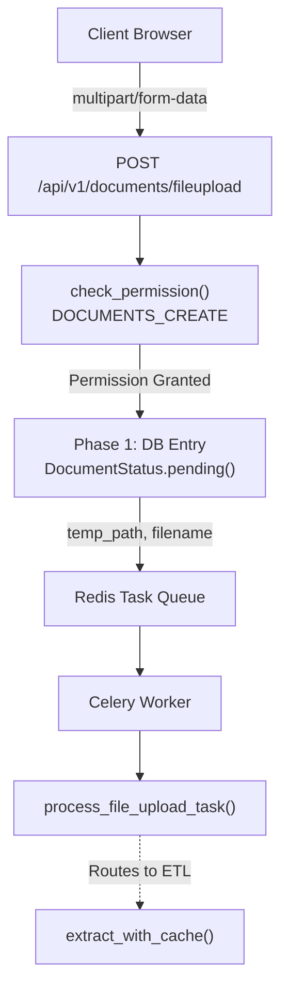
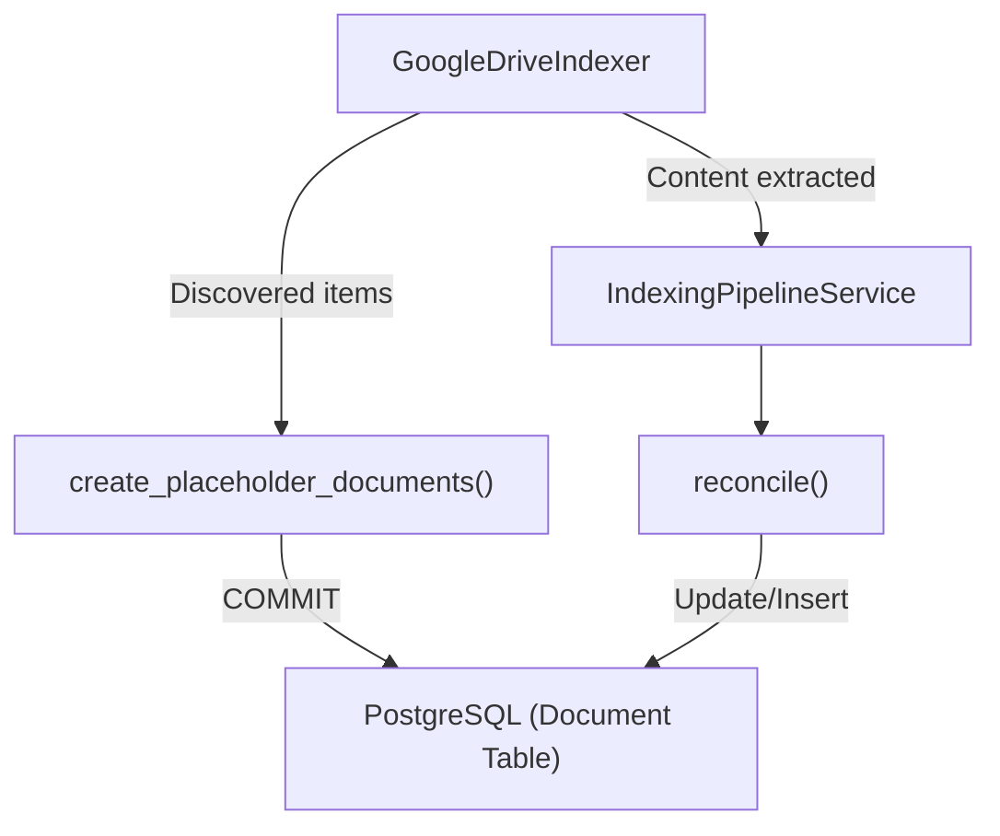
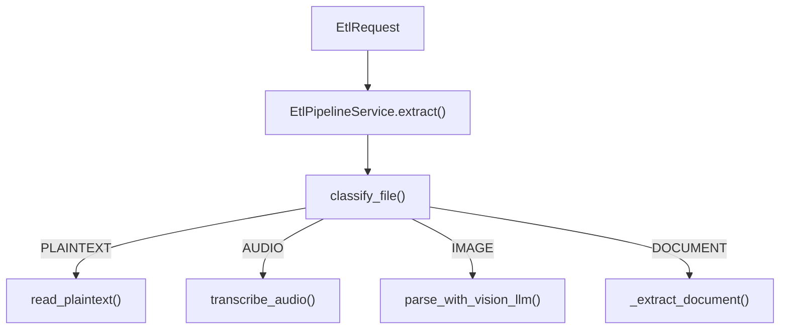
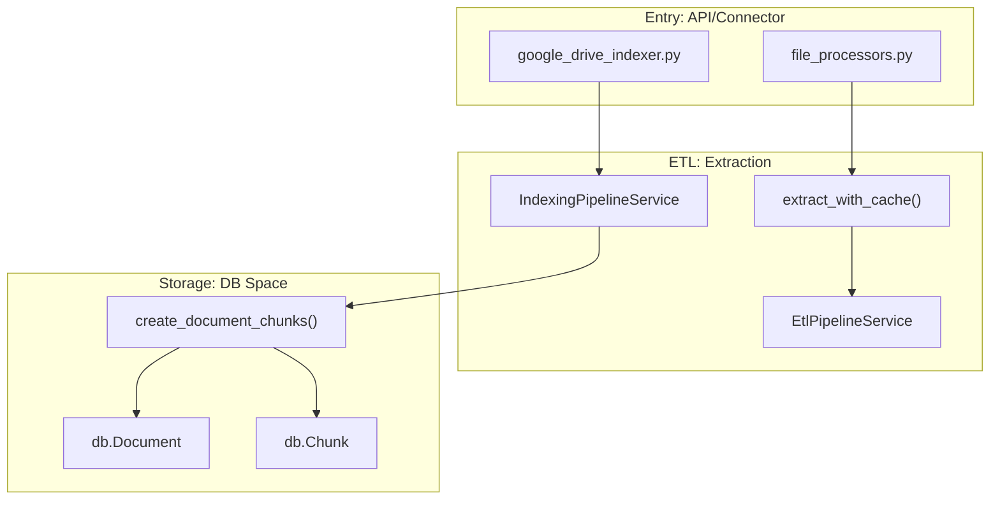

<!-- source: DeepWiki mcp.deepwiki.com · repo MODSetter/SurfSense · page 8.1 Document Ingestion Pipeline · fetched 2026-10-29 -->

# Document Ingestion Pipeline

Relevant source files

The following files were used as context for generating this wiki page:

- [surfsense_backend/app/connectors/dropbox/client.py](surfsense_backend/app/connectors/dropbox/client.py)
- [surfsense_backend/app/connectors/dropbox/file_types.py](surfsense_backend/app/connectors/dropbox/file_types.py)
- [surfsense_backend/app/connectors/google_drive/__init__.py](surfsense_backend/app/connectors/google_drive/__init__.py)
- [surfsense_backend/app/connectors/google_drive/change_tracker.py](surfsense_backend/app/connectors/google_drive/change_tracker.py)
- [surfsense_backend/app/connectors/google_drive/client.py](surfsense_backend/app/connectors/google_drive/client.py)
- [surfsense_backend/app/connectors/google_drive/content_extractor.py](surfsense_backend/app/connectors/google_drive/content_extractor.py)
- [surfsense_backend/app/connectors/google_drive/credentials.py](surfsense_backend/app/connectors/google_drive/credentials.py)
- [surfsense_backend/app/connectors/google_drive/file_types.py](surfsense_backend/app/connectors/google_drive/file_types.py)
- [surfsense_backend/app/connectors/google_drive/folder_manager.py](surfsense_backend/app/connectors/google_drive/folder_manager.py)
- [surfsense_backend/app/connectors/onedrive/file_types.py](surfsense_backend/app/connectors/onedrive/file_types.py)
- [surfsense_backend/app/etl_pipeline/etl_pipeline_service.py](surfsense_backend/app/etl_pipeline/etl_pipeline_service.py)
- [surfsense_backend/app/etl_pipeline/file_classifier.py](surfsense_backend/app/etl_pipeline/file_classifier.py)
- [surfsense_backend/app/indexing_pipeline/__init__.py](surfsense_backend/app/indexing_pipeline/__init__.py)
- [surfsense_backend/app/indexing_pipeline/adapters/__init__.py](surfsense_backend/app/indexing_pipeline/adapters/__init__.py)
- [surfsense_backend/app/indexing_pipeline/adapters/file_upload_adapter.py](surfsense_backend/app/indexing_pipeline/adapters/file_upload_adapter.py)
- [surfsense_backend/app/indexing_pipeline/connector_document.py](surfsense_backend/app/indexing_pipeline/connector_document.py)
- [surfsense_backend/app/indexing_pipeline/document_persistence.py](surfsense_backend/app/indexing_pipeline/document_persistence.py)
- [surfsense_backend/app/indexing_pipeline/indexing_pipeline_service.py](surfsense_backend/app/indexing_pipeline/indexing_pipeline_service.py)
- [surfsense_backend/app/indexing_pipeline/pipeline_logger.py](surfsense_backend/app/indexing_pipeline/pipeline_logger.py)
- [surfsense_backend/app/services/task_dispatcher.py](surfsense_backend/app/services/task_dispatcher.py)
- [surfsense_backend/app/tasks/connector_indexers/dropbox_indexer.py](surfsense_backend/app/tasks/connector_indexers/dropbox_indexer.py)
- [surfsense_backend/app/tasks/connector_indexers/google_drive_indexer.py](surfsense_backend/app/tasks/connector_indexers/google_drive_indexer.py)
- [surfsense_backend/app/tasks/connector_indexers/onedrive_indexer.py](surfsense_backend/app/tasks/connector_indexers/onedrive_indexer.py)
- [surfsense_backend/app/tasks/document_processors/__init__.py](surfsense_backend/app/tasks/document_processors/__init__.py)
- [surfsense_backend/app/tasks/document_processors/_helpers.py](surfsense_backend/app/tasks/document_processors/_helpers.py)
- [surfsense_backend/app/tasks/document_processors/_save.py](surfsense_backend/app/tasks/document_processors/_save.py)
- [surfsense_backend/app/tasks/document_processors/extension_processor.py](surfsense_backend/app/tasks/document_processors/extension_processor.py)
- [surfsense_backend/app/tasks/document_processors/file_processors.py](surfsense_backend/app/tasks/document_processors/file_processors.py)
- [surfsense_backend/app/tasks/document_processors/markdown_processor.py](surfsense_backend/app/tasks/document_processors/markdown_processor.py)
- [surfsense_backend/app/utils/document_converters.py](surfsense_backend/app/utils/document_converters.py)
- [surfsense_backend/app/utils/file_extensions.py](surfsense_backend/app/utils/file_extensions.py)
- [surfsense_backend/tests/conftest.py](surfsense_backend/tests/conftest.py)
- [surfsense_backend/tests/integration/conftest.py](surfsense_backend/tests/integration/conftest.py)
- [surfsense_backend/tests/integration/document_upload/conftest.py](surfsense_backend/tests/integration/document_upload/conftest.py)
- [surfsense_backend/tests/integration/indexing_pipeline/adapters/__init__.py](surfsense_backend/tests/integration/indexing_pipeline/adapters/__init__.py)
- [surfsense_backend/tests/integration/indexing_pipeline/adapters/test_file_upload_adapter.py](surfsense_backend/tests/integration/indexing_pipeline/adapters/test_file_upload_adapter.py)
- [surfsense_backend/tests/integration/indexing_pipeline/test_dropbox_pipeline.py](surfsense_backend/tests/integration/indexing_pipeline/test_dropbox_pipeline.py)
- [surfsense_backend/tests/integration/indexing_pipeline/test_index_document.py](surfsense_backend/tests/integration/indexing_pipeline/test_index_document.py)
- [surfsense_backend/tests/integration/indexing_pipeline/test_onedrive_pipeline.py](surfsense_backend/tests/integration/indexing_pipeline/test_onedrive_pipeline.py)
- [surfsense_backend/tests/integration/indexing_pipeline/test_prepare_for_indexing.py](surfsense_backend/tests/integration/indexing_pipeline/test_prepare_for_indexing.py)
- [surfsense_backend/tests/unit/connector_indexers/test_confluence_parallel.py](surfsense_backend/tests/unit/connector_indexers/test_confluence_parallel.py)
- [surfsense_backend/tests/unit/connector_indexers/test_dropbox_parallel.py](surfsense_backend/tests/unit/connector_indexers/test_dropbox_parallel.py)
- [surfsense_backend/tests/unit/connector_indexers/test_google_drive_parallel.py](surfsense_backend/tests/unit/connector_indexers/test_google_drive_parallel.py)
- [surfsense_backend/tests/unit/connector_indexers/test_linear_parallel.py](surfsense_backend/tests/unit/connector_indexers/test_linear_parallel.py)
- [surfsense_backend/tests/unit/connector_indexers/test_notion_parallel.py](surfsense_backend/tests/unit/connector_indexers/test_notion_parallel.py)
- [surfsense_backend/tests/unit/connector_indexers/test_onedrive_parallel.py](surfsense_backend/tests/unit/connector_indexers/test_onedrive_parallel.py)
- [surfsense_backend/tests/unit/connectors/test_dropbox_file_types.py](surfsense_backend/tests/unit/connectors/test_dropbox_file_types.py)
- [surfsense_backend/tests/unit/connectors/test_google_drive_file_types.py](surfsense_backend/tests/unit/connectors/test_google_drive_file_types.py)
- [surfsense_backend/tests/unit/connectors/test_onedrive_file_types.py](surfsense_backend/tests/unit/connectors/test_onedrive_file_types.py)
- [surfsense_backend/tests/unit/etl_pipeline/test_etl_pipeline_service.py](surfsense_backend/tests/unit/etl_pipeline/test_etl_pipeline_service.py)
- [surfsense_backend/tests/unit/indexing_pipeline/conftest.py](surfsense_backend/tests/unit/indexing_pipeline/conftest.py)
- [surfsense_backend/tests/unit/indexing_pipeline/test_connector_document.py](surfsense_backend/tests/unit/indexing_pipeline/test_connector_document.py)
- [surfsense_backend/tests/unit/indexing_pipeline/test_document_chunker.py](surfsense_backend/tests/unit/indexing_pipeline/test_document_chunker.py)
- [surfsense_backend/tests/unit/indexing_pipeline/test_index_batch_parallel.py](surfsense_backend/tests/unit/indexing_pipeline/test_index_batch_parallel.py)
- [surfsense_backend/tests/unit/utils/test_file_extensions.py](surfsense_backend/tests/unit/utils/test_file_extensions.py)
- [surfsense_web/components/assistant-ui/connector-popup/connector-configs/components/dropbox-config.tsx](surfsense_web/components/assistant-ui/connector-popup/connector-configs/components/dropbox-config.tsx)

This page describes the document ingestion pipeline, which processes documents from various sources (file uploads, browser extension, connectors) through ETL services and prepares them for storage and search. For details on the chunking and embedding strategy, see [Document Processing and Chunking](8.2). For the user-facing document management interface, see [Document Management UI](8.3). For API endpoint details, see [Document API](8.4).

## Overview

The document ingestion pipeline handles the complete flow from document input (file upload or connector fetch) to indexed, searchable content. The pipeline supports multiple document sources, multiple ETL service options (Docling, Unstructured, LlamaCloud), and includes deduplication, background processing, and real-time status tracking. All ingestion tasks are processed asynchronously via Celery workers.

Sources: [surfsense_backend/app/indexing_pipeline/indexing_pipeline_service.py:82-86](), [surfsense_backend/app/tasks/document_processors/file_processors.py:1-7]()

## Document Entry Points

Documents enter the system through three primary channels, all of which trigger background processing tasks:

### File Upload

Direct file uploads are handled via multipart form data. The system implements a 2-phase status update for real-time UI feedback.

**File Upload Flow:**
1. Client POSTs files to the upload endpoint.
2. **Phase 1:** The system creates a `Document` record with `DocumentStatus.pending()` for instant UI feedback via Zero sync. [surfsense_backend/app/indexing_pipeline/indexing_pipeline_service.py:88-104]()
3. **Phase 2:** A Celery task is dispatched. The status transitions from `pending` → `processing` → `ready` (or `failed`). [surfsense_backend/app/tasks/document_processors/file_processors.py:118-130]()

Sources: [surfsense_backend/app/indexing_pipeline/indexing_pipeline_service.py:88-155](), [surfsense_backend/app/tasks/document_processors/file_processors.py:118-130]()

### Browser Extension

The browser extension captures web pages which are saved and then processed by the `extension_processor`.

Sources: [surfsense_backend/app/tasks/document_processors/extension_processor.py:1-20]()

### Connector Indexing

Connectors (Slack, Notion, GitHub, Google Drive, etc.) fetch documents programmatically. Each connector uses the `IndexingPipelineService` to manage document state and persistence.

**Connector Flow:**
1. **Discovery:** The indexer identifies new or changed files and creates placeholders. [surfsense_backend/app/indexing_pipeline/indexing_pipeline_service.py:88-104]()
2. **Parallel Processing:** Files are downloaded and extracted in parallel, bounded by a semaphore to manage resources. [surfsense_backend/app/tasks/connector_indexers/google_drive_indexer.py:158-186]()
3. **Reconciliation:** The pipeline compares extracted content hashes against existing records to avoid redundant embedding. [surfsense_backend/app/indexing_pipeline/indexing_pipeline_service.py:22-24]()

Sources: [surfsense_backend/app/tasks/connector_indexers/google_drive_indexer.py:158-186](), [surfsense_backend/app/indexing_pipeline/indexing_pipeline_service.py:88-155]()

## Document Types

The system categorizes documents by source using the `DocumentType` enum.

| Document Type | Description |
|--------------|-------------|
| `FILE` | Direct user-uploaded files |
| `EXTENSION` | Web pages saved via browser extension |
| `GOOGLE_DRIVE_FILE` | Files from Google Drive |
| `DROPBOX_FILE` | Files from Dropbox |
| `ONEDRIVE_FILE` | Files from Microsoft OneDrive |

Sources: [surfsense_backend/app/db.py:35-35](), [surfsense_backend/app/tasks/connector_indexers/dropbox_indexer.py:26-26]()

## ETL Service Selection

The pipeline uses `EtlPipelineService` to route files to the appropriate parsing engine based on the `FileCategory`.

**Processing Modes:**
- **Basic:** Uses Docling for local processing. [surfsense_backend/app/tasks/document_processors/file_processors.py:195-209]()
- **Advanced/Premium:** Leverages Unstructured or LlamaCloud. These modes are subject to credit checks via `EtlCreditService`. [surfsense_backend/app/tasks/document_processors/file_processors.py:190-212]()

Sources: [surfsense_backend/app/etl_pipeline/etl_pipeline_service.py:23-80](), [surfsense_backend/app/tasks/document_processors/file_processors.py:186-212]()

## Document Processing Pipeline

### Implementation Detail: `extract_with_cache`

The `extract_with_cache` facade (used by both file uploads and connectors) manages the lifecycle of content extraction:
1. **Vision LLM Integration:** If `use_vision_llm` is enabled, images are described using a Vision LLM before fallback to standard OCR. [surfsense_backend/app/etl_pipeline/etl_pipeline_service.py:104-122]()
2. **Markdown Normalization:** All ETL outputs are normalized to Markdown for consistent chunking. [surfsense_backend/app/tasks/document_processors/file_processors.py:150-157]()

### Data Flow and Code Entities

Sources: [surfsense_backend/app/indexing_pipeline/indexing_pipeline_service.py:82-86](), [surfsense_backend/app/tasks/document_processors/file_processors.py:120-143](), [surfsense_backend/app/utils/document_converters.py:178-195]()

## Deduplication and Hashing

The system uses specific hashing utilities to identify duplicates and changes:

1. **Content Hash:** Computed using `compute_content_hash()`, used to detect if the actual text of a document has changed. [surfsense_backend/app/indexing_pipeline/indexing_pipeline_service.py:26-30]()
2. **Unique Identifier Hash:** Generated via `compute_identifier_hash()`, combining the source ID (e.g., Drive File ID) and workspace ID to track document identity across re-indexing cycles. [surfsense_backend/app/indexing_pipeline/document_hashing.py:26-30]()

Sources: [surfsense_backend/app/indexing_pipeline/indexing_pipeline_service.py:113-115](), [surfsense_backend/app/tasks/connector_indexers/dropbox_indexer.py:63-65]()

## Heartbeat and Reliability

To ensure long-running indexing tasks are healthy, connectors implement a heartbeat:

- **Heartbeat Callback:** The `_download_files_parallel` function accepts an `on_heartbeat` callback. [surfsense_backend/app/tasks/connector_indexers/google_drive_indexer.py:158-166]()
- **Interval:** Heartbeats typically fire every 30 seconds (`HEARTBEAT_INTERVAL_SECONDS`) to update the task status in the database or Redis. [surfsense_backend/app/tasks/connector_indexers/google_drive_indexer.py:60-60]()

Sources: [surfsense_backend/app/tasks/connector_indexers/google_drive_indexer.py:158-166](), [surfsense_backend/app/tasks/connector_indexers/dropbox_indexer.py:40-41]()

---

