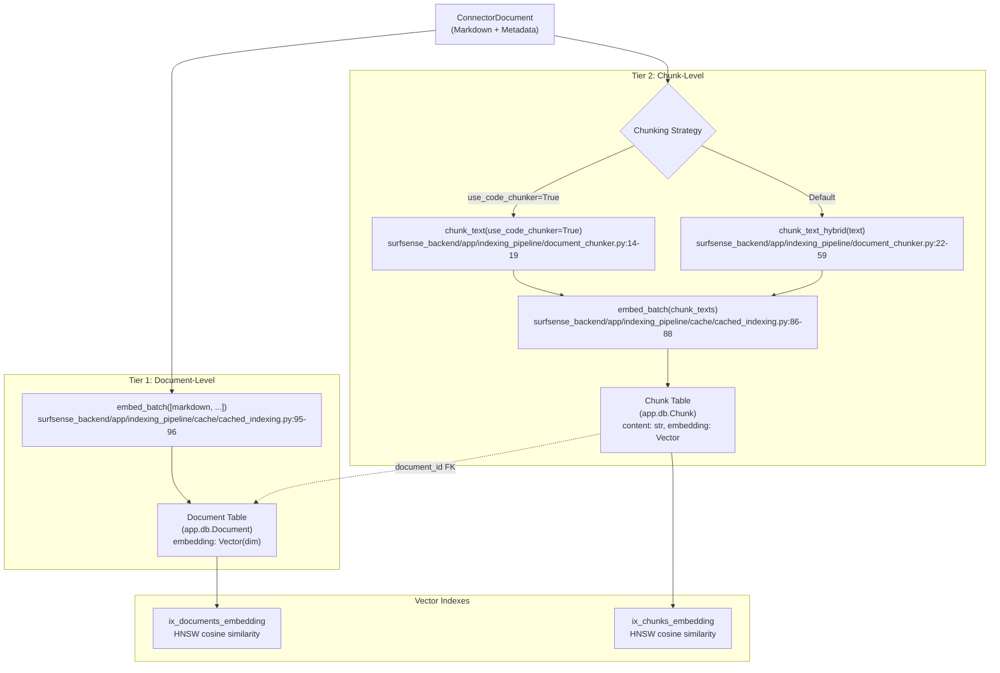
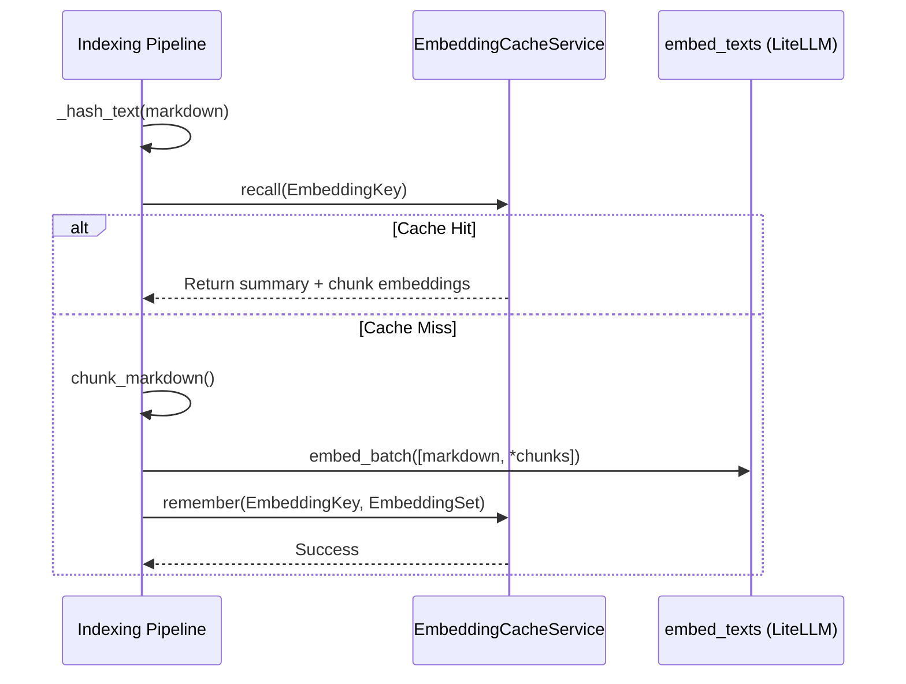

<!-- source: DeepWiki mcp.deepwiki.com · repo MODSetter/SurfSense · page 8.2 Document Processing and Chunking · fetched 2026-10-29 -->

# Document Processing and Chunking

Relevant source files

The following files were used as context for generating this wiki page:

- [surfsense_backend/alembic/versions/164_remove_inactive_users.py](surfsense_backend/alembic/versions/164_remove_inactive_users.py)
- [surfsense_backend/alembic/versions/165_add_chunk_position.py](surfsense_backend/alembic/versions/165_add_chunk_position.py)
- [surfsense_backend/app/etl_pipeline/cache/__init__.py](surfsense_backend/app/etl_pipeline/cache/__init__.py)
- [surfsense_backend/app/etl_pipeline/cache/cached_extraction.py](surfsense_backend/app/etl_pipeline/cache/cached_extraction.py)
- [surfsense_backend/app/etl_pipeline/cache/eligibility.py](surfsense_backend/app/etl_pipeline/cache/eligibility.py)
- [surfsense_backend/app/etl_pipeline/cache/eviction/__init__.py](surfsense_backend/app/etl_pipeline/cache/eviction/__init__.py)
- [surfsense_backend/app/etl_pipeline/cache/eviction/task.py](surfsense_backend/app/etl_pipeline/cache/eviction/task.py)
- [surfsense_backend/app/etl_pipeline/cache/schemas/parse_key.py](surfsense_backend/app/etl_pipeline/cache/schemas/parse_key.py)
- [surfsense_backend/app/etl_pipeline/cache/storage/backend.py](surfsense_backend/app/etl_pipeline/cache/storage/backend.py)
- [surfsense_backend/app/indexing_pipeline/cache/__init__.py](surfsense_backend/app/indexing_pipeline/cache/__init__.py)
- [surfsense_backend/app/indexing_pipeline/cache/cached_indexing.py](surfsense_backend/app/indexing_pipeline/cache/cached_indexing.py)
- [surfsense_backend/app/indexing_pipeline/cache/eligibility.py](surfsense_backend/app/indexing_pipeline/cache/eligibility.py)
- [surfsense_backend/app/indexing_pipeline/cache/eviction/__init__.py](surfsense_backend/app/indexing_pipeline/cache/eviction/__init__.py)
- [surfsense_backend/app/indexing_pipeline/cache/eviction/task.py](surfsense_backend/app/indexing_pipeline/cache/eviction/task.py)
- [surfsense_backend/app/indexing_pipeline/cache/persistence/models.py](surfsense_backend/app/indexing_pipeline/cache/persistence/models.py)
- [surfsense_backend/app/indexing_pipeline/cache/persistence/repository.py](surfsense_backend/app/indexing_pipeline/cache/persistence/repository.py)
- [surfsense_backend/app/indexing_pipeline/cache/serialization.py](surfsense_backend/app/indexing_pipeline/cache/serialization.py)
- [surfsense_backend/app/indexing_pipeline/cache/settings.py](surfsense_backend/app/indexing_pipeline/cache/settings.py)
- [surfsense_backend/app/indexing_pipeline/cache/storage/__init__.py](surfsense_backend/app/indexing_pipeline/cache/storage/__init__.py)
- [surfsense_backend/app/indexing_pipeline/cache/storage/embedding_store.py](surfsense_backend/app/indexing_pipeline/cache/storage/embedding_store.py)
- [surfsense_backend/app/indexing_pipeline/cache/storage/object_keys.py](surfsense_backend/app/indexing_pipeline/cache/storage/object_keys.py)
- [surfsense_backend/app/indexing_pipeline/chunk_reconciler.py](surfsense_backend/app/indexing_pipeline/chunk_reconciler.py)
- [surfsense_backend/app/indexing_pipeline/document_chunker.py](surfsense_backend/app/indexing_pipeline/document_chunker.py)
- [surfsense_backend/app/indexing_pipeline/document_hashing.py](surfsense_backend/app/indexing_pipeline/document_hashing.py)
- [surfsense_backend/app/routes/agent_revert_route.py](surfsense_backend/app/routes/agent_revert_route.py)
- [surfsense_backend/tests/integration/etl_pipeline/cache/test_cached_extraction.py](surfsense_backend/tests/integration/etl_pipeline/cache/test_cached_extraction.py)
- [surfsense_backend/tests/integration/test_connector_index_authz.py](surfsense_backend/tests/integration/test_connector_index_authz.py)
- [surfsense_backend/tests/unit/gateway/test_byo_long_poll_lifespan.py](surfsense_backend/tests/unit/gateway/test_byo_long_poll_lifespan.py)
- [surfsense_backend/tests/unit/gateway/test_inbox_worker.py](surfsense_backend/tests/unit/gateway/test_inbox_worker.py)
- [surfsense_backend/tests/unit/indexing_pipeline/test_chunk_reconciler.py](surfsense_backend/tests/unit/indexing_pipeline/test_chunk_reconciler.py)
- [surfsense_backend/tests/unit/indexing_pipeline/test_document_hashing.py](surfsense_backend/tests/unit/indexing_pipeline/test_document_hashing.py)
- [surfsense_backend/tests/unit/routes/test_revert_turn_route.py](surfsense_backend/tests/unit/routes/test_revert_turn_route.py)

This page describes the document processing and chunking system that transforms ingested documents into searchable content. This includes the two-tier hierarchical indexing strategy, chunk generation using Chonkie, embedding creation, and database storage with vector indexes.

**Scope**: This page covers the processing that occurs after ETL conversion to markdown. For information about ETL service selection (Docling, Unstructured, LlamaCloud), see [Document Ingestion Pipeline](#8.1). For API endpoints and UI components, see [Document API](#8.4) and [Document Management UI](#8.3).

## Overview

SurfSense implements a **two-tier hierarchical indexing system** that creates both document-level and chunk-level embeddings. This approach enables efficient retrieval at multiple granularities:

1.  **Document-level**: LLM-generated summaries or full content embedded for broad semantic search.
2.  **Chunk-level**: Intelligently segmented content pieces using Chonkie, each with its own embedding for precise retrieval.

The processing pipeline utilizes an **Embedding Cache** [surfsense_backend/app/indexing_pipeline/cache/cached_indexing.py:1-6]() to ensure that identical markdown content is chunked and embedded only once, regardless of how many workspaces it appears in.

## Two-Tier Hierarchical Indexing Architecture

The following diagram bridges the logical indexing tiers to the physical database entities and processing functions.

**Sources**: [surfsense_backend/app/indexing_pipeline/cache/cached_indexing.py:91-97](), [surfsense_backend/app/indexing_pipeline/document_chunker.py:14-59](), [surfsense_backend/app/indexing_pipeline/cache/cached_indexing.py:86-88]()

| Tier | Purpose | Granularity | Use Case |
| :--- | :--- | :--- | :--- |
| Document-level | Broad semantic understanding | Full content or Summary | Initial retrieval, filtering, ranking |
| Chunk-level | Precise content matching | Chonkie segments | Citation-specific retrieval, RAG context |

## Document Processing Pipeline

### Deduplication and Hashing
Before indexing, SurfSense performs rigorous hashing to prevent redundant work.
- **Content Hash**: `compute_content_hash` generates a SHA-256 of the markdown content [surfsense_backend/app/indexing_pipeline/document_hashing.py:44-48]().
- **Identifier Hash**: `compute_unique_identifier_hash` combines the document type, unique ID, and workspace ID [surfsense_backend/app/indexing_pipeline/document_hashing.py:13-31]().

### The Indexing Flow
The pipeline uses `build_chunk_embeddings` as the primary entry point [surfsense_backend/app/indexing_pipeline/cache/cached_indexing.py:30-37]().

**Sources**: [surfsense_backend/app/indexing_pipeline/cache/cached_indexing.py:50-75](), [surfsense_backend/app/indexing_pipeline/cache/cached_indexing.py:100-109]()

## Chunking Strategy

SurfSense utilizes **Chonkie** for intelligent segmentation, with a specialized hybrid approach to handle structured data.

### Table-Aware Hybrid Chunking
Standard token-based chunkers often split Markdown tables in the middle of rows, making them unreadable for LLMs. The `chunk_text_hybrid` function [surfsense_backend/app/indexing_pipeline/document_chunker.py:22-37]() fixes this:
1.  **Regex Identification**: It uses `_TABLE_BLOCK_RE` to find Markdown table blocks [surfsense_backend/app/indexing_pipeline/document_chunker.py:8-11]().
2.  **Indivisible Blocks**: Each table is emitted as a single, unmodified chunk [surfsense_backend/app/indexing_pipeline/document_chunker.py:48-50]().
3.  **Prose Processing**: Non-table text between tables is passed through the standard `chunk_text` function [surfsense_backend/app/indexing_pipeline/document_chunker.py:43-45]().

### Chunk Reconciliation
When a document is updated, SurfSense does not delete and recreate all chunks. Instead, `reconcile()` [surfsense_backend/app/indexing_pipeline/chunk_reconciler.py:38-56]() performs a greedy multiset match:
- **Reused Chunks**: If content is identical, the existing embedding is kept, and only the `position` is updated [surfsense_backend/app/indexing_pipeline/chunk_reconciler.py:50-51]().
- **New Chunks**: Only genuinely new text segments are sent to the embedding model [surfsense_backend/app/indexing_pipeline/chunk_reconciler.py:53-53]().
- **Deleted Chunks**: Only vanished segments are removed from the DB [surfsense_backend/app/indexing_pipeline/chunk_reconciler.py:55-55]().

**Sources**: [surfsense_backend/app/indexing_pipeline/chunk_reconciler.py:1-9](), [surfsense_backend/app/indexing_pipeline/chunk_reconciler.py:38-56]()

## Embedding Generation and Storage

### Embedding Cache
The `EmbeddingCacheStore` persists results to a backend (e.g., S3 or local disk) [surfsense_backend/app/indexing_pipeline/cache/storage/embedding_store.py:17-23]().
- **Serialization**: `EmbeddingSet` objects (containing the summary and all chunk vectors) are serialized to `application/octet-stream` [surfsense_backend/app/indexing_pipeline/cache/storage/embedding_store.py:29-32]().
- **Eviction**: A Celery task `evict_etl_cache_task` (and similar for embeddings) prunes the cache based on TTL and size budgets [surfsense_backend/app/etl_pipeline/cache/eviction/task.py:21-50]().

### Database Schema
The system explicitly tracks document order using a `position` column in the `chunks` table [surfsense_backend/alembic/versions/164_remove_inactive_users.py:1-6]().
- **Explicit Ordering**: `position` ensures that even when chunks are reused across updates, their relative order in the document is preserved [surfsense_backend/alembic/versions/165_add_chunk_position.py:1-6]().
- **Performance**: The migration adding this column used `DEFAULT 0` to ensure metadata-only updates on large tables [surfsense_backend/alembic/versions/165_add_chunk_position.py:35-41]().

**Sources**: [surfsense_backend/app/indexing_pipeline/cache/storage/embedding_store.py:1-40](), [surfsense_backend/alembic/versions/165_add_chunk_position.py:1-50]()

---

