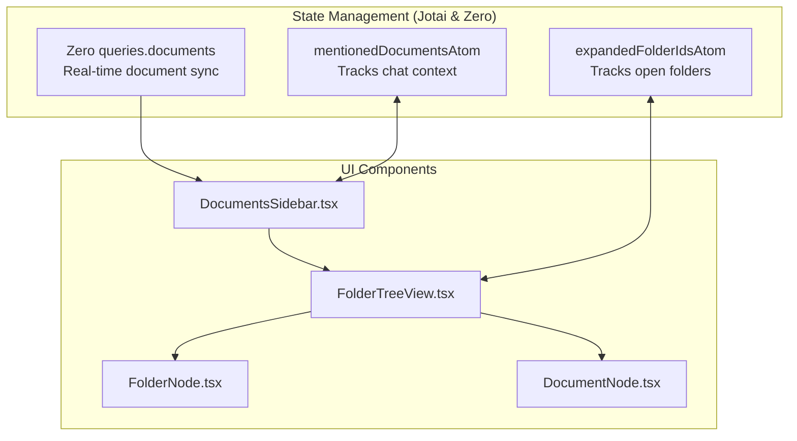
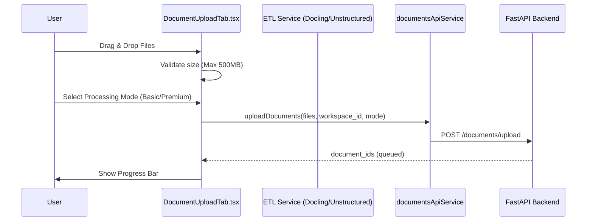

<!-- source: DeepWiki mcp.deepwiki.com · repo MODSetter/SurfSense · page 8.3 Document Management UI · fetched 2026-10-29 -->

# Document Management UI

Relevant source files

The following files were used as context for generating this wiki page:

- [surfsense_web/components/assistant-ui/document-upload-popup.tsx](surfsense_web/components/assistant-ui/document-upload-popup.tsx)
- [surfsense_web/components/documents/DocumentNode.tsx](surfsense_web/components/documents/DocumentNode.tsx)
- [surfsense_web/components/documents/DocumentTypeIcon.tsx](surfsense_web/components/documents/DocumentTypeIcon.tsx)
- [surfsense_web/components/documents/DocumentsFilters.tsx](surfsense_web/components/documents/DocumentsFilters.tsx)
- [surfsense_web/components/documents/FolderNode.tsx](surfsense_web/components/documents/FolderNode.tsx)
- [surfsense_web/components/documents/FolderTreeView.tsx](surfsense_web/components/documents/FolderTreeView.tsx)
- [surfsense_web/components/layout/providers/FreeLayoutDataProvider.tsx](surfsense_web/components/layout/providers/FreeLayoutDataProvider.tsx)
- [surfsense_web/components/layout/providers/LayoutDataProvider.tsx](surfsense_web/components/layout/providers/LayoutDataProvider.tsx)
- [surfsense_web/components/layout/ui/icon-rail/IconRail.tsx](surfsense_web/components/layout/ui/icon-rail/IconRail.tsx)
- [surfsense_web/components/layout/ui/shell/LayoutShell.tsx](surfsense_web/components/layout/ui/shell/LayoutShell.tsx)
- [surfsense_web/components/layout/ui/sidebar/AllChatsSidebar.tsx](surfsense_web/components/layout/ui/sidebar/AllChatsSidebar.tsx)
- [surfsense_web/components/layout/ui/sidebar/ChatListItem.tsx](surfsense_web/components/layout/ui/sidebar/ChatListItem.tsx)
- [surfsense_web/components/layout/ui/sidebar/DocumentsSidebar.tsx](surfsense_web/components/layout/ui/sidebar/DocumentsSidebar.tsx)
- [surfsense_web/components/layout/ui/sidebar/MobileSidebar.tsx](surfsense_web/components/layout/ui/sidebar/MobileSidebar.tsx)
- [surfsense_web/components/layout/ui/sidebar/NotificationsDropdown.tsx](surfsense_web/components/layout/ui/sidebar/NotificationsDropdown.tsx)
- [surfsense_web/components/layout/ui/sidebar/Sidebar.tsx](surfsense_web/components/layout/ui/sidebar/Sidebar.tsx)
- [surfsense_web/components/layout/ui/sidebar/SidebarSection.tsx](surfsense_web/components/layout/ui/sidebar/SidebarSection.tsx)
- [surfsense_web/components/layout/ui/sidebar/SidebarUserProfile.tsx](surfsense_web/components/layout/ui/sidebar/SidebarUserProfile.tsx)
- [surfsense_web/components/layout/ui/sidebar/index.ts](surfsense_web/components/layout/ui/sidebar/index.ts)
- [surfsense_web/components/sources/DocumentUploadTab.tsx](surfsense_web/components/sources/DocumentUploadTab.tsx)
- [surfsense_web/lib/comments/utils.ts](surfsense_web/lib/comments/utils.ts)
- [surfsense_web/lib/documents/document-type-labels.ts](surfsense_web/lib/documents/document-type-labels.ts)
- [surfsense_web/lib/layout-events.ts](surfsense_web/lib/layout-events.ts)
- [surfsense_web/messages/en.json](surfsense_web/messages/en.json)
- [surfsense_web/messages/es.json](surfsense_web/messages/es.json)
- [surfsense_web/messages/hi.json](surfsense_web/messages/hi.json)
- [surfsense_web/messages/pt.json](surfsense_web/messages/pt.json)
- [surfsense_web/messages/zh.json](surfsense_web/messages/zh.json)

## Purpose and Scope

The Document Management UI provides a comprehensive interface for browsing, searching, filtering, and managing documents within a SearchSpace. It consists of two primary components: a **Sidebar-based Tree View** for rapid navigation and chat mentions, and a **Management Table** for detailed administration, metadata inspection, and bulk operations. The system handles diverse document types (FILE, NOTE, CONNECTOR, YOUTUBE, LOCAL_FOLDER_FILE, etc.) and supports real-time processing status updates via background sync.

For information about document upload and ingestion, see [Document Ingestion Pipeline](#8.1). For document processing internals, see [Document Processing and Chunking](#8.2). For backend API endpoints, see [Document API](#8.4).

**Sources:** [surfsense_web/components/layout/ui/sidebar/DocumentsSidebar.tsx:1-120](), [surfsense_web/components/documents/DocumentNode.tsx:46-52]()

## Sidebar Navigation and Folders

The `DocumentsSidebar` is the primary navigational entry point, providing a hierarchical view of folders and documents. It leverages `FolderTreeView` to render a nested structure with drag-and-drop support.

### Folder Tree Data Flow

**Sources:** [surfsense_web/components/layout/ui/sidebar/DocumentsSidebar.tsx:18-20](), [surfsense_web/components/documents/FolderTreeView.tsx:61-87](), [surfsense_web/zero/queries/index.ts:1-5]()

### Key Features
*   **Hierarchical Organization:** Supports nested folders with infinite depth via `FolderNode` recursion and grouping logic in `FolderTreeView` [surfsense_web/components/documents/FolderTreeView.tsx:88-90]().
*   **Chat Mentions:** Documents and folders can be toggled as "mentions" (using `mentionedDocumentsAtom`), passing them as context to the AI agent [surfsense_web/components/layout/ui/sidebar/DocumentsSidebar.tsx:18]().
*   **Drag and Drop:** Uses `react-dnd` to allow moving documents into folders or reordering folders within the workspace [surfsense_web/components/documents/DocumentNode.tsx:120-128]().
*   **Memory Documents:** Special system documents (`MEMORY.md`, `TEAM_MEMORY.md`) are rendered at the top of the sidebar and are non-deletable [surfsense_web/components/layout/ui/sidebar/DocumentsSidebar.tsx:77-92]().

## Document Management Table

The management interface is organized as a hierarchical component structure coordinating multiple sub-components for filtering, table display, pagination, and actions.

### Main Management Component
The `DocumentsTable` (located in the dashboard route) orchestrates the administrative view using the following parameters:

| State Variable | Type | Purpose |
|---|---|---|
| `searchQuery` | `string` | Search query for document titles [surfsense_web/components/documents/FolderTreeView.tsx:38]() |
| `activeTypes` | `DocumentTypeEnum[]` | Selected document type filters [surfsense_web/components/documents/FolderTreeView.tsx:37]() |
| `expandedIds` | `Set<number>` | Set of folder IDs currently expanded in the view [surfsense_web/components/documents/FolderTreeView.tsx:19]() |
| `mentionedDocKeys` | `Set<string>` | Keys of documents selected for chat context [surfsense_web/components/documents/FolderTreeView.tsx:21]() |

**Sources:** [surfsense_web/components/documents/FolderTreeView.tsx:16-49](), [surfsense_web/components/layout/ui/sidebar/DocumentsSidebar.tsx:124-127]()

### Filtering and Search
The `EmbeddedDocumentsMenu` component provides:
*   **Type Filtering:** A dropdown or drawer (on mobile) with checkboxes for each `DocumentTypeEnum` (e.g., FILE, NOTE, USER_MEMORY) [surfsense_web/components/layout/ui/sidebar/DocumentsSidebar.tsx:111-121]().
*   **Type Counts:** Displays the number of documents per type next to the filter label [surfsense_web/components/layout/ui/sidebar/DocumentsSidebar.tsx:173-175]().
*   **Folder Creation:** Quick action to create a new folder via `CreateFolderDialog` [surfsense_web/components/layout/ui/sidebar/DocumentsSidebar.tsx:147-150]().

## Document Ingestion UI

The `DocumentUploadTab` handles the client-side logic for file and folder ingestion, supporting both standard web uploads and native Electron integration.

### Upload Workflow

**Sources:** [surfsense_web/components/sources/DocumentUploadTab.tsx:121-144](), [surfsense_web/components/sources/DocumentUploadTab.tsx:172-183]()

### Ingestion Features
*   **Processing Modes:** Users can choose between `basic` (standard parsing) and vision-enhanced modes for OCR/complex layouts [surfsense_web/components/sources/DocumentUploadTab.tsx:140-141]().
*   **Folder Upload:** Supports uploading entire directory structures, preserving relative paths via `buildFolderTree` and `flattenTree` [surfsense_web/components/sources/DocumentUploadTab.tsx:68-119]().
*   **Electron Integration:** On desktop, uses native file pickers via `electronAPI.browseFiles` and `readLocalFiles` to bypass browser sandbox limitations [surfsense_web/components/sources/DocumentUploadTab.tsx:215-225]().

## Real-time Status Monitoring

Documents transition through several states during ingestion, reflected in the `DocumentNode` via icons and tooltips.

| State | UI Representation | Description |
|---|---|---|
| `pending` | `Clock` Icon | Waiting in the task queue to be synced [surfsense_web/components/documents/DocumentNode.tsx:180-190]() |
| `processing` | `Spinner` | Currently being chunked/embedded [surfsense_web/components/documents/DocumentNode.tsx:192-202]() |
| `ready` | Type Icon (e.g., PDF) | Indexed and searchable [surfsense_web/components/documents/DocumentNode.tsx:218-228]() |
| `failed` | `AlertCircle` (Red) | Error during ingestion; shows reason on hover [surfsense_web/components/documents/DocumentNode.tsx:204-217]() |

**Sources:** [surfsense_web/components/documents/DocumentNode.tsx:180-228]()

## Version History and Actions

For supported document types, the UI provides deep management capabilities via the `DocumentNode` context menu and action items.

### Document Actions Menu
Available via right-click (`ContextMenu`) or the `DropdownMenu`:
*   **Preview:** Opens the document in the integrated viewer [surfsense_web/components/documents/DocumentNode.tsx:104-107]().
*   **Version History:** Displays a timeline of document changes with restore capabilities (for `FILE` and `NOTE` types) [surfsense_web/components/documents/DocumentNode.tsx:64]().
*   **Export:** Allows downloading documents in formats defined in `EXPORT_FILE_EXTENSIONS` [surfsense_web/components/documents/DocumentNode.tsx:136-144](), [surfsense_web/components/layout/ui/sidebar/DocumentsSidebar.tsx:31]().
*   **Move:** Triggers a `FolderPickerDialog` to relocate the document within the SearchSpace [surfsense_web/components/documents/DocumentNode.tsx:61]().
*   **Reset:** Re-triggers the processing pipeline for a document if ingestion was incomplete [surfsense_web/components/documents/DocumentNode.tsx:62]().

**Sources:** [surfsense_web/components/documents/DocumentNode.tsx:3-36](), [surfsense_web/components/layout/ui/sidebar/DocumentsSidebar.tsx:27-31]()

---

