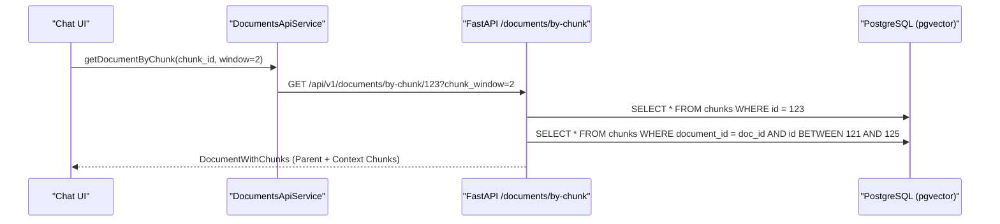

<!-- source: DeepWiki mcp.deepwiki.com · repo MODSetter/SurfSense · page 8.4 Document API · fetched 2026-10-29 -->

# Document API

Relevant source files

The following files were used as context for generating this wiki page:

- [surfsense_backend/app/tasks/connector_indexers/local_folder_indexer.py](surfsense_backend/app/tasks/connector_indexers/local_folder_indexer.py)
- [surfsense_backend/tests/integration/indexing_pipeline/test_local_folder_pipeline.py](surfsense_backend/tests/integration/indexing_pipeline/test_local_folder_pipeline.py)
- [surfsense_web/components/assistant-ui/connector-popup/utils/connector-document-mapping.ts](surfsense_web/components/assistant-ui/connector-popup/utils/connector-document-mapping.ts)
- [surfsense_web/components/assistant-ui/tooltip-icon-button.tsx](surfsense_web/components/assistant-ui/tooltip-icon-button.tsx)
- [surfsense_web/components/sources/FolderWatchDialog.tsx](surfsense_web/components/sources/FolderWatchDialog.tsx)
- [surfsense_web/contracts/types/document.types.ts](surfsense_web/contracts/types/document.types.ts)
- [surfsense_web/contracts/types/inbox.types.ts](surfsense_web/contracts/types/inbox.types.ts)
- [surfsense_web/hooks/use-documents.ts](surfsense_web/hooks/use-documents.ts)
- [surfsense_web/hooks/use-folder-sync.ts](surfsense_web/hooks/use-folder-sync.ts)
- [surfsense_web/hooks/use-inbox.ts](surfsense_web/hooks/use-inbox.ts)
- [surfsense_web/lib/apis/documents-api.service.ts](surfsense_web/lib/apis/documents-api.service.ts)
- [surfsense_web/lib/apis/notifications-api.service.ts](surfsense_web/lib/apis/notifications-api.service.ts)
- [surfsense_web/lib/folder-sync-upload.ts](surfsense_web/lib/folder-sync-upload.ts)

## Purpose and Scope

This document describes the HTTP REST API endpoints provided by the Document routes module for managing documents within SurfSense. These endpoints handle document creation from various sources (file uploads, browser extension data, URLs), document retrieval with advanced filtering and pagination, and document lifecycle management (updates and deletions).

The Document API is designed for real-time interaction, supporting a 2-phase ingestion model for file uploads where documents are immediately visible in the UI with a "pending" status before being processed by background workers [surfsense_backend/app/routes/documents_routes.py:132-135]().

**Sources:** [surfsense_backend/app/routes/documents_routes.py:1-135]()

---

## API Overview

The Document API provides endpoints organized into three functional categories. All endpoints require authentication via JWT bearer token and enforce strict RBAC permission checks [surfsense_backend/app/routes/documents_routes.py:60-78]().

### Document API Endpoints and Routes

```mermaid
graph TD
    subgraph "Document Creation"
        CreateDocs["POST /documents<br/>create_documents()"]
        FileUpload["POST /documents/fileupload<br/>create_documents_file_upload()"]
        FolderUpload["POST /documents/folder-upload<br/>folder_upload_files()"]
    end
    
    subgraph "Document Retrieval"
        ListDocs["GET /documents<br/>read_documents()"]
        SearchDocs["GET /documents/search<br/>search_documents()"]
        TypeCounts["GET /documents/type-counts<br/>get_document_type_counts()"]
        GetByChunk["GET /documents/by-chunk/{chunk_id}<br/>get_document_by_chunk_id()"]
        GetDoc["GET /documents/{document_id}<br/>read_document()"]
        GetStatus["GET /documents/status/batch<br/>get_documents_status_batch()"]
    end
    
    subgraph "Document Management"
        UpdateDoc["PUT /documents/{document_id}<br/>update_document()"]
        DeleteDoc["DELETE /documents/{document_id}<br/>delete_document()"]
        NotifyUnlinked["POST /documents/folder-notify-unlinked<br/>folder_notify_unlinked()"]
    end
    
    subgraph "Task Queue"
        ExtTask["process_extension_document_task"]
        FileTask["process_file_upload_task"]
    end
    
    subgraph "Database Models"
        DocModel["Document"]
        ChunkModel["Chunk"]
        WorkspaceModel["Workspace"]
    end
    
    CreateDocs -->|"queue tasks"| ExtTask
    FileUpload -->|"queue task"| FileTask
    
    ListDocs -->|"query"| DocModel
    SearchDocs -->|"query"| DocModel
    TypeCounts -->|"query"| DocModel
    GetByChunk -->|"query"| ChunkModel
    GetDoc -->|"query"| DocModel
    UpdateDoc -->|"update"| DocModel
    DeleteDoc -->|"delete"| DocModel
    
    CreateDocs -.->|"permission check"| WorkspaceModel
    FileUpload -.->|"permission check"| WorkspaceModel
```

**Sources:** [surfsense_backend/app/routes/documents_routes.py:59-650](), [surfsense_backend/app/db.py:400-600](), [surfsense_web/lib/apis/documents-api.service.ts:46-230]()

---

## Document Creation and Ingestion

### POST /documents
Creates documents asynchronously by queueing Celery tasks. This is primarily used by the browser extension to save web page content [surfsense_backend/app/routes/documents_routes.py:80-84]().

**Request Schema (`createDocumentRequest`):**
| Field | Type | Required | Description |
|-------|------|----------|-------------|
| `workspace_id` | `number` | Yes | Target workspace ID |
| `document_type` | `DocumentType` | Yes | Supports `EXTENSION`, `CRAWLED_URL`, `YOUTUBE_VIDEO` [surfsense_web/contracts/types/document.types.ts:114-118]() |
| `content` | `string | array` | Yes | Raw content or extension metadata objects [surfsense_web/contracts/types/document.types.ts:117]() |

**Sources:** [surfsense_web/contracts/types/document.types.ts:114-123](), [surfsense_web/lib/apis/documents-api.service.ts:100-114]()

### POST /documents/fileupload
Handles multi-part form data file uploads. The `DocumentsApiService` on the frontend implements a batching strategy (`UPLOAD_BATCH_SIZE = 5`) to avoid proxy/LB timeouts [surfsense_web/lib/apis/documents-api.service.ts:132-136]().

**Request Parameters:**
| Field | Type | Required | Description |
|-------|------|----------|-------------|
| `files` | `File[]` | Yes | List of binary files |
| `workspace_id` | `number` | Yes | Target workspace |
| `use_vision_llm` | `boolean` | No | Enable multimodal processing |
| `processing_mode` | `basic | premium` | No | ETL strategy [surfsense_web/contracts/types/document.types.ts:128-135]() |

**Sources:** [surfsense_web/lib/apis/documents-api.service.ts:121-180](), [surfsense_web/contracts/types/document.types.ts:130-144]()

### Local Folder Ingestion (Desktop Only)
For the desktop application, SurfSense provides specialized endpoints for syncing local filesystem folders.

*   **`folder_upload_files`**: Uploads files with relative path preservation to mirror local directory structures in the database `Folder` model [surfsense_backend/app/tasks/connector_indexers/local_folder_indexer.py:7-9]().
*   **`folder_notify_unlinked`**: Notifies the backend when files are deleted locally so they can be removed from the index [surfsense_web/hooks/use-folder-sync.ts:75-82]().

**Sources:** [surfsense_web/hooks/use-folder-sync.ts:38-92](), [surfsense_backend/app/tasks/connector_indexers/local_folder_indexer.py:1-40]()

---

## Document Retrieval and Search

### GET /documents
List documents with pagination, sorting, and workspace filtering. The frontend `useDocuments` hook uses this as the primary data source while supplementing with Zero for real-time deltas [surfsense_web/hooks/use-documents.ts:57-64]().

**Query Parameters (`getDocumentsRequest`):**
| Parameter | Type | Description |
|-----------|------|-------------|
| `workspace_id`| `number` | Required workspace context |
| `page` | `number` | Zero-based index |
| `document_types`| `array` | Filter by specific types (e.g., `FILE`, `NOTE`) |
| `sort_by` | `enum` | `created_at`, `title`, or `document_type` |
| `sort_order` | `enum` | `asc` or `desc` |

**Sources:** [surfsense_web/contracts/types/document.types.ts:85-94](), [surfsense_web/hooks/use-documents.ts:65-116]()

### GET /documents/status
Allows the frontend to poll for the status of multiple documents during the ingestion pipeline [surfsense_web/lib/apis/documents-api.service.ts:185-204]().

**States Returned:**
*   `ready`: Indexed and searchable.
*   `pending`: In queue.
*   `processing`: Currently being parsed/embedded.
*   `failed`: Processing halted (includes `reason`).

**Sources:** [surfsense_web/contracts/types/document.types.ts:156-170](), [surfsense_web/lib/apis/documents-api.service.ts:185-204]()

---

## Chunk-Based Retrieval

For RAG (Retrieval-Augmented Generation) and source attribution, the API provides endpoints to retrieve document context around specific vector matches.

### GET /documents/by-chunk/{chunk_id}
Resolves a chunk to its parent document and retrieves a surrounding window of chunks for LLM context [surfsense_web/contracts/types/document.types.ts:232-235]().

**Sources:** [surfsense_web/contracts/types/document.types.ts:232-237](), [surfsense_web/lib/apis/documents-api.service.ts:246-261]()

---

## Inbox and Notifications API

Document processing events trigger notifications that are managed via the Notifications API.

### GET /notifications
Fetches a paginated list of notifications. The system categorizes these into `comments` (mentions/replies) and `status` (connector/document processing) [surfsense_web/hooks/use-inbox.ts:19-27]().

**Notification Types (`inboxItemTypeEnum`):**
*   `connector_indexing`: Progress updates for external sources.
*   `document_processing`: Status of individual file uploads.
*   `insufficient_credits`: Alerts for ETL credit exhaustion [surfsense_web/contracts/types/inbox.types.ts:8-15]().

**Sources:** [surfsense_web/contracts/types/inbox.types.ts:211-233](), [surfsense_web/hooks/use-inbox.ts:44-121](), [surfsense_web/lib/apis/notifications-api.service.ts:28-78]()

---

## Data Model Reference

### Document Status Enum
The document status is stored as a `JSONB` field in the database, allowing for flexible error reporting [surfsense_backend/app/db.py:127-129]().

| State | Description |
|-------|-------------|
| `pending` | Created in DB, waiting for worker [surfsense_backend/app/db.py:156-159]() |
| `processing` | Currently being parsed/embedded [surfsense_backend/app/db.py:161-164]() |
| `ready` | Fully indexed and searchable [surfsense_backend/app/db.py:151-154]() |
| `failed` | Processing halted; contains `reason` [surfsense_backend/app/db.py:166-177]() |

**Sources:** [surfsense_backend/app/db.py:127-187](), [surfsense_web/contracts/types/document.types.ts:156-159]()

---

