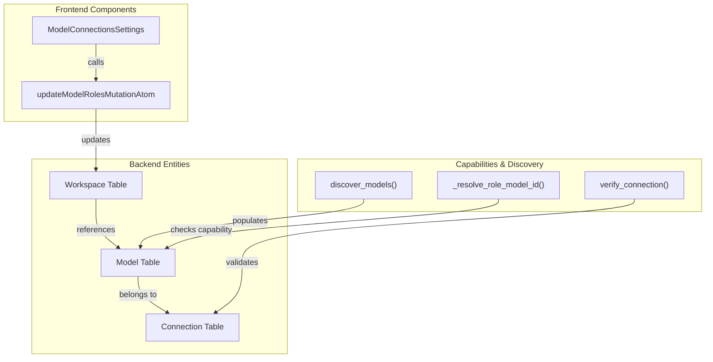
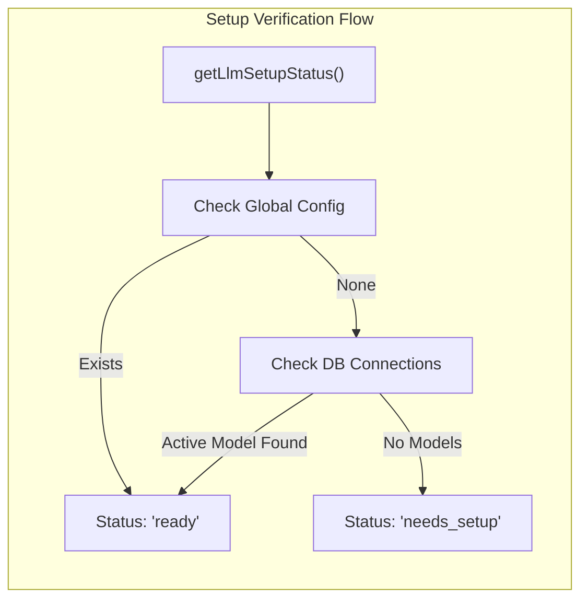

<!-- source: DeepWiki mcp.deepwiki.com · repo MODSetter/SurfSense · page 9 LLM Configuration · fetched 2026-10-29 -->

# LLM Configuration

Relevant source files

The following files were used as context for generating this wiki page:

- [docs/chinese-llm-setup.md](docs/chinese-llm-setup.md)
- [surfsense_backend/alembic/versions/160_add_model_connections.py](surfsense_backend/alembic/versions/160_add_model_connections.py)
- [surfsense_backend/app/config/global_llm_config.example.yaml](surfsense_backend/app/config/global_llm_config.example.yaml)
- [surfsense_backend/app/routes/model_connections_routes.py](surfsense_backend/app/routes/model_connections_routes.py)
- [surfsense_backend/app/schemas/__init__.py](surfsense_backend/app/schemas/__init__.py)
- [surfsense_backend/app/schemas/model_connections.py](surfsense_backend/app/schemas/model_connections.py)
- [surfsense_backend/app/services/global_model_catalog.py](surfsense_backend/app/services/global_model_catalog.py)
- [surfsense_backend/app/services/model_connection_service.py](surfsense_backend/app/services/model_connection_service.py)
- [surfsense_backend/app/services/openrouter_integration_service.py](surfsense_backend/app/services/openrouter_integration_service.py)
- [surfsense_backend/app/services/pricing_registration.py](surfsense_backend/app/services/pricing_registration.py)
- [surfsense_backend/app/services/provider_capabilities.py](surfsense_backend/app/services/provider_capabilities.py)
- [surfsense_backend/app/services/quality_score.py](surfsense_backend/app/services/quality_score.py)
- [surfsense_backend/tests/unit/services/test_openrouter_integration_service.py](surfsense_backend/tests/unit/services/test_openrouter_integration_service.py)
- [surfsense_backend/tests/unit/services/test_pricing_registration.py](surfsense_backend/tests/unit/services/test_pricing_registration.py)
- [surfsense_backend/tests/unit/services/test_quality_score.py](surfsense_backend/tests/unit/services/test_quality_score.py)
- [surfsense_web/atoms/model-connections/model-connections-mutation.atoms.ts](surfsense_web/atoms/model-connections/model-connections-mutation.atoms.ts)
- [surfsense_web/atoms/model-connections/model-connections-query.atoms.ts](surfsense_web/atoms/model-connections/model-connections-query.atoms.ts)
- [surfsense_web/components/settings/model-connections-settings.tsx](surfsense_web/components/settings/model-connections-settings.tsx)
- [surfsense_web/contracts/types/model-connections.types.ts](surfsense_web/contracts/types/model-connections.types.ts)
- [surfsense_web/lib/apis/model-connections-api.service.ts](surfsense_web/lib/apis/model-connections-api.service.ts)
- [surfsense_web/lib/query-client/cache-keys.ts](surfsense_web/lib/query-client/cache-keys.ts)
- [surfsense_web/lib/query-client/query-client.provider.check.tsx](surfsense_web/lib/query-client/query-client.provider.check.tsx)
- [surfsense_web/lib/query-client/query-client.provider.tsx](surfsense_web/lib/query-client/query-client.provider.tsx)

The LLM Configuration system in SurfSense provides a flexible, multi-tenant approach to managing language model providers and their assignments. It supports both global (system-wide) and workspace-specific (per-SearchSpace) configurations, utilizing a role-based assignment system that optimizes different LLMs for specific functional tasks like chat, vision, and image generation.

This page covers the configuration architecture, role assignment, and management interfaces.

---

## Configuration Architecture

SurfSense implements a hierarchical LLM configuration system with two distinct levels: global configurations (defined by the operator) and user-specific configurations (scoped to individual SearchSpaces via "Bring Your Own Key").

### Configuration Entity Space

The diagram below maps the configuration concepts to the underlying code entities and database models.

**Sources:** [surfsense_web/components/settings/model-connections-settings.tsx:53-80](), [surfsense_backend/app/routes/model_connections_routes.py:119-142](), [surfsense_backend/app/routes/model_connections_routes.py:193-209]()

### LLM Roles and Selection

The system maps LLM configurations to functional roles within a SearchSpace. For details, see [Role-Based LLM Selection](#9.2).

| Role | Code Schema Field | Primary Purpose |
|-------|------|-------------|
| **Chat Model** | `chat_model_id` | Primary model for chat responses and agent tasks [surfsense_backend/app/schemas/model_connections.py:135](). |
| **Vision Model** | `vision_model_id` | Used to understand images in uploads and documents [surfsense_backend/app/schemas/model_connections.py:136](). |
| **Image Gen** | `image_gen_model_id` | Dedicated model for generating images via tools [surfsense_backend/app/schemas/model_connections.py:137](). |

---

## Configuration Management

SurfSense provides a unified interface for managing model connections, whether they are local (Ollama), cloud (OpenAI), or proxied (OpenRouter). For details, see [LLM Configuration Management](#9.1).

### Global LLM Configurations
Global configurations are system-wide LLM setups defined in a YAML file and loaded at application startup. These allow operators to provide "out-of-the-box" models.

- **Static Source:** Defined in `global_llm_config.yaml` using the `global_llm_configs` section [surfsense_backend/app/config/global_llm_config.example.yaml:78-80]().
- **ID Namespace:** Global models use negative IDs (e.g., -1, -2), while user database models use positive IDs [surfsense_backend/app/config/global_llm_config.example.yaml:33-38]().
- **Auto Mode:** ID `0` is reserved for "Auto mode," which utilizes a router to select the best available global deployment [surfsense_backend/app/config/global_llm_config.example.yaml:57-67]().

### OpenRouter Dynamic Integration
SurfSense includes a specialized service to fetch the entire OpenRouter catalog dynamically, making hundreds of models available without manual entry [surfsense_backend/app/services/openrouter_integration_service.py:1-11]().
- **Stable IDs:** Uses a hashing mechanism to ensure dynamic model IDs remain stable across refreshes [surfsense_backend/app/services/openrouter_integration_service.py:54-70]().
- **Tier Classification:** Automatically classifies models as `free` or `premium` based on OpenRouter pricing data [surfsense_backend/app/services/openrouter_integration_service.py:73-91]().

**Sources:** [surfsense_backend/app/config/global_llm_config.example.yaml:1-55](), [surfsense_backend/app/services/openrouter_integration_service.py:1-70]()

---

## LLM Provider Support

SurfSense supports a vast array of providers through the `provider_registry` and LiteLLM. For a complete list, see [LLM Provider Support](#9.3).

### Supported Provider Types

| Provider Category | Examples | Key Implementation |
|-------------------|----------|--------------------|
| **Major Cloud** | OpenAI, Anthropic, Azure | Standard API key auth [surfsense_backend/app/services/model_connection_service.py:38-48]() |
| **Chinese LLM** | DeepSeek, Qwen, Kimi | Compatible endpoints [docs/chinese-llm-setup.md:9-17]() |
| **Local Inference** | Ollama, vLLM | Custom `base_url` support [surfsense_backend/app/services/model_connection_service.py:51-59]() |
| **Aggregators** | OpenRouter, Requesty | Dynamic discovery & normalization [surfsense_backend/app/services/model_connection_service.py:15-18]() |

---

## Onboarding and Setup

New workspaces are guided through an onboarding flow to ensure at least one chat-capable model is available. For details, see [Onboarding Flow](#9.4).

### Setup Status Logic
The system authoritatively determines if a workspace is ready for AI interaction via the `LlmSetupStatusRead` schema [surfsense_backend/app/schemas/model_connections.py:140-153]().

**Sources:** [surfsense_web/lib/apis/model-connections-api.service.ts:43-45](), [surfsense_backend/app/schemas/model_connections.py:149-152](), [surfsense_web/atoms/model-connections/model-connections-mutation.atoms.ts:35-48]()

---

## Child Pages

- [LLM Configuration Management](#9.1) — Interface for creating, verifying, and discovering models within connections.
- [Role-Based LLM Selection](#9.2) — How to assign specific models to Chat, Vision, and Image Generation roles.
- [LLM Provider Support](#9.3) — Technical guide for configuring 28+ providers including DeepSeek, OpenAI, and Ollama.
- [Onboarding Flow](#9.4) — The initial setup wizard and recovery states for workspace LLM configuration.

---

