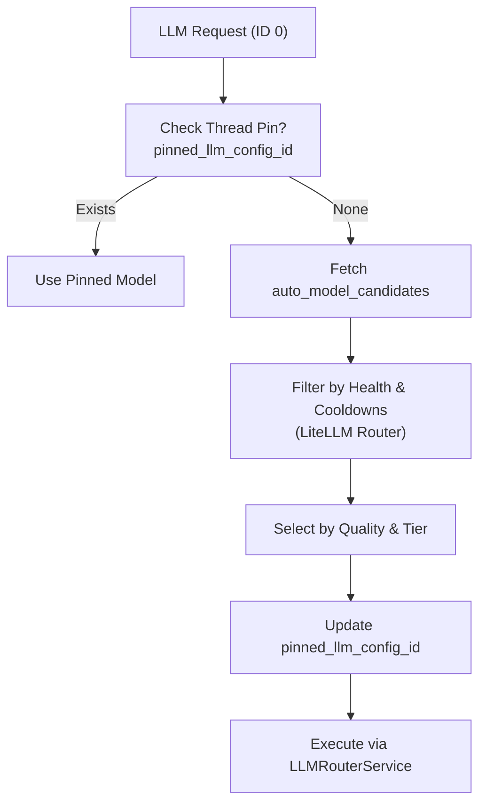

<!-- source: DeepWiki mcp.deepwiki.com · repo MODSetter/SurfSense · page 9.2 Role-Based LLM Selection · fetched 2026-10-29 -->

# Role-Based LLM Selection

<details>
<summary>Relevant source files</summary>

The following files were used as context for generating this wiki page:

- [surfsense_backend/app/agents/chat/runtime/llm_config.py](surfsense_backend/app/agents/chat/runtime/llm_config.py)
- [surfsense_backend/app/retriever/chunks_hybrid_search.py](surfsense_backend/app/retriever/chunks_hybrid_search.py)
- [surfsense_backend/app/retriever/documents_hybrid_search.py](surfsense_backend/app/retriever/documents_hybrid_search.py)
- [surfsense_backend/app/services/connector_service.py](surfsense_backend/app/services/connector_service.py)
- [surfsense_backend/app/services/llm_router_service.py](surfsense_backend/app/services/llm_router_service.py)
- [surfsense_backend/app/services/llm_service.py](surfsense_backend/app/services/llm_service.py)
- [surfsense_backend/app/services/token_tracking_service.py](surfsense_backend/app/services/token_tracking_service.py)
- [surfsense_backend/app/tasks/chat/streaming/flows/shared/llm_bundle.py](surfsense_backend/app/tasks/chat/streaming/flows/shared/llm_bundle.py)
- [surfsense_backend/tests/unit/observability/test_retriever_otel.py](surfsense_backend/tests/unit/observability/test_retriever_otel.py)
- [surfsense_web/components/assistant-ui/document-upload-popup.tsx](surfsense_web/components/assistant-ui/document-upload-popup.tsx)
- [surfsense_web/components/assistant-ui/token-usage-context.tsx](surfsense_web/components/assistant-ui/token-usage-context.tsx)
- [surfsense_web/components/sources/DocumentUploadTab.tsx](surfsense_web/components/sources/DocumentUploadTab.tsx)
- [surfsense_web/messages/en.json](surfsense_web/messages/en.json)
- [surfsense_web/messages/es.json](surfsense_web/messages/es.json)
- [surfsense_web/messages/hi.json](surfsense_web/messages/hi.json)
- [surfsense_web/messages/pt.json](surfsense_web/messages/pt.json)
- [surfsense_web/messages/zh.json](surfsense_web/messages/zh.json)

</details>


## Purpose and Scope

This document describes the role-based LLM selection system in SurfSense, which enables different LLM configurations to be assigned to specialized functional roles for optimal performance. Each SearchSpace assigns LLM configurations to distinct roles: `Agent LLM` for chat interactions and agent operations, and `Document Summary LLM` for document summarization tasks.

The system supports a tiered resolution strategy: it can use specific user-defined configurations, global configurations provided by administrators, or an **Auto Mode** that dynamically selects the best available model based on health, quality scores, and rate limits.

## Functional Role Definitions

SurfSense defines specialized functional roles to handle different computational requirements:

| Role | Field Name | Purpose | Typical Use Cases |
|------|-----------|---------|-------------------|
| **Agent LLM** | `agent_llm_id` | Primary LLM for chat interactions and agent operations | Chat responses, agent tasks, tool calling [surfsense_backend/app/services/llm_service.py:97-98]() |
| **Document Summary LLM** | `document_summary_llm_id` | Handles document summarization | Document analysis, podcast generation, research synthesis |

### Role Characteristics (UI)

- **Agent LLM**: Fast responses, conversational, blue theme in UI.
- **Document Summary LLM**: Large context window, deep reasoning, purple theme in UI.

## Preference Storage Architecture

LLM role assignments are stored in an `llm_preferences` JSONB field at the `SearchSpace` level. All members of a SearchSpace share these assignments.

### Preference Storage Model

```mermaid
graph TB
    subgraph "PostgreSQL SearchSpace Table"
        [SearchSpace Entity] --> PREFS["llm_preferences: JSONB<br/>{<br/>  agent_llm_id: int,<br/>  document_summary_llm_id: int<br/>}"]
    end
    
    subgraph "Model ID Resolution Space"
        PREFS --> AUTO["ID 0: AUTO_MODE_ID<br/>Dynamic Routing"]
        PREFS --> GLOBAL["ID < 0: Global Configs<br/>YAML-defined"]
        PREFS --> USER["ID > 0: Model Table<br/>User-created"]
    end
    
    AUTO --> ROUTER["LLMRouterService<br/>Load Balancing"]
    GLOBAL --> YAML["global_llm_config.yaml"]
    USER --> DB_MODEL["Model Table Entity"]
```
**Sources:**
- [surfsense_backend/app/db.py:12-13]()
- [surfsense_backend/app/services/llm_service.py:100-112]()
- [surfsense_backend/app/services/llm_router_service.py:100-101]()

## Auto Mode and Dynamic Routing

When a role is set to `ID 0` (`AUTO_MODE_ID`), SurfSense employs a dynamic selection logic managed by the `LLMRouterService` and `AutoModelPinService`.

### Auto-Model Selection Logic
1. **Thread Pinning**: For chat threads, the system resolves `Auto` to a concrete global model once and persists it to `pinned_llm_config_id` to ensure conversation stability [surfsense_backend/app/services/auto_model_pin_service.py:3-7]().
2. **Quality Scoring**: Models are ranked using a `quality_score` (0-100). The system prefers higher quality models that are currently healthy [surfsense_backend/app/services/auto_model_pin_service.py:32-35]().
3. **Health & Cooldowns**: If a model returns a 429 (Rate Limit) or hard failure, it is placed in a `runtime_cooldown` (default 60s) to prevent re-selection [surfsense_backend/app/services/llm_router_service.py:190-191]().
4. **Load Balancing**: The `LLMRouterService` uses `usage-based-routing` to distribute non-pinned requests across eligible global deployments [surfsense_backend/app/services/llm_router_service.py:186-192]().

### Routing Implementation


**Sources:**
- [surfsense_backend/app/services/auto_model_pin_service.py:170-201]()
- [surfsense_backend/app/services/llm_router_service.py:132-175]()

## Global Configuration Management

Global models are defined in `global_llm_config.yaml`. These models are materialized at startup and assigned negative IDs. The `LLMRouterService` initializes itself using these configurations [surfsense_backend/app/services/llm_router_service.py:132-149]().

### YAML Configuration Logic
Models with `router_pool_eligible=False` are skipped during router initialization to ensure only stable, production-ready models are used for automatic tasks like title generation or sub-agent flows [surfsense_backend/app/services/llm_router_service.py:159-163]().

**Sources:**
- [surfsense_backend/app/services/llm_router_service.py:158-175]()
- [surfsense_backend/app/services/llm_service.py:100-119]()

## Role Usage in Tasks

Functional roles are resolved at runtime by various services:

| Service/Task | Logic | Source |
|--------------|-------|--------|
| **Chat Streaming** | Resolves `agent_llm_id` from workspace prefs; handles thread pinning. | [surfsense_backend/app/services/auto_model_pin_service.py:186-192]() |
| **Document Processing** | Uses `config.embedding_model_instance` for vector search (distinct from chat roles). | [surfsense_backend/app/retriever/chunks_hybrid_search.py:91-93]() |
| **LLM Validation** | Validates provider compatibility, rejecting interactive auth providers like `github_copilot`. | [surfsense_backend/app/services/llm_service.py:171-212]() |

### Token Tracking & Attribution
Regardless of the role, usage is tracked via `TokenTrackingCallback` [surfsense_backend/app/services/llm_service.py:35](). The `TurnTokenAccumulator` groups usage across a single turn (e.g., agent planning + final response) to report back to the UI and debit user credits [surfsense_backend/app/services/token_tracking_service.py:67-78]().

**Sources:**
- [surfsense_backend/app/services/token_tracking_service.py:162-186]()
- [surfsense_backend/app/services/llm_service.py:171-212]()
- [surfsense_backend/app/retriever/chunks_hybrid_search.py:91-93]()

---

