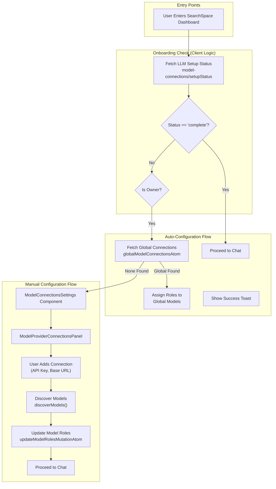
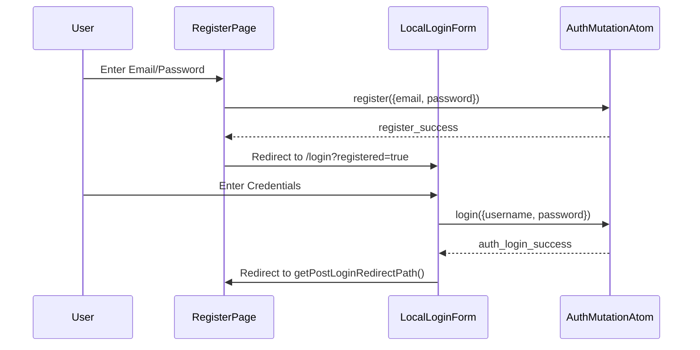

<!-- source: DeepWiki mcp.deepwiki.com · repo MODSetter/SurfSense · page 9.4 Onboarding Flow · fetched 2026-10-29 -->

# Onboarding Flow

<details>
<summary>Relevant source files</summary>

The following files were used as context for generating this wiki page:

- [surfsense_desktop/src/modules/shortcuts.ts](surfsense_desktop/src/modules/shortcuts.ts)
- [surfsense_web/app/(home)/login/GoogleLoginButton.tsx](surfsense_web/app/(home)/login/GoogleLoginButton.tsx)
- [surfsense_web/app/(home)/login/LocalLoginForm.tsx](surfsense_web/app/(home)/login/LocalLoginForm.tsx)
- [surfsense_web/app/(home)/login/page.tsx](surfsense_web/app/(home)/login/page.tsx)
- [surfsense_web/app/(home)/page.tsx](surfsense_web/app/(home)/page.tsx)
- [surfsense_web/app/(home)/register/page.tsx](surfsense_web/app/(home)/register/page.tsx)
- [surfsense_web/app/auth/callback/loading.tsx](surfsense_web/app/auth/callback/loading.tsx)
- [surfsense_web/app/dashboard/layout.tsx](surfsense_web/app/dashboard/layout.tsx)
- [surfsense_web/app/dashboard/loading.tsx](surfsense_web/app/dashboard/loading.tsx)
- [surfsense_web/app/dashboard/page.tsx](surfsense_web/app/dashboard/page.tsx)
- [surfsense_web/app/desktop/login/page.tsx](surfsense_web/app/desktop/login/page.tsx)
- [surfsense_web/atoms/ui/loading.atoms.ts](surfsense_web/atoms/ui/loading.atoms.ts)
- [surfsense_web/components/UserDropdown.tsx](surfsense_web/components/UserDropdown.tsx)
- [surfsense_web/components/assistant-ui/document-upload-popup.tsx](surfsense_web/components/assistant-ui/document-upload-popup.tsx)
- [surfsense_web/components/desktop/shortcut-recorder.tsx](surfsense_web/components/desktop/shortcut-recorder.tsx)
- [surfsense_web/components/json-metadata-viewer.tsx](surfsense_web/components/json-metadata-viewer.tsx)
- [surfsense_web/components/providers/GlobalLoadingProvider.tsx](surfsense_web/components/providers/GlobalLoadingProvider.tsx)
- [surfsense_web/components/sources/DocumentUploadTab.tsx](surfsense_web/components/sources/DocumentUploadTab.tsx)
- [surfsense_web/hooks/use-global-loading.ts](surfsense_web/hooks/use-global-loading.ts)
- [surfsense_web/messages/en.json](surfsense_web/messages/en.json)
- [surfsense_web/messages/es.json](surfsense_web/messages/es.json)
- [surfsense_web/messages/hi.json](surfsense_web/messages/hi.json)
- [surfsense_web/messages/pt.json](surfsense_web/messages/pt.json)
- [surfsense_web/messages/zh.json](surfsense_web/messages/zh.json)

</details>


The onboarding flow is the initial setup wizard that ensures every SearchSpace has a valid LLM configuration before users can access the chat interface. This flow guides workspace owners through configuring LLM providers and automatically assigns them to functional roles.

## Purpose and Scope

The onboarding system ensures that:
- Every SearchSpace has at least one LLM configuration with both `chat_model_id` and `vision_model_id` assigned.
- New workspaces are automatically configured when global LLM connections are available.
- Workspace owners manually configure LLM settings when global configs are not available.
- Users cannot access chat features until onboarding is complete.

## Architecture Overview

The onboarding flow is managed primarily by the `ModelConnectionsSettings` component and the underlying `modelConnectionsApiService`. It leverages Jotai atoms for state management and React Query for data fetching.



**Sources:** `surfsense_web/app/dashboard/page.tsx:73-108`(), `surfsense_web/messages/en.json:144-146`()

## Onboarding Check Logic

### Setup Status Verification

The frontend checks the workspace status upon entry. If no workspaces exist, the user is presented with an empty state to create their first SearchSpace. Once a SearchSpace exists, the application verifies if LLM configurations are present.

```mermaid
graph LR
    [DashboardPage] --> [workspacesAtom]
    [workspacesAtom] -- "Empty" --> [EmptyState]
    [workspacesAtom] -- "Exists" --> [RedirectToChat]
    [EmptyState] -- "Click" --> [CreateWorkspaceDialog]
```

**Sources:** `surfsense_web/app/dashboard/page.tsx:73-88`(), `surfsense_web/app/dashboard/page.tsx:44-71`()

### Workspace Redirection

When a user lands on the dashboard, the system automatically redirects them to the most recent or first available workspace. If the LLM configuration is missing for that workspace, the `DashboardPage` logic triggers the redirection to the chat interface which contains the setup guards.

```typescript
export default function DashboardPage() {
	const { data: workspaces = [], isLoading, error } = useAtomValue(workspacesAtom);

	useEffect(() => {
		if (isLoading) return;
		if (workspaces.length > 0) {
			const query = window.location.search;
			router.replace(`/dashboard/${workspaces[0].id}/new-chat${query}`);
		}
	}, [isLoading, workspaces, router]);
    // ...
}
```

**Sources:** `surfsense_web/app/dashboard/page.tsx:73-88`()

## Manual Configuration Flow

When no global configurations are available, workspace owners must manually configure an LLM provider.

### Component Structure

The setup process involves several localized strings and UI components to guide the user through the dashboard and settings.

| Role | Purpose | Translation Key (en.json) |
|------|---------|-----------------|
| **Dashboard Entry** | Initial view for workspace-less users. | `workspace.welcome_title` |
| **LLM Loading** | State while fetching model configs. | `dashboard.loading_config` |
| **Error Handling** | UI for failed LLM loads. | `dashboard.failed_load_llm_config` |

**Sources:** `surfsense_web/messages/en.json:103-104`(), `surfsense_web/messages/en.json:144-146`()

## User Authentication & Registration

The onboarding process begins with account creation. The `RegisterPage` handles user signup, specifically enforcing `LOCAL` authentication types if configured.

### Registration and Login Flow



**Sources:** `surfsense_web/app/(home)/register/page.tsx:71-92`(), `surfsense_web/app/(home)/login/LocalLoginForm.tsx:34-55`(), `surfsense_web/app/(home)/login/page.tsx:39-44`()

## Role Assignment and Persistence

Once a user is authenticated and a workspace is created, they must assign models to roles. This is critical for the RAG (Retrieval-Augmented Generation) pipeline.

### Document Ingestion Readiness

A key part of onboarding is preparing the workspace for knowledge ingestion. The `DocumentUploadTab` provides the interface for adding files, which requires a functional LLM for processing if "Vision" or "Advanced" modes are selected.

| Feature | Requirement | Code Identifier |
|---------|-------------|-----------------|
| **Basic Upload** | Standard ETL | `processingMode: "basic"` |
| **Vision Analysis** | Vision-capable LLM | `useVisionLlm: true` |

**Sources:** `surfsense_web/components/sources/DocumentUploadTab.tsx:130-143`(), `surfsense_web/components/assistant-ui/document-upload-popup.tsx:93-126`()

## Internationalization Support

The onboarding flow UI provides localized strings for various languages to ensure a smooth setup experience globally.

| Language | Welcome String | Workspace String |
|----------|----------------|------------------|
| **English** | "Welcome to SurfSense" | "Create Search Space" |
| **Chinese** | "欢迎使用 SurfSense" | "创建搜索空间" |
| **Spanish** | "Bienvenido a SurfSense" | "Crear espacio de búsqueda" |
| **Portuguese**| "Bem-vindo ao SurfSense" | "Criar espaço de pesquisa" |
| **Hindi** | "SurfSense में आपका स्वागत है" | "सर्च स्पेस बनाएं" |

**Sources:** `surfsense_web/messages/en.json:103`(), `surfsense_web/messages/zh.json:103`(), `surfsense_web/messages/es.json:103`(), `surfsense_web/messages/pt.json:103`(), `surfsense_web/messages/hi.json:103`()

---

