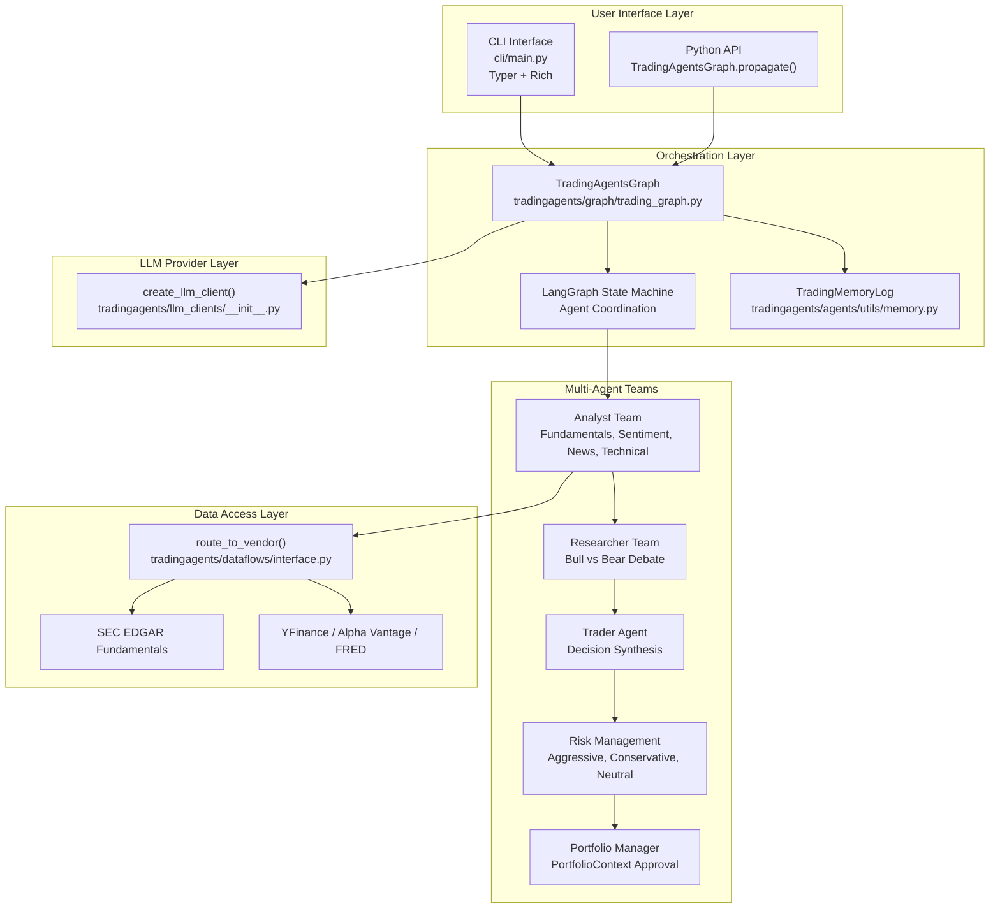
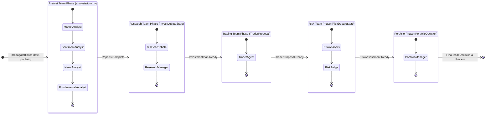

<!-- source: DeepWiki mcp.deepwiki.com · repo TauricResearch/TradingAgents · page 1 TradingAgents Overview · fetched 2026-10-29 -->

# TradingAgents Overview

Relevant source files

The following files were used as context for generating this wiki page:

- [CHANGELOG.md](CHANGELOG.md)
- [LICENSE](LICENSE)
- [README.md](README.md)
- [assets/TauricResearch.png](assets/TauricResearch.png)
- [assets/analyst.png](assets/analyst.png)
- [assets/cli/cli_init.png](assets/cli/cli_init.png)
- [assets/cli/cli_news.png](assets/cli/cli_news.png)
- [assets/cli/cli_technical.png](assets/cli/cli_technical.png)
- [assets/cli/cli_transaction.png](assets/cli/cli_transaction.png)
- [assets/researcher.png](assets/researcher.png)
- [assets/risk.png](assets/risk.png)
- [pyproject.toml](pyproject.toml)
- [requirements.txt](requirements.txt)
- [tests/test_version.py](tests/test_version.py)
- [tradingagents/__init__.py](tradingagents/__init__.py)

## Introduction and Purpose

TradingAgents is a multi-agent LLM financial trading framework built on **LangGraph** that coordinates specialized agents to analyze markets, simulate professional deliberations, and generate rigorous trading decisions [README.md:30-62](), [tradingagents/graph/trading_graph.py:93-178](). The system mirrors the dynamics of real-world trading firms through a structured, multi-phase collaborative workflow [README.md:60-63]().

With recent releases (including **v0.5.0** and **v0.6.0**), TradingAgents introduces major architectural and capability advancements:
- **HTML Reports:** Generates self-contained, browser-friendly single-page HTML reports (`complete_report.html`) alongside traditional Markdown outputs [CHANGELOG.md:9-15]().
- **Point-in-Time Integrity:** Ensures that historical runs never incorporate future data, clamping data acquisition, insider filings, macroeconomic vintages, and corporate profiles to the exact run date [README.md:33](), [CHANGELOG.md:11-32]().
- **Backtesting Sweep:** Enables automated pipeline execution over a grid of tickers and dates via `run_backtest` and `iter_grid`, scored by `summarize` [README.md:33](), [CHANGELOG.md:18](), [cli/main.py:46]().
- **Portfolio Context:** Integrates real holdings and cash via `PortfolioContext` (`propagate(..., portfolio=...)` and `--portfolio`), allowing trader, risk, and portfolio agents to size positions against actual capital [README.md:33](), [CHANGELOG.md:19](), [cli/main.py:56]().
- **SEC EDGAR Fundamentals:** Serves US company financial statements strictly as filed on the run date, handling restatements and suppression of unfiled periods without requiring API keys [README.md:33](), [CHANGELOG.md:17]().

This page provides a high-level overview of the framework's architecture, components, and operational patterns. For installation, see Getting Started; for detailed implementation, follow the child page links below.

**Sources:** [README.md:30-63](), [pyproject.toml:5-7](), [CHANGELOG.md:9-32](), [tradingagents/graph/trading_graph.py:93-178]()

---

## 1.1. System Architecture

TradingAgents implements a modular multi-layer architecture that separates user interfaces, orchestration, multi-agent execution, LLM provider abstraction, and data acquisition [README.md:30-63](), [tradingagents/graph/trading_graph.py:93-178](). The orchestration layer is anchored by `TradingAgentsGraph` in `tradingagents/graph/trading_graph.py`, which compiles workflows using `LangGraph` and maintains a persistent markdown decision log via `TradingMemoryLog` [tradingagents/graph/trading_graph.py:93-146]().

### High-Level Architecture

**Diagram: Five-Layer System Architecture bridging Natural Language Space to Code Entity Space**

The architecture ensures strict modularity: data requests pass through vendor routers with point-in-time checks, agent teams execute a sequential graph state machine, and outputs are logged persistently. 

For detailed technical specifications, checkpointing, and component interactions, see [System Architecture](#1.1).

**Sources:** [README.md:30-63](), [tradingagents/graph/trading_graph.py:93-178](), [cli/main.py:55]()

---

## 1.2. Agent Teams and Roles

TradingAgents organizes specialized LLM-powered agents into distinct collaborative teams that mimic professional financial institutions [README.md:60-63](). Each agent utilizes tailored prompt templates, factory patterns, and bound tools to process information [tradingagents/graph/trading_graph.py:147-160]().

- **Analyst Team:** Comprises the Fundamentals Analyst (evaluating SEC EDGAR as-filed statements), Sentiment Analyst (aggregating news, StockTwits, and Reddit), News Analyst (monitoring macroeconomic and global events), and Technical Analyst (running indicators via `stockstats`) [README.md:72-76]().
- **Researcher Team:** Features bullish and bearish researchers who critique analyst reports through structured debate rounds governed by `max_debate_rounds`, overseen by a Research Manager [README.md:82-88](), [tradingagents/graph/trading_graph.py:151-154]().
- **Trader Agent:** Synthesizes insights from analysts and researchers into structured transaction proposals with grounded price-level entry and stop-loss targets [README.md:89-91](), [CHANGELOG.md:41]().
- **Risk Management Team:** Evaluates risk from multiple perspectives (Aggressive, Conservative, and Neutral analysts) to stress-test proposals against market volatility and exposure limits [README.md:62](), [cli/main.py:86]().
- **Portfolio Manager:** Finalizes the decision by evaluating the proposal against the real portfolio holdings and cash via `PortfolioContext`, enforcing governance rules and rating consistency [CHANGELOG.md:19]().

For detailed breakdowns of agent creation patterns, tools, and memory integration, see [Agent Teams and Roles](#1.2).

**Sources:** [README.md:60-95](), [tradingagents/graph/trading_graph.py:147-160](), [CHANGELOG.md:19-41](), [cli/main.py:81-88]()

---

## 1.3. Trading Decision Pipeline

The execution flow within `TradingAgentsGraph.propagate()` follows a strictly sequential five-phase workflow [tradingagents/graph/trading_graph.py:93-178](), [cli/main.py:56](). Each phase transitions state deterministically through LangGraph nodes, ensuring auditability and structured output enforcement.

### Sequential Decision Flow

**Diagram: Five-Phase Sequential Workflow bridging Natural Language Space to Code Entity Space**

1. **Analyst Phase:** Parallel data retrieval and report generation across fundamentals, sentiment, news, and technical metrics [README.md:72-76]().
2. **Research Phase:** Bullish and bearish debate leading to a synthesized `ResearchPlan` [README.md:82-88]().
3. **Trading Phase:** Formulation of price-grounded entry and exit strategies by the Trader agent [README.md:89-91](), [CHANGELOG.md:41]().
4. **Risk Assessment Phase:** Multi-perspective risk evaluation by aggressive, conservative, and neutral analysts [README.md:62]().
5. **Portfolio Approval Phase:** Final evaluation and approval by the Portfolio Manager against the caller's `PortfolioContext` [CHANGELOG.md:19]().

For detailed explanations of state objects, debate routing, and decision logging, see [Trading Decision Pipeline](#1.3).

**Sources:** [README.md:60-95](), [tradingagents/graph/trading_graph.py:93-178](), [CHANGELOG.md:19-41](), [cli/main.py:56]()

---

