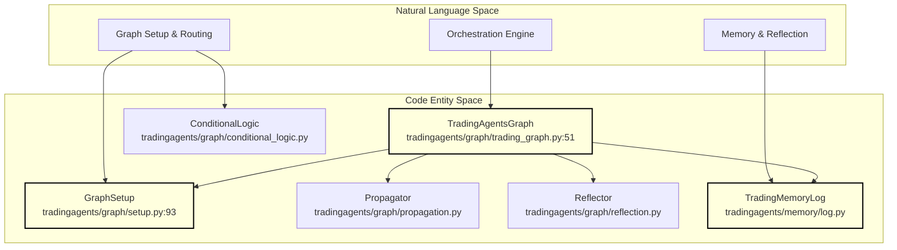

<!-- source: DeepWiki mcp.deepwiki.com · repo TauricResearch/TradingAgents · page 1.1 System Architecture · fetched 2026-10-29 -->

# System Architecture

<details>
<summary>Relevant source files</summary>

The following files were used as context for generating this wiki page:

- [tests/test_graph_end_to_end.py](tests/test_graph_end_to_end.py)
- [tests/test_layering.py](tests/test_layering.py)
- [tests/test_memory_log.py](tests/test_memory_log.py)
- [tradingagents/agents/__init__.py](tradingagents/agents/__init__.py)
- [tradingagents/graph/setup.py](tradingagents/graph/setup.py)
- [tradingagents/graph/trading_graph.py](tradingagents/graph/trading_graph.py)

</details>


## Purpose and Scope
This document details the overall system architecture of the TradingAgents framework, focusing on the orchestration layer (`TradingAgentsGraph` in [tradingagents/graph/trading_graph.py:51-116]()), the LangGraph compilation model using `GraphSetup` [tradingagents/graph/setup.py:93-122](), the five-phase agent pipeline, and component interaction across graph setup, execution state management, and memory subsystems.

Sources: [tradingagents/graph/trading_graph.py:51-116](), [tradingagents/graph/setup.py:93-122]()

## Orchestration Layer: TradingAgentsGraph and LangGraph
The orchestration engine centers around `TradingAgentsGraph`, which manages runtime initialization, LLM client tiering (`create_tier_client`), memory logging (`TradingMemoryLog`), and compilation of the workflow graph [tradingagents/graph/trading_graph.py:51-116](). The workflow execution is powered by LangGraph via `StateGraph` and compiled workflow runnables [tradingagents/graph/setup.py:93-156]().



Sources: [tradingagents/graph/trading_graph.py:51-116](), [tradingagents/graph/setup.py:93-156]()

## Five-Phase Agent Pipeline
The execution pipeline progresses through distinct phases: Analyst execution, research debate, transaction proposal, risk assessment, and portfolio management. `GraphSetup.setup_graph` builds the topology using `build_analyst_execution_plan` [tradingagents/graph/setup.py:109-187](). Individual analysts are isolated via sub-graphs (`_analyst_graph`) to prevent cross-talk and bound by `max_tool_rounds` [tradingagents/graph/setup.py:53-90]().

```mermaid
graph LR
    subgraph "Phase 1: Analyst Subgraphs [setup.py:53]"
        MA["create_market_analyst<br/>tradingagents/agents/analysts/market_analyst.py"] --> SA["create_sentiment_analyst<br/>tradingagents/agents/analysts/sentiment_analyst.py"]
        SA --> NA["create_news_analyst<br/>tradingagents/agents/analysts/news_analyst.py"]
        NA --> FA["create_fundamentals_analyst<br/>tradingagents/agents/analysts/fundamentals_analyst.py"]
    end

    subgraph "Phase 2: Research Debate [setup.py:35]"
        FA --> Bull["create_bull_researcher<br/>tradingagents/agents/researchers/bull_researcher.py"]
        Bull <--- "DEBATE_PATH_MAP" ---> Bear["create_bear_researcher<br/>tradingagents/agents/researchers/bear_researcher.py"]
        Bear --> RM["create_research_manager<br/>tradingagents/agents/managers/research_manager.py"]
    end

    subgraph "Phase 3: Transaction"
        RM --> Trader["create_trader<br/>tradingagents/agents/trader/trader.py"]
    end

    subgraph "Phase 4: Risk Analysis [setup.py:40]"
        Trader --> Agg["create_aggressive_debator<br/>tradingagents/agents/risk_mgmt/aggressive_debator.py"]
        Agg <--- "RISK_ANALYSIS_PATH_MAP" ---> Neu["create_neutral_debator<br/>tradingagents/agents/risk_mgmt/neutral_debator.py"]
        Neu <--- "RISK_ANALYSIS_PATH_MAP" ---> Con["create_conservative_debator<br/>tradingagents/agents/risk_mgmt/conservative_debator.py"]
        Con --> PM["create_portfolio_manager<br/>tradingagents/agents/managers/portfolio_manager.py"]
    end

    subgraph "Phase 5: Output"
        PM --> END["Decision Log & Reporting"]
    end

    style MA fill:none,stroke:#000,stroke-width:1px
    style Bull fill:none,stroke:#000,stroke-width:1px
    style Trader fill:none,stroke:#000,stroke-width:1px
    style Agg fill:none,stroke:#000,stroke-width:1px
    style PM fill:none,stroke:#000,stroke-width:1px
```

Sources: [tradingagents/graph/setup.py:35-187](), [tradingagents/agents/__init__.py:1-31]()

## Component Interaction and Data Flow
During graph execution, state flows through `AgentState`, `InvestDebateState`, and `RiskDebateState` [tradingagents/agents/__init__.py:12](). Instrument identities are resolved upfront via `resolve_instrument_context` to ground all downstream agent turns in factual vendor profiles [tradingagents/graph/trading_graph.py:117-128](). Conditional routing paths such as `DEBATE_PATH_MAP` and `RISK_ANALYSIS_PATH_MAP` ensure fall-through safety across iterative debate cycles [tradingagents/graph/setup.py:35-46]().

Sources: [tradingagents/graph/trading_graph.py:117-128](), [tradingagents/graph/setup.py:35-46](), [tradingagents/agents/__init__.py:12]()

---

