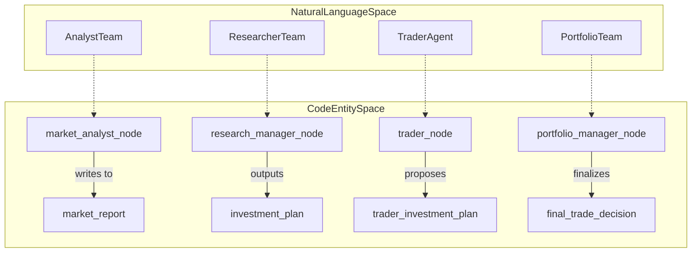
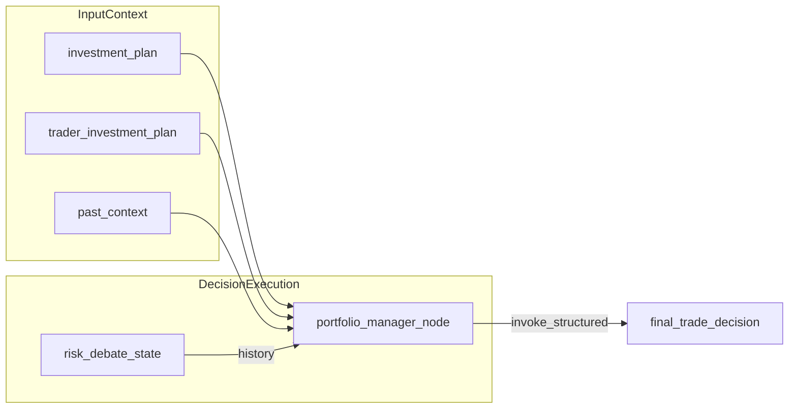

<!-- source: DeepWiki mcp.deepwiki.com · repo TauricResearch/TradingAgents · page 1.2 Agent Teams and Roles · fetched 2026-10-29 -->

# Agent Teams and Roles

Relevant source files

The following files were used as context for generating this wiki page:

- [tradingagents/agents/analysts/fundamentals_analyst.py](tradingagents/agents/analysts/fundamentals_analyst.py)
- [tradingagents/agents/analysts/market_analyst.py](tradingagents/agents/analysts/market_analyst.py)
- [tradingagents/agents/analysts/news_analyst.py](tradingagents/agents/analysts/news_analyst.py)
- [tradingagents/agents/managers/portfolio_manager.py](tradingagents/agents/managers/portfolio_manager.py)
- [tradingagents/agents/managers/research_manager.py](tradingagents/agents/managers/research_manager.py)
- [tradingagents/agents/trader/trader.py](tradingagents/agents/trader/trader.py)

This page details the specialized agent teams that comprise the TradingAgents multi-agent system and their specific roles in the trading decision pipeline. Each team represents a distinct phase of analysis, from initial data gathering through final risk assessment and execution.

## Overview of Agent Teams

The TradingAgents framework organizes LLM-powered agents into specialized teams that mirror the structure of real-world trading firms. The orchestration is managed via a graph-based state machine where each node represents an agent or a specialized manager.

| Team | Primary Function | Key Output |
|------|------------------|------------|
| **Analyst Team** | Data collection and domain analysis | `fundamentals_report`, `market_report`, `sentiment_report`, `news_report` |
| **Researcher Team** | Critical evaluation and bull/bear debate | `investment_debate_state`, `investment_plan` |
| **Trader Agent** | Decision synthesis and strategy formulation | `trader_investment_plan` |
| **Portfolio Team** | Multi-perspective risk assessment and final approval | `risk_debate_state`, `final_trade_decision` |

### System Entity Mapping
The following diagram bridges the natural language roles to the specific code entities and state keys used in the implementation.

Diagram: Natural Language to Code Entity Mapping

Sources: [tradingagents/agents/analysts/market_analyst.py:15-84](), [tradingagents/agents/managers/research_manager.py:14-74](), [tradingagents/agents/trader/trader.py:20-98](), [tradingagents/agents/managers/portfolio_manager.py:23-106]()

## Analyst Team

The Analyst Team consists of specialized agents that perform initial data collection. These agents are tool-enabled, allowing them to fetch real-time or cached financial data via specific functions.

### Fundamentals Analyst
The `fundamentals_analyst_node` evaluates company financials [tradingagents/agents/analysts/fundamentals_analyst.py:23-64](). It utilizes tools like `get_fundamentals`, `get_balance_sheet`, `get_cashflow`, and `get_income_statement` [tradingagents/agents/analysts/fundamentals_analyst.py:14-20]() to identify intrinsic values and red flags.

### Market Analyst
The `market_analyst_node` utilizes technical indicators to detect patterns [tradingagents/agents/analysts/market_analyst.py:15-84](). It is designed to select up to 8 complementary indicators (e.g., `close_50_sma`, `macd`, `rsi`, `atr`) [tradingagents/agents/analysts/market_analyst.py:22-52]() using `get_indicators` and `get_stock_data` [tradingagents/agents/analysts/market_analyst.py:8-12](). It treats `get_verified_market_snapshot` as the source of truth for OHLCV data [tradingagents/agents/analysts/market_analyst.py:48-48]().

### News Analyst
The `news_analyst_node` monitors global news and macroeconomic indicators [tradingagents/agents/analysts/news_analyst.py:21-63](). It uses `get_news` for ticker-specific updates, `get_global_news`, `get_macro_indicators` for FRED data (e.g., CPI, unemployment), and `get_prediction_markets` for forward-looking event probabilities via Polymarket [tradingagents/agents/analysts/news_analyst.py:13-18]().

### Sentiment Analyst
The `sentiment_analyst_node` aggregates multiple sources including Yahoo Finance news, StockTwits cashtag streams, and Reddit posts. It produces a deterministic `SentimentReport` using structured output binding.

Sources: [tradingagents/agents/analysts/fundamentals_analyst.py:14-64](), [tradingagents/agents/analysts/market_analyst.py:8-84](), [tradingagents/agents/analysts/news_analyst.py:13-63]()

## Researcher Team (The Debate System)

The Researcher Team employs a dialectic approach, comprising bullish and bearish researchers who critically assess the Analyst Team's reports.

- **Debate Management:** The Research Manager (`create_research_manager`) evaluates the debate history [tradingagents/agents/managers/research_manager.py:19-20]() and produces a structured `ResearchPlan` [tradingagents/agents/managers/research_manager.py:14-16]().
- **Rating Scale:** The manager must commit to a stance using a 5-tier scale: **Buy, Overweight, Hold, Underweight, Sell** [tradingagents/agents/managers/research_manager.py:29-34]().
- **State Transition:** The results are stored in `investment_plan` and the `investment_debate_state` is updated with the judge's decision [tradingagents/agents/managers/research_manager.py:61-72]().

Sources: [tradingagents/agents/managers/research_manager.py:14-74]()

## Trader Agent

The `trader_node` synthesizes the `investment_plan` and instrument context to formulate a concrete transaction proposal [tradingagents/agents/trader/trader.py:23-33](). It uses `bind_structured` with the `TraderProposal` schema [tradingagents/agents/trader/trader.py:20-21]() to determine the action and reasoning. 

When a technical market report is available, the agent grounds absolute price levels (entry price, stop-loss) in real ATR, support/resistance, and volatility data [tradingagents/agents/trader/trader.py:35-44](). The final output is saved to `trader_investment_plan` [tradingagents/agents/trader/trader.py:93-96]().

Sources: [tradingagents/agents/trader/trader.py:20-98]()

## Risk Management and Portfolio Manager

The final phase acts as the gatekeeper, evaluating portfolio risk and providing final authorization.

### Risk Management Team
The team evaluates strategies through three distinct perspectives (Aggressive, Conservative, Neutral), maintaining a `risk_debate_state` [tradingagents/agents/managers/portfolio_manager.py:30-31]().

### Portfolio Manager
The `portfolio_manager_node` holds final authority [tradingagents/agents/managers/portfolio_manager.py:23-106](). It synthesizes the risk analysts' debate, the `investment_plan`, the `trader_investment_plan`, and `past_context` (lessons from previous decisions) [tradingagents/agents/managers/portfolio_manager.py:30-40]().

It produces a `PortfolioDecision` via structured output binding or falls back to free-text parsing, which is rendered to markdown for the decision log [tradingagents/agents/managers/portfolio_manager.py:80-87]().

Diagram: Portfolio Decision Data Flow

Sources: [tradingagents/agents/managers/portfolio_manager.py:23-106]()

---

